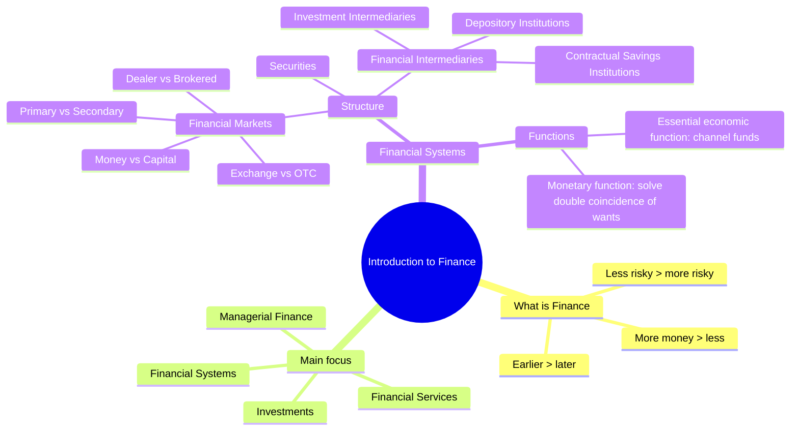
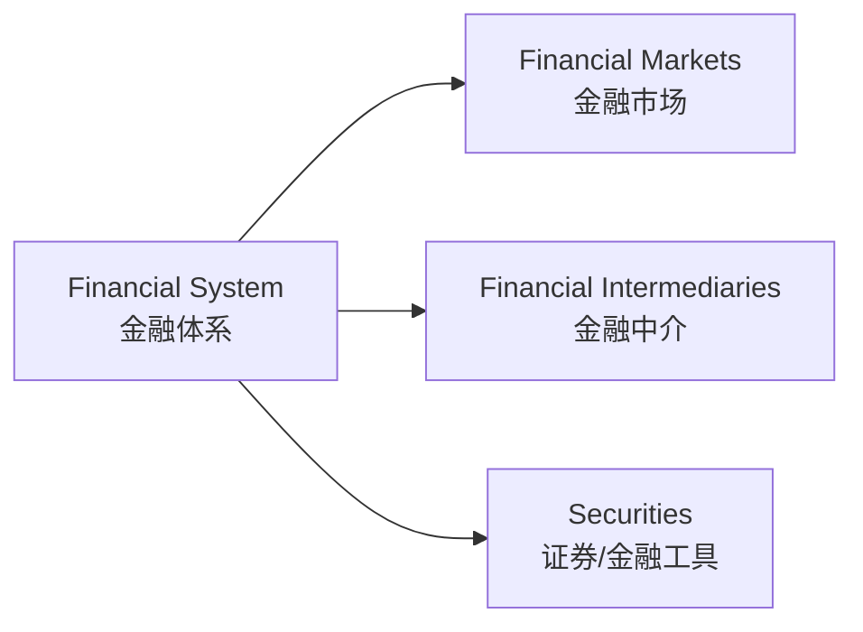
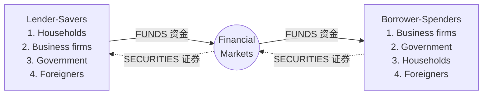
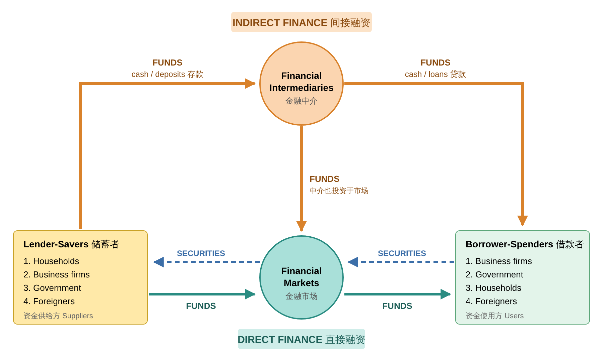
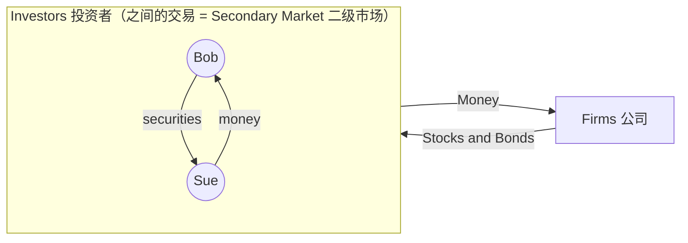
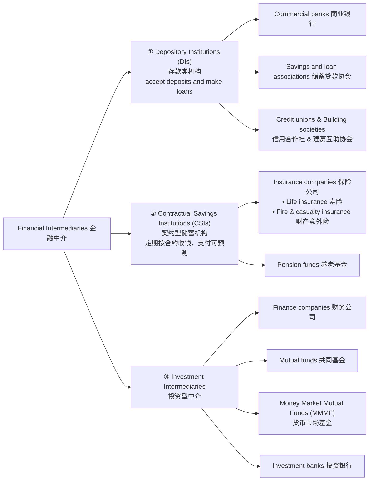

# FIN2002S Principles of Finance · Part 1.1 金融导论（Introduction to Finance）学习笔记

> 课程：BBS45 FT · Principles of Finance (FIN2002S)
> 内容范围：讲义 Part One — The Finance World / Financial Systems / Financial Markets / Financial Intermediaries（共 38 页）
>
> 📌 阅读说明
> - 正文按讲义顺序整理，**英文术语保留原文**（考试用英文作答），中文帮助理解。
> - 标有 **💡 补充** 的部分是讲义里没有、但能帮助你理解的扩展内容。
> - 标有 **⚠️ 易错** 的是考试/理解中容易混淆的地方。
> - 文末有 **术语表、自测题（含答案）、Discussion 参考思路**。

---

## 0. 一张图看懂本章

**一句话总结本章：** 金融体系（financial system）的核心任务，就是把钱从"有钱但没好项目"的人手里，转移到"有好项目但缺钱"的人手里。转移的途径有两条：**直接融资（通过金融市场）** 和 **间接融资（通过金融中介，比如银行）**。

---

## 1. The Finance World — 什么是金融？

### 1.1 What is Finance?

Finance 研究的是 **关于钱的决策（financial decisions about money）**。所有金融决策背后都有三条基本偏好：

| 偏好 | 英文原文 | 通俗理解 |
|---|---|---|
| 多比少好 | More money is preferred to less | 给你 100 元还是 200 元？当然 200 |
| 早比晚好 | Earlier receipt is preferred to later | 今天拿 100 元 vs 一年后拿 100 元？当然今天 |
| 风险小比大好 | Less risky is preferred to more | 确定拿 100 元 vs 50% 概率拿 200 元？大多数人选确定的 |

> 💡 **补充：这三条偏好其实就是整门课的三大主线**
> - "早比晚好" → **货币时间价值（Time Value of Money, TVM）**：今天的 1 元比明天的 1 元值钱，因为今天的钱可以拿去投资赚利息。后面学的 present value（现值）、future value（终值）、discounting（折现）都源于这一条。
> - "风险小比大好" → **风险与收益的权衡（Risk–Return Trade-off）**：既然人们讨厌风险，那么要让人承担更高风险，就必须给他 **更高的预期收益（risk premium，风险溢价）** 作为补偿。
> - "多比少好" → 投资决策的目标是 **创造价值（maximise value / wealth）**。
>
> 记住这三条，后面所有公式你都能找到"为什么"。

### 1.2 Main Focus of Finance — 金融学的四大领域

| 领域 | 研究什么 | 举例 |
|---|---|---|
| **Financial Systems**（金融体系） | 金融市场、金融中介和证券 (financial markets, financial intermediaries and securities) | 新加坡交易所 SGX 怎么运作？银行为什么存在？ |
| **Investments**（投资） | 投资的价值以及最优组合 (value of investments and the optimal mix) | 一只股票值多少钱？我的钱应该多少放股票、多少放债券？ |
| **Financial Services**（金融服务） | 资金管理：如何投资 (management of money: how to invest) | 理财顾问、基金经理、保险规划 |
| **Managerial Finance**（管理金融 / 公司金融） | 企业管理者的财务决策 (decisions by corporate managers) | 公司要不要建新厂？用借款还是发股票融资？ |

> 💡 **补充：** Managerial Finance 也常被叫做 **Corporate Finance（公司金融）**，它主要回答三个问题：
> 1. 投资什么项目？（Capital budgeting 资本预算）
> 2. 钱从哪里来？（Capital structure 资本结构 / Financing decision）
> 3. 日常资金怎么管？（Working capital management 营运资本管理）

**本章（Part 1.1）的重点是第一个领域：Financial Systems。**

---

## 2. Financial Systems — 金融体系

### 2.1 Functions of Financial Systems — 金融体系的功能

#### 功能 1：Perform essential economic function（基本经济功能：资金融通）

> Channels funds from person or business **without investment opportunities** (i.e., **"Lender-Savers"**) to one who **has them** (i.e., **"Borrower-Spenders"**).

把资金从 **没有投资机会的人（贷款者-储蓄者）** 引导到 **有投资机会的人（借款者-支出者）** 手中。

🌰 **例子：** 阿姨有 10 万元存款但不懂投资（Lender-Saver）；小王有个很赚钱的创业项目但没本钱（Borrower-Spender）。如果没有金融体系，阿姨的钱只能躺在床底下，小王的项目做不成——**两个人都亏了，整个经济也亏了**。金融体系让钱流到能产生最大价值的地方，从而 **提高经济效率（improves economic efficiency）**。

#### 功能 2：Monetary function（货币功能）

> The introduction of money in the economy enables savers and spenders to **separate the act of sale from the act of purchase** and enables them to overcome the main problem of barter, which is the **"double coincidence of wants"**.

**关键词解释：**
- **Barter（以物易物）**：没有货币时，只能拿东西换东西。
- **Double coincidence of wants（需求的双重巧合）**：以物易物要成功，双方必须**同时**想要对方的东西。

🌰 **例子：** 你是渔夫，想用鱼换面包。面包师却不想要鱼，他想要鞋子。→ 交易失败。
有了货币：你把鱼卖给任何想要鱼的人换成钱，再用钱去买面包。**"卖"和"买"被拆成两个独立的动作**，不再需要"巧合"。

> 💡 **补充：货币的三大职能（经常一起考）**
> 1. **Medium of exchange（交换媒介）**——解决 double coincidence of wants
> 2. **Unit of account（计价单位）**——所有东西用同一把"尺子"标价
> 3. **Store of value（价值储藏）**——今天卖鱼的钱可以明天再花

#### 金融体系功能的另一种总结（讲义 Slide 10）

金融体系：
1. **提供资金转移机制**：把资金从 **盈余单位（units in surplus）** 转移到 **短缺单位（units in shortage of funds）**，即促进借贷 (facilitate lending and borrowing)；
2. **让财富持有者调整投资组合（adjust the composition of their portfolios）**：例如把存款换成股票、把股票换成债券；
3. **提供支付机制（payment mechanisms）**：例如转账、支票、信用卡、PayNow 等。

### 2.2 Structure of Financial Systems — 金融体系的结构

金融体系由三部分组成：

- **Financial Markets（金融市场）**：交易的"场所/机制"
- **Financial Intermediaries（金融中介）**：中间人机构（银行、保险公司、基金等）
- **Securities（证券）**：被交易的"商品"本身（股票、债券等）

> 💡 **补充：什么是 Security（证券）/ Financial Instrument（金融工具）？**
> 本质上是一张 **对发行人未来收入或资产的索取权（claim on the issuer's future income or assets）**。
> - **Bond（债券）= 债权（debt）**：发行人承诺未来按时付利息 + 到期还本。持有人是 **债权人（creditor）**。
> - **Stock / Share（股票）= 股权（equity）**：持有人是公司的 **所有者之一（owner）**，分享公司利润（股息 dividends）和增值，但没有"到期还本"。

---

## 3. Financial Markets — 金融市场

### 3.1 定义

> Financial markets are markets in which **funds are transferred** from people and firms who have an **excess of available funds** to people and firms who have a **need of funds**.

### 3.2 谁提供资金？谁使用资金？（Funds Transferees）

| **Lender-Savers（贷款者-储蓄者）= Suppliers 资金供给方** | **Borrower-Spenders（借款者-支出者）= Users 资金使用方** |
|---|---|
| 1. Households / individuals（家庭/个人）⭐ 最主要 | 1. Business firms（企业）⭐ 最主要 |
| 2. Business firms | 2. Government |
| 3. Government | 3. Households |
| 4. Foreigners | 4. Foreigners |

⚠️ **易错：** 注意 **排序**！最主要的资金供给者是 **家庭（households）**，最主要的资金需求者是 **企业（business firms）**。但同一类主体两边都可能出现：
- 家庭存钱 → Lender-Saver；家庭贷款买房 → Borrower-Spender
- 政府有财政盈余 → Lender-Saver；政府发国债修地铁 → Borrower-Spender

### 3.3 ⭐ 供需双方的"错配"（Slide 15，非常重要）

两边对资金的需求特征 **天然不匹配**：

| 特征 | Lender-Savers（个人投资者） 又称 buyers / investors / **surplus unit** | Borrower-Spenders（公司） 又称 sellers / issuers / **deficit unit** |
|---|---|---|
| **Size / amount（金额）** | 小（small） | 大（large） |
| **Maturity（期限）** | 短期（short-term） | 长期（long-term） |
| **Liquidity（流动性）** | 高（high）——随时能取 | 低（low）——钱投进厂房就拿不出来 |
| **Risk（风险）** | 低（less / low）——不想亏 | 高（more / high）——项目可能失败 |

🌰 **想象一下：** 一家公司要借 1 亿元建工厂，用 20 年。而你只有 5 万元，可能下个月就要用，还不想亏本。你们俩直接谈，根本谈不拢！

**→ 这就是 Financial Intermediary（金融中介，例如银行）存在的根本原因：它站在中间，把双方"不匹配"的需求转换成"匹配"的。**

> 💡 **补充：中介如何解决错配？——"资产转换（Asset Transformation）"**
>
> | 错配 | 中介做了什么 | 英文术语 |
> |---|---|---|
> | 金额小 vs 大 | 银行把成千上万人的小额存款 **汇集（pool）** 起来，变成大额贷款 | Size / denomination intermediation |
> | 短期 vs 长期 | 银行吸收短期存款，发放长期贷款（如 30 年房贷） | **Maturity transformation**（期限转换） |
> | 流动性高 vs 低 | 你的存款随时可取，但银行的贷款是长期锁定的 | **Liquidity transformation**（流动性转换） |
> | 风险低 vs 高 | 银行把钱分散贷给许多借款人，**分散风险（diversification）**；再加上存款保险 | **Risk transformation**（风险转换） |
>
> **SDIC = Singapore Deposit Insurance Corporation（新加坡存款保险公司）**
> 讲义特意标注它，是因为它解释了"为什么个人存款几乎没风险"：就算银行倒闭，SDIC 也会赔付储户一定金额以内的存款（目前为每位储户在每家成员机构最高 **S\$100,000**，自 2024 年 4 月起）。这就是让 lender-saver 的"低风险需求"得到满足的制度保障。

### 3.4 ⭐ Direct Finance vs Indirect Finance（直接融资 vs 间接融资）

#### Direct Finance（直接融资）
> Borrowers borrow funds **directly from lenders in the financial markets** by **selling them financial instruments** which are claims on the borrower's future income or assets.

借款人 **在金融市场上直接** 向贷款人出售证券来借钱。
🌰 苹果公司发行债券，你直接买了这只债券 → 你直接借钱给了苹果。

📝 **记忆方法：钱和证券永远反方向流动。** 钱从左往右（储蓄者→借款者），证券从右往左（借款者→储蓄者）。

#### Indirect Finance（间接融资）
> Borrowers borrow **indirectly** from lenders **via financial intermediaries** (established to source both loanable funds and loan opportunities) by issuing financial instruments which are claims on the borrower's future income or assets.

借款人 **通过金融中介** 间接向贷款人借钱。
🌰 你把钱存进 DBS（存款 deposit），DBS 把钱贷给一家公司（贷款 loan）。你和这家公司根本不认识。

#### 完整的资金流动图（讲义 Slide 19，必须会画/会解释）

图中右上角的文字框说明了金融体系的两大贡献：
1. **Allows transfers of funds** from person or business without investment opportunities to one who has them（实现资金转移）
2. **Improves economic efficiency**（提高经济效率）

⚠️ **易错：中间那根 "Financial Intermediaries → Financial Markets" 的箭头**：说明中介也会把钱投到金融市场里（例如保险公司、基金用收到的钱去买股票和债券）。所以中介和市场 **不是完全分开的**。

> 💡 **补充：为什么现实中间接融资比直接融资更重要？**（讲义没讲，但后面很可能用到）
> 1. **降低交易成本（Transaction costs）**：你自己去找借款人、谈合同、催收，成本太高；银行有规模经济（economies of scale）和专业知识。
> 2. **风险分担（Risk sharing）**：银行通过分散贷款来降低风险，再把低风险的资产（存款）卖给你。
> 3. **解决信息不对称（Asymmetric information）**：借款人比你更了解自己的还款能力。
>    - **Adverse selection（逆向选择）**——**交易前**：最急着借钱的往往是风险最高的人。
>    - **Moral hazard（道德风险）**——**交易后**：借到钱的人可能拿钱去干高风险的事。
>    - 银行擅长筛选（screening）和监督（monitoring），所以能缓解这两个问题。

### 3.5 Financial Markets 的特点（Slide 20）

金融市场：
- 是 **交易证券的市场**（如 bond market 债券市场、stock market 股票市场）；
- 把钱从 **有闲钱（但缺投资机会）** 的人转移到 **有投资机会（但缺钱）** 的人；
- **直接影响个人财富以及企业和消费者的行为**（例如：股市大涨，人们觉得更富有，消费更多；利率上升，企业减少借钱投资）；
- **有助于提高整体经济的产出和效率**。

---

## 4. ⭐ Structure of Financial Markets — 金融市场的四种分类

讲义给了 **四个分类维度**，每个维度都是"二选一"：

| 分类依据 | 类型 A | 类型 B |
|---|---|---|
| 交易的证券性质（nature of securities traded） | **Primary market**（一级市场） | **Secondary market**（二级市场） |
| 组织形式（forms of organization） | **Organized exchanges**（交易所） | **Over-the-counter, OTC**（场外市场） |
| 金融工具的期限（maturity） | **Money market**（货币市场，< 1 年） | **Capital market**（资本市场，> 1 年） |
| 交易中介方式（forms of trade intermediation） | **Dealer market**（交易商市场） | **Brokered market**（经纪市场） |

⚠️ **这四种分类互相独立，可以叠加！** 例如：你在 SGX 上从另一个投资者手里买 DBS 股票 = **二级市场 + 交易所市场 + 资本市场 + 经纪市场**。

### 4.1 Primary vs Secondary Markets（一级市场 vs 二级市场）

| | **Primary Market（一级市场）** | **Secondary Market（二级市场）** |
|---|---|---|
| 定义 | **新发行（new issues）** 的证券（债券和股票）**第一次** 卖给最初买家 | **已经发行过** 的证券被 **转售（resold）** |
| 钱给谁？ | 钱 → **发行公司**（公司拿到新资金） | 钱 → **另一个投资者**（公司拿不到一分钱）|
| 交易量 | 较少 | **大部分交易发生在这里** |
| 例子 | 公司 IPO 发行新股 | 你在股市买入别人卖出的股票 |

讲义 Slide 23 的图：

- 公司 ↔ 投资者：**Primary Market**（公司卖证券、拿到钱）
- Bob ↔ Sue（投资者之间）：**Secondary Market**（公司不参与，拿不到钱）

**关键术语：**
- **IPO = Initial Public Offering（首次公开发行）**：公司 **第一次** 向公众发行股票（"上市"）。
- **SEO = Seasoned Equity Offering（增发 / 再融资）**：**已经上市** 的公司 **再次** 发行新股。

> 💡 **补充：** 在一级市场上，帮助公司发行证券的通常是 **Investment Bank（投资银行）**，这个过程叫 **Underwriting（承销）**：投行先以约定价格从公司买下全部证券，再卖给公众，赚取差价。

#### ⭐ 既然公司在二级市场拿不到钱，二级市场还有什么用？（Slide 24，常考！）

1. **Provide liquidity（提供流动性）**：让证券 **容易买卖**。
   👉 如果买了股票以后永远卖不掉，谁还敢在 IPO 时买？二级市场让投资者"随时能退出"，因此他们才愿意在一级市场掏钱。
2. **Establish a price（价格发现 / 确定价格）**：为证券确定价格，包括 IPO 和 SEO。
   👉 公司增发新股（SEO）时，发行价就参考二级市场的现价；IPO 定价也参考同行业已上市公司在二级市场的价格。二级市场价格越高，公司在一级市场能融到的钱越多。

### 4.2 Exchange-traded vs OTC Markets（交易所市场 vs 场外市场）

| | **Exchanges（交易所）** | **Over-the-Counter, OTC（场外市场）** |
|---|---|---|
| 交易方式 | 在 **集中的地点/平台（central locations）** 进行 | **分布在不同地点的交易商（dealers at different locations）** 之间买卖（通过电话、电子网络） |
| 例子 | **Euronext**（欧洲）、**CME Group**（芝加哥商品交易所集团）、**SGX**（新加坡交易所） | **Treasury securities market**（美国国债市场）、**Foreign Exchange (FX) market**（外汇市场） |

> 💡 **补充：两者的其他区别（帮助理解）**
>
> | | Exchange | OTC |
> |---|---|---|
> | 合约 | 标准化（standardised） | 可定制（customised） |
> | 透明度 | 高，价格公开 | 较低 |
> | 对手方风险（counterparty risk） | 低，有清算所（clearing house）担保 | 较高，直接面对交易对手 |
> | 监管 | 较严格 | 相对宽松 |
>
> 外汇市场是全世界交易量最大的金融市场，但它 **没有一个集中的交易所**——全球银行之间 24 小时通过电子网络交易，所以是典型的 OTC 市场。

### 4.3 Money Markets vs Capital Markets（货币市场 vs 资本市场）

| | **Money Markets（货币市场）** | **Capital Markets（资本市场）** |
|---|---|---|
| 期限 | **短期** debt instruments，**maturity < 1 year** | **长期** securities，**maturity > 1 year**（或无到期日）|
| 性质 | 主要是 **批发市场（wholesale markets）**——交易金额很大 | — |
| 用途 | 企业和金融机构管理 **短期流动性需求**（如把暂时多出来的闲钱拿去赚点利息） | 长期融资和投资 |
| 例子（讲义） | — | **Equity**（股票，infinite life 无限期）、**Government bonds** 和 **Corporate bonds**（期限 > 1 年）|
| 主要持有者 | 企业、银行等 | **Mutual funds**（共同基金）、**Pension funds**（养老基金）、**Insurance companies**（保险公司）|

> 💡 **补充：常见的货币市场工具（讲义没列，后面章节常出现）**
> - **Treasury bills (T-bills)**：短期国债，期限通常 3/6/12 个月，几乎无风险
> - **Commercial paper (CP)**：大公司发行的短期无担保债券
> - **Negotiable certificates of deposit (NCDs)**：可转让大额存单
> - **Repurchase agreements (Repos)**：回购协议，以证券作抵押的短期借款
> - **Interbank loans**：银行间拆借
>
> 💡 **为什么股票叫 "infinite life"？** 因为公司理论上可以永续经营，股票没有到期日，公司也不需要"还本"给股东。
>
> 💡 **为什么养老基金和保险公司喜欢持有资本市场工具？** 因为它们的负债（未来要付的养老金、寿险赔付）都是 **长期** 的，正好用长期资产去匹配。

### 4.4 Dealer Markets vs Brokered Markets（交易商市场 vs 经纪市场）

| | **Dealer Market（交易商市场）** | **Brokered Market（经纪市场）** |
|---|---|---|
| 角色 | 交易商 / **做市商（market-maker）** 站在 **每一笔交易的一方** | 经纪人 **主动寻找（active search）**，撮合买家和卖家 |
| 是否持有库存 | **持有（hold an inventory）**，库存随交易而变化 | **不持有库存**，不亲自参与交易 |
| 流动性 | **提供流动性（provide liquidity）**：报价并随时按报价买卖 | **寻找流动性（find liquidity）**，不提供 |
| 怎么赚钱 | **买卖价差（bid-ask spread）** + 投机（speculating） | 佣金（commission）💡 |
| 例子 | **Bonds market**（债券市场）、**FX market**（外汇市场） | **Stocks market**（股票市场） |

> 💡 **补充：Bid-ask spread（买卖价差）举例**
> 一个外汇交易商报价：USD/SGD **Bid 1.3400 / Ask 1.3420**
> - **Bid（买入价）**：交易商 **愿意买入** 的价格 → 你卖给他得到 1.3400
> - **Ask（卖出价，也叫 Offer）**：交易商 **愿意卖出** 的价格 → 你从他那买要付 1.3420
> - **Spread = Ask − Bid = 0.0020**，这就是交易商的利润来源。
>
> 📝 **记忆：** 交易商永远 **低买高卖**，所以 Bid < Ask。
>
> 📝 **Dealer vs Broker 一句话区分：**
> - **Dealer = 二手车行**：自己先买进车（有库存），再加价卖给你。
> - **Broker = 房产中介**：自己不买房，只帮买家和卖家牵线，收中介费。

---

## 5. Financial Intermediaries — 金融中介

### 5.1 定义（Slide 31）

> Agents who specialize in the activities of **buying and selling (at the same time)** financial **contracts** (loans and deposits) and **securities** (bonds and stocks).

金融中介是专门 **同时买入和卖出** 金融合约（贷款、存款）和证券（债券、股票）的机构。

⚠️ **重要区分：Securities vs Financial Contracts**

| | **Financial Securities（证券）** | **Financial Contracts（金融合约）** |
|---|---|---|
| 例子 | Bonds（债券）、Stocks（股票） | Loans（贷款）、Deposits（存款） |
| 能否转让 | **易于买卖（easily marketable）** | **不易出售（non-marketable）** |

🌰 你持有的 DBS 股票可以随时在 SGX 卖给别人；但你在银行的定期存款合同、银行给你的房贷合同，没法直接拿到市场上卖给第三方。

### 5.2 Banks（银行）

- **规模最大的金融机构**（the largest financial institution）
- **接受存款（accept deposits）**：存款 = 个人或企业 **借给银行** 的钱
- **发放贷款（make loans）**：贷款 = 银行 **借给** 个人或企业的钱
- 也就是说：银行 **从储蓄者那里借入存款，再把钱贷给别人**。

⚠️ **易错：** 存款对你来说是 **资产**，但对银行来说是 **负债（liability）**——因为银行欠你钱。贷款对银行来说是 **资产（asset）**——因为别人欠银行钱。这个视角在 Slide 36 的表格里非常重要。

> 💡 **补充：银行怎么赚钱？** 存款利率低（如 1%），贷款利率高（如 5%），中间的差额叫 **Net Interest Margin / Interest rate spread（利差）**。

### 5.3 ⭐ Classification of Financial Intermediaries（金融中介的三大类）

#### ① Depository Institutions（DIs，存款类机构）
**特点：接受存款并发放贷款（accept deposits and make loans）**
- **Commercial banks（商业银行）**——💡 新加坡例子：DBS、OCBC、UOB
- **Savings and loan associations（储蓄贷款协会，S&Ls）**——主要在美国，主要发放住房抵押贷款
- **Credit unions（信用合作社）**——会员制，由有共同纽带的人（同一单位、同一社区）组成
- **Building societies（建房互助协会）**——英国常见，类似 S&L，专注住房贷款

#### ② Contractual Savings Institutions（CSIs，契约型储蓄机构）
**特点：按照合约定期（periodic intervals）向客户收取资金，并且未来的支付需求相当可预测（fairly predictable future payout requirements）**
- **Insurance companies（保险公司）**
  - **Life insurance（人寿保险）**
  - **Fire and casualty insurance（财产与意外险）**
- **Pension funds（养老基金）**——💡 新加坡例子：CPF（中央公积金）就是一种政府性质的退休储蓄计划

> 💡 **补充：为什么 CSIs 的支付"可预测"很重要？**
> 寿险公司可以用精算（actuarial）方法比较准确地预测每年大概有多少人身故需要赔付；养老基金也知道员工大概什么时候退休。因为 **不怕被突然挤兑（不像银行）**，它们可以放心地把钱投到 **长期资产**（如公司债券、股票、房贷）里。
> ⚠️ 对比：寿险的支付最可预测，所以投资最长期；财产意外险（火灾、车祸）没那么可预测，所以会持有更多流动性高的资产（如政府债券）。

#### ③ (Other) Investment Intermediaries（投资型中介）
- **Finance companies（财务公司）**：通过发行商业票据、股票、债券融资，然后向消费者和企业放贷（如汽车贷款、分期付款）
- **Mutual funds（共同基金）**：把许多投资者的钱集中起来（卖"基金份额 shares"给投资者），投资于股票和债券组合
- **Money Market Mutual Funds（MMMF，货币市场基金）**：一种特殊的共同基金，只投资于 **货币市场工具**（短期、低风险）
- **Investment banks（投资银行）**：帮助公司在一级市场发行证券（承销 underwriting）、提供并购（M&A）咨询等 💡 传统上 **不吸收存款**，所以不属于 DIs

### 5.4 ⭐ Primary Assets and Liabilities of Financial Intermediaries（Slide 36 表格）

**看懂这张表的关键：**
- **Primary Liabilities = Sources of Funds（钱从哪来）**
- **Primary Assets = Uses of Funds（钱用到哪去）**

| 中介类型 | Primary Liabilities （资金来源） | Primary Assets （资金用途） |
|---|---|---|
| **Depository institutions (banks)** | | |
| Commercial banks 商业银行 | Deposits 存款 | Business and consumer loans, mortgages, U.S. government securities and municipal bonds（企业和消费贷款、房贷、政府债券、市政债券） |
| Savings and loan associations | Deposits | Mortgages 房贷 |
| Mutual savings banks | Deposits | Mortgages |
| Credit unions | Deposits | Consumer loans 消费贷款 |
| **Contractual savings institutions** | | |
| Life insurance companies 寿险公司 | Premiums from policies 保费 | Corporate bonds and mortgages 公司债券和房贷 |
| Fire and casualty insurance companies 财产险公司 | Premiums from policies | Municipal bonds, corporate bonds and stock, U.S. government securities |
| Pension funds, government retirement funds | Employer and employee contributions 雇主和雇员供款 | Corporate bonds and stock 公司债券和股票 |
| **Investment intermediaries** | | |
| Finance companies | Commercial paper, stocks, bonds | Consumer and business loans |
| Mutual funds | Shares 基金份额 | Stocks, bonds |
| Money market mutual funds | Shares | Money market instruments 货币市场工具 |

*Source: Federal Reserve Flow of Funds Accounts（美国数据，所以出现 U.S. government securities 和 municipal bonds）*

📝 **规律总结（帮你记住这张表）：**
1. **DIs 的资金来源全是 Deposits（存款）**——这正是它们叫"存款类机构"的原因。
2. **CSIs 的资金来源是"合约定期付款"**：保险公司收 **premiums（保费）**，养老基金收 **contributions（供款）**。
3. **基金（Mutual funds / MMMF）的资金来源是卖 shares（份额）** 给投资者。
4. **资产端看"负债期限"**：负债越长期（寿险、养老金）→ 越倾向持有长期资产（公司债券、股票、房贷）；MMMF 要应对随时赎回 → 只持有短期货币市场工具。

---

## 6. ⚠️ 易混淆概念汇总

| 容易混淆 | 区别 |
|---|---|
| Direct vs Indirect finance | 有没有 **金融中介** 夹在中间？直接买公司债券 = direct；存银行再由银行放贷 = indirect |
| Financial market vs Financial intermediary | 市场是"场所/机制"；中介是"机构"。但中介也会在市场里投资 |
| Primary vs Secondary market | 证券 **第一次** 卖出（钱给公司）vs **转售**（钱给其他投资者）|
| Secondary market vs OTC | 完全不同的分类维度！二级市场可以在交易所，也可以在 OTC |
| Money vs Capital market | 看 **期限**：< 1 年 vs > 1 年 |
| Dealer vs Broker | Dealer 自己 **持有库存、做对手方、提供流动性**；Broker 只 **撮合、不持仓、寻找流动性** |
| Securities vs Financial contracts | 证券 **易转让（marketable）**；合约（存款、贷款）**不易转让（non-marketable）** |
| Deposit 对谁是负债？ | 对 **银行** 是负债（liability），对 **储户** 是资产 |
| IPO vs SEO | **首次** 公开发行 vs 已上市公司 **再次** 发行 |
| Investment bank vs Commercial bank | 投行做承销、并购咨询，不吸收存款；商业银行吸收存款、发放贷款（属于 DIs）|

---

## 7. 📖 中英术语表（Glossary）

| English | 中文 |
|---|---|
| Lender-Savers / Surplus unit | 贷款者-储蓄者 / 盈余单位 |
| Borrower-Spenders / Deficit unit | 借款者-支出者 / 赤字单位 |
| Direct finance | 直接融资 |
| Indirect finance | 间接融资 |
| Financial intermediary | 金融中介 |
| Securities | 证券 |
| Barter | 以物易物 |
| Double coincidence of wants | 需求的双重巧合 |
| Liquidity | 流动性（资产能否快速、低成本地变现） |
| Maturity | 期限 / 到期日 |
| Portfolio | 投资组合 |
| Primary market | 一级市场 |
| Secondary market | 二级市场 |
| IPO (Initial Public Offering) | 首次公开发行 |
| SEO (Seasoned Equity Offering) | 增发 |
| Exchange | 交易所 |
| Over-the-counter (OTC) market | 场外市场 |
| Money market | 货币市场 |
| Capital market | 资本市场 |
| Equity | 股权 / 股票 |
| Bond (government / corporate / municipal) | 债券（政府 / 公司 / 市政）|
| Dealer / Market-maker | 交易商 / 做市商 |
| Broker | 经纪人 |
| Inventory | 库存（持仓）|
| Bid-ask spread | 买卖价差 |
| Depository Institutions (DIs) | 存款类机构 |
| Contractual Savings Institutions (CSIs) | 契约型储蓄机构 |
| Investment intermediaries | 投资型中介 |
| Commercial bank | 商业银行 |
| Savings and loan association | 储蓄贷款协会 |
| Credit union | 信用合作社 |
| Building society | 建房互助协会 |
| Pension fund | 养老基金 |
| Mutual fund | 共同基金 |
| Money market mutual fund (MMMF) | 货币市场基金 |
| Finance company | 财务公司 |
| Investment bank | 投资银行 |
| Premium | 保费 |
| Mortgage | 房屋抵押贷款 |
| Commercial paper | 商业票据 |
| SDIC (Singapore Deposit Insurance Corporation) | 新加坡存款保险公司 |
| 💡 Time value of money | 货币时间价值 |
| 💡 Asymmetric information | 信息不对称 |
| 💡 Adverse selection / Moral hazard | 逆向选择 / 道德风险 |
| 💡 Underwriting | 承销 |

---

## 8. 💬 Discussion 参考思路（讲义 Slide 29 & 37）

讲义在 Financial Markets 和 Financial Intermediaries 之后各有一次 Discussion。以下是可能讨论的问题和参考答题思路：

**Q1. 如果没有金融市场，经济会怎样？**
> 资金无法从 lender-savers 流向有生产性投资机会的 borrower-spenders；好项目因缺钱做不成，闲钱也得不到回报 → 经济效率低、增长慢。另外投资者无法调整组合，也缺乏支付机制。

**Q2. 公司在二级市场上拿不到钱，为什么还关心自己的股价？**
> ① 二级市场提供流动性，投资者才愿意在一级市场买新股；② 二级市场价格决定了公司未来 SEO 能以什么价格融资——股价越高，发行同样数量的新股能融到更多钱；③ 管理层薪酬（如股票期权）和公司声誉也与股价挂钩。

**Q3. 既然可以直接买公司债券，为什么大多数人还是把钱存银行？**
> 因为 Slide 15 的"错配"：个人资金小、要短期、要流动性、怕风险。银行通过 pooling、maturity/liquidity transformation 和 diversification 解决这些问题，还有 SDIC 存款保险。此外银行能降低交易成本、缓解信息不对称（逆向选择、道德风险）。

**Q4. 为什么寿险公司和养老基金主要投资长期债券和股票，而货币市场基金只投资短期工具？**
> 资产期限要匹配负债期限：寿险、养老金的支付是长期且可预测的；而货币市场基金的投资者可以随时赎回，必须保持高流动性。

**Q5. 举例说明你身边（新加坡）的各类金融中介。**
> DIs：DBS、OCBC、UOB；CSIs：Great Eastern、AIA、Prudential 等保险公司，CPF；Investment intermediaries：各类 unit trusts（共同基金）、Hong Leong Finance 等 finance companies、外资投行在新加坡的分支。

---

## 9. ✍️ 自测题（Self-test）

### Part A：选择题

1. 以下哪一项 **不是** 讲义中提到的金融决策三大偏好？\
   A. More money is preferred to less\
   B. Earlier receipt is preferred to later\
   C. Higher risk is preferred to lower risk\
   D. Less risky is preferred to more

2. 小明把钱存进 OCBC，OCBC 再把钱贷给一家中小企业。这属于：\
   A. Direct finance\
   B. Indirect finance\
   C. Primary market transaction\
   D. OTC transaction

3. 某公司首次在 SGX 上市发行新股，投资者购买这些新股的市场是：\
   A. Secondary market\
   B. Money market\
   C. Primary market\
   D. Dealer market

4. 期限为 6 个月的国库券（T-bill）在哪个市场交易？\
   A. Capital market\
   B. Money market\
   C. Equity market\
   D. Primary market only

5. 以下关于 broker 的说法 **正确** 的是：\
   A. 持有证券库存\
   B. 通过 bid-ask spread 赚钱\
   C. 提供流动性\
   D. 撮合买卖双方，不参与交易本身

6. 外汇（FX）市场最典型的特征是：\
   A. 集中在一个交易所交易\
   B. OTC 市场、dealer 市场\
   C. Brokered 市场\
   D. 只有一级市场

7. 养老基金的主要资金来源（primary liabilities）是：\
   A. Deposits\
   B. Premiums from policies\
   C. Employer and employee contributions\
   D. Commercial paper

8. 以下哪一个属于 Contractual Savings Institutions？\
   A. Credit union\
   B. Mutual fund\
   C. Life insurance company\
   D. Finance company

9. 关于 lender-savers 的典型特征，以下哪项 **错误**？\
   A. 金额小\
   B. 偏好短期\
   C. 偏好低流动性\
   D. 偏好低风险

10. 二级市场的两大功能是：\
   A. 为公司筹集新资金 & 提供流动性\
   B. 提供流动性 & 确定价格\
   C. 确定价格 & 发放贷款\
   D. 吸收存款 & 发放贷款

### Part B：简答题

1. 用一句话解释 "double coincidence of wants"，并说明货币如何解决这个问题。
2. 画出（或描述）直接融资和间接融资的资金流动图，标明资金（funds）和证券（securities）的流向。
3. 比较 dealer market 和 brokered market（至少 3 点区别），各举一个例子。
4. 为什么说 financial securities 是 marketable 的，而 financial contracts 是 non-marketable 的？各举一例。
5. 列出金融中介的三大类别，每类至少举两个例子。

<b>👉 点击查看答案</b>

**Part A**
1. **C**（人们偏好 **低** 风险）
2. **B**（通过银行这个中介 → 间接融资）
3. **C**（新发行 → 一级市场，IPO）
4. **B**（期限 < 1 年 → 货币市场）
5. **D**（A、B、C 都是 dealer 的特征）
6. **B**（讲义：FX 是 OTC 的最佳例子，也是 dealer market 的例子）
7. **C**（B 是保险公司，A 是银行，D 是 finance companies）
8. **C**（A 是 DI，B 和 D 是 investment intermediaries）
9. **C**（lender-savers 偏好 **高** 流动性）
10. **B**（公司在二级市场 **不** 筹集新资金）

**Part B**
1. 以物易物时，交易双方必须 **同时** 想要对方提供的物品，交易才能成功。货币作为交换媒介，使人们可以把"卖"和"买"分开：先把东西卖给任何人换成钱，再用钱买自己想要的东西。
2. 见本笔记 3.4 节的图。要点：资金从 lender-savers 流向 borrower-spenders；证券反方向流动；直接融资经过 financial markets，间接融资经过 financial intermediaries（存款进、贷款出）。
3. ① Dealer 是每笔交易的对手方，broker 只撮合不参与；② Dealer 持有库存，broker 不持有；③ Dealer 提供流动性，broker 寻找流动性；④ Dealer 靠 bid-ask spread 和投机赚钱，broker 靠佣金。例子：dealer — 债券市场、外汇市场；broker — 股票市场。
4. 证券（如股票、债券）标准化、有活跃的二级市场，可以方便地卖给第三方；金融合约（如存款、贷款）是双方之间的个性化协议，难以直接转让给他人。
5. ① Depository Institutions：commercial banks、savings and loan associations、credit unions、building societies；② Contractual Savings Institutions：life insurance、fire & casualty insurance companies、pension funds；③ Investment Intermediaries：finance companies、mutual funds、MMMFs、investment banks。

---

## 10. 📌 考前 1 分钟速记

1. **三大偏好**：多 > 少，早 > 晚，低风险 > 高风险
2. **两大功能**：资金融通（lender-savers → borrower-spenders）+ 货币功能（解决 double coincidence of wants）
3. **三大结构**：Markets + Intermediaries + Securities
4. **错配四要素**：Size、Maturity、Liquidity、Risk → 中介来解决
5. **两种融资**：Direct（经市场）vs Indirect（经中介）；**钱和证券反向流动**
6. **市场四种分类**：Primary/Secondary · Exchange/OTC · Money(<1y)/Capital(>1y) · Dealer/Brokered
7. **二级市场两功能**：Liquidity + Price
8. **中介三大类**：DIs（存款）· CSIs（保险、养老金）· Investment intermediaries（财务公司、基金、MMMF、投行）
9. **Slide 36 表格**：Liabilities = 钱从哪来；Assets = 钱去哪了
