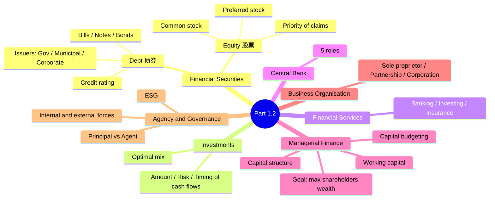
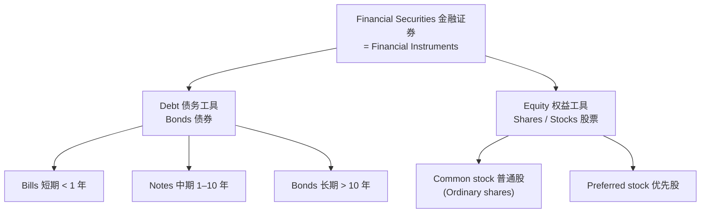
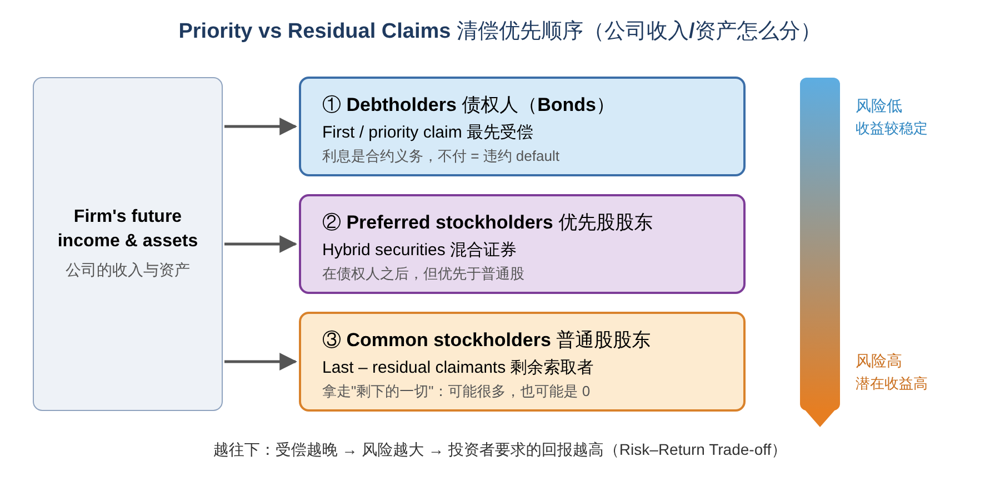
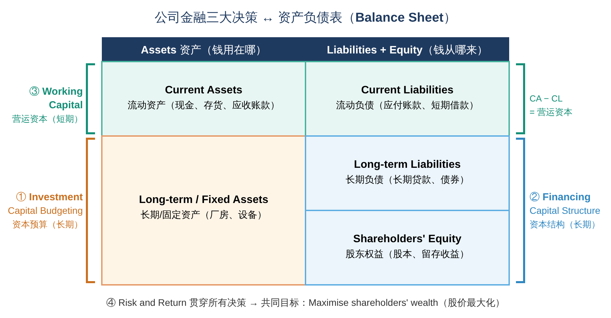
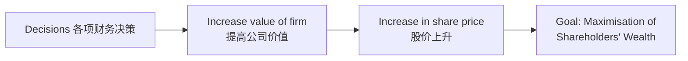
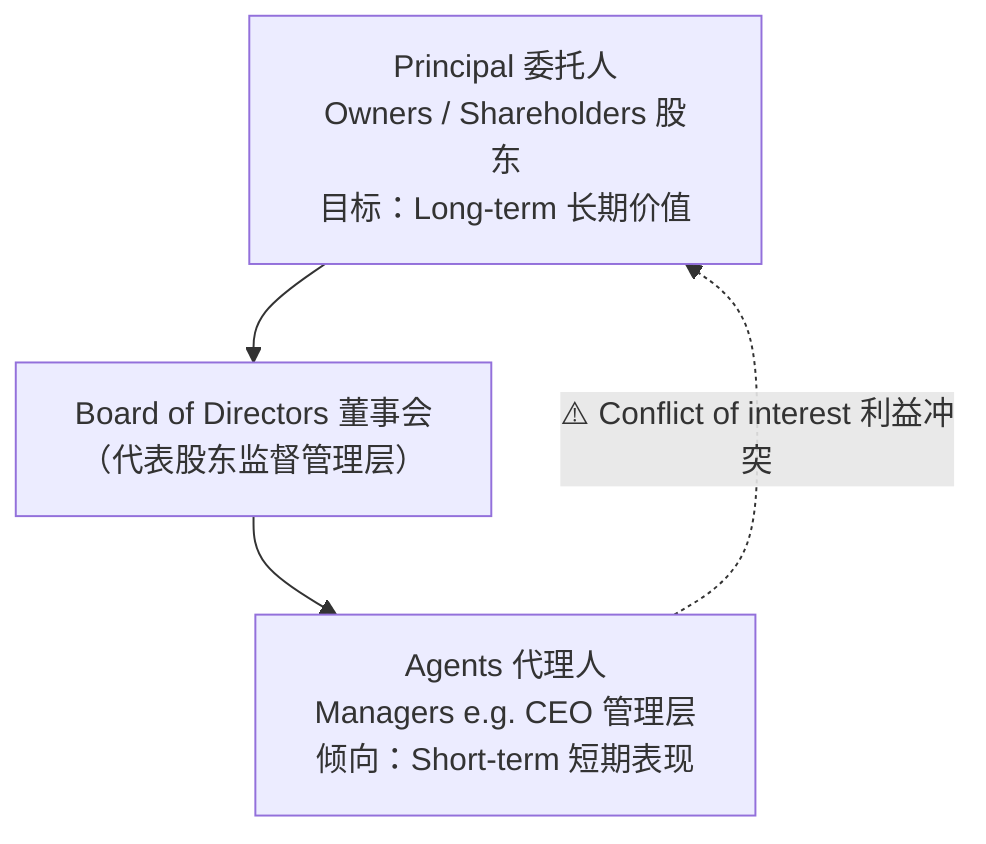
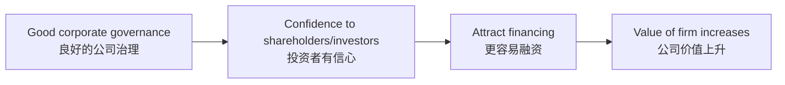

# FIN2002S Principles of Finance · Part 1.2 金融证券、投资与公司金融 学习笔记

> 课程：BBS45 FT · Principles of Finance (FIN2002S)
> 内容范围：
> - **讲义 Part 1.2**（Slide 38–62）：Financial Securities（债券、股票、信用评级）→ Investments → Financial Services
> - **Lesson 2 课堂笔记**：Central Bank（央行）→ Managerial Finance Decisions（公司金融决策）→ Goal of the Firm（企业目标）→ Forms of Business Organisation（企业组织形式）→ Agency Theory（代理理论）→ Corporate Governance（公司治理）→ **Assignment 1 写作框架**
>
> 📌 阅读说明（和 Part 1.1 一样）
> - **英文术语保留原文**（考试用英文作答），中文帮助理解。
> - **💡 补充** = 讲义/课堂没讲但能帮助理解的内容；**⚠️ 易错** = 容易混淆的地方；**🎓 课堂** = 老师在 Lesson 2 课上讲的内容。
> - 文末有 **对比总表、术语表、自测题（含答案）、Discussion 参考思路、Assignment 1 写作清单**。

---

## 0. 一张图看懂本章



**和 Part 1.1 的关系：** Part 1.1 讲的是金融体系的"场所"（市场）和"中间人"（中介）；Part 1.2 讲在市场上被交易的 **"商品"——证券（Securities）**，然后转向 **公司内部** 怎么做财务决策（Managerial / Corporate Finance）。

---

## 1. Financial Securities — 金融证券

### 1.1 什么是证券？（Slide 39–40）

- 证券也叫 **financial instruments（金融工具）**，分为两大类：**debt instruments（债务工具）** 和 **equity instruments（权益工具）**。
- 证券是对发行人（借款人）**未来收入或资产的索取权**（financial claims on the issuer's future income or assets）。
- ⭐ **同一张证券，对两边的意义相反：**

| | 卖方 / 发行人（borrower / issuer） | 买方 / 投资者（lender / investor） |
|---|---|---|
| 证券对他来说是 | **Financial liability（金融负债）** | **Financial asset（金融资产）** |
| 原因 | 他用这张"欠条"换来了钱，以后要还 | 他付了钱，换来以后收钱的权利 |

- **政府只发行债务工具**（debt），**公司既发行债务工具也发行权益工具**（debt and equity），用来为经营活动融资。
- **Debt holders（债权人）** 和 **equity holders（股东）** 都是 **资金提供者（funds providers）**。

> 💡 **补充：为什么政府不发股票？** 股票代表"所有权"，而政府不能被"拥有"和分红，所以政府只能借债（发国债）。

🎓 **课堂（Lesson 2）：** 老师用一个例子说明"债券"是什么：一笔 **\$9,000 的借款** 可以拆成若干张 **\$1,000 面值的债券** 卖给不同投资者。也就是说，债券就是把一笔大额借款"切成小块"，好让很多投资者分别购买。



### 1.2 Debt Markets — 债券市场（Slide 41）

> Borrowers issue a security, known as **bond**, that promises **periodic interest (coupon payments)** until the **maturity date**, and pay back the **par value (face value)** to the investor at the maturity date.

**债券的三个关键要素：**

| 术语 | 中文 | 含义 |
|---|---|---|
| **Coupon payment** | 票息 | 定期支付的利息 |
| **Maturity date** | 到期日 | 债券结束、归还本金的日子 |
| **Par value / Face value** | 面值 | 到期时归还给投资者的本金 |

- **The interest rate is the cost of borrowing.** 利率就是借款人的 **借钱成本**。

**按期限分类：**

| 类型 | 期限 | 中文 |
|---|---|---|
| **Short-term** — e.g. **Bills** | < 1 year | 短期（票据） |
| **Intermediate-term** — e.g. **Notes** | 介于中间 | 中期 |
| **Long-term** — e.g. **Bonds** | > 10 years | 长期 |

> 💡 **补充：一张债券的现金流长什么样？**
> 假设一张公司债：面值 **\$1,000**，票面利率 **6%**，**每半年付息**（semi-annually），期限 **3 年**。
> - 每年利息 = \$1,000 × 6% = \$60 → 每半年付 **\$30**
> - 投资者收到：\$30、\$30、\$30、\$30、\$30、**\$30 + \$1,000**（最后一期连本带息）
>
> ```
> 时间(年):  0.5   1.0   1.5   2.0   2.5   3.0
> 现金流:    $30   $30   $30   $30   $30   $1,030
> ```
> 后面学 **Bond Valuation（债券估值）** 时，就是把这些未来现金流折现回今天。

🎓 **课堂：** 老师强调了两点（和 Part 1.1 连起来）：
- **Bonds = OTC markets**：债券主要在 **场外市场** 交易。
- **Dealer markets**：交易商 **持有债券库存（keep inventory）**，再去找买家；交易商赚的是 **买入价和卖出价之差**（bid-ask spread）。

### 1.3 Issuers — 债券发行人（Slide 42–47）

讲义列了三类发行人：**Governments（政府）**、**Municipal（地方政府）**、**Corporations（公司）**。

#### (1) Government Bonds — 国债（以美国为例，Slide 43–44）

- **U.S. Treasury（美国财政部）** 发行 notes 和 bonds 来为政府运作融资。
- 利率通常很低，**常被视为无风险利率（risk-free rate）**。
- **一般不免税**（generally not tax-exempted）。

| Treasury securities | 期限 |
|---|---|
| **Treasury bill (T-bill)** | **< 1 year** |
| **Treasury note (T-note)** | **1 to 10 years** |
| **Treasury bond (T-bond)** | **10 to 30 years** |

> 💡 **补充：为什么讲义在 "risk-free" 上打了个红色问号 "?"**
> 这是在提醒你思考：国债真的 **完全** 没有风险吗？
> - ✅ **违约风险（default risk）几乎为零**：美国政府可以加税，甚至由央行"印钱"来还本国货币债务，所以几乎不会还不起。这就是它被当作 risk-free rate 的原因，也是后面 CAPM 等模型的基准利率。
> - ❌ **但不是真的零风险**：
>   - **Interest rate risk（利率风险）**：市场利率上升 → 已发行债券的价格下跌（长期债券尤其明显）；
>   - **Inflation risk（通胀风险）**：通胀会侵蚀利息和本金的购买力；
>   - **信用评级也会被下调**：美国国债曾被 S&P（2011 年）、Fitch（2023 年）、Moody's（2025 年）先后从最高评级下调一级。
> - 所以更准确的说法是：**default-risk-free（无违约风险）**，而不是"毫无风险"。

> 💡 **补充：新加坡的对应产品**——新加坡政府也发行 **SGS (Singapore Government Securities)**、**T-bills** 和面向散户的 **Singapore Savings Bonds (SSB)**。

#### (2) Municipal Bonds — 市政债券（Slide 45）

- 由 **local, county, and state governments（地方、县、州政府）** 发行；
- 用于为 **公共利益项目（public interest projects）** 融资，例如学校、道路、医院；
- **免税（tax-exempted）**。

⚠️ **易错：税收对比**
- **Treasury（国债）**：generally **NOT** tax-exempted（一般 **不免税**）
- **Municipal（市政债）**：**tax-exempted**（**免税**）

> 💡 **补充：免税有什么用？** 免税意味着投资者拿到手的是"税后全额"，所以市政债即使 **票面利率更低**，对高税率投资者也可能比国债更划算。地方政府因此能用更低的成本借到钱。

#### (3) Corporate Bonds — 公司债券（Slide 46–47）

- 面值通常是 **\$1,000**，有些是 **\$5,000 或 \$10,000**；
- 通常 **每半年付一次息（pay coupons semi-annually）**；
- **发行人不能随时赎回**，除非合约里有专门条款允许，即 **call option（赎回权）**；
- **风险因债券而异，即使是同一个发行人发行的也不一样**，因此 **要求的利率也随风险高低而变化**。

> 💡 **补充：Callable bond（可赎回债券）**
> 带有 call option 的债券叫 callable bond。发行人通常在 **市场利率下降** 时行使赎回权：把旧的高息债提前还掉，再按更低的利率重新借钱。这对投资者 **不利**（好的高息债被"收走"了），所以 **可赎回债券通常要支付更高的利率** 作为补偿。
>
> 💡 **为什么同一家公司发的债，风险也不同？** 因为条款不同，例如：
> - **期限**：越长越不确定；
> - **是否有抵押（secured vs unsecured）**：有抵押品的更安全；
> - **清偿顺序（senior vs subordinated）**：优先级高的先拿钱。

### 1.4 ⭐ Credit Rating — 信用评级（Slide 48）

信用评级机构（credit rating agencies）评估债券发行人 **按时还本付息的能力**。三大评级机构：**Moody's（穆迪）、S&P（标准普尔）、Fitch（惠誉）**。

| 大类 | Moody's | S&P / Fitch | 含义 |
|---|---|---|---|
| **INVESTMENT GRADE 投资级**<br/>（high creditworthiness 信用高） | Aaa | AAA | Gilt edge, prime, maximum safety 最高安全性 |
| | Aa1 / Aa2 / Aa3 | AA+ / AA / AA− | Very high grade, high quality 很高质量 |
| | A1 / A2 / A3 | A+ / A / A− | Upper medium grade 中上等 |
| | Baa1 / **Baa2** / **Baa3** | BBB+ / BBB / **BBB−** | Lower medium grade 中下等 ← **投资级的最低一档** |
| **SPECULATIVE 投机级 / "垃圾债" Junk**<br/>（low creditworthiness 信用低） | Ba1 / Ba2 / Ba3 | BB+ / BB / BB− | Low grade, speculative 低等、投机 |
| | B1 / B2 / B3 | B+ / B / B− | Highly speculative 高度投机 |
| **PREDOMINANTLY SPECULATIVE**<br/>（substantial risk of default 违约风险很大） | Caa | CCC+ / CCC / CCC− | Substantial risk, in poor standing |
| | Ca | CC | May be in default, extremely speculative |
| | C | C | Even more speculative |
| | — | C1（S&P） | Income bonds — no interest is being paid |
| | — | DDD / DD / D | **Default 已违约** |

**📝 记忆要点：**
1. **分界线在 BBB− / Baa3**：BBB− 及以上 = **Investment grade（投资级）**；BB+ 及以下 = **Speculative / Junk grade（投机级 / 垃圾级）**。
2. **Moody's 用 "Aaa, Aa, A, Baa…" + 数字 1/2/3**；**S&P 和 Fitch 用 "AAA, AA, A, BBB…" + 正负号 +/−**。
3. **评级越低 → 违约风险越高 → 投资者要求的利率越高**（这就是 Slide 47 说的 "required interest rate varies with level of risk"）。

🎓 **课堂：** 老师用 S&P 的刻度做了简化记忆：
- **AAA** → 课上说成"risk-free"（最安全）
- **AAA ~ BBB−** → **Investment grade**
- **BB+ 以下** → **Speculative / Junk grade**
- **D** → **Default（违约）**

> ⚠️ **易错：** 课上说的 "AAA risk-free" 是简化说法。即使 AAA 也只是"违约风险极低"，并不等于零风险（参考上面国债 risk-free 的讨论）。
>
> 💡 **补充：为什么评级对公司很重要？** 很多养老基金、保险公司等机构 **按规定只能投资"投资级"债券**。一旦公司被降到 BB+ 以下（叫 **"fallen angel" 堕落天使**），这些机构必须卖出，债券价格大跌，公司的借款成本也会急升。

### 1.5 Equity Markets — 股票市场（Slide 49–53）

**Common stock（普通股）**，也叫 **stock** 或 **ordinary shares**，代表 **对公司的所有权（ownership）**。

- 股东对公司的 **net income（净利润）和 assets（资产）** 有索取权；
- **没有到期日（do not have a maturity date）**；
- 公司最初在 **一级市场** 卖股票融资，之后股票在 **投资者之间（二级市场）** 交易；
- **理论上永远支付股息（pay dividends, in theory forever）**。

#### ⭐ 为什么股票比债券风险更高？（Slide 51，常考）

> **Equity claims are riskier than debt instruments.**

1. **公司没有合约义务定期给股东付钱**：**派不派股息是公司自己决定的（discretionary decision）**。而债券利息是 **合约义务**，不付就是违约。
2. **公司必须先付清所有债权人，才能给股东付钱** → 所以股东是 **residual claimants（剩余索取者）**：只能拿"剩下的"。

#### 股东 vs 债权人：权利不同（Slide 52）

| | **Shareholders 股东** | **Debtholders 债权人** |
|---|---|---|
| 身份 | **Owners 所有者**（ownership rights） | **Creditors 债权人**（no ownership interest） |
| 收益 | 公司收入/资产增值时受益；股价上涨 → **capital gains（资本利得）** | 只拿约定的利息 + 本金，公司赚再多也不多拿 |
| 投票权 | **有**：选董事（directors）、对特定事项投票 | **没有** |
| 清偿顺序 | **最后** | **最先** |

**所有权的两个主要含义：**
1. 公司的收入或资产价值增长时，股东受益；股价上涨时可获得 **高额资本利得**；
2. **有权投票选举董事或就某些事项投票**。

📝 **一句话理解：** 债权人是"房东"（收固定租金，不管你生意多好）；股东是"合伙老板"（生意好赚大钱，生意差可能血本无归，但有话语权）。

### 1.6 ⭐ Common Stocks vs Preferred Stocks — 普通股 vs 优先股（Slide 53–56）

普通股和优先股股东享有的 **经济权利和所有权的比例不同**。

#### Common Stocks 普通股（Slide 54）
- 代表对公司的 **所有权**；
- 股东获得 **股息（公司分配时才有，when distributed）**；股价上涨（下跌）时获得 **资本利得（资本损失）**；
- 在 **AGM 和 EGM** 上 **有投票权**。

#### Preferred Stocks 优先股（Slide 55–56）
与普通股相比，**所有权受限（limited ownership rights）**，并在几个方面不同：
1. **支付固定不变的股息（fixed constant dividend）** → 这使它 **更像债券**，不太像普通股；
2. **价格相对稳定**，因为股息是固定金额；
3. **在 AGM 上没有投票权**，**在 EGM 上可能有投票权**；
4. 对资产和收入的索取 **排在债权人之后（residual claim after creditors）**，但 **优先于普通股股东（priority claim over common stockholders）**。

**关键术语：**
- **AGM = Annual General Meeting（年度股东大会）**：每年例行召开，批准财报、选举董事、决定分红等。
- **EGM = Extraordinary General Meeting（特别股东大会）**：遇到重大或紧急事项（如并购、修改公司章程、变更优先股权利）时临时召开。

| 对比项 | **Common Stock 普通股** | **Preferred Stock 优先股** |
|---|---|---|
| 别名 | Ordinary shares | Preference shares；**hybrid security（混合证券）** |
| 股息 | **不固定**（no fixed dividend），公司决定 | **固定**（fixed dividend） |
| 价格波动 | 较大 | **相对稳定** |
| 投票权 | **有**（AGM & EGM） | AGM **没有**；EGM **可能有** |
| 清偿顺序 | **最后** | 债权人之后、**普通股之前** |
| 上涨潜力 | 大（资本利得） | 小 |
| 像什么 | 纯股权 | **介于债券和股票之间** |

🎓 **课堂总结（Lesson 2）：**

| Ordinary / Common | Preferred |
|---|---|
| No fixed dividend 无固定股息 | Fixed dividend 固定股息 |
| Voting rights 有投票权 | No voting rights 无投票权 |

> 💡 **补充：为什么优先股叫 "hybrid（混合）"？**
> - 像 **债券**：固定收益、价格稳定、清偿优先于普通股；
> - 像 **股票**：在会计上属于权益（equity），没有到期日；而且不付股息 **不算违约**（和债券不同）。
>
> 💡 **补充：Cumulative preferred（累积优先股）**：如果公司某年没付优先股股息，欠的股息会"累积"下来，**必须先补发给优先股股东，才能给普通股股东分红**。

### 1.7 ⭐ Priority vs Residual Claims — 清偿优先顺序（Slide 57）

按优先级排序：
1. **Debtholders（债权人）**：对公司未来收入和资产有 **第一（优先）索取权**；
2. **Preferred stockholders（优先股股东）**，也叫 **hybrid securities**；
3. **最后是 Common stockholders（普通股股东）**。



> 💡 **补充：用一个破产例子理解**
> 某公司破产清算，资产变卖后得到 **\$100 万**。欠债权人 \$70 万；优先股面值 \$20 万；还有普通股。
> 1. 债权人先拿 **\$70 万**（全额）→ 剩 \$30 万
> 2. 优先股股东拿 **\$20 万** → 剩 \$10 万
> 3. 普通股股东分剩下的 **\$10 万**
>
> 如果资产只卖了 \$60 万？→ 债权人只能拿回 \$60 万（损失 \$10 万），**优先股和普通股都是 0**。
> 这就是为什么 **普通股风险最高**，投资者也要求 **最高的预期回报**。

---

## 2. Investments — 投资（Slide 59–60）

**什么因素决定一项好的投资？（What contributes good investments）**

1. **Value of the investments（投资的价值）**，取决于：
   - **Amount of cash flows（现金流的多少）**
   - **Risk and returns（风险与回报）**
   - **Timing of cash flows（现金流的时间）**
2. **Optimal mix of securities（证券的最优组合）**

> 💡 **补充：这三个因素正好对应 Part 1.1 的"三大偏好"！**
>
> | 决定价值的因素 | 对应的偏好（Part 1.1） |
> |---|---|
> | Amount of cash flows | More money is preferred to less 多比少好 |
> | Timing of cash flows | Earlier receipt is preferred to later 早比晚好 |
> | Risk and returns | Less risky is preferred to more 低风险比高风险好 |
>
> 所以：**一项投资的价值 = 未来现金流有多少 × 什么时候到手 × 有多确定**。后面学的 **Discounted Cash Flow (DCF, 现金流折现)** 就是把这三点放进一个公式里。
>
> 💡 **Optimal mix（最优组合）** 指的是 **分散投资（diversification）**："不要把所有鸡蛋放在一个篮子里"。把不同证券组合在一起，可以在 **同样的预期回报下降低风险**。这是后面 **Portfolio Theory（投资组合理论）** 的核心。

---

## 3. Financial Services — 金融服务（Slide 61–62）

- 是经济中 **最重要、最有影响力的行业之一**；
- 包含很多具体活动，例如 **banking（银行）、investing（投资）、insurance（保险）**；
- **既可以推动经济增长，也可能拖垮一国经济（can lead to economic growth OR drag down a nation's economy）**。

> 💡 **补充：为什么会"拖垮经济"？** 典型例子是 **2008 年全球金融危机**：美国银行大量发放高风险的次级房贷（subprime mortgages），再打包成复杂证券卖给全世界。房价下跌后这些证券暴跌，雷曼兄弟（Lehman Brothers）倒闭，信贷冻结，全球经济衰退。这也是为什么金融业需要 **央行监管** 和 **良好的公司治理**（下面两节）。

---

## 4. 🎓 Central Bank — 中央银行（Lesson 2 课堂）

**央行的核心任务：** 管理金融体系，**确保稳定（stability）** → **建立投资者信心（confidence）** → **促进经济增长（economic growth）**。

**例子：**
- **Federal Reserve（美联储，美国）**
- **MAS = Monetary Authority of Singapore（新加坡金融管理局）**：**de facto（事实上的）** 央行
- **Full（完全意义上的）央行**：**PBOC**（中国人民银行，People's Bank of China）、**Bank of England**（英格兰银行）、**ECB**（欧洲央行，European Central Bank）

> 💡 **补充：为什么说 MAS 是 "de facto" 央行？** 它名字里没有"Central Bank"，但实际履行央行的全部职能（货币政策、发行货币、监管银行）。而且它比一般央行管得更宽：**同时监管银行、保险和证券市场**。另外，新加坡的货币政策 **不是靠调利率，而是靠管理新元汇率**（S\$NEER 汇率政策区间）。

### ⭐ 央行的五大职能（Roles / Functions）

| # | 职能 | 解释 |
|---|---|---|
| 1 | **Issue currency** 发行货币 | 印发本国纸币和硬币 |
| 2 | **Banker for the government** 政府的银行 | 管理政府的账户、帮政府发行国债 |
| 3 | **Banker for the private banks** 银行的银行 | 商业银行在央行存准备金；银行缺钱时央行做 **lender of last resort（最后贷款人）** 💡 |
| 4 | **Manage payment system** 管理支付系统 | 确保银行间转账清算顺畅；**数字化（digitisation）**，如 **e-Yuan（数字人民币）** |
| 5 | **Monetary authority — regulations to ensure stability** 货币当局：通过监管确保稳定 | 制定规则、监管金融机构 |

- **CBDC = Central Bank Digital Currency（央行数字货币）**：由央行直接发行的数字形式法定货币，例如中国的 **e-CNY（数字人民币）**。
- 🎓 **监管例子：** 课上提到 2019 年前后中国人民银行限制科技公司（**Peer-to-Peer lending, P2P 网络借贷**）的借贷业务，以防范金融风险。

> 💡 **补充：P2P lending 是什么？** 网络平台直接把借款人和出借人撮合在一起（不经过银行）——这其实就是 Part 1.1 讲的 **direct finance** 的一种。但很多平台缺乏监管、风控差，导致大量违约和跑路，所以被监管机构整顿。

---

## 5. 🎓 Managerial (Corporate) Finance Decisions — 公司金融决策

### 5.1 四大决策，以及它们在资产负债表上的位置

| # | 决策 | 期限 | 对应资产负债表（Balance Sheet） |
|---|---|---|---|
| 1 | **Investment Decisions — Capital Budgeting（资本预算）** | Long-term 长期 | **Long-term assets / Fixed assets**（长期/固定资产） |
| 2 | **Financing Decisions — Capital Structure（资本结构）** | Long-term 长期 | **Long-term liabilities / Shareholders' equity**（长期负债 / 股东权益） |
| 3 | **Working Capital Decisions（营运资本）** | Short-term 短期 | **Current assets and current liabilities**（流动资产与流动负债） |
| 4 | **Risk and Return（风险与回报）** | — | 贯穿以上所有决策 |



> 💡 **补充：用一家咖啡店来理解三大决策**
> - **Capital budgeting**：要不要花 \$50 万开第二家分店？这家店未来能赚回来吗？→ **投资什么**
> - **Capital structure**：这 \$50 万是向银行借（debt），还是找新股东入股（equity）？→ **钱从哪来**
> - **Working capital**：每周要囤多少咖啡豆？供应商的货款能不能晚 30 天付？手上留多少现金？→ **日常资金怎么管**

### 5.2 ⭐ Goal of the Firm — 企业的目标是什么？



| 选项 | 是不是企业的目标？ |
|---|---|
| Maximise sales / market share（销售额 / 市场份额最大化） | ❌ **No** |
| Maximise profits（利润最大化） | ❌ **No** |
| **Maximisation of shareholders' wealth（股东财富最大化）** | ✅ **Yes** |

> 💡 **补充：为什么不是"利润最大化"？（考试常问 Why）**
> 1. **忽略了时间（timing）**：今年赚 100 万 vs 5 年后赚 100 万，利润一样，但价值不同（货币时间价值）。
> 2. **忽略了风险（risk）**：稳定赚 100 万 vs 可能赚 200 万也可能亏 100 万，利润目标区分不了。
> 3. **"利润"是会计数字，可以被操纵**，也不等于现金流。
> 4. **容易导致短视（short-termism）**：比如砍掉研发、培训来"做高"今年的利润，却伤害长期价值。
>
> 而 **股价** 反映了市场对公司 **未来所有现金流的数量、时间和风险** 的综合判断（就是第 2 节投资价值的三因素！），所以股东财富最大化是更好的目标。
>
> ⚠️ **注意：** "股东财富最大化"不是"不择手段赚钱"：下面的公司治理部分会讲到，还要兼顾 **stakeholders（利益相关者）** 和 **ESG**。

🎓 **课堂例子：Berkshire Hathaway（伯克希尔·哈撒韦），Warren Buffett（巴菲特）**：长期专注于为股东创造价值。老师举的数字是：早年投入的每 \$1，几十年后（课上说到 2002 年）增长到了数千倍（约 **\$7,000**）。说明长期持续地增加股东财富，回报是惊人的。

### 5.3 Accounting vs Finance — 会计 vs 金融

| | **Accounting 会计** | **Finance 金融** |
|---|---|---|
| 关注的数据 | **过去和现在（past, present data）** | **未来（future data）** |
| 主要工作 | **数据处理（data processing）**：记账、编财报 | **资金管理（treasury）**：投资、融资决策 |

- **CFO = Chief Financial Officer（首席财务官）** 同时管理这两块：**会计（data processing）** 和 **财务/资金（treasury）**。

> 💡 **补充：** 在大公司里，CFO 下面通常有 **Controller（财务总监，管会计）** 和 **Treasurer（司库 / 资金主管，管资金和融资）**。

---

## 6. 🎓 Forms of Business Organisation — 企业组织形式

| | **(1) Sole Proprietor 独资企业** | **(2) Partnership 合伙企业** | **(3) Corporation 公司** |
|---|---|---|---|
| 所有者 | **1 个** | **多于 1 个** | 股东（可以非常多） |
| 企业与所有者 | **同一个实体（same entity）** | **同一个实体（same entity）** | **分开的实体（separate entities）** |
| 责任 | **Unlimited liability 无限责任** | **Unlimited liability 无限责任** | **Limited liability 有限责任** |
| 税 | **Personal income tax 个人所得税** | **Personal income tax 个人所得税** | **Corporate tax 公司税** |

**关键概念：**
- **Unlimited liability（无限责任）**：企业欠的债，所有者要用 **个人财产**（房子、车、存款）偿还。
- **Limited liability（有限责任）**：股东最多只损失 **自己投进去的钱**，个人财产不受牵连。

> 💡 **补充：各自的优缺点**
>
> | | 优点 | 缺点 |
> |---|---|---|
> | Sole proprietor | 成立简单、成本低、完全自主 | 无限责任；融资难；老板退出/去世企业就结束 |
> | Partnership | 多人出资、分担工作 | 无限责任；合伙人之间可能有矛盾 |
> | Corporation | **有限责任**；**容易融资**（可发股票、债券）；**永续存在**；股份容易转让 | 成立和监管成本高；可能 **double taxation（双重征税）**：公司交公司税，股东分红后可能再交个人税；**所有权与经营权分离 → 代理问题**（见下一节） |
>
> 💡 新加坡常见的公司形式是 **Private Limited Company（Pte. Ltd.）**，公司税率为 **17%**。

---

## 7. 🎓 ⭐ Agency Theory — 代理理论（Principal–Agent Problem）

在公司（corporation）里，**所有者（股东）和经营者（经理）是不同的人**，这就产生了 **委托–代理问题**。



| | **Principal 委托人** | **Agent 代理人** |
|---|---|---|
| 是谁 | **Owners / Shareholders 股东** | **Managers（如 CEO）管理层** |
| 目标 | **Long-term（长期）**：公司长期价值、股价 | **Short-term（短期）**：任期内业绩、奖金、个人利益 |

**→ 两者目标不一致 = Conflict of interest（利益冲突）**

> 💡 **补充：代理问题的常见表现**
> - 经理追求 **个人享受（perks）**：豪华办公室、私人飞机；
> - **"帝国建设"（empire building）**：盲目扩张、收购，只为了让自己管的公司更大、更有权力（不一定赚钱）；
> - **短视**：为了达成今年的业绩目标（拿奖金），削减长期投资；
> - **过度保守**：不敢做高风险但正 NPV 的项目，怕失败丢工作。
>
> **Agency costs（代理成本）** = 因为这些冲突，以及股东为了监督经理所付出的成本（审计费、监督成本等）。

**🎓 课堂提到的解决方法：**
1. **Frequent audits（经常审计）**：监督经理的行为；
2. **Compensation schemes（薪酬设计）**，例如 **stock options（股票期权）**：让经理的收入和股价挂钩 → 经理也变成"股东"，利益趋于一致。

---

## 8. 🎓 ⭐ Corporate Governance — 公司治理

**定义：** 管理利益冲突，使 **经理的行为与股东利益一致**，**同时** 兼顾 **stakeholders（利益相关者）**，例如 customers（客户）、employees（员工）、suppliers（供应商）、environment（环境）等。

**为什么重要？**


### 8.1 Board of Directors — 董事会结构

| **Effective structure 有效的结构** | **Non-effective structure 无效的结构** |
|---|---|
| **Chairman（董事长）** + **Independent / Non-executive directors（独立 / 非执行董事）** + 来自 stakeholders 的代表（如供应商、公务员等） | 董事会全是 **family members（家族成员）**，没有人能独立监督管理层 |

> 💡 **补充：**
> - **Executive director（执行董事）**：同时在公司担任管理职位（如 CEO 兼任董事）。
> - **Non-executive / Independent director（非执行 / 独立董事）**：不参与日常管理，和公司没有利益关系，能 **客观地监督管理层**。
> - 很多地方建议 **CEO 和 Chairman 由不同的人担任**，避免"自己监督自己"。

### 8.2 ⭐ Methods of Corporate Governance — 内部力量 vs 外部力量

| **Internal Forces 内部力量** | **External Forces 外部力量** |
|---|---|
| (1) **Board of Directors** 董事会 | (1) **Hostile take-over** 恶意收购 |
| (2) **Regular audits** 定期审计 | (2) **Shareholders more engaging with managers** 股东更积极地与管理层沟通（股东积极主义） |
| (3) **Executive compensation (long-term)** 长期导向的高管薪酬 | (3) **Reputation of firm** 公司声誉 → **CSR（企业社会责任）** |
| (4) **Regulations** 法规：如 **Sarbanes-Oxley Act (SOX) 2002**、**Cadbury**、**Dodd-Frank Act (2010)** | |

> 💡 **补充：这几部法规的背景（写 Assignment 很有用）**
> - **Sarbanes-Oxley Act (SOX), 2002（美国）**：起因是 **Enron（安然）** 和 **WorldCom（世通）** 的财务造假丑闻。要求 CEO/CFO **亲自签字保证财报真实**，加强内部控制和审计独立性。
> - **Cadbury Report, 1992（英国）**：课上叫 "Cadbury Act"，严格来说它是一份 **报告/准则（Report / Code）**，不是法律。它是现代公司治理准则的鼻祖，提出 **董事长与 CEO 分设**、设立 **独立董事** 和 **审计委员会** 等建议。
> - **Dodd-Frank Act, 2010（美国）**：**2008 年金融危机** 之后出台，加强对银行和金融体系的监管，保护消费者。
> - 新加坡对应的是 **Code of Corporate Governance（新加坡公司治理守则）**，由 MAS 发布。
>
> 💡 **补充：Hostile take-over 为什么能起到治理作用？** 如果管理层经营不善，股价就会偏低，外部收购者可以低价买下公司，然后 **换掉管理层**。这种"被收购就会丢饭碗"的威胁，会迫使经理努力为股东创造价值。

### 8.3 ESG

- **E = Environment（环境）**：碳排放、污染、资源使用
- **S = Social（社会）**：员工权益、社区、客户、供应链
- **G = Governance（治理）**：董事会结构、高管薪酬、透明度、反腐败

> 💡 **补充：CSR vs ESG**：**CSR（Corporate Social Responsibility）** 更多是公司 **自己主动做** 的社会责任活动；**ESG** 则是 **投资者用来衡量和评估公司** 的一套标准。现在很多基金在投资时都会参考 ESG 评分。

---

## 9. 🎓 📝 Assignment 1 写作框架（2,000–2,500 words）

老师在 Lesson 2 给出了 Assignment 1 的结构：**选一个国家，分析它的金融体系和公司治理**。

| 部分 | 字数 | 内容 |
|---|---|---|
| **Introduction 引言** | 200–250 | 简要介绍所选国家；**为什么选它**（重点在金融业）：规模（size）、发展程度（development）、快速增长（rapid growth）等；**用数据和证据支持** |
| **Main Body 正文** | ~1,500 | 见下方 |
| **Corporate Governance 公司治理** | ~500 | 见下方 |
| **Conclusion 结论** | 200–250 | 见下方 |

### Main Body — Financial System（金融体系）
1. **Financial Intermediaries（金融中介）**
   - **Banking structure（银行业结构）**，例如 **concentration（集中度）**：用数据和证据说明（比如前几大银行占多少市场份额）
   - **Other FIs（其他金融机构）**：Insurance、Pension、Investments 等
2. **Financial Markets（金融市场）**
   - **Bond market、Stock market**
   - **Stock exchange（证券交易所）**：监管规则、规模、上市公司数量等
3. **Financial securities（金融证券）**
   - 公司的 **主要融资来源** 是什么：**Bank loans、Bonds 还是 Shares**？
4. **Management of financial system（金融体系的管理）**
   - **Roles of Central Bank（央行的职能）**
   - **Comment（评论）**：近期是否有失败事件（any recent failures, if any）

### Corporate Governance（约 500 words）
- 政府和企业采用了哪些 **公司治理实践**
- **Methods（方法）**：例如 **Regulations（如 SEC）**、**Board of Directors** 等
- **Comment（评论）**：近期是否有治理失败事件

### Conclusion
- **稳定的金融体系 + 有效的公司治理** → **提升投资者信心、吸引资金** → **金融中心和经济增长**
- **Future challenges（未来挑战）**：例如来自 **BigTech firms（大型科技公司）**，如 Amazon、Alibaba 等

> 💡 **补充：写作小贴士**
> - **这份作业几乎把 Part 1.1 和 Part 1.2 的全部内容都用上了**：金融中介的分类（DIs / CSIs / Investment intermediaries）、金融市场的分类、债券 vs 股票、央行五大职能、公司治理的内部/外部力量，都可以直接当作分析框架。
> - **可以找数据的地方**（找到的数字建议和原始来源核对一下）：
>   - 该国 **央行官网**（年报、金融稳定报告），如 MAS、PBOC、Bank of England
>   - 该国 **证券交易所官网**（上市公司数量、市值）
>   - **World Bank** 的 Global Financial Development Database
>   - **IMF** 的 Financial Development Index、各国 Financial Sector Assessment Program (FSAP) 报告
>   - **World Federation of Exchanges (WFE)**（各交易所规模对比）
> - 每个论点尽量配 **一个数据 + 一个例子**；"recent failures" 部分可以写具体事件（如某银行倒闭、某公司财务丑闻），这样很加分。

---

## 10. ⚠️ 易混淆概念汇总

| 容易混淆 | 区别 |
|---|---|
| Financial asset vs Financial liability | 同一张证券：对 **买方** 是资产，对 **发行人** 是负债 |
| Bills vs Notes vs Bonds | **< 1 年** / **1–10 年** / **10–30 年**（Treasury） |
| Treasury vs Municipal bonds 的税 | Treasury **一般不免税**；Municipal **免税** |
| Coupon vs Par value | Coupon = **定期利息**；Par / Face value = **到期还的本金** |
| Investment grade vs Junk | 分界线：**BBB−（S&P/Fitch）/ Baa3（Moody's）** 及以上 = 投资级 |
| Moody's vs S&P 评级写法 | Moody's：**Aaa, Aa1, Baa3**…；S&P/Fitch：**AAA, AA+, BBB−**… |
| Dividend vs Interest | 股息 **公司可以不发（discretionary）**；利息 **必须付，不付就违约** |
| Common vs Preferred stock | 普通股：股息不固定、有投票权、最后受偿；优先股：股息固定、AGM 无投票权、先于普通股受偿 |
| AGM vs EGM | **年度** 例会 vs **特别** 会议（重大事项临时召开） |
| Residual claimant | **普通股股东**：最后拿、拿剩下的 |
| Capital budgeting vs Capital structure | **投什么**（资产端）vs **钱从哪来**（负债 + 权益端） |
| Working capital | **流动资产 − 流动负债**，属于 **短期** 决策 |
| Profit max vs Shareholder wealth max | 利润最大化忽略时间、风险，还容易短视；**正确目标是股东财富（股价）最大化** |
| Accounting vs Finance | 会计看 **过去和现在**；金融看 **未来** |
| Unlimited vs Limited liability | 独资和合伙企业 = **无限责任**；公司 = **有限责任** |
| Principal vs Agent | 股东（委托人，**长期**）vs 经理（代理人，**短期**） |
| Internal vs External governance forces | 内部：董事会、审计、薪酬、法规；外部：恶意收购、股东积极主义、声誉/CSR |
| MAS vs PBOC | MAS = **de facto** 央行；PBOC / BoE / ECB = **full** 央行 |

---

## 11. 📖 中英术语表（Glossary）

| English | 中文 |
|---|---|
| Financial instruments / Securities | 金融工具 / 证券 |
| Debt instruments | 债务工具 |
| Equity instruments | 权益工具 |
| Financial claim | 金融索取权 |
| Financial asset / Financial liability | 金融资产 / 金融负债 |
| Bond | 债券 |
| Coupon payment | 票息 / 利息 |
| Par value / Face value | 面值 |
| Maturity date | 到期日 |
| Treasury bill / note / bond | 短期 / 中期 / 长期国债 |
| Municipal bond | 市政债券 |
| Corporate bond | 公司债券 |
| Risk-free rate | 无风险利率 |
| Tax-exempted | 免税 |
| Semi-annually | 每半年 |
| Call option / Callable bond | 赎回权 / 可赎回债券 |
| Credit rating agency | 信用评级机构 |
| Investment grade | 投资级 |
| Speculative / Junk grade | 投机级 / 垃圾级 |
| Default | 违约 |
| Common stock / Ordinary shares | 普通股 |
| Preferred stock / Preference shares | 优先股 |
| Hybrid securities | 混合证券 |
| Dividend | 股息 |
| Capital gains / losses | 资本利得 / 资本损失 |
| Residual claimant | 剩余索取者 |
| Priority claim | 优先索取权 |
| Voting rights | 投票权 |
| AGM (Annual General Meeting) | 年度股东大会 |
| EGM (Extraordinary General Meeting) | 特别股东大会 |
| Cash flows | 现金流 |
| Optimal mix | 最优组合 |
| Central bank | 中央银行 |
| De facto | 事实上的 |
| CBDC (Central Bank Digital Currency) | 央行数字货币 |
| Peer-to-Peer (P2P) lending | 网络借贷 |
| Capital budgeting | 资本预算 |
| Capital structure | 资本结构 |
| Working capital | 营运资本 |
| Current assets / liabilities | 流动资产 / 负债 |
| Fixed assets | 固定资产 |
| Shareholders' equity | 股东权益 |
| Balance sheet | 资产负债表 |
| Shareholders' wealth maximisation | 股东财富最大化 |
| CFO (Chief Financial Officer) | 首席财务官 |
| Treasury (function) | 资金管理 |
| Sole proprietorship | 独资企业 |
| Partnership | 合伙企业 |
| Corporation | 公司 |
| Unlimited / Limited liability | 无限 / 有限责任 |
| Personal income tax / Corporate tax | 个人所得税 / 公司税 |
| Agency theory / Principal–agent problem | 代理理论 / 委托–代理问题 |
| Principal / Agent | 委托人 / 代理人 |
| Conflict of interest | 利益冲突 |
| Stock options | 股票期权 |
| Corporate governance | 公司治理 |
| Stakeholders | 利益相关者 |
| Board of Directors | 董事会 |
| Independent / Non-executive director | 独立 / 非执行董事 |
| Audit | 审计 |
| Executive compensation | 高管薪酬 |
| Hostile take-over | 恶意收购 |
| CSR (Corporate Social Responsibility) | 企业社会责任 |
| ESG (Environment, Social, Governance) | 环境、社会、治理 |
| 💡 Interest rate risk / Inflation risk | 利率风险 / 通胀风险 |
| 💡 Lender of last resort | 最后贷款人 |
| 💡 Agency costs | 代理成本 |
| 💡 Double taxation | 双重征税 |

---

## 12. 💬 Discussion 参考思路（讲义 Slide 58）

**Q1. 美国国债常被称为 "risk-free"，你同意吗？**
> 部分同意。违约风险几乎为零（政府可以征税，也可以由央行发行本币来还债），所以可以作为 risk-free rate 的基准。但它仍有 **利率风险**（利率上升，债券价格下跌）和 **通胀风险**；而且评级也会被下调（S&P 2011、Fitch 2023、Moody's 2025）。更准确的说法是 "default-risk-free"。

**Q2. 为什么股票比债券风险更高？**
> ① 股息是公司的 **自主决定**，不是合约义务；债券利息是合约义务。② 股东是 **residual claimants**，必须等所有债权人拿完钱后才轮到股东。所以投资者对股票要求更高的预期回报。

**Q3. 为什么优先股被称为 hybrid security？**
> 它像债券：**固定股息、价格稳定、清偿顺序优先于普通股**；又像股票：**属于权益、没有到期日、不付股息不算违约**；而且投票权有限。

**Q4. 如果你是投资者，你会买普通股还是优先股？**
> 看风险偏好和目标：想要 **稳定收入、较低波动** → 优先股（或债券）；想要 **长期增值潜力、参与公司决策** → 普通股。也可以两者组合，即"optimal mix"。

**Q5. 同一家公司发行的两只债券，为什么利率不同？**
> 因为风险不同：期限长短、是否有抵押、清偿顺序（senior / subordinated）、是否可赎回（callable）等条款不同 → 风险越高，要求的利率越高。

**Q6.（Lesson 2 延伸）为什么企业目标是股东财富最大化而不是利润最大化？**
> 利润忽略了现金流的 **时间** 和 **风险**，可以被会计手段操纵，还容易导致短视。股价反映市场对公司未来现金流的数量、时间和风险的综合评价。

---

## 13. ✍️ 自测题（Self-test）

### Part A：选择题

1. 对于发行债券的公司来说，这张债券是：\
   A. Financial asset\
   B. Financial liability\
   C. Equity\
   D. Dividend

2. 一张期限为 5 年的美国国债属于：\
   A. Treasury bill\
   B. Treasury note\
   C. Treasury bond\
   D. Municipal bond

3. 以下哪一种债券通常 **免税**？\
   A. Treasury bonds\
   B. Corporate bonds\
   C. Municipal bonds\
   D. Junk bonds

4. 一张公司债面值 \$1,000，票面利率 8%，每半年付息。每次付息金额是：\
   A. \$80\
   B. \$40\
   C. \$8\
   D. \$1,080

5. S&P 评级中 **最低的投资级** 是：\
   A. AAA\
   B. A−\
   C. BBB−\
   D. BB+

6. 以下哪一项 **不是** 股票比债券风险更高的原因？\
   A. 股息由公司自主决定\
   B. 股东是 residual claimants\
   C. 股票有到期日\
   D. 公司必须先付清债权人

7. 关于优先股，以下说法 **正确** 的是：\
   A. 股息不固定\
   B. 在 AGM 上有完全投票权\
   C. 清偿顺序在债权人之前\
   D. 清偿顺序在普通股之前

8. 公司决定是否购买一条新的生产线，属于：\
   A. Capital structure decision\
   B. Capital budgeting decision\
   C. Working capital decision\
   D. Dividend decision

9. 以下哪种企业形式提供 **有限责任**？\
   A. Sole proprietorship\
   B. Partnership\
   C. Corporation\
   D. 以上都是

10. 以下哪一项属于公司治理的 **外部力量（external force）**？\
    A. Board of Directors\
    B. Regular audits\
    C. Executive compensation\
    D. Hostile take-over

11. 在委托–代理关系中，"principal" 指的是：\
    A. Managers\
    B. CEO\
    C. Shareholders\
    D. Creditors

12. 以下哪一项 **不是** 央行的职能？\
    A. Issue currency\
    B. Banker for the government\
    C. Banker for the private banks\
    D. Underwriting company IPOs

### Part B：简答题

1. 解释为什么同一张证券对发行人是负债、对投资者是资产。
2. 比较 Treasury bonds 和 Municipal bonds（至少 3 点）。
3. 说出普通股和优先股的 4 个区别。
4. 写出公司破产时的清偿顺序，并解释为什么普通股股东被称为 "residual claimants"。
5. 列出公司金融的三大决策，并说明它们分别对应资产负债表的哪个部分。
6. 什么是 agency problem？举出两种解决方法。
7. 比较 sole proprietorship、partnership 和 corporation 的责任和税务。

<details>
<summary><b>👉 点击查看答案</b></summary>

**Part A**
1. **B**（发行人拿了钱，以后要还 → 负债）
2. **B**（1–10 年 = note）
3. **C**（市政债免税；国债一般不免税）
4. **B**（\$1,000 × 8% = \$80/年，半年付一次 → \$40）
5. **C**（BBB− 是投资级最低档；BB+ 已经是投机级）
6. **C**（股票 **没有** 到期日）
7. **D**（优先股：股息固定、AGM 无投票权、在债权人 **之后**、普通股 **之前**）
8. **B**（投资长期资产 → 资本预算）
9. **C**
10. **D**（A、B、C 都是内部力量）
11. **C**
12. **D**（承销 IPO 是投资银行的业务）

**Part B**
1. 发行人卖出证券换到了钱，承诺未来支付利息/本金或分享收益，这是一种义务 → **负债**；投资者付出了钱，换来未来收钱的权利 → **资产**。
2. ① 发行人：联邦政府（U.S. Treasury）vs 地方/县/州政府；② 用途：政府运作 vs 公共利益项目；③ 税收：一般不免税 vs 免税；④ 风险：被视为 risk-free vs 风险相对较高。
3. ① 股息：不固定 vs 固定；② 投票权：有 vs AGM 无（EGM 可能有）；③ 清偿顺序：最后 vs 优先于普通股；④ 价格波动：较大 vs 相对稳定。
4. 债权人 → 优先股股东 → 普通股股东。普通股股东只能在债权人和优先股股东都拿完之后，分配"剩下的"收入和资产，所以叫剩余索取者。
5. ① Capital budgeting（投资决策，长期）→ 长期/固定资产；② Capital structure（融资决策，长期）→ 长期负债和股东权益；③ Working capital（短期）→ 流动资产和流动负债。
6. 股东（委托人）和经理（代理人）的目标不一致：股东看长期价值，经理可能追求短期业绩或个人利益。解决方法：经常审计；把薪酬与股价挂钩（如 stock options）；建立有效的董事会；外部还有恶意收购的威胁。
7. 独资和合伙企业：企业与所有者是同一实体，**无限责任**，交 **个人所得税**；公司：与所有者是分开的实体，**有限责任**，交 **公司税**。

</details>

---

## 14. 📌 考前 1 分钟速记

1. **证券 = 对发行人未来收入/资产的索取权**；对卖方是负债，对买方是资产。
2. **政府只发债；公司既发债也发股。**
3. **债券三要素**：Coupon（利息）、Maturity（到期日）、Par / Face value（面值）；**利率 = 借款成本**。
4. **Bills < 1 年；Notes 1–10 年；Bonds 10–30 年。**
5. **国债**：risk-free（?），**不免税**；**市政债**：公共项目，**免税**；**公司债**：\$1,000 面值，半年付息，可能有 call option。
6. **评级分界线**：BBB− / Baa3 及以上 = Investment grade；以下 = Junk。
7. **股票风险更高**：股息可以不发 + 股东是 residual claimants。
8. **清偿顺序**：Debt → Preferred（hybrid）→ Common。
9. **优先股**：固定股息、价格稳定、AGM 无投票权、先于普通股受偿。
10. **投资价值** = 现金流的 **多少 + 时间 + 风险**；再加 **最优组合**。
11. **央行五大职能**：发行货币 / 政府的银行 / 银行的银行 / 支付系统 / 监管稳定。
12. **公司金融**：Capital budgeting（固定资产）· Capital structure（长期负债 + 权益）· Working capital（流动资产与流动负债）· Risk & Return。
13. **企业目标 = 股东财富最大化**（不是利润最大化，也不是销售额最大化）。
14. **企业形式**：独资、合伙 = 无限责任 + 个人所得税；公司 = 有限责任 + 公司税。
15. **代理问题**：股东（长期）vs 经理（短期）→ 用审计和股票期权解决。
16. **公司治理**：内部（董事会、审计、薪酬、法规 SOX / Cadbury / Dodd-Frank）+ 外部（恶意收购、股东积极主义、声誉/CSR）→ ESG。
