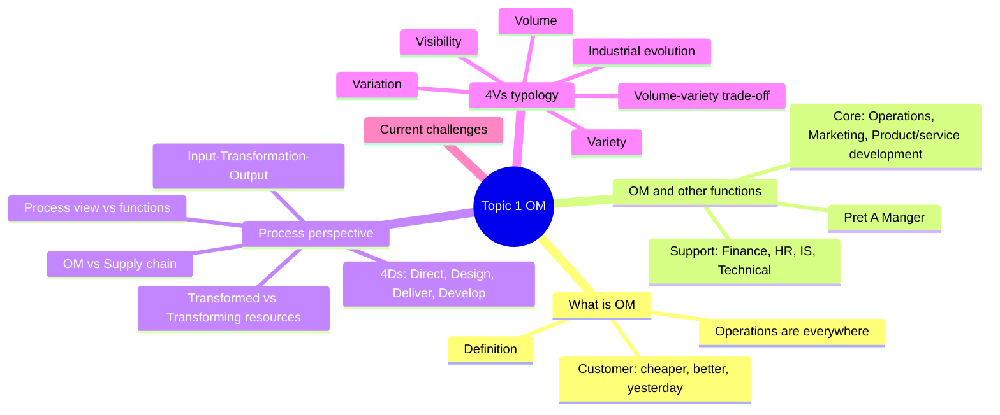
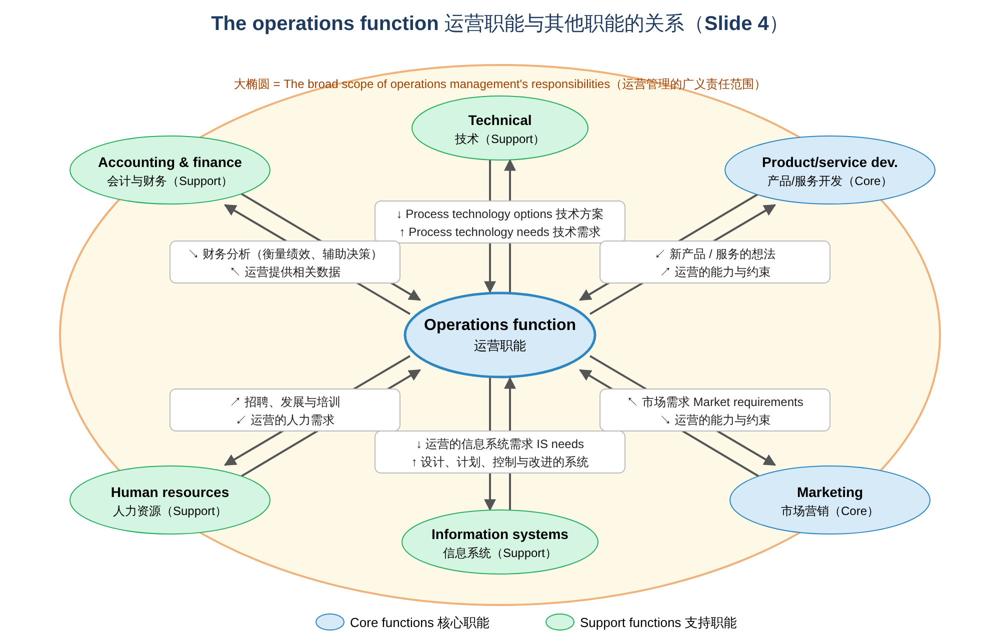
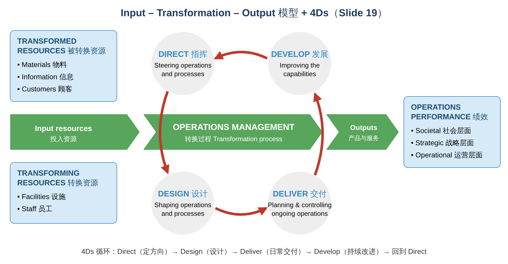
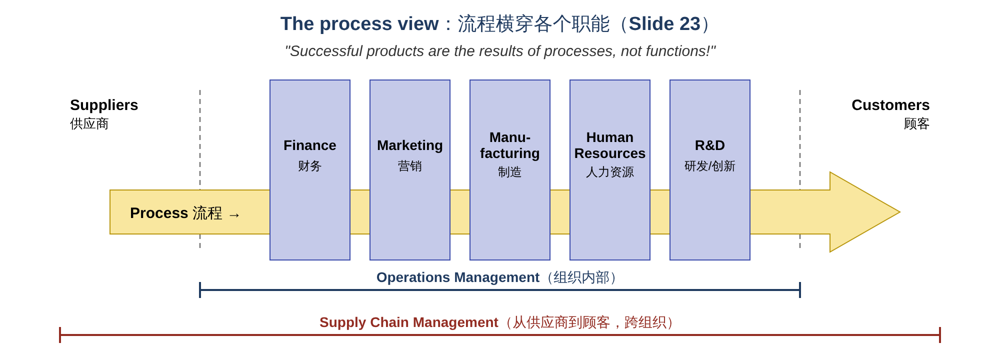
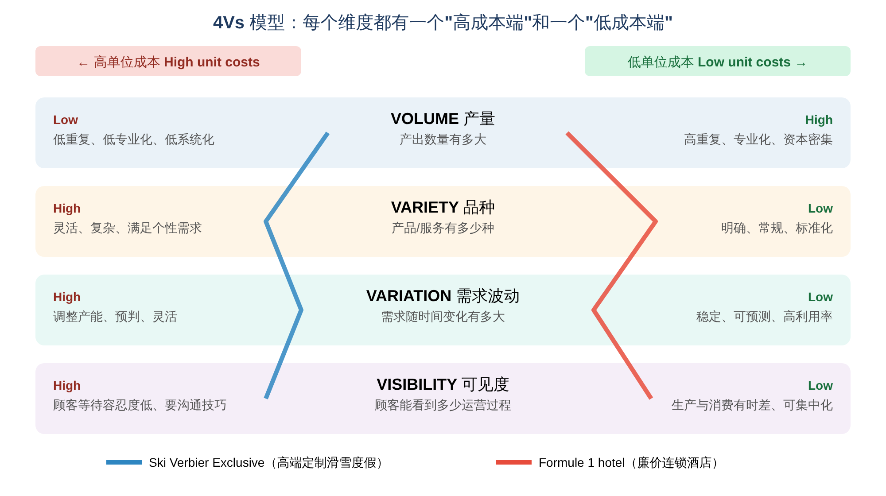
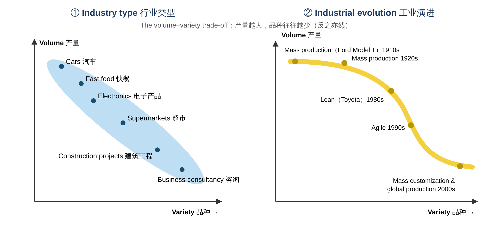

# Operations Management · Topic 1 运营管理导论（Introduction to Operations Management）学习笔记

> 教材：Slack, Brandon-Jones & Burgess, *Operations Management*, 10th Edition — Part One "Directing the operation", Chapter 1
> 内容范围：讲义 Topic 1（共 36 页）
>
> 📌 阅读说明
> - **英文术语保留原文**（考试用英文作答），中文帮助理解。
> - **💡 补充** = 讲义没讲但能帮助理解的内容；**⚠️ 易错** = 容易混淆的地方。
> - 文末有 **易混淆汇总、术语表、自测题（含答案）、课堂讨论题参考思路**。

---

## 0. 一张图看懂本章

### 本章的四个学习目标（Learning Outcomes）

| # | Learning Outcome | 中文 |
|---|---|---|
| 1 | What is Operations Management? Successful business examples | 什么是运营管理？成功企业的例子 |
| 2 | How is OM linked to other firm's functions? | 运营管理和企业其他职能是什么关系？ |
| 3 | Operations management: the process perspectives | 运营管理的"流程视角" |
| 4 | Operations management typology: 4Vs model | 运营的分类：4Vs 模型 |



**一句话总结本章：** 任何组织（工厂、医院、餐厅、慈善机构……）都在把 **输入（inputs）转换成输出（outputs）**，运营管理就是管好这个"转换过程"。不同企业的运营可以用 **4Vs（Volume 产量、Variety 品种、Variation 需求波动、Visibility 可见度）** 来区分，而 4Vs 决定了运营 **应该怎么设计、成本是高还是低**。

> 💡 **本章在全书中的位置（Slide 2）：** 教材把运营管理分成 **4Ds** 四大块：**Direct（指挥）→ Design（设计）→ Deliver（交付）→ Develop（发展）**。第 1 章属于 **Direct** 部分的第一个主题；同一部分后面还有 Operations performance（运营绩效）、Operations strategy（运营战略）、Product and service innovation（产品与服务创新）、Structure and scope of supply（供应的结构与范围）。

---

## 1. What is Operations Management? 什么是运营管理？

### 1.1 ⭐ 定义（Slide 8，必背）

> **"Operations management is the activity of managing the resources which are devoted to the production and delivery of products and services."**

**运营管理是管理那些用于生产和交付产品与服务的资源的活动。**

拆解关键词：
- **Managing the resources（管理资源）**：人、设备、材料、信息、资金……
- **Production and delivery（生产与交付）**：不只是"做出来"，还要"送到顾客手上"
- **Products and services（产品和服务）**：⚠️ **服务业也有运营管理**，不只是工厂！

> 💡 **补充：** 公司里负责这件事的部门叫 **operations function（运营职能）**；负责的人叫 **operations managers（运营经理）**。在不同行业里他们的头衔可能不同，例如工厂的"生产经理"、医院的"院务主任"、酒店的"运营总监"、物流公司的"配送经理"。

### 1.2 Operations are everywhere — 运营无处不在（Slide 9）

- 理解"运营"最好的方法就是 **看看你周围**；
- 你身边能看到的一切（除了"血肉之躯"）都是 **被某个运营生产出来的**；
- 你今天消费的每一项服务（电台、公交、讲课……）也都是 **被某个运营生产出来的**；
- **运营经理创造了你买的、坐的、穿的、吃的、扔向别人的、扔掉的一切东西。**

### 1.3 OM in all types of organization — 各类组织中的运营管理（Slide 10–15）

讲义用 5 个例子说明：**无论制造业、服务业还是非营利组织，都有运营管理。** 而且这 5 句话的 **句式完全一样**：

| 组织 | 用什么（resources） | 怎样（how） | 做什么（do） | 产出什么（output） |
|---|---|---|---|---|
| **Automobile assembly factory** 汽车装配厂 | **machines** 机器 | **efficiently** 高效地 | **assemble** 装配 | **products** that satisfy current customer demands |
| **Physician (GP)** 全科医生 | **knowledge** 知识 | **effectively** 有效地 | **diagnose conditions** 诊断 | to treat **real and perceived patient concerns** |
| **Management consultant** 管理咨询 | **people** 人 | **effectively** 有效地 | **create** 创造 | **services** that address current and potential client needs |
| **Disaster relief charity** 救灾慈善机构 | **ours and our partners' resources** 自己和伙伴的资源 | **speedily** 迅速地 | **provide** 提供 | **supplies and services** that relieve community suffering |
| **Advertising agency** 广告公司 | **our staff's knowledge and experience** 员工的知识和经验 | **creatively** 有创意地 | **present** 展示 | **ideas** that delight clients and address their real needs |

📝 **万能句式（Slide 18）：** **"Operations management uses ___ (resources) to ___ (how) ___ (do) ___ (outputs)."**
考试遇到"描述某组织的运营"，可以直接套这个句子。例如：
> 🌰 **Grab（网约车平台）**：Operations management uses **its drivers, app technology and data** to **speedily** **match and transport** **passengers to their destinations safely**.

> 💡 **补充：注意每个例子的"how"不一样**：工厂讲 **efficiently（效率）**，医生和咨询讲 **effectively（效果）**，救灾讲 **speedily（速度）**，广告讲 **creatively（创意）**。这说明 **不同组织的运营目标重点不同**（后面章节会学到 performance objectives：质量、速度、可靠性、灵活性、成本）。
>
> ⚠️ **Efficiency vs Effectiveness：** **Efficiency（效率）= 把事情做对（do things right）**，用最少的资源完成；**Effectiveness（效果）= 做对的事情（do the right things）**，真正达到目的。

### 1.4 OM and the Customer — 运营管理与顾客（Slide 16）

> **"Any customer, in any industry, in any market wants stuff that is both *cheaper* and *better*, and they want it *yesterday*."**（Ridderstrale & Nordstrom, 2000）

任何顾客都想要 **更便宜（cheaper）**、**更好（better）**、而且 **"昨天就要"（yesterday = 越快越好）**。

```
The business of the organization  ──── OM ────▶  The needs of the customers
       组织的业务                     运营管理是桥梁          顾客的需求
```

**OM 是连接"组织的业务"和"顾客需求"的桥梁。**

> 💡 **补充：** cheaper / better / yesterday 正好对应后面章节的 **performance objectives（绩效目标）**：
> - **Cheaper** → **Cost（成本）**
> - **Better** → **Quality（质量）**
> - **Yesterday** → **Speed（速度）**（以及 Dependability 可靠性：说好什么时候到就什么时候到）
>
> 难点在于：这几个目标经常 **互相冲突**（又快又好又便宜很难兼得），运营管理就是要找到最好的平衡。

---

## 2. How is OM linked to other functions? 运营与其他职能的关系

### 2.1 ⭐ Core functions vs Support functions（Slide 4）

任何组织都有 **三大核心职能（core functions）**，以及若干 **支持职能（support functions）**：

| 类型 | 职能 | 主要负责 |
|---|---|---|
| **Core 核心** | **Operations function** 运营 | 生产和交付产品/服务，满足顾客需求 |
| **Core 核心** | **Marketing (and sales) function** 市场营销 | 向市场传播产品/服务、获取订单 |
| **Core 核心** | **Product/service development function** 产品/服务开发 | 开发新产品/服务、改进现有产品 |
| Support 支持 | **Accounting and finance function** 会计与财务 | 提供财务信息、管理资金 |
| Support 支持 | **Human resources (HR) function** 人力资源 | 招聘、培训、发展员工 |
| Support 支持 | **Information systems (IS) function** 信息系统 | 提供信息技术和系统 |
| Support 支持 | **Technical function** 技术 | 提供流程技术（process technology） |



**📝 读图要点：运营职能处在中心，和每个职能都有"双向"沟通。**
- 运营 → 产品开发 / 营销：**告诉它们运营流程能做什么、做不了什么**（capabilities and constraints）
- 产品开发 → 运营：**新产品/服务的想法**
- 营销 → 运营：**市场需求**（顾客想要什么）
- 财务 → 运营：**财务分析**，用于衡量绩效和决策；运营 → 财务：**提供相关数据**
- 人力资源 → 运营：**招聘、发展和培训**；运营 → 人力资源：**人力需求**
- 信息系统 → 运营：**用于设计、计划、控制和改进的系统**；运营 → 信息系统：**信息系统需求**
- 技术 → 运营：**流程技术方案**；运营 → 技术：**流程技术需求**

> 💡 **补充：图中的大椭圆（"The broad scope of OM's responsibilities"）** 表示：广义上，运营管理的责任范围 **覆盖了所有这些职能** 中涉及"生产和交付"的部分。比如营销部门处理订单的流程、财务部门做报表的流程，本身也是"运营"。这就引出了后面的 **process view（流程视角）**。

### 2.2 案例：Prêt A Manger（Slide 5–6）

**背景：** 英国的"高端"三明治和小吃零售连锁店（"High-end" sandwich and snack retailer）
- 只使用 **"健康天然"的食材（wholesome ingredients）**；
- **每家店都有自己的厨房**，每天现做新鲜三明治；
- 新鲜食材 **每天清早送达**；
- 中午给你服务的店员，**就是早上做三明治的人**；
- 员工口号："We don't work nights, we wear jeans, we party…"（我们不上夜班、穿牛仔裤、爱聚会……）

**Prêt 的三大核心职能：**

| 职能 | Prêt 的具体工作 |
|---|---|
| **Product/Service Development** | 三明治和小吃的 **营养、"结构"和美观设计**（nutritional "mechanical" and aesthetic design） |
| **Marketing** | **促销活动、市场调研** 等（promotional activities, market research） |
| **Operations** | **门店的设计、选址和管理，店内流程，以及供货网络**（design, location and management of stores and in-store processes and the network that supplies them） |

讲义用三个 **相互重叠的圆（Venn diagram）** 表示：这三个职能 **不是互相隔离的，而是有交集、需要紧密配合**。

> 💡 **补充：为什么 Prêt 是运营管理的好例子？**
> 它的核心卖点"新鲜"完全靠 **运营** 实现：每天清晨送货（供应链）、店内现做（流程设计）、同一批员工从做到卖（人员安排）。如果运营做不好（比如送货晚了、员工不够），营销宣传得再好也没用。**这说明运营往往是企业竞争优势的来源。**

### 2.3 不同组织中核心职能的活动（Slide 7）

| 核心职能 | **Internet service provider (ISP)** 网络服务商 | **Fast food chain** 快餐连锁 | **International aid charity** 国际援助慈善 | **Furniture manufacturer** 家具制造商 |
|---|---|---|---|---|
| **Operations** | 维护硬件、软件和内容；上线新链接和服务 | 做汉堡等；服务顾客；维护设备 | 为受助者提供服务 | 制造零部件；组装家具 |
| **Marketing and sales** | 向用户推广服务、获取注册；出售广告位 | 投放电视广告；设计促销材料 | 争取资助合同；寄送募捐信 | 在杂志上做广告；定价；卖给门店 |
| **Product/service development** | 设计新服务、委托制作新信息内容 | 设计汉堡、披萨等；设计餐厅装修 | 策划新的募捐活动；设计新援助项目 | 设计新家具；配合流行色彩 |

📝 **结论：** 不管是营利还是非营利、制造还是服务，**三大核心职能都存在**，只是具体活动不同。

---

## 3. ⭐ The Process Perspective — 流程视角

### 3.1 All operations are input–transformation–output processes（Slide 17）

```
  Inputs  ──▶  [ Transformation process 转换过程 ]  ──▶  Outputs
  投入                                                    产出
```

**所有运营都是"输入 → 转换 → 输出"的过程。** 这是整门课最核心的模型。

### 3.2 ⭐ 完整模型（Slide 19，必会画、必会解释）



#### (1) Input resources 投入资源：分两类

| | **Transformed resources 被转换资源** | **Transforming resources 转换资源** |
|---|---|---|
| 含义 | 在运营过程中 **被加工、被处理、被改变** 的资源 | **执行加工的** 资源，用来"转换"别的东西 |
| 包括 | **Materials（物料）**、**Information（信息）**、**Customers（顾客）** | **Facilities（设施）**：建筑、设备、技术等；**Staff（员工）**：操作、维护、管理运营的人 |
| 特点 | 进来时是一个样子，出去时变了 | 用完之后 **还在**，可以重复使用 |

📝 **记忆方法：** **Transform-ED（被动）= 被改变的那个**；**Transform-ING（主动）= 动手去改变的那个**。

⚠️ **易错：顾客也可以是"被转换资源"！** 比如：
- 理发店把 **顾客** 从"头发长"变成"头发短"
- 医院把 **病人** 从"生病"变成"健康"
- 航空公司把 **乘客** 从新加坡"移动"到伦敦

#### (2) The 4Ds of operations management：运营管理做的四件事

| D | 英文 | 中文 | 含义 |
|---|---|---|---|
| **Direct** | Steering operations and processes | **指挥** | 确定运营战略和方向 |
| **Design** | Shaping operations and processes | **设计** | 设计运营和流程（布局、产能、流程） |
| **Deliver** | Planning and controlling ongoing operations | **交付** | 计划和控制日常运营（排产、库存、质量） |
| **Develop** | Improving the operation's capabilities | **发展** | 持续提升运营能力（改进） |

顺序是一个 **循环**：**Direct → Design → Deliver → Develop → 回到 Direct**。

#### (3) Outputs：产品和服务

#### (4) Operations performance 运营绩效：三个层面
- **Societal（社会层面）**：对社会和环境的影响，例如可持续性、员工福利
- **Strategic（战略层面）**：对企业整体战略的贡献，例如竞争优势
- **Operational（运营层面）**：日常运营表现，例如质量、速度、可靠性、灵活性、成本

> 💡 **补充：** 这三个层面会在第 2 章 "Operations performance" 详细展开。其中 Societal 层面常和 **Triple Bottom Line（三重底线：People 人、Planet 地球、Profit 利润）** 一起讲。

### 3.3 案例：Prêt A Manger 的投入与产出（Slide 20）

| 类别 | Prêt 的具体内容 |
|---|---|
| **Transformed resources** | **Ingredients（食材）**、**Packaging（包装）**、**Customers（顾客）** |
| **Transforming resources** | **Equipment（设备）**、**Fittings（店内装修/固定设施）**、**Staff（员工）** |
| **Outputs** | **Served and satisfied customers**（得到服务并满意的顾客） |

⚠️ **注意：** Prêt 的产出不只是"三明治"，而是 **"得到服务并感到满意的顾客"**。这体现了服务业的特点：**产品和服务往往结合在一起**。

### 3.4 Dominant transformed resource inputs：主要的被转换资源（Slide 21）

不同运营 **主要（predominantly）** 处理的资源不同：

| **主要处理 Materials 物料** | **主要处理 Information 信息** | **主要处理 Customers 顾客** |
|---|---|---|
| All manufacturing operations 所有制造业 | Accountants 会计师 | Hairdressers 理发店 |
| Mining companies 矿业公司 | Bank headquarters 银行总部 | Hotels 酒店 |
| Retail operations 零售 | Market research company 市场调研公司 | Hospitals 医院 |
| Warehouses 仓库 | Financial analysts 金融分析师 | Mass rapid transports 地铁（如新加坡 MRT） |
| Postal services 邮政 | News service 新闻机构 | Theatres 剧院 |
| Container shipping line 集装箱航运 | University research unit 大学研究单位 | Theme parks 主题公园 |
| Trucking companies 货运公司 | Telecoms company 电信公司 | Dentists 牙医 |

> 💡 **补充：被转换的物料、信息、顾客，各自可能发生哪些变化？**
> - **Materials（物料）**：物理性质（制造：把钢材变成汽车）、位置（运输：快递）、所有权（零售：商品从店里到你手里）、存放（仓储）
> - **Information（信息）**：形式（会计：把数据变成报表）、所有权（市场调研：把信息卖给客户）、存储（图书馆）、位置（电信：把信息从 A 传到 B）
> - **Customers（顾客）**：外表（理发）、身体状态（医院）、位置（地铁、航空）、住宿（酒店）、心理状态（剧院、主题公园）
>
> ⚠️ **"Predominantly"（主要）** 这个词很重要：大多数运营 **同时** 处理多种资源，只是有一种占主导。比如零售店主要处理物料（商品），但也处理顾客和信息。

### 3.5 Some operations described in terms of their processes（Slide 22）

| Operation 运营 | Inputs 投入 | Processes 流程 | Outputs 产出 |
|---|---|---|---|
| **Airline** 航空公司 | Aircraft 飞机；Pilots and air crew 机组；Ground crew 地勤；**Passengers and freight 乘客和货物** | Check passengers in 值机；Board passengers 登机；Fly passengers and freight around the world 飞行；Care for passengers 照顾乘客 | **Transported passengers and freight** 被运送的乘客和货物 |
| **Department store** 百货公司 | Products for sale 商品；Sales staff 销售员；Information systems 信息系统；**Customers 顾客** | Source and store products 采购与存储；Display products 陈列；Give sales advice 提供建议；Sell products 销售 | **Customers and products "assembled" together** 顾客与商品"组合"在一起 |
| **Police** 警察 | Police officers 警员；Computer systems 计算机系统；Information systems 信息系统；**Public (law-abiding and criminals)** 公众（守法者和罪犯） | Crime prevention 预防犯罪；Crime detection 侦查犯罪；Information gathering 收集信息；Detaining suspects 拘留嫌疑人 | **Lawful society, public with a feeling of security** 守法的社会、有安全感的公众 |
| **Frozen food manufacturer** 冷冻食品制造商 | **Fresh food 新鲜食材**；Operators 操作员；Processing technology 加工技术；Cold storage facilities 冷库 | Source raw materials 采购原料；Prepare food 备料；Freeze food 冷冻；Pack and freeze food 包装冷冻 | **Frozen food** 冷冻食品 |

> 💡 **练习：** 试着区分上表每一行的投入中，哪些是 **transformed resources**，哪些是 **transforming resources**。
> 例如航空公司：**乘客和货物 = transformed**；飞机、机组、地勤 = **transforming**。

### 3.6 ⭐ The Process View：流程视角（Slide 23）

> **Processes are the fundamental unit of analysis in operations management** because they represent the exact mechanisms through which a business **transforms inputs into valuable outputs**.

**流程是运营管理中最基本的分析单位**，因为流程正是企业 **把投入转换成有价值的产出** 的具体机制。

> **"Successful products are the results of processes, not functions!"**
> **成功的产品是流程的结果，而不是职能的结果！**



**读图要点：**
- 一条 **流程（Process）** 横向穿过 **多个职能部门**（Finance、Marketing、Manufacturing、HR、R&D）；
- **Operations Management（运营管理）** 的范围：**组织内部** 的流程；
- **Supply Chain Management（供应链管理）** 的范围更大：**从供应商一直到顾客**，跨越多个组织。

> 💡 **补充：为什么强调"流程而不是职能"？**
> 顾客不在乎你公司内部怎么分部门，他只关心 **从下单到收货的整个过程** 是否顺畅。如果每个部门只顾自己（"部门墙 / silo"），流程就会在部门交接处出问题，比如营销承诺了运营做不到的交期。
> 🌰 **例子：** 网购一件衣服。下单（IS）→ 付款（Finance）→ 仓库拣货（Operations）→ 发货（Logistics）→ 售后（Customer service）。任何一个环节慢了，顾客都会觉得"这家店很差"。
>
> ⚠️ **易错：OM vs SCM**
> - **OM（Operations Management）**：关注 **一个组织内部** 的转换流程
> - **SCM（Supply Chain Management）**：关注 **跨组织** 的整个链条（供应商的供应商 → 本企业 → 顾客的顾客）

### 3.7 讨论：What is OM for Amazon?（Slide 24）

> 💡 **参考思路（讲义只有一张亚马逊仓库的照片）：**
> - **Transformed resources**：商品（materials）、订单与顾客数据（information）
> - **Transforming resources**：**fulfilment centres（履约中心 / 大型仓库）**、仓储机器人、配送车队、员工、IT 系统
> - **核心流程**：采购入库 → 存储 → 接单 → 拣货包装 → 配送（last-mile delivery 最后一公里）→ 退货处理
> - **运营带来的竞争优势**：极大的品种（variety）、快速配送（如 Prime 的次日达）、低成本（规模效应）。可以说 **亚马逊的核心竞争力就是运营能力**。

### 3.8 讨论：Tesla — Entrepreneurship or OM?（Slide 25）

> 💡 **参考思路：**
> - **创业精神 / 创新（Entrepreneurship）**：Elon Musk 的愿景、电动车产品设计、品牌，让 Tesla 拥有好的 **产品**。
> - **运营管理（OM）**：好产品要 **大规模、高质量、低成本地造出来** 才能成功。Tesla 在 2017–2018 年 Model 3 量产初期遇到严重的产能瓶颈，Musk 本人称之为 **"production hell"（生产地狱）**，并承认工厂 **过度自动化（excessive automation）** 是个错误。
> - **结论：** 两者缺一不可。**好的想法需要好的运营才能变成成功的产品**，这正是讲义说的 "successful products are the results of processes"。

---

## 4. ⭐ 4Vs Model — 运营的分类（Typology）

### 4.1 OM 对每个企业都一样吗？（Slide 26）

> Businesses (operations) are **similar** in that they transform inputs into outputs; however, they can be **differentiated** through specific product/service characteristics.

所有企业都在做"输入 → 转换 → 输出"，这一点 **相同**；但它们可以通过 **4Vs** 来 **区分**：

| V | 英文 | 中文 | 问的问题 |
|---|---|---|---|
| 1 | **Volume** | 产量 | 产出的数量有多大？ |
| 2 | **Variety** | 品种 | 产品/服务的种类有多少？ |
| 3 | **Variation** (in the demand) | 需求波动 | 需求随时间变化有多大？ |
| 4 | **Visibility** (of the operation with the customer) | 可见度 | 顾客能看到/接触到多少运营过程？ |

### 4.2 ⭐ A typology of operations：4Vs 的影响（Slide 27，必背）

| 维度 | **← 这一端：高单位成本** | **这一端：低单位成本 →** |
|---|---|---|
| **VOLUME** | **Low** volume：<br/>• Low repetition 低重复<br/>• Each staff member performs more of each task 每个员工做更多不同的工作<br/>• Less systemization 系统化程度低<br/>• **High unit costs** | **High** volume：<br/>• High repeatability 高重复<br/>• Specialization 专业化分工<br/>• Capital intensive 资本密集（大量机器设备）<br/>• **Low unit costs** |
| **VARIETY** | **High** variety：<br/>• Flexible 灵活<br/>• Complex 复杂<br/>• Match customer needs 满足顾客个性需求<br/>• **High unit costs** | **Low** variety：<br/>• Well-defined 明确<br/>• Routine 常规<br/>• Standardized 标准化<br/>• Regular 有规律<br/>• **Low unit costs** |
| **VARIATION IN DEMAND** | **High** variation：<br/>• Changing capacity 产能要经常调整<br/>• Anticipation 需要预判<br/>• Flexibility 灵活<br/>• In touch with demand 紧跟需求<br/>• **High unit costs** | **Low** variation：<br/>• Stable 稳定<br/>• Routine 常规<br/>• Predictable 可预测<br/>• High utilization 高利用率<br/>• **Low unit costs** |
| **VISIBILITY** | **High** visibility：<br/>• Short waiting tolerance 顾客等待容忍度低<br/>• Satisfaction governed by customer perception 满意度取决于顾客感知<br/>• Customer contact skills needed 需要与顾客沟通的技能<br/>• Received variety is high 顾客感受到的多样性高<br/>• **High unit costs** | **Low** visibility：<br/>• Time lag between production and consumption 生产与消费之间有时间差<br/>• Standardization 标准化<br/>• Low contact skills 不太需要沟通技能<br/>• High staff utilization 员工利用率高<br/>• Centralization 可以集中化<br/>• **Low unit costs** |



⭐ **最重要的规律：**
**High Volume + Low Variety + Low Variation + Low Visibility → Low unit costs（低单位成本）**
**Low Volume + High Variety + High Variation + High Visibility → High unit costs（高单位成本）**

⚠️ **易错：方向！** 讲义的图里 **只有 Volume 是"Low → High"**，其他三个都是 **"High → Low"**。这样排列是为了让 **右边永远是低成本端**。考试画图时注意别画反。

> 💡 **补充：为什么会这样？**
> - **Volume 高** → 同样的事重复做 → 可以 **分工专业化**、**买专用机器**、**固定成本被大量产品分摊** → 每件成本低（规模经济 economies of scale）
> - **Variety 低** → 产品标准化 → 流程简单、不用频繁切换 → 成本低
> - **Variation 低** → 需求稳定 → 产能可以按平均需求设置，**不用为高峰期预留闲置产能** → 利用率高、成本低
> - **Visibility 低** → 顾客看不到后台 → 可以 **集中处理、排队处理**，不用"随叫随到"，员工也不用花时间和顾客沟通 → 成本低

### 4.3 四个 V 的例子（Slide 28–32）

讲义每个 V 都用了 **"流程特征 + 例子"** 来说明：

| V | **Low 端的例子** | 流程特征 | **High 端的例子** | 流程特征 |
|---|---|---|---|---|
| **Volume** | 小型精品店/小餐馆 | Low repeatability, low specialization, low systemization | **快餐店厨房**（如 McDonald's） | High repeatability, high specialization, high systemization |
| **Variety** | **快餐店**（菜单固定） | High repeatability, specialization, systemization | **出租车**（每趟路线都不同） | Low repeatability, specialization, systemization |
| **Variation** | **汽车装配线**（需求稳定） | High repeatability, specialization, systemization | **手工定制皮鞋**（需求不稳定） | Low repeatability, specialization, systemization |
| **Visibility** | **银行后台（back office）** | High repeatability, specialization, systemization | **高级酒店/餐厅服务员**（front office） | Low repeatability, specialization, systemization |

📝 **规律：** 处在"低成本端"的例子，流程都是 **高重复、高专业化、高系统化**；处在"高成本端"的例子正好相反。

> 💡 **补充：Visibility 的直观理解 = "前台 vs 后台"**
> - **Front office（前台）**：顾客能看到、能接触的部分，如银行柜台、酒店前台、餐厅大堂 → **高可见度**
> - **Back office（后台）**：顾客看不到的部分，如银行的数据处理中心、酒店洗衣房、餐厅厨房 → **低可见度**
> - 🌰 网上购物 vs 实体店：网店 **visibility 低**（顾客只看到网页），实体店 **visibility 高**（顾客全程在场）。
>
> ⚠️ **"Received variety is high"** 的意思是：高可见度的运营中，**每个顾客的要求都不一样**，员工必须现场应对各种不同的情况，所以 **顾客"带来的"多样性很高**。

### 4.4 ⭐ The Volume–Variety Trade-off：产量与品种的权衡（Slide 30–31）



#### ① Industry type 行业类型（Slide 30）
**产量和品种通常呈反向关系**：产量越大，品种越少；品种越多，产量越小。行业大致分布在一条从左上到右下的斜带上：

| 位置 | 行业 | 特点 |
|---|---|---|
| 左上：**高产量、低品种** | **Cars（汽车）、Fast food（快餐）、Electronics（电子产品）** | 标准化、大规模生产 |
| 中间 | **Supermarkets（超市）** | 品种较多、产量较大 |
| 右下：**低产量、高品种** | **Construction projects（建筑工程）、Business consultancy（商业咨询）** | 每个项目都不一样 |

#### ② Industrial evolution 工业演进（Slide 31）
随着时代发展，企业一直在尝试 **突破这个权衡**：在保持较高产量的同时，提供更多品种。

| 年代 | 生产方式 | 💡 补充说明 |
|---|---|---|
| **1910s** | **Mass production（Ford Model T）** 大规模生产 | 福特流水线：一种车型、极高产量、极低成本。福特的名言："顾客可以选任何颜色，只要它是黑色的。" |
| **1920s** | **Mass production** | 大规模生产普及；后来通用汽车（GM）开始提供多种车型和颜色 |
| **1980s** | **Lean Production（Toyota）** 精益生产 | 丰田生产方式（TPS）：**消除浪费**、**准时制生产（JIT, Just-in-Time）**、小批量、持续改进（Kaizen），在保持效率的同时提供更多品种 |
| **1990s** | **Agile Production** 敏捷生产 | 强调 **快速响应** 市场变化和顾客需求 |
| **2000s** | **Mass customization and global production** 大规模定制与全球化生产 | 以接近大规模生产的成本提供 **个性化产品**，如 Dell 按订单组装电脑、Nike By You 定制球鞋；生产也分布到全球各地 |

> 💡 **补充：这条曲线说明了什么？** 曲线越来越往 **右**（品种越来越多），说明顾客需求越来越个性化，企业必须用新的生产方式（精益、敏捷、大规模定制），**在不大幅增加成本的前提下提供更多品种**。这也是 Slide 34 "Current challenges" 中 **mass customization** 的由来。

### 4.5 ⭐ 4Vs profiles：两家风格完全不同的酒店（Slide 33）

用 4Vs 给企业画一条 **"轮廓线"（profile）**，就能直观对比不同运营：

| 维度 | **Ski Verbier Exclusive**<br/>（瑞士 Verbier 高端定制滑雪度假） | **Formule 1 hotel brand**<br/>（法国廉价连锁酒店） |
|---|---|---|
| **Volume** | **Low**（客人少） | **High**（客人多、连锁规模大） |
| **Variety** | **High**（为每位客人定制服务） | **Low**（房间和服务都标准化） |
| **Variation** | **High**（滑雪季节性强） | **中等偏低**（需求相对稳定） |
| **Visibility** | **High**（与客人大量接触） | **Low**（自助入住，很少接触员工） |
| **结果** | **高成本 → 高价格**，靠个性化服务取胜 | **低成本 → 低价格**，靠标准化和效率取胜 |

> 💡 **补充：没有"好"或"坏"的 profile！** 两种都能成功，关键是 **运营方式要和 4Vs 定位匹配（fit）**。高端度假村如果像廉价酒店一样标准化，就会失去顾客；廉价酒店如果提供高端个性化服务，成本就控制不住。

### 4.6 ⭐ Operations fit：4Vs 模型的应用（Slide 34）

讲义的课堂练习：
1. **想一家你熟悉的成功企业，用 4Vs 模型给它的运营分类。**
2. **企业的性质（4Vs）和它采用的运营方式（高/低专业化、重复、系统化）之间是否匹配（fit）？**

> 💡 **参考答案示例：McDonald's（麦当劳）**
>
> | V | 定位 | 理由 |
> |---|---|---|
> | Volume | **High** | 每天服务大量顾客 |
> | Variety | **Low** | 菜单有限、标准化 |
> | Variation | **中等** | 有午餐、晚餐高峰，但整体可预测 |
> | Visibility | **中等偏高** | 顾客在柜台点餐，但厨房在后台 |
>
> **运营方式：** 高度标准化的流程、专用设备、员工分工明确（有人炸薯条、有人做汉堡）→ **高重复、高专业化、高系统化**。
> **结论：** 4Vs 定位（高产量、低品种）和运营方式（标准化）**高度匹配（good fit）** → 能够做到 **低成本、快速、品质稳定**。
>
> 💡 **对比示例：婚礼策划公司** → Low volume、High variety、High variation（季节性）、High visibility → 运营方式应 **灵活、定制化**，员工需要高沟通技能 → 成本高，所以定价也高。
>
> 💡 **答题框架（考试/作业可用）：**
> 1. 简单介绍公司及其产品/服务
> 2. 逐个分析 4Vs（High / Low + 理由 + 证据）
> 3. 描述它的运营方式（repetition / specialization / systemization）
> 4. 判断是否匹配（fit），以及对成本和竞争力的影响
> 5. 如果不匹配，给出改进建议

---

## 5. OM: Current Challenges 当前挑战（Slide 35）

来源：Heizer, Render & Munson (2017)。讲义列出了 9 个挑战，课堂任务是：**挑一个话题，分组讨论它和运营管理有什么关系。**

| 挑战 | 💡 和 OM 的关系（参考思路） |
|---|---|
| **Globalization** 全球化 | 供应链跨国分布：可以降低成本，但更复杂、风险更高（如贸易摩擦、运输中断） |
| **Rapid product development** 快速产品开发 | 产品生命周期缩短 → 运营要能快速转产新产品 |
| **Mass customization** 大规模定制 | 既要个性化（high variety）又要低成本（high volume）→ 挑战 volume–variety trade-off |
| **Sustainability** 可持续性 | 减少浪费、碳排放、能耗；循环经济 → 对应运营绩效的 **societal** 层面 |
| **Natural disasters** 自然灾害 | 供应链中断风险（如 2011 年日本地震影响全球汽车和电子产业）→ 需要供应链韧性（resilience） |
| **Poverty** 贫困 | 如何为低收入人群提供低成本的产品和服务（如低价医疗、小额信贷的运营设计） |
| **Education** 教育 | 教育本身也是一种运营（学生 = 被转换的"顾客"）；在线教育改变了运营方式 |
| **War / occupations** 战争 / 占领 | 供应链中断、能源与原材料价格波动；人道主义物流 |
| **Digital revolution** 数字革命 | 自动化、人工智能、物联网、大数据、电子商务 → 改变运营的设计和管理方式（**Industry 4.0**） |

> 💡 **小组讨论答题模板：**
> **[挑战] → 对运营的影响（4Vs 哪些维度变了？投入/流程/产出哪里受影响？）→ 企业的应对方法 → 一个真实例子**
>
> 🌰 例：**Sustainability** → 投入端要用可持续材料、产出端要减少浪费 → 企业采用 circular economy（循环经济）、回收包装 → 例子：很多快时尚品牌推出旧衣回收计划。

---

## 6. ⚠️ 易混淆概念汇总

| 容易混淆 | 区别 |
|---|---|
| Operations function vs Operations management | 前者是 **部门/职能**；后者是 **管理这些资源的活动** |
| Core functions vs Support functions | Core：**Operations、Marketing、Product/service development**；Support：**Finance、HR、IS、Technical** |
| Transformed vs Transforming resources | **Transformed（被转换）** = 物料、信息、顾客；**Transforming（转换别人的）** = 设施、员工 |
| 顾客是什么资源？ | 顾客可以是 **transformed resource**（理发店、医院、航空公司里） |
| Efficiency vs Effectiveness | 效率 = 把事情做对（少用资源）；效果 = 做对的事情（达到目的） |
| 4Ds 的顺序 | **Direct → Design → Deliver → Develop**（循环） |
| Operations performance 三层面 | **Societal、Strategic、Operational** |
| Process vs Function | 流程 **横跨** 多个职能；"成功的产品来自流程，而非职能" |
| OM vs SCM | OM = **组织内部**；SCM = **从供应商到顾客**，跨组织 |
| 4Vs 的方向 | 只有 **Volume** 是 "高 = 低成本"；**Variety、Variation、Visibility** 都是 **"低 = 低成本"** |
| Variety vs Variation | **Variety = 产品种类多少**；**Variation = 需求随时间的波动** |
| Visibility | 顾客 **能看到/接触到** 多少运营；前台（高）vs 后台（低） |
| Volume–variety trade-off | 产量和品种通常 **反向**；大规模定制试图打破这一权衡 |
| Mass production vs Lean vs Mass customization | 福特（单一产品、高产量）→ 丰田（消除浪费、JIT）→ 个性化 + 规模化 |

---

## 7. 📖 中英术语表（Glossary）

| English | 中文 |
|---|---|
| Operations management (OM) | 运营管理 |
| Operations function | 运营职能 |
| Operations manager | 运营经理 |
| Core functions | 核心职能 |
| Support functions | 支持职能 |
| Marketing (and sales) | 市场营销（与销售） |
| Product/service development | 产品/服务开发 |
| Accounting and finance | 会计与财务 |
| Human resources (HR) | 人力资源 |
| Information systems (IS) | 信息系统 |
| Technical function | 技术职能 |
| Capabilities and constraints | 能力与约束 |
| Process technology | 流程技术 |
| Input–transformation–output | 输入–转换–输出 |
| Transformation process | 转换过程 |
| Transformed resources | 被转换资源 |
| Transforming resources | 转换资源 |
| Materials / Information / Customers | 物料 / 信息 / 顾客 |
| Facilities / Staff | 设施 / 员工 |
| Direct / Design / Deliver / Develop (4Ds) | 指挥 / 设计 / 交付 / 发展 |
| Operations performance | 运营绩效 |
| Societal / Strategic / Operational | 社会 / 战略 / 运营层面 |
| Predominantly | 主要地 |
| Process view | 流程视角 |
| Unit of analysis | 分析单位 |
| Supply chain management (SCM) | 供应链管理 |
| Typology | 分类（类型学） |
| Volume | 产量 |
| Variety | 品种 |
| Variation (in demand) | 需求波动 |
| Visibility | 可见度 |
| Repeatability / Repetition | 重复性 |
| Specialization | 专业化 |
| Systemization | 系统化 |
| Capital intensive | 资本密集 |
| Unit costs | 单位成本 |
| Standardized | 标准化 |
| Utilization | 利用率 |
| Capacity | 产能 |
| Anticipation | 预判 |
| Waiting tolerance | 等待容忍度 |
| Customer perception | 顾客感知 |
| Customer contact skills | 顾客接触/沟通技能 |
| Centralization | 集中化 |
| Front office / Back office | 前台 / 后台 |
| Volume–variety trade-off | 产量–品种权衡 |
| Mass production | 大规模生产 |
| Lean production | 精益生产 |
| Agile production | 敏捷生产 |
| Mass customization | 大规模定制 |
| Operations fit | 运营匹配 |
| Globalization | 全球化 |
| Sustainability | 可持续性 |
| Digital revolution | 数字革命 |
| 💡 Efficiency / Effectiveness | 效率 / 效果 |
| 💡 Performance objectives | 绩效目标 |
| 💡 Economies of scale | 规模经济 |
| 💡 Just-in-Time (JIT) | 准时制生产 |
| 💡 Fulfilment centre | 履约中心（电商仓库） |
| 💡 Triple Bottom Line | 三重底线 |

---

## 8. 💬 课堂讨论题参考思路

**Q1. 为什么说 "Operations are everywhere"？请举出 3 个不同类型组织的运营例子。**
> 因为所有组织都在把投入转换成产出。例如：① 制造业：汽车厂用机器把零件装配成汽车；② 服务业：医院用医生的知识把病人从生病变成健康；③ 非营利：救灾机构用资源迅速为灾民提供物资。

**Q2. 用 input–transformation–output 模型分析新加坡 MRT（地铁）。**
> - **Transformed resources**：乘客（customers，主要）、乘客信息（如刷卡数据）
> - **Transforming resources**：列车、轨道、车站（facilities）；司机、站务员、维修员（staff）
> - **Process**：进站 → 候车 → 运输 → 出站
> - **Output**：被安全、准时送到目的地的乘客

**Q3. What is OM for Amazon?**（见 3.7 节）

**Q4. Tesla 的成功靠创业精神还是运营管理？**（见 3.8 节）
> 两者都需要。愿景和创新带来好产品，但只有运营管理才能把产品大规模、低成本、高质量地造出来并交付。

**Q5. 比较快餐店和高级餐厅的 4Vs，并说明这对它们的成本有什么影响。**
> | V | 快餐店 | 高级餐厅 |
> |---|---|---|
> | Volume | High | Low |
> | Variety | Low | High |
> | Variation | 中（有饭点高峰） | 中高（预约、节假日） |
> | Visibility | 中 | High |
> 快餐店处在低成本端 → 标准化、低价；高级餐厅处在高成本端 → 个性化、高价。

**Q6.（Slide 35）挑一个当前挑战，讨论它和 OM 的关系。**（见第 5 节表格和模板）

---

## 9. ✍️ 自测题（Self-test）

### Part A：选择题

1. 根据教材，运营管理的定义是：\
   A. The activity of selling products and services\
   B. The activity of managing the resources devoted to the production and delivery of products and services\
   C. The activity of managing a firm's finances\
   D. The activity of designing new products

2. 以下哪一项 **不是** 核心职能（core function）？\
   A. Operations\
   B. Marketing\
   C. Product/service development\
   D. Human resources

3. 在理发店里，**顾客** 属于：\
   A. Transforming resource\
   B. Transformed resource\
   C. Output only\
   D. Support function

4. 以下哪一项属于 **transforming resources**？\
   A. Materials\
   B. Information\
   C. Staff\
   D. Customers

5. 4Ds 的正确顺序是：\
   A. Design → Direct → Develop → Deliver\
   B. Direct → Design → Deliver → Develop\
   C. Deliver → Design → Direct → Develop\
   D. Develop → Deliver → Design → Direct

6. 会计师事务所 **主要（predominantly）** 处理的是：\
   A. Materials\
   B. Information\
   C. Customers\
   D. Facilities

7. 以下哪一组组合最可能带来 **低单位成本**？\
   A. Low volume, high variety\
   B. High volume, low variety, low variation, low visibility\
   C. High volume, high variety, high variation, high visibility\
   D. Low volume, low variety, high visibility

8. "Received variety is high" 是哪一个 V 的特征？\
   A. High volume\
   B. Low variety\
   C. High visibility\
   D. Low variation

9. 银行的后台数据处理中心属于：\
   A. High visibility\
   B. Low visibility\
   C. High variation\
   D. High variety

10. 在 volume–variety 图中，以下哪个行业最接近 **"低产量、高品种"**？\
    A. Cars\
    B. Fast food\
    C. Electronics\
    D. Business consultancy

11. 精益生产（Lean production）与哪家公司关系最密切？\
    A. Ford\
    B. Toyota\
    C. Amazon\
    D. Tesla

12. 与 OM 相比，Supply Chain Management 的范围：\
    A. 只在组织内部\
    B. 只在营销部门\
    C. 从供应商一直到顾客，跨越多个组织\
    D. 只包括财务流程

### Part B：简答题

1. 写出运营管理的定义，并用"万能句式"描述一家你熟悉的企业的运营。
2. 区分 transformed resources 和 transforming resources，并以一家餐厅为例说明。
3. 什么是 4Ds？简要说明每一个 D 的含义。
4. 解释为什么"高产量"会带来"低单位成本"。
5. 用 4Vs 比较 Ski Verbier Exclusive 和 Formule 1 酒店。
6. 解释 "Successful products are the results of processes, not functions"。

<details>
<summary><b>👉 点击查看答案</b></summary>

**Part A**
1. **B**
2. **D**（HR 是 support function）
3. **B**（顾客被"转换"：头发变短）
4. **C**（staff 和 facilities 是 transforming resources）
5. **B**
6. **B**
7. **B**
8. **C**
9. **B**（后台 = 顾客看不到）
10. **D**
11. **B**（Ford 是 mass production）
12. **C**

**Part B**
1. 定义：Operations management is the activity of managing the resources which are devoted to the production and delivery of products and services. 例：Starbucks uses its baristas, equipment and store network to consistently prepare and serve customised beverages in a welcoming environment.
2. Transformed resources 是被加工、被改变的资源（物料、信息、顾客）；transforming resources 是执行加工的资源（设施、员工）。餐厅：食材和顾客 = transformed；厨房设备、餐厅装修、厨师和服务员 = transforming。
3. Direct（指挥：确定运营战略和方向）、Design（设计：设计运营和流程）、Deliver（交付：计划和控制日常运营）、Develop（发展：持续改进运营能力）。
4. 高产量意味着高重复性 → 可以专业化分工、使用专用设备（资本密集）、提高系统化程度，固定成本也被大量产品分摊 → 每单位成本下降（规模经济）。
5. Ski Verbier：低产量、高品种、高需求波动、高可见度 → 高成本、个性化；Formule 1：高产量、低品种、需求波动中低、低可见度 → 低成本、标准化。两者都匹配各自的市场定位。
6. 顾客体验到的是从供应商到顾客的整条流程，它横跨财务、营销、制造、人力资源、研发等多个职能。只有各职能沿着流程协同配合，才能交付成功的产品；如果各部门只顾自己（部门墙），流程就会在交接处出问题。

</details>

---

## 10. 📌 考前 1 分钟速记

1. **定义**：OM = managing the resources devoted to the **production and delivery** of **products and services**。
2. **运营无处不在**：制造业、服务业、非营利组织都有。
3. **万能句式**：OM uses ___ to ___ ___ ___（资源 → 方式 → 动作 → 产出）。
4. **顾客想要**：cheaper、better、yesterday。
5. **核心职能**：Operations + Marketing + Product/service development；**支持职能**：Finance、HR、IS、Technical。
6. **I–T–O 模型**：Transformed（物料、信息、顾客）+ Transforming（设施、员工）→ 转换过程 → 产品和服务。
7. **4Ds**：Direct → Design → Deliver → Develop。
8. **运营绩效**：Societal、Strategic、Operational。
9. **流程视角**：流程是基本分析单位；成功的产品来自 **流程而非职能**；OM（组织内）vs SCM（供应商到顾客）。
10. **4Vs**：Volume、Variety、Variation、Visibility。
11. **低成本组合**：**High** volume + **Low** variety + **Low** variation + **Low** visibility。
12. **Volume–variety trade-off**：产量高 ↔ 品种少；演进：Mass（Ford）→ Lean（Toyota）→ Agile → Mass customization。
13. **Operations fit**：运营方式（重复、专业化、系统化）要和 4Vs 定位匹配。
14. **当前挑战**：全球化、快速开发、大规模定制、可持续性、自然灾害、贫困、教育、战争、数字革命。
