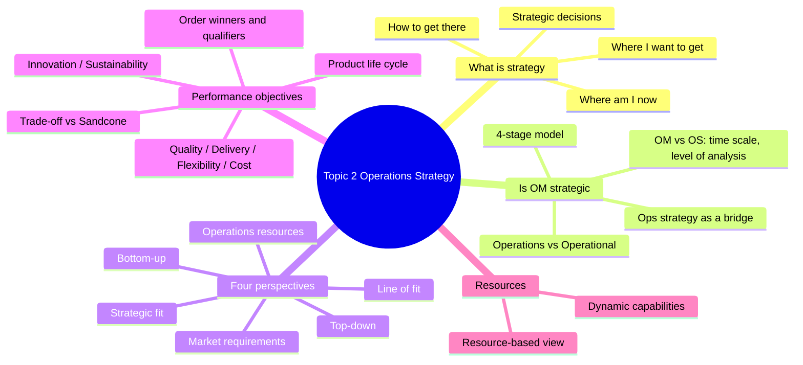
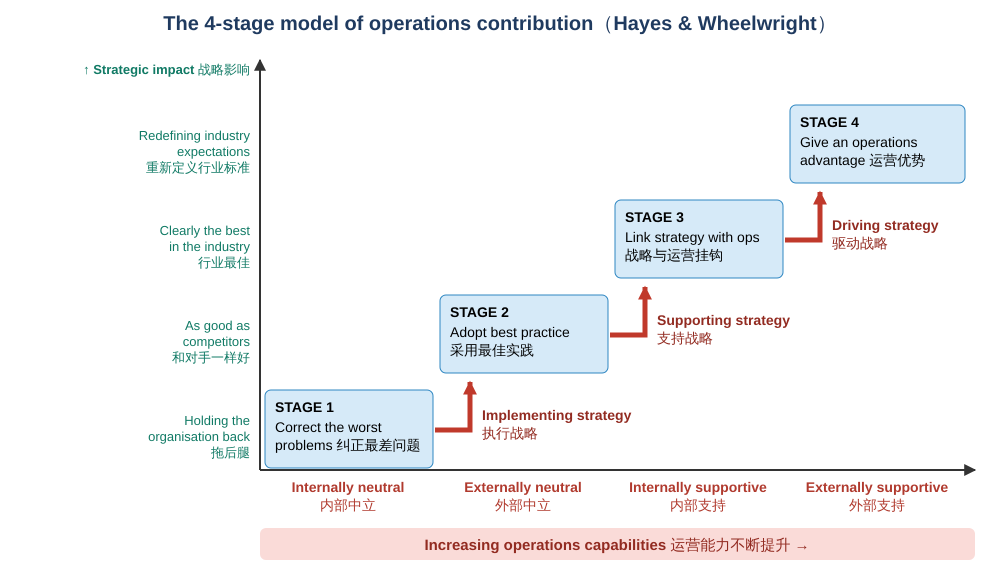
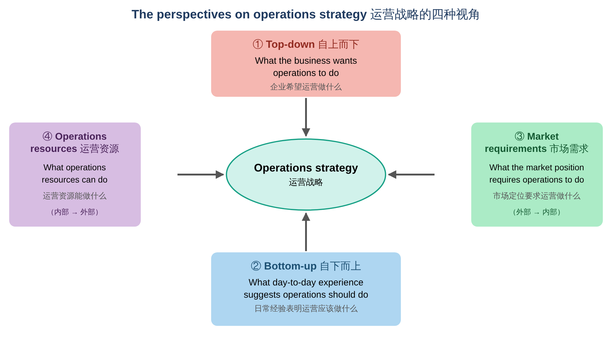
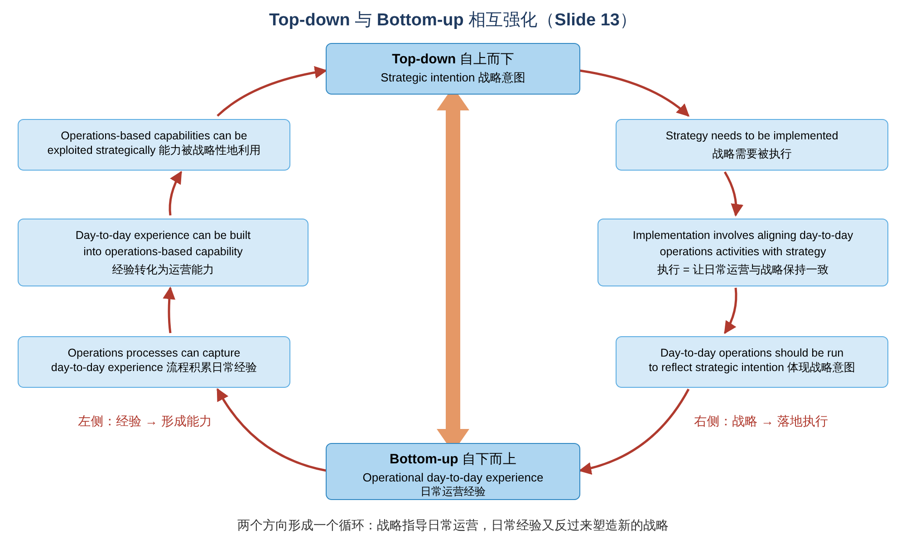
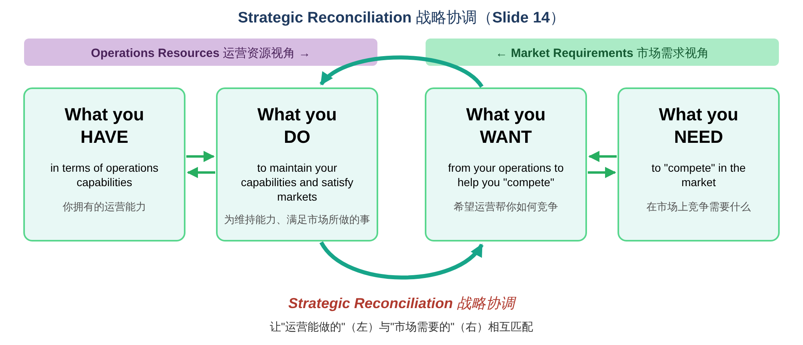
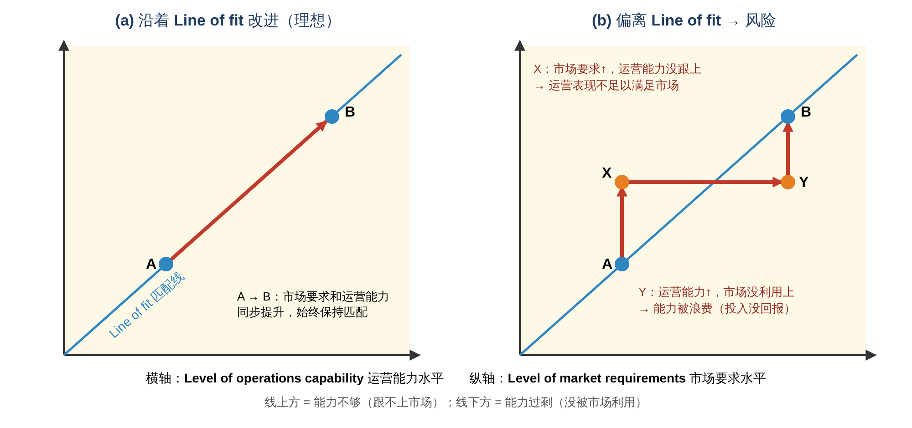
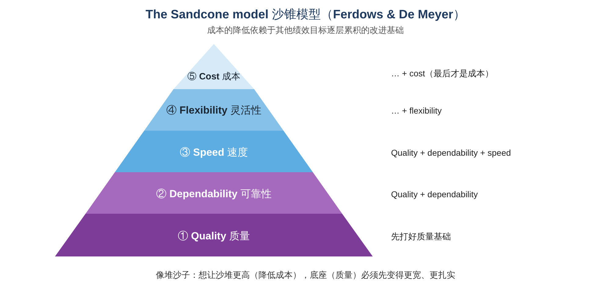
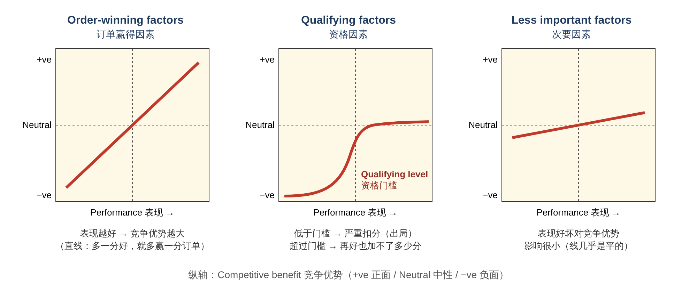

# Operations Management · Topic 2 运营战略（Operations Strategy）学习笔记

> 教材：Slack, Brandon-Jones & Burgess, *Operations Management*, 10th Edition — Part One "Directing the operation", **Chapter 3 Operations strategy**
> 内容范围：讲义 Topic 2（共 36 页）
>
> 📌 阅读说明
> - **英文术语保留原文**（考试用英文作答），中文帮助理解。
> - **💡 补充** = 讲义没讲但能帮助理解的内容；**⚠️ 易错** = 容易混淆的地方。
> - 文末有 **易混淆汇总、术语表、自测题（含答案）、课堂活动参考思路**。

---

## 0. 一张图看懂本章

### 本章的四个学习目标（Learning Outcomes）

| # | Learning Outcome | 中文 |
|---|---|---|
| 1 | What strategy is? | 什么是战略？ |
| 2 | Is Operations Management strategic? | 运营管理具有战略意义吗？ |
| 3 | Operations strategies: different perspectives | 运营战略的不同视角 |
| 4 | Operations objectives and perspectives | 运营目标（绩效目标）与相关视角 |



**一句话总结本章：** 运营战略（operations strategy）是连接 **企业战略** 和 **顾客需求** 的"桥梁"。制定运营战略有 **四种视角**（自上而下、自下而上、市场需求、运营资源），最终要落实到 **绩效目标（quality、speed、dependability、flexibility、cost……）**，并且让 **市场要求** 与 **运营能力** 保持 **匹配（fit）**。

> 💡 **和 Topic 1 的联系：** Topic 1 讲运营 **"是什么"**（输入–转换–输出、4Vs）；Topic 2 讲运营 **"往哪个方向走、为什么这样走"**，也就是 4Ds 中的 **Direct（指挥）**。Topic 1 里提到的 "cheaper, better, yesterday" 在本章变成了正式的 **performance objectives（绩效目标）**。

---

## 1. What is Strategy? 什么是战略？

### 1.1 战略包括什么？（Slide 4）

**① Strategy includes（战略包括）：**
- **The position of the organization relative to its environment** 组织相对于环境的位置 → **Where am I now?（我现在在哪？）**
- **Long-term objectives** 长期目标 → **Where I want to get?（我想去哪？）**

**② Strategy supports the organization to reach its objectives（战略帮助组织实现目标）：**
- **How to get there?（怎么到达？）**
  - **Provide a detailed plan** 提供详细计划
  - **Use appropriate resources and build capabilities** 使用合适的资源、建立能力

📝 **记忆：战略 = 三个问题**
**Where am I now? → Where do I want to get? → How to get there?**

> 💡 **补充：讲义里 Komatsu（小松）和 Caterpillar（卡特彼勒）的例子**
> 这是战略管理中的经典案例（Hamel & Prahalad 提出的 **"strategic intent 战略意图"**）。1960 年代的小松远比卡特彼勒弱小，但它定下了一个长期目标 **"Maru-C"（包围卡特彼勒）**，然后几十年如一日地提升质量、降低成本、开拓海外市场，最终成为全球第二大工程机械企业。
> - **Where am I now?** 一家小型日本本土企业
> - **Where I want to get?** 赶上并"包围"行业老大卡特彼勒
> - **How to get there?** 分阶段的详细计划 + 持续建设运营能力（质量、成本、产品开发）

### 1.2 ⭐ Strategic decisions 战略决策（Slide 5，必背）

> **Strategic decisions** are those decisions which: are **widespread in their effect** on the organization to which the strategy refers, **define the position** of the organization relative to its environment, and **move the organization closer to its long-term goals**.

战略决策的三个特征：
1. **影响范围广**（widespread in their effect）：影响整个组织，而不只是一个部门；
2. **确定组织相对于环境的位置**（define the position）；
3. **推动组织接近长期目标**（move closer to long-term goals）。

🌰 **例子：** "要不要在越南建一座新工厂"是战略决策（影响大、长期、决定市场地位）；"明天这条生产线排几个班"是运营层面（operational）的决策。

---

## 2. Is Operations Management Strategic? 运营管理是战略性的吗？

### 2.1 ⭐ Operations strategy as a "bridge"（Slide 6，必背定义）

```
The business of the organization  ═══ Operations strategy ═══▶  The needs of the organization's customers
      组织的业务                    "How to get there?"            组织顾客的需求
                                     运营战略 = 桥梁
```

> **"Operations strategy is the pattern of *decisions* and *actions* that shape the long-term vision, objectives and capabilities of the operation and its contribution to the overall strategy of the business."**（Brown et al., 2001）

**运营战略是一系列决策和行动的模式，它塑造了运营的长期愿景、目标和能力，以及运营对企业整体战略的贡献。**

拆解关键词：
- **Pattern of decisions and actions（决策和行动的模式）**：不是一次性的决定，而是 **持续一致的** 一系列选择；
- **Long-term vision, objectives and capabilities（长期愿景、目标和能力）**：关注长期；
- **Contribution to the overall strategy（对整体战略的贡献）**：运营要服务于企业战略。

### 2.2 ⚠️ "Operations" ≠ "Operational"（Slide 7，易混淆）

| | **Operations** | **Operational** |
|---|---|---|
| 含义 | **创造产品和服务的资源**（the resources that create products and services） | **与 strategic（战略的）相反**，指 **日常的、细节的**（day-to-day and detailed） |
| 词性 | 名词（一个职能/一组资源） | 形容词（一个"层次"） |

→ **所以，运营（operations）既有"日常运营层面（operational）"，也有"战略层面（strategic）"。我们可以同时研究两者。**

🌰 **例子：** 一家航空公司的运营（operations）：
- **Operational 层面**：今天这架飞机的地勤怎么排班
- **Strategic 层面**：未来 10 年是否只用一种机型（如 Southwest 只用 Boeing 737）

### 2.3 ⭐ Operations strategy vs Operations management 的区别（Slide 8–9）

| 维度 | **Operations management 运营管理** | **Operations strategy 运营战略** |
|---|---|---|
| **The time scale is longer**（时间跨度） | **Short-term**：例如 **1–12 个月** 的产能决策（应对短期需求波动） | **Long-term**：例如 **1–10 年** 的产能决策（应对长期需求趋势） |
| **The level of analysis is higher**（分析层次） | **Micro**：**单个流程（process）** 层面 | **Macro**：**整个运营（total operation）** 层面 |

🌰 **产能决策的例子：**
- **运营管理**：圣诞节前需求激增 → 临时加班、请临时工（1–12 个月）
- **运营战略**：预计未来 5 年市场翻倍 → 新建工厂（1–10 年）

> 💡 **补充：** 教材中还提到另外两个区别：**level of aggregation（汇总程度）更高**（把很多产品、流程合在一起看）和 **level of abstraction（抽象程度）更高**（更多是方向性判断，而不是具体操作细节）。讲义只列了时间跨度和分析层次，这两点了解即可。

### 2.4 ⭐ The 4-stage model of operations contribution（Slide 10，Hayes & Wheelwright）

这个模型回答"运营对企业战略的贡献有多大"：**运营能力越强，对战略的贡献越大**。



| 阶段 | 名称 | 运营的状态 | 战略影响（纵轴） | 角色 |
|---|---|---|---|---|
| **Stage 1** | **Internally neutral** 内部中立 | **Correct the worst problems**：只求不出大错 | **Holding the organisation back**：拖企业后腿 | — |
| **Stage 2** | **Externally neutral** 外部中立 | **Adopt best practice**：向同行学习最佳实践 | **As good as competitors**：和对手一样好 | **Implementing strategy** 执行战略 |
| **Stage 3** | **Internally supportive** 内部支持 | **Link strategy with operations**：运营与企业战略挂钩 | **Clearly the best in the industry**：行业最佳 | **Supporting strategy** 支持战略 |
| **Stage 4** | **Externally supportive** 外部支持 | **Give an operations advantage**：运营本身成为竞争优势 | **Redefining industry expectations**：重新定义行业标准 | **Driving strategy** 驱动战略 |

📝 **记忆口诀：** **内中 → 外中 → 内支 → 外支**；运营的角色：**执行 → 支持 → 驱动** 战略。

> 💡 **补充：各阶段举例**
> - **Stage 1**：经常交货延误、质量问题频发的工厂，管理层只希望运营"别再出事"
> - **Stage 2**：一家普通的连锁超市，学习行业通用做法，表现和同行差不多
> - **Stage 3**：运营被明确设计来支持企业战略，比如低价超市把运营重心放在降低成本
> - **Stage 4**：**Toyota（丰田生产方式）、Zara（快时尚供应链）、Amazon（物流履约）**，它们的运营能力本身就是核心竞争力，甚至改变了整个行业的玩法
>
> ⚠️ **"Internally / Externally" 的意思：** Internally = 和 **企业内部** 比较（是否支持本企业的战略）；Externally = 和 **外部竞争对手 / 行业** 比较。

---

## 3. ⭐ Operations Strategy: Different Perspectives 运营战略的四种视角

### 3.1 四种视角总览（Slide 11）



| 视角 | 问的问题 | 方向 |
|---|---|---|
| **① Top-down perspective** 自上而下 | **What the business wants operations to do**（企业希望运营做什么） | 企业战略 → 运营 |
| **② Bottom-up perspective** 自下而上 | **What day-to-day experience suggests operations should do**（日常经验表明运营应该做什么） | 日常运营 → 战略 |
| **③ Market requirements perspective** 市场需求 | **What the market position requires operations to do**（市场定位要求运营做什么） | 外部（市场）→ 内部 |
| **④ Operations resources perspective** 运营资源 | **What operations resources can do**（运营资源能做什么） | 内部（资源）→ 外部 |

> 💡 **补充：四种视角可以分成两对**
> - **Top-down vs Bottom-up**：讨论战略 **从哪个层级产生**（高层制定 vs 基层经验积累）
> - **Market requirements vs Operations resources**：讨论战略 **从哪里出发**（外部市场 vs 内部能力）
>
> **好的运营战略要同时考虑这四种视角**，而不是只用其中一种。

### 3.2 ① Top-down perspective：三层战略（Slide 12）

自上而下，战略分三个层级。讲义用一家 **印刷服务集团（printing services group）** 来举例：

| 层级 | 要做的决策 | 印刷服务集团的例子 |
|---|---|---|
| **Corporate strategy decisions 公司战略** | • **What businesses to be in?** 进入哪些业务？<br/>• **Allocation of cash to businesses?** 资金怎么分配给各业务？<br/>• **How to manage the relationships between different businesses?** 如何管理各业务之间的关系？ | • **Specialize in packaging businesses** 专注包装业务<br/>• **Become a major player in all its markets** 成为各市场的主要玩家 |
| ⬇ | | ⬇ |
| **Business strategy decisions 业务战略** | • **Defining the mission of the business**，如 growth targets（增长目标）、return on investment（投资回报）、profitability targets（盈利目标）、cash generation（现金创造）<br/>• **Setting competitive objectives** 设定竞争目标 | **Consumer packaging business strategy（消费品包装业务）**：<br/>• **Rapid volume growth** 快速增长产量<br/>• **Fast service** 快速服务<br/>• **Economies of scale** 规模经济 |
| ⬇ | | ⬇ |
| **Functional strategy decisions 职能战略** | • **The role of the function** 职能的角色<br/>• **Translating business objectives into functional objectives** 把业务目标转化为职能目标<br/>• **Allocation of resources** to achieve functional objectives 分配资源<br/>• **Performance improvement priorities** 绩效改进的优先顺序 | **Operations strategy（运营战略）**：<br/>• **Capacity expansion** 扩大产能<br/>• **Tolerate some over-capacity in the short term** 短期内容忍一定的产能过剩<br/>• **New locations established** 建立新厂址 |

📝 **读表要点：** 上一层的决策 **决定** 下一层的方向。因为业务战略要求"快速增长 + 快速服务"，运营战略就选择"扩产能、开新厂，即使短期产能有点过剩也可以接受"（宁可产能多一点，也不能因为产能不够而错失增长）。

### 3.3 ② Top-down 与 Bottom-up 相互强化（Slide 13）



**读图要点：这是一个循环。**
- **右边（自上而下）**：战略意图 → 执行 → 日常运营与战略对齐；
- **左边（自下而上）**：日常经验 → 被流程记录下来 → 变成运营能力 → 被用于制定新战略。

> 💡 **补充例子：** 丰田生产方式（TPS）最初就是从 **车间的日常改进经验（bottom-up）** 中逐步形成的，后来被提升为公司层面的战略能力（top-down），再推广到全球工厂。

### 3.4 ③ + ④ Strategic Reconciliation 战略协调（Slide 14）

运营战略的核心任务，是 **协调（reconcile）** "运营资源能做什么" 和 "市场需要什么"：



- 左边两块来自 **Operations Resources（运营资源）** 视角：**HAVE（拥有什么）+ DO（做什么）**
- 右边两块来自 **Market Requirements（市场需求）** 视角：**WANT（想要什么）+ NEED（需要什么）**
- 中间的 **Strategic Reconciliation（战略协调）**：让两边 **相互匹配**

### 3.5 ⭐ Line of fit：匹配线（Slide 15）

> **Improvement should achieve "fit" between market requirements and operations performance, but deviation from the "line of fit" can expose the operation to risk.**



| 点 | 状态 | 含义 | 风险 |
|---|---|---|---|
| **A → B（沿线）** | **Fit 匹配** | 市场要求提高的同时，运营能力也同步提高 | 最理想 |
| **X（线上方）** | **Off the line of fit — operations performance inadequate for market requirements** | 市场要求提高了，但 **运营能力没跟上** | 顾客不满意、失去订单 |
| **Y（线下方）** | **Off the line of fit — operations performance not exploited in the market** | 运营能力提高了，但 **市场没有用上**（能力过剩） | 投资浪费、成本过高 |

📝 **记忆：线上方 = "能力不够"；线下方 = "能力过剩"。**

> 💡 **补充例子：**
> - **X 的风险**：一家网店承诺"次日达"（市场要求↑），但仓库和物流能力没升级 → 大量延误、差评。
> - **Y 的风险**：一家工厂花大钱买了能做 100 种颜色的设备（能力↑），但顾客只买黑白两色 → 设备闲置，成本白白增加。

### 3.6 Fit: Competitive and functional strategy 竞争战略与职能战略的匹配（Slide 16–17）

| 战略 | 定义 | 例子 |
|---|---|---|
| **Competitive strategy 竞争战略** | 定义企业想通过产品和服务满足 **哪些顾客需求** | **Walmart**：以低价提供 **种类丰富、供货充足、质量合理** 的商品 |
| **Functional strategies 职能战略** | | |
| — **OM strategy** 运营战略 | 决定 **采购、物料运输、产品制造或服务创造、产品分销** 的方式 | |
| — **Product development strategy** 产品开发战略 | 决定企业要开发的 **新产品组合** | |
| — **Marketing and sales strategy** 营销与销售战略 | 决定 **市场如何细分、产品如何定位、定价和促销** | |

> **"All functional strategies must support one another and the competitive strategy."**
> **所有职能战略必须相互支持，并且共同支持竞争战略。**

#### ⭐ Strategic fit 战略匹配（Slide 17）
Strategic fit 意味着：
1. **The competitive strategy and OM strategy have aligned goals** 竞争战略和运营战略有 **一致的目标**（例如：都追求 **availability of products 商品的可得性**）；
2. **Processes / resources / capabilities are suitable to achieve those goals** 流程、资源和能力 **适合实现这些目标**。

> 💡 **补充：Walmart 的运营怎么支持它的竞争战略？**
> - 竞争战略：**Everyday Low Prices（天天低价）** + 商品充足
> - 运营战略：**cross-docking（越库配送，货到配送中心后直接转运，几乎不存储）**、高效的配送中心网络、强大的信息系统与供应商共享销售数据、大批量采购压低进价
> - → 运营目标（低成本、高可得性）和竞争战略（低价、商品充足）**高度一致 = strategic fit**

### 3.7 案例讨论：Southwest Airlines（Slide 18）

讲义问题：
1. **What are the main strategic objectives of Southwest Airlines?**
2. **How does OM contribute to achieve those objectives?**

> 💡 **参考思路：**
>
> **① 战略目标：** 成为 **低成本、低票价（low-cost carrier）** 的航空公司，同时保持 **准点、友好的服务**，吸引对价格敏感的短途旅客。
>
> **② 运营如何支持（传统的经典模式）：**
>
> | 运营决策 | 如何支持低成本战略 |
> |---|---|
> | **只用一种机型（Boeing 737）** | 飞行员、机组、维修只需掌握一种机型 → 培训、维修、备件成本低，人员调度灵活 |
> | **点对点航线（point-to-point）**，不用"枢纽–辐射"模式 | 航线简单，减少转机等待和延误连锁反应 |
> | **使用二线/次要机场** | 起降费低、拥堵少 → 准点率高 |
> | **快速过站（quick turnaround）** | 飞机落地后很快再次起飞 → 飞机利用率高（飞机只有在天上才赚钱） |
> | **不对号入座（open seating）、不提供餐食** | 登机快、流程简单、成本低 |
> | **重视员工文化** | 员工效率高、服务友好 → 弥补"便宜"带来的体验短板 |
>
> **结论：** 竞争战略（低价）和运营战略（低成本、高效率）**高度一致**，是 **strategic fit** 的经典案例。
>
> ⚠️ 注：近年 Southwest 调整了部分做法（例如改为对号入座、对托运行李收费），但课堂讨论一般以上面的经典模式为准。

---

## 4. ⭐ Operations Objectives 运营绩效目标

### 4.1 竞争因素 → 绩效目标（Slide 19，必背）

**顾客看重什么（competitive factors），运营就要擅长什么（performance objectives）：**

| **Competitive factors**<br/>如果顾客看重…… | → | **Performance objectives**<br/>那么运营需要擅长…… |
|---|---|---|
| **Low price** 低价 | → | **Cost** 成本 |
| **High quality** 高质量 | → | **Quality** 质量 |
| **Fast delivery** 快速交付 | → | **Speed** 速度 |
| **Reliable delivery** 可靠交付 | → | **Dependability** 可靠性 |
| **Innovative products and services** 创新的产品和服务 | → | **Flexibility (products/services)** 产品/服务灵活性 |
| **Wide range of products and services** 丰富的产品和服务种类 | → | **Flexibility (mix)** 组合灵活性 |
| **The ability to change the timing or quantity** of products and services 能改变交付时间或数量 | → | **Flexibility (volume and/or delivery)** 产量/交付灵活性 |

📝 **Slack 的五大绩效目标：Quality、Speed、Dependability、Flexibility、Cost**
记忆口诀：**"Q-S-D-F-C"**，也就是 **"质、速、靠、灵、本"**。

⚠️ **易错：Speed vs Dependability**
- **Speed（速度）= 多快**：从下单到收货的时间有多短
- **Dependability（可靠性）= 多准**：说好什么时候到，就什么时候到（准时）
- 🌰 快递承诺"3 天到"，第 3 天准时送到 → dependability 好；承诺"当天到" → speed 快。

### 4.2 Operations capabilities / Competitive priorities（Slide 20）

讲义把运营能力（也叫 **competitive priorities 竞争优先级**）列为 6 项：
**Quality、Delivery（speed & dependability）、Flexibility、Cost、Innovation\*、Sustainability\***

（\* 表示较新加入的两项）

⚠️ 注意：这里把 **Speed 和 Dependability 合并成了 Delivery**，又新增了 **Innovation** 和 **Sustainability**。

### 4.3 六大运营能力详解（Slide 21–26）

| 能力 | 定义 | **Goods（产品）的衡量指标** | **Services（服务）的衡量指标** | 例子 |
|---|---|---|---|---|
| **Quality 质量** | The ability to produce **unquestionable quality**；provide **error-free** goods that **comply with specifications**（零缺陷、符合规格） | Made to specification 符合规格；Reliable 可靠；Consistent 一致；Easy to assemble and service 易组装、易维修 | Clean and tidy 干净整洁；Courteous personnel, friendly and helpful 员工礼貌、友好、乐于助人 | **Toyota**（产品）、**Radisson 酒店**（服务） |
| **Delivery 交付（speed & dependability）** | **Time-based** capability to deliver products **at the promised time**；对某些顾客来说，光"准时"不够，**交付速度** 也是赢得订单的关键 | On-time delivery of products / parts 产品、零件准时交付；Dependability 可靠；Fast lead-time 交货期短 | Predictable opening hours 营业时间可预期；Reasonable queuing times 排队时间合理；Stock available 有货；Parking spaces available 有停车位 | **Dell**（产品）、**Walmart**（服务） |
| **Flexibility 灵活性** | The ability to **adapt and respond to demand change**；也包括应对 **流程中断**（如机器故障、原材料晚到）的能力 | Fast production reaction 快速生产响应；Multi-purpose machines 多用途机器；Multi-skilled personnel 多技能员工；Fast spare parts changeovers 快速换件；Flexible suppliers 灵活的供应商 | Wide range of options 选择多；Multi-skilled personnel 多技能员工 | **Zara**（产品）、**Singapore Airlines**（服务） |
| **Cost 成本** | The ability to **save resources** by pursuing a given strategy；⚠️ 虽然成本常是首选的竞争优先级，但 **只看成本可能损害其他方面的绩效** | Staff costs 人工成本；Raw material costs 原材料成本；Technology and facilities costs 技术与设施成本 | 同左 | **Tata Nano**（产品）、**McDonald's**（服务） |
| **Innovation 创新** | The ability to **develop new products, technologies and processes** in anticipation of or in response to customer requirements | New products 新产品；New processes 新流程；New facilities 新设施；New organization structures 新组织结构 | Innovative ways to deliver the service 创新的服务方式；New corporate image 新企业形象；New processes 新流程 | **Intel**（产品）、**Amazon**（服务） |
| **Sustainability 可持续性** | The ability to develop products that **do not affect the natural and social environment** while still **economically feasible** | Products that use **renewable energy** 使用可再生能源的产品；Products that encourage **social responsibility** practices 鼓励社会责任的产品 | Services that encourage **low CO2 emissions** 低碳服务；Services that improve **social wellbeing** 提升社会福祉的服务 | **Minesto**（水下风筝式潮汐发电，产品）、**共享单车**（服务） |

> 💡 **补充：讲义中例子的背景**
> - **Toyota**：以质量和可靠性著称，源自 TPS 和"零缺陷"理念。
> - **Dell**：经典的 **build-to-order（按订单组装）+ 直销** 模式，交货快且准。
> - **Zara**：快时尚的代表，从设计到上架只需 **几周**，小批量生产，畅销款快速追加、滞销款快速停产 → 灵活性极强。
> - **Singapore Airlines**：多种舱位与服务选项，乘务员（"Singapore Girl"）训练有素、能提供多样化服务。
> - **Tata Nano**：印度塔塔推出的"世界最便宜汽车"（约 10 万卢比）。它把成本压到极致，却因为安全和品质形象问题销量不佳，最终停产。**这正好说明讲义那句话：只盯着成本，可能损害其他方面的绩效。**
> - **McDonald's**：标准化、规模化，带来低成本。

### 4.4 ⭐ The trade-off model vs The Sandcone model（Slide 27–28）

#### The trade-off model 权衡模型（Slide 27）
- 认为 **必须在竞争优先级之间做取舍**（need to prioritise between competitive priorities）；
- **企业不可能在所有竞争优先级上都做到最好**（cannot compete by offering superior performance through all competitive priorities）；
- 管理者应 **先选定工厂的竞争优先级，再设计和运营能实现这些目标的制造系统**。

讲义用一个 **跷跷板（seesaw）** 来表示：一边是 **Cost、Delivery**，另一边是 **Flexibility、Quality、Innovation、Sustainability**，一边高了，另一边就会低。

🌰 **例子：** 想要 **极低成本**（标准化、大批量），就很难同时做到 **极高灵活性**（小批量、多品种），这和 Topic 1 的 **volume–variety trade-off** 是同一个道理。

> 💡 **补充：** 权衡模型最早由 **Wickham Skinner（1969、1974）** 提出，并由此引出 **"focused factory（专注工厂）"** 的概念：一个工厂只专注于少数几个目标，才能做到最好。

#### ⭐ The Sandcone model 沙锥模型（Slide 28）

> **Cost reduction relies on a cumulative foundation of improvement in the other performance objectives.**
> **降低成本，依赖于其他绩效目标逐层累积的改进基础。**



**改进顺序（从底到顶）：**
1. **Quality**
2. **Quality + dependability**
3. **Quality + dependability + speed**
4. **Quality + dependability + speed + flexibility**
5. **Quality + dependability + speed + flexibility + cost**

📝 **为什么是这个顺序？**
- **质量是基础**：质量好 → 返工、报废少 → 流程更稳定
- 流程稳定 → 能 **准时（dependability）**
- 准时可靠 → 才能进一步 **加快（speed）**
- 又快又稳 → 才有余力 **应对变化（flexibility）**
- 以上都做好了 → 浪费自然减少，**成本随之下降（cost）**

**像堆沙子：要让沙堆更高（降低成本），底座（质量）必须先变得更宽、更扎实。**

| | **Trade-off model 权衡模型** | **Sandcone model 沙锥模型** |
|---|---|---|
| 核心观点 | 绩效目标之间 **相互冲突**，必须取舍 | 绩效目标可以 **逐层累积**，相互促进 |
| 关系 | 此消彼长 | 打好基础后可以兼得 |
| 改进方式 | 选定少数目标，集中资源 | 按顺序改进：质量 → 可靠 → 速度 → 灵活 → 成本 |

> 💡 **补充：** 沙锥模型由 **Ferdows & De Meyer（1990）** 提出，也叫 **"cumulative capabilities（累积能力）"** 模型。两种模型并不完全对立：**短期** 内资源有限，常常需要权衡；**长期** 通过持续改进（如精益生产），可以逐步把多个目标都做好。丰田就是典型例子：质量、速度和成本兼得。

#### 课堂活动：Sustainability 和 Innovation 应该放在沙锥的哪里？（Slide 28）

> 💡 **参考思路（没有标准答案，关键是讲出理由）：**
> - **观点 1：Sustainability 放在最底层（和 Quality 一起作为地基）**
>   理由：可持续性是 **"经营许可证"**：环保法规越来越严，顾客和投资者也越来越看重 ESG。如果不可持续，其他一切都无从谈起。而且减少浪费、节能本身也能 **降低成本**，与沙锥"最后降成本"的逻辑一致。
> - **观点 2：Innovation 放在 Flexibility 附近或最顶层**
>   理由：创新需要 **稳定的质量和流程作为基础**，也需要 **灵活性** 来快速试制新产品。也可以认为创新 **贯穿每一层**（流程创新能同时提升质量、速度和成本）。
> - **答题技巧：** 先说放在哪一层，再说 **"因为它依赖于下面的哪些能力"** 以及 **"它又为上面哪些能力提供了基础"**。

### 4.5 ⭐ Order-winning, Qualifying and Less important factors（Slide 29–32）

不同的竞争因素，对 **赢得订单** 的作用不一样：



| 类型 | 定义 | 图形 | 管理含义 |
|---|---|---|---|
| **Order-winning factors 订单赢得因素** | **直接且显著地帮助赢得订单** 的因素 | **斜直线**：表现越好，竞争优势越大 | 要 **做到比对手更好**，持续提升 |
| **Qualifying factors 资格因素** | 必须 **达到某个门槛（qualifying level）**，顾客才会考虑你 | **S 形曲线**：低于门槛 → 竞争优势严重为负（直接出局）；高于门槛 → 再提升也几乎没有额外好处 | **达到门槛即可**，不必过度投入 |
| **Less important factors 次要因素** | 对顾客购买决策 **影响很小** 的因素 | **接近水平的线** | 不必花太多资源 |

> 💡 **补充：用买手机来理解**
> - **Qualifying（资格因素）**：能正常打电话、上网、电池能撑一天 → 达不到直接不考虑；达到了就"理所当然"，再好也不会因此多买
> - **Order-winner（订单赢得因素）**：拍照效果、价格、品牌 → 越好越能打动顾客
> - **Less important（次要因素）**：包装盒的设计 → 好不好都不太影响购买
>
> 💡 **补充：航空公司的例子**
> - **安全** = 资格因素（必须达标，否则没人坐）
> - **低价航空** 的订单赢得因素 = **价格**；**全服务航空**（如 SIA）的订单赢得因素 = **服务质量、舒适度**
>
> ⚠️ **易错：订单赢得因素和资格因素会随时间变化！** 今天的订单赢得因素，明天可能变成资格因素。例如早年"手机能拍照"是卖点（order-winner），现在是基本要求（qualifier）。这就引出了下面的产品生命周期。
>
> 💡 Order winners / qualifiers 的概念由 **Terry Hill** 提出。

### 4.6 ⭐ 产品/服务生命周期对绩效目标的影响（Slide 33）

| | **Introduction 导入期**<br/>Introduction into market | **Growth 成长期**<br/>Growth in market acceptance | **Maturity 成熟期**<br/>Maturity of market, sales level off | **Decline 衰退期**<br/>Decline as market becomes saturated |
|---|---|---|---|---|
| **Sales volume 销量** | 很低 | 快速上升 | 达到顶峰后趋平 | 下降 |
| **Customers 顾客** | **Innovators** 创新者 | **Early adopters** 早期采用者 | **Bulk of market** 大众市场 | **Laggards** 落后者 |
| **Competitors 竞争者** | **Few / none** 很少或没有 | **Increasing numbers** 增加 | **Stable numbers** 稳定 | **Declining number** 减少 |
| **Likely order winners 订单赢得因素** | **Product/service specification** 产品/服务的规格（功能新颖） | **Availability** 可得性（买得到） | **Low price**、**Dependable supply** 低价、可靠供应 | **Low price** 低价 |
| **Likely qualifiers 资格因素** | **Quality**、**Range** 质量、种类 | **Price**、**Range** 价格、种类 | **Range**、**Quality** 种类、质量 | **Dependable supply** 可靠供应 |
| **Dominant operations performance objectives 主导的运营绩效目标** | **Flexibility**、**Quality** | **Speed**、**Dependability**、**Quality** | **Cost**、**Dependability** | **Cost** |

📝 **规律总结：** 产品越成熟，竞争越集中在 **价格** 上 → 运营的重点从 **灵活性和质量**（导入期）逐步转向 **成本**（成熟期、衰退期）。

> 💡 **补充：用电动车举例**
> - **导入期（约 2010 年前后）**：顾客是科技爱好者，看重新功能 → 运营重点：**灵活性**（快速改设计）、**质量**
> - **成长期**：需求暴涨，能不能 **交得出车（availability）** 最重要 → 运营重点：**速度**（快速扩产）、**可靠性**
> - **成熟期**：竞争者众多，价格战 → 运营重点：**成本**
>
> ⚠️ **易错：** 同一个因素在不同阶段可以扮演不同角色。例如 **price（价格）** 在成长期是 **资格因素**，到了成熟期就变成 **订单赢得因素**。

---

## 5. Resources Perspective：资源基础观与动态能力观

### 5.1 ⭐ The Resource-Based View（RBV）资源基础观（Slide 34）

> **An operations-led perspective should start with an understanding of the resources and constraints.**
> **以运营为主导的视角，应该从理解（自身的）资源和约束开始。**

| 资源类型 | 例子 |
|---|---|
| **Tangible resources 有形资源** | **Machinery（机器）、technology（技术）、premises（场地/厂房）** |
| **Intangible resources 无形资源** | **Relationship with suppliers（与供应商的关系）**；**Knowledge in handling a process（处理流程的知识）**；**Ways staff work to develop a new product（员工开发新产品的工作方式）** |

⭐ **These intangibles are the real source of competitive advantage.**
**无形资源才是竞争优势的真正来源。**

> 💡 **补充：为什么无形资源更重要？**
> 有形资源（机器、厂房）**花钱就能买到**，竞争对手也能买；而无形资源（经验、关系、文化、工作方式）是 **长期积累** 起来的，**很难被模仿**。
>
> 💡 **补充：VRIN 框架（Barney, 1991）**：能带来持续竞争优势的资源要满足四个条件：
> - **V**aluable（有价值）
> - **R**are（稀缺）
> - **I**nimitable（难以模仿）
> - **N**on-substitutable（不可替代）
>
> 🌰 例：丰田的生产体系很多企业都参观学习过，但很难完全复制，因为它依赖于 **几十年积累的员工习惯、组织文化和供应商关系**（无形资源）。

### 5.2 ⭐ Dynamic Capability View 动态能力观（Slide 35）

- **RBV 有一个"向内看"的视角（inner perspective）**，可以扩展到 **外部的竞争优势来源**，例如 **ERBV（Extended RBV，扩展的资源基础观）**（Eisenhardt, 2000）；
- 但是 **今天多变的市场条件需要更简单、而不是更复杂的能力**（simpler, rather than complex, capabilities）；
- **简单的能力更容易改变或重新配置**（easy to change or reconfigure），例如 **practices（做法/惯例）**；
- **Short term（短期）**：**暂时的优势（temporal advantage）** 来自于 **快速反应、改变资源和能力** 的能力；
- **Long term（长期）**：**在简单能力之上逐步构建起来的能力**。

| | **RBV 资源基础观** | **Dynamic capability view 动态能力观** |
|---|---|---|
| 关注点 | 企业 **拥有什么** 资源 | 企业 **如何改变和重新配置** 资源 |
| 视角 | 偏静态、向内看 | 动态、也看外部环境 |
| 适用环境 | 相对稳定的市场 | **快速变化** 的市场 |
| 优势来源 | 有价值、稀缺、难以模仿的资源 | **快速适应、学习和重组** 的能力 |

> 💡 **补充：** 动态能力（dynamic capabilities）的概念主要来自 **Teece, Pisano & Shuen（1997）** 和 **Eisenhardt & Martin（2000）**。可以理解为 **"改变能力的能力"**。

### 5.3 课堂活动：举一个用动态能力获得竞争优势的例子（Slide 36）

> 💡 **参考例子（任选一个展开）：**
>
> **① Netflix**
> - DVD 邮寄租赁 → **在线流媒体** → **自制原创内容**（如《纸牌屋》）
> - 每当环境变化（宽带普及、版权方涨价），Netflix 都能 **重新配置资源**，把优势从"物流"转到"技术平台"，再转到"内容创作"
> - 对比：同时代的 Blockbuster 没能及时转型，最终破产
>
> **② Fujifilm vs Kodak**
> - 胶卷市场因数码相机崩溃时，富士把 **胶片化学和涂层技术** 重新用于 **化妆品、医疗影像、液晶屏光学薄膜** 等新领域 → 成功转型
> - 柯达拥有同样的技术（甚至发明了数码相机），但未能重新配置资源 → 2012 年申请破产保护
> - → **资源相似，但"改变资源的能力"不同，结局截然不同**
>
> **③ Zara**
> - 不是靠某台机器，而是靠一套 **能快速重新配置的做法**：设计师实时跟进门店销售数据、小批量快速生产、两周左右补货
> - 每一季都能根据潮流迅速调整产品组合 → 持续的 **短期优势** 累积成 **长期优势**
>
> 💡 **答题框架：** ① 介绍公司 → ② 环境发生了什么变化 → ③ 公司如何改变或重新配置资源和能力（具体做法）→ ④ 带来了什么竞争优势 →（可选）⑤ 与没能做到的竞争对手对比

---

## 6. ⚠️ 易混淆概念汇总

| 容易混淆 | 区别 |
|---|---|
| Strategy 的三个问题 | Where am I now? / Where I want to get? / How to get there? |
| Strategic vs Operational decisions | 战略决策：**影响广、确定位置、走向长期目标**；运营层面决策：**日常、细节** |
| Operations vs Operational | Operations = **创造产品和服务的资源**（名词）；Operational = **日常、细节的**（与 strategic 相对） |
| OM vs Operations strategy | OM：**短期（1–12 个月）、微观（流程）**；OS：**长期（1–10 年）、宏观（整个运营）** |
| 4-stage model 的顺序 | Internally neutral → Externally neutral → Internally supportive → Externally supportive；执行 → 支持 → 驱动战略 |
| Internally vs Externally | Internally = 对照 **企业内部**；Externally = 对照 **外部竞争对手 / 行业** |
| Top-down vs Bottom-up | 企业 **想要** 运营做什么 vs 日常 **经验** 表明运营应该做什么 |
| Market requirements vs Operations resources | **外部**：市场需要什么 vs **内部**：资源能做什么 |
| Corporate / Business / Functional strategy | 进入哪些业务 / 业务如何竞争 / 职能如何支持 |
| Line of fit 上方 vs 下方 | **上方（X）**：运营能力不足；**下方（Y）**：运营能力没被市场利用 |
| Competitive strategy vs Functional strategy | 满足哪些顾客需求 vs 各职能（运营、产品开发、营销）如何支持 |
| Speed vs Dependability | **多快** vs **多准时** |
| 5 个 vs 6 个绩效目标 | Slack 五大：Q、S、D、F、C；讲义六大：Quality、Delivery、Flexibility、Cost、Innovation、Sustainability |
| Flexibility 的种类 | product/service（新产品）、mix（种类组合）、volume（产量）、delivery（交付时间） |
| Trade-off vs Sandcone | 取舍、此消彼长 vs 累积、逐层改进（质量 → 可靠 → 速度 → 灵活 → 成本） |
| Order winner vs Qualifier | 越好越能赢单（直线）vs 达到门槛即可（S 曲线） |
| 生命周期 | 导入期重 **灵活、质量** → 成长期重 **速度、可靠、质量** → 成熟期重 **成本、可靠** → 衰退期重 **成本** |
| Tangible vs Intangible resources | 机器、技术、厂房 vs 供应商关系、流程知识、员工工作方式（**真正的竞争优势来源**） |
| RBV vs Dynamic capabilities | **拥有什么**资源 vs **如何改变**资源 |

---

## 7. 📖 中英术语表（Glossary）

| English | 中文 |
|---|---|
| Strategy | 战略 |
| Strategic decisions | 战略决策 |
| Long-term objectives | 长期目标 |
| Capabilities | 能力 |
| Operations strategy | 运营战略 |
| Pattern of decisions and actions | 决策和行动的模式 |
| Operational | 日常运营层面的 |
| Time scale | 时间跨度 |
| Level of analysis | 分析层次 |
| Micro / Macro | 微观 / 宏观 |
| Capacity decisions | 产能决策 |
| 4-stage model of operations contribution | 运营贡献四阶段模型 |
| Internally / Externally neutral | 内部 / 外部中立 |
| Internally / Externally supportive | 内部 / 外部支持 |
| Best practice | 最佳实践 |
| Operations advantage | 运营优势 |
| Top-down perspective | 自上而下视角 |
| Bottom-up perspective | 自下而上视角 |
| Market requirements perspective | 市场需求视角 |
| Operations resources perspective | 运营资源视角 |
| Corporate / Business / Functional strategy | 公司 / 业务 / 职能战略 |
| Economies of scale | 规模经济 |
| Over-capacity | 产能过剩 |
| Strategic intention | 战略意图 |
| Strategic reconciliation | 战略协调 |
| Line of fit | 匹配线 |
| Competitive strategy | 竞争战略 |
| Functional strategies | 职能战略 |
| Strategic fit | 战略匹配 |
| Competitive factors | 竞争因素 |
| Performance objectives | 绩效目标 |
| Competitive priorities | 竞争优先级 |
| Quality | 质量 |
| Speed | 速度 |
| Dependability | 可靠性 |
| Delivery | 交付 |
| Flexibility (product/service, mix, volume, delivery) | 灵活性（产品/服务、组合、产量、交付） |
| Cost | 成本 |
| Innovation | 创新 |
| Sustainability | 可持续性 |
| Specifications | 规格 |
| Lead-time | 交货期 |
| Multi-skilled personnel | 多技能员工 |
| Changeover | 换型/换件 |
| Trade-off model | 权衡模型 |
| Sandcone model | 沙锥模型 |
| Cumulative | 累积的 |
| Order-winning factors | 订单赢得因素 |
| Qualifying factors | 资格因素 |
| Less important factors | 次要因素 |
| Qualifying level | 资格门槛 |
| Competitive benefit | 竞争优势/竞争收益 |
| Product/service life cycle | 产品/服务生命周期 |
| Introduction / Growth / Maturity / Decline | 导入期 / 成长期 / 成熟期 / 衰退期 |
| Innovators / Early adopters / Bulk of market / Laggards | 创新者 / 早期采用者 / 大众市场 / 落后者 |
| Resource-based view (RBV) | 资源基础观 |
| Tangible / Intangible resources | 有形 / 无形资源 |
| Constraints | 约束 |
| Dynamic capability view | 动态能力观 |
| Reconfigure | 重新配置 |
| Temporal advantage | 暂时的优势 |
| 💡 Strategic intent | 战略意图 |
| 💡 Focused factory | 专注工厂 |
| 💡 Cumulative capabilities | 累积能力 |
| 💡 VRIN | 有价值、稀缺、难模仿、不可替代 |
| 💡 Cross-docking | 越库配送 |
| 💡 Low-cost carrier | 低成本航空公司 |

---

## 8. 💬 课堂活动与讨论题参考思路

**Q1. 运营管理是战略性的吗？（Is OM strategic?）**
> 是。① 运营战略是连接企业业务和顾客需求的"桥梁"；② 运营不只是日常（operational）工作，也有长期、宏观的战略层面；③ 根据 Hayes & Wheelwright 的四阶段模型，运营能力强的企业（Stage 4）可以 **驱动战略**，甚至重新定义行业标准，如 Toyota、Zara、Amazon。

**Q2. Southwest Airlines 的战略目标是什么？运营如何支持？**（见 3.7 节）

**Q3. Sustainability 和 Innovation 应放在沙锥模型的哪里？**（见 4.4 节）

**Q4. 举一个用动态能力获得竞争优势的例子。**（见 5.3 节）

**Q5. 以一家你熟悉的企业为例，指出它的订单赢得因素和资格因素。**
> 🌰 **新加坡的 Grab Food**：
> - **Qualifiers**：App 能正常使用、食物送达时安全卫生、能用常见方式付款
> - **Order winners**：配送速度、餐厅选择多（种类）、优惠和价格
> - **Less important**：骑手制服的颜色

**Q6. 为什么只追求低成本可能是危险的？**
> 讲义提到"considering cost as a sole performance may undermine other aspects of performance"。例如 Tata Nano 把成本压到极低，但安全和品质形象受损，最终销量不佳而停产。根据沙锥模型，成本的降低应该建立在 **质量、可靠性、速度、灵活性** 的基础上，而不是牺牲它们。

---

## 9. ✍️ 自测题（Self-test）

### Part A：选择题

1. 战略要回答的三个问题 **不包括**：\
   A. Where am I now?\
   B. Where I want to get?\
   C. How to get there?\
   D. How much did I earn last month?

2. 根据 Brown et al.（2001），运营战略是：\
   A. The day-to-day scheduling of staff\
   B. The pattern of decisions and actions that shape the long-term vision, objectives and capabilities of the operation\
   C. The marketing plan of a firm\
   D. A one-off decision about price

3. "Operational" 的意思是：\
   A. The resources that create products and services\
   B. Day-to-day and detailed, the opposite of strategic\
   C. Long-term and widespread\
   D. Related to the market

4. 与运营管理相比，运营战略：\
   A. 时间跨度更短，分析层次更低\
   B. 时间跨度更长，分析层次更高\
   C. 只关注单个流程\
   D. 只关注 1–12 个月的产能

5. 在 Hayes & Wheelwright 模型中，"Adopt best practice / As good as competitors" 对应：\
   A. Stage 1 Internally neutral\
   B. Stage 2 Externally neutral\
   C. Stage 3 Internally supportive\
   D. Stage 4 Externally supportive

6. "What day-to-day experience suggests operations should do" 是哪种视角？\
   A. Top-down\
   B. Bottom-up\
   C. Market requirements\
   D. Operations resources

7. 在 line of fit 图中，X 点（在线的上方）表示：\
   A. 运营能力没被市场利用\
   B. 运营表现不足以满足市场要求\
   C. 完美匹配\
   D. 成本最低

8. 如果顾客最看重"可靠交付（reliable delivery）"，运营应该擅长：\
   A. Cost\
   B. Speed\
   C. Dependability\
   D. Flexibility (mix)

9. 如果顾客看重"丰富的产品种类（wide range）"，对应的绩效目标是：\
   A. Flexibility (mix)\
   B. Flexibility (volume)\
   C. Quality\
   D. Speed

10. 根据沙锥模型，改进的第一步应该是：\
    A. Cost\
    B. Speed\
    C. Quality\
    D. Flexibility

11. 一个因素"必须达到某个门槛，否则顾客不会考虑；超过门槛后再提升也没有太多好处"，它是：\
    A. Order-winning factor\
    B. Qualifying factor\
    C. Less important factor\
    D. Performance objective

12. 在产品生命周期的 **成熟期**，主导的运营绩效目标是：\
    A. Flexibility, Quality\
    B. Speed, Dependability, Quality\
    C. Cost, Dependability\
    D. Innovation only

13. 根据讲义，竞争优势的 **真正来源** 是：\
    A. Tangible resources\
    B. Intangible resources\
    C. Machinery\
    D. Premises

14. 动态能力观认为，在多变的市场中企业需要：\
    A. 更复杂、更难改变的能力\
    B. 更简单、容易改变或重新配置的能力\
    C. 只依靠有形资源\
    D. 永远不改变能力

### Part B：简答题

1. 写出运营战略的定义（Brown et al., 2001），并解释为什么它被称为"桥梁"。
2. 从时间跨度和分析层次两个方面，比较运营管理和运营战略。
3. 简述 Hayes & Wheelwright 四阶段模型。
4. 说明运营战略的四种视角。
5. 比较 trade-off model 和 sandcone model。
6. 什么是 order-winning factors 和 qualifying factors？各举一例。
7. 产品从成长期进入成熟期时，运营的重点会怎样变化？为什么？
8. 区分有形资源和无形资源，并说明为什么无形资源是竞争优势的真正来源。

<details>
<summary><b>👉 点击查看答案</b></summary>

**Part A**
1. **D**
2. **B**
3. **B**（A 是 "operations" 的定义）
4. **B**
5. **B**
6. **B**
7. **B**（Y 才是"能力没被利用"）
8. **C**
9. **A**
10. **C**
11. **B**
12. **C**
13. **B**
14. **B**

**Part B**
1. "Operations strategy is the pattern of decisions and actions that shape the long-term vision, objectives and capabilities of the operation and its contribution to the overall strategy of the business." 它连接 **组织的业务** 和 **顾客的需求**，回答"How to get there?"，所以被称为桥梁。
2. 时间跨度：运营管理是短期（如 1–12 个月的产能决策），运营战略是长期（如 1–10 年）；分析层次：运营管理是微观（单个流程），运营战略是宏观（整个运营）。
3. Stage 1 Internally neutral（纠正最严重的问题，拖后腿）→ Stage 2 Externally neutral（采用最佳实践，和对手一样好，执行战略）→ Stage 3 Internally supportive（战略与运营挂钩，行业最佳，支持战略）→ Stage 4 Externally supportive（运营成为优势，重新定义行业标准，驱动战略）。运营能力越强，战略影响越大。
4. Top-down：企业希望运营做什么；Bottom-up：日常经验表明运营应该做什么；Market requirements：市场定位要求运营做什么；Operations resources：运营资源能做什么。好的运营战略要协调这四种视角。
5. Trade-off：绩效目标之间相互冲突，企业不可能在所有方面都最好，必须先选优先级；Sandcone：绩效目标可以逐层累积，按 质量 → 可靠性 → 速度 → 灵活性 → 成本 的顺序改进，成本降低建立在其他目标改进的基础上。
6. Order-winning factors：直接且显著帮助赢得订单的因素，表现越好优势越大（如低价航空的价格）；Qualifying factors：必须达到门槛才会被顾客考虑，超过门槛后再提升作用不大（如航空安全）。
7. 成长期重点是速度、可靠性和质量（需求快速增长，要确保 availability）；成熟期竞争者稳定、竞争集中在低价和可靠供应，重点转向 **成本** 和 **可靠性**。
8. 有形资源：机器、技术、厂房；无形资源：与供应商的关系、处理流程的知识、员工开发新产品的方式。有形资源可以买到、容易被模仿；无形资源靠长期积累、难以模仿，所以才是持续竞争优势的来源。

</details>

---

## 10. 📌 考前 1 分钟速记

1. **战略三问**：Where am I now? → Where I want to get? → How to get there?
2. **战略决策**：影响广、确定位置、推动长期目标。
3. **运营战略定义**：pattern of decisions and actions → long-term vision, objectives, capabilities → contribution to business strategy（"桥梁"）。
4. **Operations ≠ Operational**：资源 vs 日常细节。
5. **OM vs OS**：短期、微观（流程）vs 长期、宏观（整个运营）。
6. **四阶段模型**：内中 → 外中 → 内支 → 外支；执行 → 支持 → 驱动战略。
7. **四种视角**：Top-down、Bottom-up、Market requirements、Operations resources。
8. **三层战略**：Corporate → Business → Functional（如印刷集团例子）。
9. **Line of fit**：线上方 = 能力不足；线下方 = 能力过剩未被利用。
10. **Strategic fit**：竞争战略与运营战略目标一致 + 流程、资源、能力适合实现目标（如 Walmart）。
11. **五大绩效目标**：Quality、Speed、Dependability、Flexibility、Cost（+ Innovation、Sustainability）。
12. **竞争因素 → 绩效目标**：低价 → 成本；高质量 → 质量；快 → 速度；准 → 可靠性；创新 / 种类 / 时间或数量 → 不同的灵活性。
13. **Trade-off**（取舍）vs **Sandcone**（质量 → 可靠 → 速度 → 灵活 → 成本）。
14. **Order winner**（直线）、**Qualifier**（S 曲线，达到门槛即可）、**Less important**（平线）。
15. **生命周期**：导入期（灵活、质量）→ 成长期（速度、可靠、质量）→ 成熟期（成本、可靠）→ 衰退期（成本）。
16. **RBV**：无形资源才是真正的竞争优势；**动态能力**：快速改变和重新配置资源的能力。
