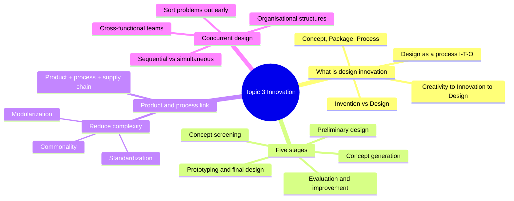
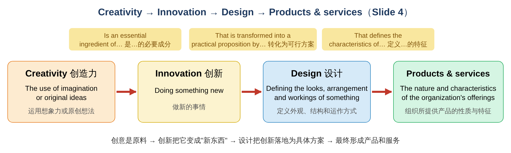
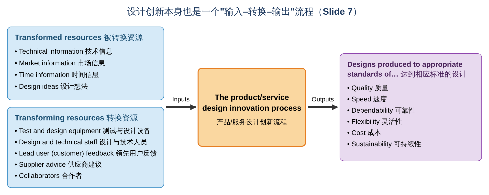
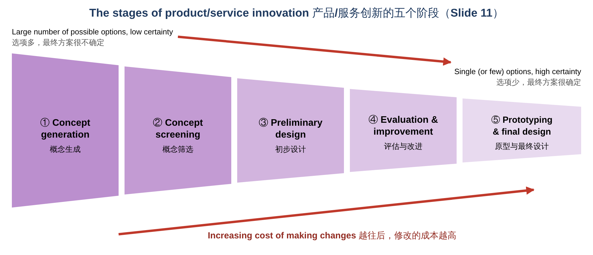
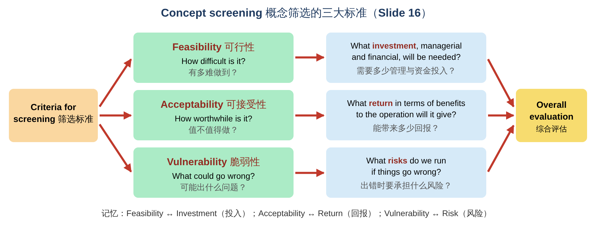
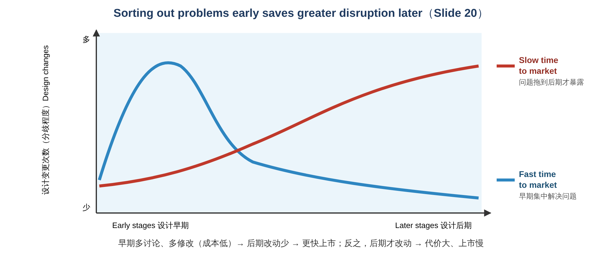
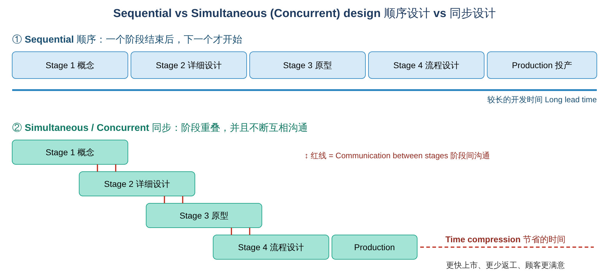
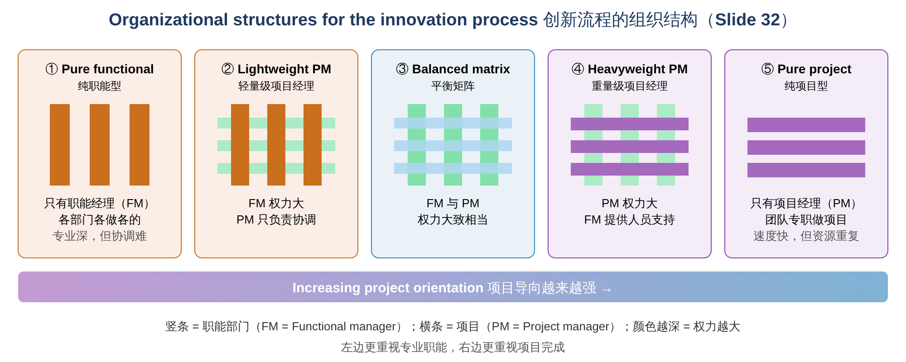

# Operations Management · Topic 3 产品与服务创新（Product and Service Innovation）学习笔记

> 教材：Slack, Brandon-Jones & Burgess, *Operations Management*, 10th Edition — Part One "Directing the operation", **Chapter 4 Managing product and service innovation**
> 内容范围：讲义 Topic 3（共 35 页）
>
> 📌 阅读说明
> - **英文术语保留原文**（考试用英文作答），中文帮助理解。
> - **💡 补充** = 讲义没讲但能帮助理解的内容；**⚠️ 易错** = 容易混淆的地方。
> - 文末有 **易混淆汇总、术语表、自测题（含答案）、案例与课堂活动参考思路**。

---

## 0. 一张图看懂本章

### 本章的四个学习目标（Learning Outcomes）

| # | Learning Outcome | 中文 |
|---|---|---|
| 1 | What is new product and service design innovation? | 什么是新产品与服务的设计创新？ |
| 2 | What are the stages of new product/service design? | 新产品/服务设计有哪些阶段？ |
| 3 | How new product design is linked to process design? | 产品设计和流程设计是什么关系？ |
| 4 | What are the benefits of iterative and concurrent design? | 迭代设计和同步设计有什么好处？ |

**一句话总结本章：** 我们买的不是"发明"，而是"设计"。新产品/服务的设计是一个 **从很多想法逐步筛选到一个最终设计的漏斗式流程**（5 个阶段），而且 **产品设计和流程设计必须一起考虑**。用 **同步（concurrent）设计** 和 **跨职能团队**，在早期把问题解决掉，可以更快、更省地把产品推向市场。

> 💡 **和前两章的联系：**
> - Topic 1：设计创新本身也是一个 **输入–转换–输出** 流程。
> - Topic 2：设计的好坏同样用 **绩效目标**（quality、speed、dependability、flexibility、cost、sustainability）来衡量；第 2 章里的 **Innovation** 能力，在这一章具体展开。
> - 本章属于 4Ds 中的 **Direct** 部分（Part One 的最后一个主题之一）。

---

## 1. What is Product and Service Design Innovation? 什么是设计创新？

### 1.1 ⭐ Creativity、Innovation 和 Design 的关系（Slide 4）

| 概念 | 定义 | 和下一个概念的关系 |
|---|---|---|
| **Creativity 创造力** | **The use of imagination or original ideas**（运用想象力或原创想法） | **Is an essential ingredient of** innovation（是创新的必要成分） |
| **Innovation 创新** | **Doing something new**（做新的事情） | **Is transformed into a practical proposition by** design（由设计转化为可行的方案） |
| **Design 设计** | **Defining the looks, arrangement and workings of something**（定义某物的外观、结构和运作方式） | **Defines the characteristics of** products and services（定义产品和服务的特征） |
| **Products and services 产品与服务** | **The nature and characteristics of the organization's offerings**（组织所提供东西的性质和特征） | — |

📝 **记忆：创意（原料）→ 创新（新东西）→ 设计（落地）→ 产品/服务（结果）**

### 1.2 ⭐ Invention vs Design：发明 vs 设计（Slide 5）

> **All products or services we buy have been designed or redesigned.**
> **"We do not buy inventions; we buy designs!"**

讲义用三组图片说明：
- **牙线**：最早的 **发明（invention）** 是一根线，之后经过多次 **设计（design）**：牙线盒 → 牙线棒 → 带手柄的牙线 → ……
- **音乐载体**：黑胶唱片 → 磁带 → CD → MP3
- **灯泡**：最早的电灯 → 白炽灯 → 节能荧光灯 → LED 灯

> 💡 **补充：为什么说"我们买的是设计"？**
> **Invention（发明）** 是第一次创造出某种新东西（新原理、新技术）；而顾客真正买到手的，是经过 **不断设计和再设计** 之后 **好用、可生产、价格合理** 的产品。
> 🌰 发明了"用线清洁牙缝"的想法不难，难的是把它设计成 **单手就能用、便宜、能大规模生产** 的牙线棒。
>
> ⚠️ **易错：Innovation ≠ Invention。** 创新不一定要发明全新的技术。把已有的东西 **重新设计** 得更好用，也是创新（**incremental innovation 渐进式创新**）；完全颠覆性的新东西叫 **radical innovation（突破式创新）**。

### 1.3 Nature and purpose of the design activity 设计活动的本质（Slide 6）

1. **Products, services and the processes which produce them all have to be designed.**
   **产品、服务，以及生产它们的流程，都需要被设计。**
2. **Decisions taken during the design of a product or service will have an impact on the decisions taken during the design of the process which produces them, and vice versa.**
   **产品/服务设计中的决策会影响流程设计中的决策，反之亦然。**

### 1.4 ⭐ 设计创新本身也是一个流程（Slide 7）

把 Topic 1 的 **输入–转换–输出** 模型用在"设计"这件事上：

| | 内容 |
|---|---|
| **Transformed resources 被转换资源** | **Technical information**（技术信息）、**Market information**（市场信息）、**Time information**（时间信息）、**Design ideas**（设计想法） |
| **Transforming resources 转换资源** | **Test and design equipment**（测试与设计设备）、**Design and technical staff**（设计与技术人员）、**Lead user (customer) feedback**（领先用户反馈）、**Supplier advice**（供应商建议）、**Collaborators**（合作者） |
| **Process 流程** | The product/service design innovation process |
| **Outputs 产出** | Designs produced to appropriate standards of **Quality、Speed、Dependability、Flexibility、Cost、Sustainability** |

> 💡 **补充：设计流程的绩效目标是什么意思？**（和 Topic 2 一一对应）
> - **Quality**：设计没有错误，符合要求
> - **Speed**：从想法到上市的时间短（**time to market**）
> - **Dependability**：按计划的时间完成设计
> - **Flexibility**：能根据新信息修改设计
> - **Cost**：设计过程本身的花费合理
> - **Sustainability**：设计出来的产品对环境和社会友好
>
> 💡 **Lead user（领先用户）**：比普通顾客更早遇到某种需求、并且常常自己动手改进产品的用户（如极限运动爱好者之于运动装备）。他们的反馈能帮企业预见市场的未来需求。

### 1.5 连电子游戏开发也是运营流程（Slide 8）

> **All products and services, even highly creative processes such as video game development, are created by operations processes.**

讲义的图把游戏开发分成三个阶段：

| 阶段 | 活动 |
|---|---|
| **Pre-production 前期制作** | Idea（想法）→ Pitch（提案）→ Concept（概念）→ Planning（计划）→ Resourcing（配置资源） |
| **Production 制作** | Design（设计）→ Programming（编程）→ Art production（美术）→ Audio production（音频）→ Game prototype（游戏原型）→ Quality testing（质量测试） |
| **Post-production 后期** | Testing, de-bugging（测试与修 bug）、Marketing planning（营销计划）、Distribution（发行）、Maintenance（维护）→ **Post-launch feedback**（上线后反馈，回到下一轮开发） |

📝 **要点：** 即使是非常"有创意"的工作，也可以像流水线一样被 **计划、组织和管理**。创意和运营管理并不矛盾。

### 1.6 ⭐ 产品设计和流程设计相互关联（Slide 9）

| 产品/服务设计 | 交集 | 流程设计（包括供应链 SCM） |
|---|---|---|
| **Products and services should be designed in such a way that they can be created effectively.** 产品和服务应该设计成 **能被有效地生产出来** | **Product/service design has an impact on the process design and vice versa.** 两者相互影响 | **Processes should be designed so they can create all products and services which the operation is likely to introduce.** 流程应该设计成 **能生产企业可能推出的所有产品和服务** |

→ **所以，两者应该一起考虑（should be treated together）。**

🌰 **例子：** 设计一把椅子时，如果每条腿的形状都不同，工厂就需要四套模具、四道工序；如果四条腿一样，生产就简单得多。这就是 **Design for Manufacture（DfM，可制造性设计）** 的思想。

### 1.7 ⭐ What is designed in a product or service? 设计什么？（Slide 10）

| 设计对象 | 含义 |
|---|---|
| **A concept 概念** | **The understanding of the nature, use and value** of the service or product（对产品或服务的性质、用途和价值的理解） |
| **A package 组合包** | **The group of "component" products and services** that provide those benefits defined in the concept（提供概念中所描述好处的一组"组件"产品和服务） |
| **A process 流程** | **The way in which the component products and services will be created and delivered**（这些组件产品和服务如何被生产和交付） |

> 💡 **补充：用一家廉价航空来理解**
> - **Concept**：便宜、准点的短途飞行
> - **Package**：机票（服务）+ 座位（产品）+ 可选的付费行李、餐食（附加服务）+ App（服务）
> - **Process**：网上订票、自助值机、快速登机、快速过站
>
> 🌰 **餐厅例子**：概念 = "15 分钟内吃到健康的午餐"；组合包 = 沙拉 + 饮料 + 外带包装 + 点餐 App；流程 = 线上点餐 → 中央厨房备料 → 门店组装 → 取餐。

---

## 2. ⭐ The Stages of Product/Service Innovation 设计的五个阶段

### 2.1 五个阶段总览（Slide 11）

1. **Concept generation** 概念生成
2. **Concept screening** 概念筛选
3. **Preliminary design** 初步设计
4. **Evaluation and improvement** 评估与改进
5. **Prototyping and final design** 原型与最终设计

**两个重要规律：**
- **越往后，选项越少、确定性越高**：开始时 **"Large number of possible options with low level of certainty regarding the final offering"**，结束时 **"Single (or few) possible option(s), but high level of certainty regarding the final offering"**。
- **越往后，修改设计的成本越高（Increasing cost of making changes）**。

📝 **记忆口诀：** **生 → 筛 → 初 → 评 → 原**（概念生成、概念筛选、初步设计、评估改进、原型定稿）

> 💡 **补充：为什么越往后改动越贵？** 早期改设计只是改一张草图；到了原型阶段，可能已经开了模具、订了零件、培训了工人。比如汽车量产前发现设计缺陷，可能要重新开模具，甚至推迟上市，损失巨大。所以要 **"把问题尽量在早期解决"**（见 2.9 节）。

### 2.2 产品设计 + 流程设计 + 供应链设计（Slide 12）

> **Designing a product can not be separated from process/layout design (and supply chain design). Why?**

| 产品设计（左圆） | 流程设计（右圆） |
|---|---|
| Concept generation → Screening → Preliminary design → Screening → Prototype → Screening → Final design | **Process design（流程设计）**、**Supply chain design（供应链设计）**、**Layout design（布局设计）** 三者相互影响 |

📝 **注意：** 讲义这张图里 **每一步之后都有一次 Screening（筛选）**，说明筛选不是只做一次，而是 **贯穿整个设计过程**。

> 💡 **"Why?" 的参考答案：**
> 1. 产品的 **零部件和材料** 决定了需要什么 **供应商**（供应链设计）；
> 2. 产品的 **结构和装配顺序** 决定了 **生产工序和工厂布局**（流程与布局设计）；
> 3. 反过来，现有的 **设备、工人技能和供应商能力** 也会 **限制** 产品能怎么设计；
> 4. 如果分开设计，常常会出现"设计出来了却造不出来，或者成本太高"的情况。

### 2.3 ⭐ Stage 1：Concept generation 概念生成（Slide 13–14）

#### 想法从哪里来？（五个来源）
1. **Ideas from customers formally through Marketing activities**：通过 **营销活动**（市场调研、焦点小组、问卷）正式收集顾客的想法
2. **Listening to customers on a day-to-day basis**：在日常中 **倾听顾客**（投诉、建议、网上评论）
3. **Ideas from competitor activity**，例如 **reverse engineering（逆向工程）**：拆解竞争对手的产品，研究它是怎么做的
4. **Ideas from staff**：来自员工，**尤其是每天接触顾客的员工**（一线员工最了解顾客的抱怨和需求）
5. **Ideas from research and development (R&D)**：来自研发部门

#### ⚠️ Ideas ≠ Concepts（想法 ≠ 概念）
- 新想法可以来自 **顾客、竞争对手或组织内部**；
- **但新想法不同于概念**：**Consumers buy concepts, not ideas!（顾客买的是概念，不是想法！）**
- **Concepts describe（概念要描述）**：**Shape（形状）、Purpose（用途）、Function（功能）、Benefits（好处）**

🌰 **讲义的例子：iWatch 设计草图**
- **想法**："能戴在手腕上的 iPhone"
- **概念**：**Shape** 弯曲的手环屏幕；**Purpose** 随时查看信息；**Function** 触屏操作、通知、通话；**Benefits** 不用掏出手机也能处理消息

> 💡 **补充：** 把想法变成概念，相当于回答"这个东西 **长什么样、给谁用、能做什么、对顾客有什么好处**"。只有把这四点说清楚，后面才能筛选和设计。

### 2.4 案例：Spangler、Hoover 和 Dyson（Slide 15）

讲义的讨论题：
1. **What do you think makes "good design" in markets such as domestic appliances?** 在家电市场，什么是"好设计"？
2. **Why do you think two major vacuum cleaner manufacturers rejected Dyson's ideas?** 为什么两家大型吸尘器厂商拒绝了 Dyson 的想法？
3. **How did design make Dyson a success?** 设计如何让 Dyson 成功？

> 💡 **背景：**
> - **James Murray Spangler** 在 1900 年代初发明了一种便携式电动吸尘器，后来把专利卖给了 **Hoover** 家族，Hoover 由此成为吸尘器的代名词。
> - **James Dyson** 发现传统集尘袋式吸尘器一旦袋子堵塞，吸力就会下降。他借鉴锯木厂的 **旋风分离（cyclone）** 原理，花了约 5 年、做了 **5,000 多个原型**，设计出 **无袋（bagless）吸尘器**。
> - 他把技术推销给多家大厂，都被拒绝；最后在 1993 年前后自己创办公司生产，大获成功。
>
> **参考答案：**
> 1. **好设计**：性能好（吸力持久）、好用（轻便、易清理）、外观吸引人、耐用可靠、价格与价值相符。
> 2. **被拒绝的可能原因**：
>    - **商业模式冲突**：大厂从 **替换集尘袋** 中赚取了可观的持续利润，无袋设计会让这部分收入消失；
>    - **投资和风险**：需要新的生产线和供应链（对应筛选标准中的 feasibility 和 vulnerability）；
>    - 对"外人"想法的保守态度（"not invented here"）。
> 3. **设计如何成就 Dyson**：
>    - 解决了顾客真实的痛点（吸力下降、换袋麻烦）；
>    - **透明集尘盒**：让顾客"看到"吸进了多少灰尘，把功能变成了卖点；
>    - 鲜艳、科技感的外观，让 Dyson 能卖出 **高端价格**；
>    - 持续的原型测试和改进，保证了质量。

### 2.5 ⭐ Stage 2：Concept screening 概念筛选（Slide 16）

**Broad categories of evaluation criteria for assessing concepts（评估概念的三大类标准）：**

| 标准 | 问的问题 | 对应的考量 |
|---|---|---|
| **Feasibility 可行性** | **How difficult is it?** 有多难？ | What **investment**, both managerial and financial, will be needed? 需要多少 **管理与资金投入**？ |
| **Acceptability 可接受性** | **How worthwhile is it?** 值不值得？ | What **return** in terms of benefits to the operation will it give? 能带来多少 **回报**？ |
| **Vulnerability 脆弱性** | **What could go wrong?** 可能出什么问题？ | What **risks** do we run if things go wrong? 出错时要承担什么 **风险**？ |

→ 三者结合得出 **Overall evaluation of the concept（对概念的综合评估）**。

📝 **记忆：F-A-V = 投入（Investment）、回报（Return）、风险（Risk）**

> 💡 **补充：筛选时可以从不同职能的角度提问**
> - **Marketing**：有没有足够的顾客？能卖多少钱？
> - **Finance**：要投多少钱？多久回本？
> - **Operations**：我们造得出来吗？要什么新设备、新技能、新供应商？
>
> 这正好对应下面方形西瓜的三个问题。

### 2.6 案例：Square watermelons 方形西瓜（Slide 17）

讲义问题：如果要 **商业化生产** 方形西瓜，你会问哪些问题？

> 💡 **背景：** 方形西瓜来自日本，是把西瓜放在方形的玻璃或塑料模具中生长而成。原本的想法是方便放进冰箱、不会滚动，但实际上价格非常高，大多作为 **观赏或送礼** 用。
>
> | 角度 | 参考问题 | 对应筛选标准 |
> |---|---|---|
> | **Market 市场** | 谁会买？是日常食用还是送礼、装饰？顾客愿意多付多少钱？市场有多大？有没有竞争者？ | Acceptability |
> | **Finance 财务** | 每个模具要多少钱？单个西瓜的成本和售价是多少？需要多少前期投资？多久能回本？如果卖不出去，损失多大？ | Feasibility（投资）、Acceptability（回报）、Vulnerability（风险） |
> | **Operations 运营** | 模具什么时候套上去？西瓜长得太大会不会撑破模具或裂开？成熟度和口感能否保证？产量和废品率是多少？怎么包装运输？需要什么技能的工人？ | Feasibility、Vulnerability |

### 2.7 设计是不断减少可能性的过程（Slide 18）

讲义用一个 **漏斗（funnel）** 来表示：
- 顶部：**CONCEPT** 产生 **大量设计选项（large number of design options）**；
- 经过一层层 **"Screens"（筛子，即选择和评估）**，选项越来越少；
- 最后只剩下 **One design（一个设计）** → **FINAL DESIGN SPECIFICATION（最终设计规格）**。
- 右侧的三角形表示：随着 **时间（TIME）** 推进，**对最终设计的不确定性（uncertainty）逐渐减少，确定性（certainty）逐渐增加**。

### 2.8 那些没能留在市场上的新产品（Slide 19）

| 产品 | 公司 / 年份 | 💡 失败原因（参考） | 对应的筛选标准 |
|---|---|---|---|
| **Cheetos Lip Balm**（奇多唇膏） | Cheetos，2005 | 零食品牌做唇膏，品牌延伸不合理，顾客难以接受"零食味"唇膏 | **Acceptability** |
| **Hoverboards**（平衡车） | 2015 | 很多廉价产品的 **电池过热甚至起火**，引发安全问题和大规模召回、禁售 | **Vulnerability** |
| **New Coke**（新可乐） | Coca-Cola Co，1985 | 改了经典配方，引起忠实顾客强烈不满；约 3 个月后恢复原配方，以 "Coca-Cola Classic" 重新推出 | **Acceptability**、**Vulnerability** |
| **Kitchen Entrees**（高露洁冷冻食品） | Colgate，1982 | 牙膏品牌卖千层面，顾客会联想到牙膏的味道，品牌错位 | **Acceptability** |
| **EV1**（电动车） | General Motors，1996–1999 | 电池技术和续航有限、成本高、市场太早；GM 最终收回并销毁了大部分车辆 | **Feasibility**、**Acceptability** |

📝 **启示：** 好的概念筛选，可以在投入大量资源之前就淘汰这些"坏点子"。

### 2.9 ⭐ Sorting out problems early saves greater disruption later（Slide 20）

**尽早解决问题，可以避免后期更大的混乱。**

| 曲线 | 特点 | 结果 |
|---|---|---|
| **Fast time to market（快速上市）** | 在设计 **早期** 就有大量讨论和修改（分歧大、改动多），之后改动迅速减少 | 后期顺利 → **上市快** |
| **Slow time to market（缓慢上市）** | 早期很少讨论，问题被掩盖；到了 **后期** 才不断出现分歧和修改 | 后期修改代价大 → **上市慢** |

> 💡 **为什么？** 回到 2.1 节："越往后，修改设计的成本越高"。在早期吵架、改图纸几乎不花钱；到了原型或投产阶段才发现问题，就要重新开模具、重新订料，时间和金钱都损失很大。
> ⚠️ **读图注意：** 讲义原图纵轴写的是 "Degree of agreement over design decision and changes in design"，**上面是 Low、下面是 High**，容易看反。我重画的图把纵轴改成了更直观的 **"设计变更次数（分歧程度）"，越往上越多**，两条曲线的含义不变。

### 2.10 案例：The Blow Dry Bar（Slide 21）

讲义问题：
1. **From a market perspective, why was the blow dry bar successful?** 从市场角度，为什么成功？
2. **From an operations perspective, why is the blow dry bar successful?** 从运营角度，为什么成功？

> 💡 **背景：** Blow dry bar（吹发吧）是一种只提供 **洗头和吹造型（wash and blow-dry）**、**不剪发** 的美发服务，常开在百货公司或商场里，价格比完整的发廊服务便宜，速度也更快。
>
> **① 市场角度：**
> - 抓住了一个 **被忽视的需求**：很多忙碌的职业女性只想在约会、面试、派对前快速做个好看的造型，不需要剪发；
> - **价格适中、快速、方便**（开在商场，可以边逛街边做，常常不需要提前预约）；
> - 把"吹头发"包装成一种轻奢、愉快的 **体验**。
>
> **② 运营角度（可以用 Topic 1 的 4Vs 分析）：**
> - **Low variety（品种少）**：只做吹发 → 流程 **标准化**，员工培训快，不需要高级剪发师；
> - **High volume（产量高）**：服务时间短而可预测 → 每天可以服务更多顾客，设备利用率高；
> - **占地小、设备简单**（椅子、吹风机、镜子）→ 开店成本低，容易复制扩张；
> - 结果：**单位成本低**，同时能保证 **稳定的质量**。
>
> 📝 **结论：** 这个案例很好地体现了"**概念（快速时尚造型）+ 组合包（只吹不剪）+ 流程（标准化、快速）**"三者一起设计的思想。

### 2.11 ⭐ Stage 3：Preliminary design 初步设计（Slide 22）

在得到一个 **更可行、能做到的概念（a more feasible and doable concept）** 之后，开始做初步设计：
- **Start specifying components** 开始确定 **零部件**；
- **Start defining production processes / layouts / sequence / supply and delivery** 开始定义 **生产流程、布局、工序顺序、供应和交付**。

讲义的例子：**Remote presentation mouse（无线演示鼠标 / 翻页笔）的零部件结构**

| 层级 | 零部件 |
|---|---|
| **Level 0** | Remote presentation mouse（整个产品） |
| **Level 1** | Presentation mouse（演示鼠标）、Receiver unit（接收器）、Packing（包装） |
| **Level 2** | Upper cover（上盖）、Main assembly（主组件）、USB connector（USB 接头）、R/C unit（遥控单元）、Outer（外包装）、Leaflet（说明书） |
| **Level 3** | Moulding（注塑件）、Logo、Moulding、Control unit（控制单元） |
| **Level 4** | Button（按钮）、Transmitter（发射器） |

右边的图是对应的 **装配流程（10 个工位的 U 形生产线）**：零部件结构决定了装配顺序和工作站布局 → **产品设计和流程设计在这里连在一起**。

> 💡 **补充：** 这种分层的零部件结构叫 **component structure / product structure（产品结构）**，在制造业中常写成 **BOM（Bill of Materials，物料清单）**。它告诉工厂：要买哪些零件、先装什么后装什么。

**问题：Complexity in the product design and manufacturing process — How can we reduce this design/production complexity?**
**产品和制造流程很复杂，怎么降低复杂度？** → 见 2.13 节。

### 2.12 ⭐ Stage 4：Design evaluation and improvement 评估与改进（Slide 23–24）

评估初步设计有多种方法，讲义列了两种：
- **Quality Function Deployment（QFD，质量功能展开）**
- **Value engineering（价值工程）**

#### (1) QFD 质量功能展开：House of Quality（质量屋）

**核心思想：把"顾客想要什么（Whats）"转化为"技术上怎么做到（Hows）"。** 因为矩阵的形状像一座房子，也叫 **House of Quality（质量屋）**。

讲义的例子：**促销用 U 盘（promotional USB data storage stick）**

| 部分 | 内容 |
|---|---|
| **Whats（顾客需求）** + **Importance to customers（重要程度）** | Size 尺寸（4）、Robustness 坚固（3）、Attach to key ring 能挂钥匙圈（2）、Capacity 容量（7）、Print logo 能印 logo（6）、**Price 价格（10，最重要）** |
| **Hows（技术特征）** | Casing material 外壳材料、Flash chip 闪存芯片、Profile 外形、Finish 表面处理、Connector 接口 |
| **中间的关系矩阵（Whats vs Hows）** | ● 强关系 Strong、○ 中等 Medium、△ 弱 Weak。例如 Capacity 与 Flash chip 是强关系；Print logo 与 Finish 是强关系 |
| **屋顶（Hows vs Hows）** | 技术特征之间的相互影响：● Strong positive、○ Positive、✚ Negative、◇ Strong negative |
| **右侧：Competitive score（1–5）** | 与竞争对手相比，每项顾客需求做得怎样 |
| **底部：Technical evaluation（1–5，5 最好）** | 每项技术特征的技术评价 |

> 💡 **怎么读 QFD？**
> 1. 先看 **最重要的顾客需求**：Price（10）> Capacity（7）> Print logo（6）……
> 2. 再看 **哪个技术特征和这些需求关系最强**：Flash chip 同时强烈影响 Size、Capacity 和 Price → 它是 **设计的重点**。
> 3. 看 **屋顶**：改变一个技术特征会不会让另一个变差（例如更好的外壳材料可能提高成本）。
> 4. 结合 **竞争得分** 找到改进的机会。
>
> **QFD 的好处：** 让设计始终围绕 **"顾客的声音（voice of the customer）"**，并且让营销、设计、生产人员用同一张表沟通。

#### (2) Value engineering 价值工程
> 💡 **补充（讲义只列了名称）：** 价值工程的目标是 **在不降低产品功能和价值的前提下降低成本**。做法是对每个零部件提问：
> - 它的 **功能** 是什么？这个功能是必需的吗？
> - 能不能 **去掉、合并**，或换成 **更便宜的材料**？
> - 能不能用 **标准件** 代替定制件？
>
> 🌰 例：把一个由 3 个零件组成、用螺丝固定的外壳，改成 1 个卡扣式注塑件 → 零件更少、装配更快、成本更低，功能不变。

### 2.13 ⭐ Reducing design complexity 降低设计复杂度（Slide 25–28）

| 方法 | 定义 | 讲义例子 |
|---|---|---|
| **Standardization 标准化** | **Variety restriction（限制品种）**，例如 **只提供有限的几种尺寸** | **T 恤只有 S / M / L / XL 四个尺码** |
| **Commonality 通用化** | **Common components（使用通用零部件）** | **Airbus A318–A380** 有 **相同的驾驶舱（identical flight decks）、通用系统和相似的操控特性**；**汽车内饰**通用 |
| **Modularization 模块化** | **Designing standardized sub-components, which can be put together in different ways to create new products**（设计标准化的子组件，用不同方式组合出新产品） | **家具模块的重新组合**；**办公室工位**；**IKEA** |

#### Commonality 通用化的利与弊（Slide 27）
- ✅ **Component-sharing strategies have proved to be a successful way to reduce manufacturing costs.**（零部件共享是降低制造成本的成功方法）
- ❌ **However, this means a faulty component may affect many products.**（缺点：一个零件有缺陷，可能影响很多产品）
- 讲义图片：**Škoda Rapid** 和 **SEAT Toledo**，两款车都属于 **大众集团**，共用同一个平台和大量零件，外观相似。
- 讲义问题：**What happened during COVID-19 between VW and BMW?**

> 💡 **补充：**
> - **Airbus 的好处**：飞行员从一种机型转到另一种机型时，培训时间大大缩短；航空公司的备件库存和维修也更简单。
> - **COVID-19 问题的参考思路（讲义没有给出答案）**：疫情期间，汽车行业普遍遭遇 **供应链中断**，最典型的是 **汽车芯片（semiconductor）短缺**，以及部分供应商工厂停工。由于很多车型、甚至不同品牌 **共用相同的零部件和供应商**，一个零件缺货，就会导致 **多条生产线、多个品牌同时停产**。这说明通用化在降低成本的同时，也 **集中了风险**。（课堂上老师可能会讲具体的事件，建议以课堂内容为准。）
> - **零件召回的风险**：如果一个通用零件（如安全气囊）有缺陷，可能要召回 **数百万辆、多种车型** 的汽车。

#### Modular design 模块化设计（Slide 28）
- **Products designed in easily segmented components**（产品被设计成容易分开的组件）
- **Adds flexibility to both production and marketing**（同时增加了生产和营销的灵活性）
- **Improved ability to satisfy customer requirements**（更能满足顾客的不同需求）
- 例子：**IKEA**（平板包装、顾客自己组装、不同模块自由组合）

> 💡 **补充：模块化是实现"大规模定制（mass customization）"的关键**（Topic 1 的 volume–variety trade-off）。用少量标准模块，组合出大量不同的最终产品：既有 **规模经济**（模块大批量生产），又有 **品种多样**（组合方式多）。
> 🌰 例：电脑（CPU、内存、硬盘、显卡都是模块）、乐高积木、Dell 按订单组装电脑。

### 2.14 ⭐ Stage 5：Prototyping and final design 原型与最终设计（Slide 33）

- **Prototypes are necessary to test products**（原型是测试产品所必需的）
- **Prototypes should resemble highly final products**（原型应该高度接近最终产品）
- **Prototypes come in various forms**（原型有多种形式）：
  - **Card models**（纸板模型）
  - **Clay models**（黏土模型，汽车设计常用）
  - **Computer simulation (Auto CAD)**（计算机模拟）
- **Screening and testing continuous until final production starts**（筛选和测试一直持续到正式投产）
- **Further modification is often required**（通常还需要进一步修改）
- 讲义配图：**Dyson** 吸尘器的多代原型

> 💡 **补充：** 现在还有 **3D printing（3D 打印）**、**virtual prototyping / digital twin（虚拟原型、数字孪生）** 等方式，可以更快、更便宜地做原型。服务也可以做原型，例如在一家门店先试行新流程（pilot），或者用"模拟顾客"走一遍服务流程。

---

## 3. ⭐ Sequential vs Concurrent Design 顺序设计 vs 同步设计（LO 3 & 4）

### 3.1 Sequential vs Simultaneous arrangement（Slide 29）

| | **Sequential arrangement 顺序安排** | **Simultaneous arrangement 同步安排** |
|---|---|---|
| 做法 | **一个阶段完全结束后，下一个阶段才开始** | **阶段之间相互重叠**，下一阶段在上一阶段完成前就开始 |
| 沟通 | 阶段之间沟通少，像"把文件扔过墙"（over the wall） | 阶段之间 **持续沟通（communication between stages）** |
| 时间 | 长 | **短**（时间压缩） |

### 3.2 Sequential vs Concurrent Product Development（Slide 30）

讲义列出产品开发组织方式的演变：
- **Traditionally — distinct departments**：传统上，各部门分开工作
- **A Champion — Product manager**：由一名 **产品经理（champion，倡导者/负责人）** 推动
- **Team approach**：团队方式
- **Japanese "whole organization" approach**：日本式的"全组织参与"方式
- **Product development teams: Cross-functional teams**：产品开发团队 = **跨职能团队**
- **Concurrent engineering**：**同步工程**，即 **simultaneous performance of product development stages**（同时进行产品开发的各个阶段）

> 💡 **补充：Cross-functional team（跨职能团队）** 由来自 **营销、设计、工程、生产、采购、财务**，甚至 **供应商和顾客** 的人组成。好处：
> - 设计早期就能听到"生产做不做得出来""采购买不买得到"的意见；
> - 减少后期返工；
> - 决策更快。

### 3.3 ⭐ Team approach — Concurrent engineering 的好处（Slide 31）

> **Concurrent and simultaneous design can work together outperforming sequential design in terms of lead time, use of resources and customer satisfaction.**
> **同步设计在开发周期、资源利用和顾客满意度方面都优于顺序设计。**（Yazdani, 1999）

讲义的两张图：
- **左图（顺序设计中的信息流）**：Design → Build → Test → Manufacture，信息（INFO.）一步一步往后传；一旦后面发现问题，信息要 **从制造环节绕回设计环节**，再重新走一遍 → 慢。
- **右图（顺序工程 vs 同步工程）**：
  - **Sequential Engineering**：Marketing → Concept design → Detail design → Prototyping → Process design → Process manufacture → Production，一个接一个；
  - **Concurrent Engineering**：同样的活动 **相互重叠**，整体提前完成，中间省下的就是 **Time Compression（时间压缩）**。

**同步工程的两个关键做法：**
- **Overlapping activities and reducing the length of time in each activity**（活动重叠，并缩短每项活动的时间）
- **Compressing lead time of product development process**（压缩产品开发流程的总周期）

> 💡 **补充：同步设计的好处与挑战**
>
> | 好处 | 挑战 |
> |---|---|
> | **Faster time to market** 更快上市 | 需要大量 **沟通和协调** |
> | **Fewer late changes** 后期改动少（问题在早期就被发现） | 下一阶段基于"未完成"的信息开始，存在 **返工风险** |
> | **Lower cost**（减少返工和浪费） | 需要 **跨部门信任** 和合适的组织结构 |
> | **Better quality / customer satisfaction** | 对项目管理能力要求高 |
>
> ⚠️ **LO4 中的 "iterative design（迭代设计）"**：指设计不是一次完成的直线过程，而是 **反复"设计 → 测试 → 反馈 → 修改"** 的循环（就像讲义里每一步之后都有 Screening，以及游戏开发中的 post-launch feedback）。迭代 + 同步，可以 **更早发现问题、更快改进**。

### 3.4 ⭐ Organizational structures for the innovation process 创新流程的组织结构（Slide 32）

从左到右，**项目导向越来越强（increasing project orientation）**：

| 结构 | 特点 | 💡 优点 | 💡 缺点 |
|---|---|---|---|
| **① Pure functional organization 纯职能型** | 只有 **职能经理（FM, functional manager）**，项目在各部门之间传递 | 专业深度强，资源利用效率高 | 部门之间协调难，开发慢，没人对整个项目负责 |
| **② Lightweight project managers 轻量级项目经理** | 有项目经理，但 **主要负责协调**，权力在职能经理手里 | 改动小，容易实施 | PM 缺乏权力，难以推动项目 |
| **③ Balanced matrix organization 平衡矩阵** | **FM 和 PM 权力大致相当** | 兼顾专业与项目 | 员工有"两个老板"，可能冲突 |
| **④ Heavyweight project managers 重量级项目经理** | **PM 权力大**，可以直接调配资源，FM 主要提供人员 | 项目推进快，责任清晰 | 职能专业性可能被削弱 |
| **⑤ Pure project organization 纯项目型** | 只有项目经理，团队 **专职** 做一个项目 | 速度最快，团队专注 | 资源重复配置，项目结束后人员安置难，专业知识难以积累 |

📝 **记忆：** 竖条 = 职能部门（FM），横条 = 项目（PM）。从左到右，**横条（PM）的权力越来越大**。
💡 **研究普遍认为，重量级项目经理（heavyweight PM）往往是开发新产品较有效的结构之一**，因为它兼顾了速度和对职能专业的利用。

---

## 4. 课堂活动：Supermarket trolley redesign 超市推车再设计（Slide 34–35）

讲义任务（分组）：
1. **Introduce a new idea for a supermarket trolley**（提出一个新推车的想法）
2. **Discuss the product design steps from concept to prototype**（讨论从概念到原型的设计步骤）
3. **Sketch your prototype**（画出原型草图）
4. **Define the main components (no more than 10)**（列出主要零部件，不超过 10 个）
5. **Establish a sequence of assembly (activities)**（确定装配顺序）
6. **Try to reduce the complexity in your design (maybe less components)**（尝试降低设计复杂度，例如减少零件）

讲义例子：**原型号（Original model）** 是一个塑料大篮子 + 下层托盘 + 儿童座椅；**再设计的原型（Redesigned model）** 改成 **上下两个小号金属网篮**，并加了 **防撞条（bumpers）** 和 **挂钩（ears）**。

> 💡 **参考答案示例：** "双篮轻便推车"（适合便利店、小型超市）
>
> **① 五个设计阶段：**
> | 阶段 | 做了什么 |
> |---|---|
> | Concept generation | 一线员工反映：顾客只买少量东西，大推车占地方、难推；很多顾客带小孩。→ 概念："轻便、窄身、上下两层、带儿童座" |
> | Concept screening | Feasibility：用现有的金属网篮工艺就能做；Acceptability：成本低、门店节省空间；Vulnerability：载重不足、儿童安全风险 |
> | Preliminary design | 确定零部件（见下表）和装配顺序 |
> | Evaluation & improvement | 用 QFD 检查"好推、安全、容量、价格"等需求；用价值工程把篮子和底座的连接方式简化 |
> | Prototyping | 先做 1:1 样品，在一家门店试用两周，收集顾客和员工的反馈后再修改 |
>
> **② 主要零部件（≤10）：** 1. Chassis 底盘车架　2. Wheels ×4 轮子　3. Handle 推手　4. Upper basket 上篮　5. Lower basket 下篮　6. Child seat 儿童座椅　7. Child safety belt 安全带　8. Bumpers 防撞条　9. Mounting sleeves 连接套件　10. Logo panel 广告牌
>
> **③ 装配顺序：** 底盘 → 安装轮子 → 安装推手 → 用连接套件装下篮 → 装上篮 → 装儿童座椅和安全带 → 装防撞条 → 装广告牌 → 质量检查
>
> **④ 降低复杂度：**
> - **合并零件**：儿童座椅直接做成上篮的一部分（翻板式），减少 2 个零件；广告牌印在推手上，不再单独安装；
> - **Commonality（通用化）**：上下两个篮子用 **同一个模具**；四个轮子完全相同；
> - **Standardization（标准化）**：使用标准螺丝和卡扣，只需一种工具就能装配；
> - **Modularization（模块化）**：底盘 + 篮子模块，可以组合成"单篮版""双篮版"满足不同门店。

---

## 5. ⚠️ 易混淆概念汇总

| 容易混淆 | 区别 |
|---|---|
| Creativity vs Innovation vs Design | 想象与原创想法 vs 做新的事情 vs 定义外观、结构和运作方式 |
| Invention vs Design | 第一次发明新东西 vs 把它变成好用、可生产的产品；"我们买的是设计" |
| Idea vs Concept | 想法只是一个点子；概念要描述 **shape、purpose、function、benefits**；"顾客买的是概念" |
| Concept vs Package vs Process | 产品的性质、用途和价值 vs 提供好处的一组组件产品和服务 vs 如何生产和交付 |
| 五个阶段的顺序 | Concept generation → Concept screening → Preliminary design → Evaluation & improvement → Prototyping & final design |
| 越往后… | 选项越少、确定性越高、**修改成本越高** |
| Screening 三标准 | **Feasibility**（多难 → 投入）、**Acceptability**（值不值 → 回报）、**Vulnerability**（会出什么错 → 风险） |
| Transformed vs Transforming resources（设计流程中） | 信息和想法 vs 设备、人员、用户反馈、供应商、合作者 |
| QFD vs Value engineering | 把顾客需求转化为技术特征 vs 不降低功能的前提下降低成本 |
| Whats vs Hows（QFD） | 顾客想要什么 vs 技术上怎么做到 |
| Standardization vs Commonality vs Modularization | 限制品种（尺码少）vs 共用零件（Airbus 驾驶舱）vs 标准子组件自由组合（IKEA） |
| Commonality 的风险 | 一个零件有问题或缺货 → 影响 **很多产品** |
| Sequential vs Concurrent | 一个接一个、沟通少、慢 vs 重叠进行、持续沟通、快 |
| Fast vs Slow time to market | 早期集中解决问题 vs 问题拖到后期才暴露 |
| Lightweight vs Heavyweight PM | PM 主要做协调、FM 权力大 vs PM 权力大、可调配资源 |
| Pure functional vs Pure project | 只有职能经理 vs 只有项目经理 |

---

## 6. 📖 中英术语表（Glossary）

| English | 中文 |
|---|---|
| Product and service innovation | 产品与服务创新 |
| Creativity | 创造力 |
| Innovation | 创新 |
| Design | 设计 |
| Invention | 发明 |
| Redesign | 再设计 |
| Offerings | （组织提供的）产品与服务 |
| Practical proposition | 可行的方案 |
| Technical / Market / Time information | 技术 / 市场 / 时间信息 |
| Lead user | 领先用户 |
| Collaborators | 合作者 |
| Pre-production / Production / Post-production | 前期制作 / 制作 / 后期制作 |
| Post-launch feedback | 上线后反馈 |
| Concept | 概念 |
| Package | 组合包 |
| Process | 流程 |
| Concept generation | 概念生成 |
| Concept screening | 概念筛选 |
| Preliminary design | 初步设计 |
| Evaluation and improvement | 评估与改进 |
| Prototyping and final design | 原型与最终设计 |
| Final design specification | 最终设计规格 |
| Reverse engineering | 逆向工程 |
| Research and development (R&D) | 研究与开发 |
| Shape / Purpose / Function / Benefits | 形状 / 用途 / 功能 / 好处 |
| Feasibility | 可行性 |
| Acceptability | 可接受性 |
| Vulnerability | 脆弱性 |
| Investment / Return / Risk | 投入 / 回报 / 风险 |
| Time to market | 上市时间 |
| Components | 零部件 |
| Component structure | 产品结构 |
| Layout | 布局 |
| Quality function deployment (QFD) | 质量功能展开 |
| House of quality | 质量屋 |
| Whats / Hows | 顾客需求 / 技术特征 |
| Value engineering | 价值工程 |
| Design complexity | 设计复杂度 |
| Standardization | 标准化 |
| Variety restriction | 品种限制 |
| Commonality | 通用化 |
| Common components / Component sharing | 通用零部件 / 零部件共享 |
| Modularization / Modular design | 模块化 / 模块化设计 |
| Sub-components | 子组件 |
| Prototype | 原型 |
| Card model / Clay model | 纸板模型 / 黏土模型 |
| Computer simulation (CAD) | 计算机模拟（计算机辅助设计） |
| Sequential arrangement | 顺序安排 |
| Simultaneous arrangement | 同步安排 |
| Concurrent engineering | 同步工程 |
| Champion | 倡导者/负责人 |
| Cross-functional teams | 跨职能团队 |
| Lead time | 开发周期 / 提前期 |
| Time compression | 时间压缩 |
| Functional manager (FM) | 职能经理 |
| Project manager (PM) | 项目经理 |
| Pure functional organization | 纯职能型组织 |
| Lightweight / Heavyweight project manager | 轻量级 / 重量级项目经理 |
| Balanced matrix organization | 平衡矩阵组织 |
| Pure project organization | 纯项目型组织 |
| Project orientation | 项目导向 |
| 💡 Incremental / Radical innovation | 渐进式 / 突破式创新 |
| 💡 Design for manufacture (DfM) | 可制造性设计 |
| 💡 Bill of materials (BOM) | 物料清单 |
| 💡 Iterative design | 迭代设计 |
| 💡 Voice of the customer | 顾客的声音 |

---

## 7. 💬 案例与讨论题参考思路

**Q1. "We do not buy inventions; we buy designs." 你怎么理解？**
> 发明只是第一次提出新原理或新技术；顾客买到手的，是经过不断设计和再设计、好用、能大规模生产、价格合理的产品。例如牙线从一根线到牙线棒、灯泡从白炽灯到 LED。

**Q2. 为什么产品设计和流程设计应该一起考虑？**（见 1.6 和 2.2 节）
> 产品的零部件和结构决定了需要什么流程、布局和供应商；反过来，现有的流程和资源也限制了产品能怎么设计。分开设计容易出现"设计好了却造不出来或成本太高"。

**Q3. Dyson 案例**（见 2.4 节）

**Q4. 方形西瓜：商业化之前要问哪些市场、财务、运营问题？**（见 2.6 节）

**Q5. Blow Dry Bar 为什么成功？**（见 2.10 节）

**Q6. 讲义列出的失败产品，分别没有通过哪项筛选标准？**（见 2.8 节）

**Q7. 什么情况下通用化（commonality）反而会带来风险？**
> 当一个通用零件出现缺陷或缺货时，会同时影响很多产品甚至多个品牌，例如大规模召回，或者疫情期间芯片短缺导致多条生产线停产。

**Q8. 超市推车再设计**（见第 4 节）

---

## 8. ✍️ 自测题（Self-test）

### Part A：选择题

1. 根据讲义，"Doing something new" 是哪个概念的定义？\
   A. Creativity\
   B. Innovation\
   C. Design\
   D. Invention

2. "Defining the looks, arrangement and workings of something" 是：\
   A. Creativity\
   B. Innovation\
   C. Design\
   D. Product

3. 讲义中 "We do not buy inventions; we buy…"：\
   A. Ideas\
   B. Concepts\
   C. Designs\
   D. Processes

4. "The group of component products and services that provide those benefits defined in the concept" 是：\
   A. A concept\
   B. A package\
   C. A process\
   D. A prototype

5. 五个设计阶段的正确顺序是：\
   A. Concept screening → Concept generation → Preliminary design → Prototyping → Evaluation\
   B. Concept generation → Concept screening → Preliminary design → Evaluation and improvement → Prototyping and final design\
   C. Preliminary design → Concept generation → Screening → Prototyping → Evaluation\
   D. Concept generation → Preliminary design → Concept screening → Evaluation → Prototyping

6. 随着设计阶段推进，以下哪项是正确的？\
   A. 选项越来越多\
   B. 不确定性越来越高\
   C. 修改设计的成本越来越高\
   D. 修改设计的成本越来越低

7. "What could go wrong?" 对应哪项筛选标准？\
   A. Feasibility\
   B. Acceptability\
   C. Vulnerability\
   D. Profitability

8. "What investment, both managerial and financial, will be needed?" 对应：\
   A. Feasibility\
   B. Acceptability\
   C. Vulnerability\
   D. Quality

9. 通过拆解竞争对手的产品来获得想法，叫做：\
   A. Value engineering\
   B. Reverse engineering\
   C. Concurrent engineering\
   D. QFD

10. 把顾客需求（Whats）转化为技术特征（Hows）的工具是：\
    A. Value engineering\
    B. Quality function deployment\
    C. Modular design\
    D. Prototyping

11. Airbus A318–A380 使用相同的驾驶舱，体现了：\
    A. Standardization\
    B. Commonality\
    C. Modularization\
    D. Reverse engineering

12. T 恤只提供 S、M、L、XL 四个尺码，体现了：\
    A. Standardization\
    B. Commonality\
    C. Modularization\
    D. Concurrent engineering

13. 通用化（commonality）的主要缺点是：\
    A. 成本更高\
    B. 一个有缺陷的零件可能影响很多产品\
    C. 品种太多\
    D. 无法降低成本

14. 与顺序设计相比，同步设计（concurrent engineering）的优势 **不包括**：\
    A. 开发周期更短\
    B. 资源利用更好\
    C. 顾客满意度更高\
    D. 不需要阶段之间的沟通

15. 项目经理权力最大、可直接调配资源，但仍保留职能部门的结构是：\
    A. Pure functional organization\
    B. Lightweight project managers\
    C. Heavyweight project managers\
    D. Balanced matrix

### Part B：简答题

1. 说明 creativity、innovation 和 design 之间的关系。
2. 解释 "Consumers buy concepts, not ideas"，并说明一个概念需要描述哪四个方面。
3. 列出设计的五个阶段，并说明为什么"越往后修改成本越高"。
4. 解释概念筛选的三大标准，并以方形西瓜为例各提一个问题。
5. 什么是 QFD？简述质量屋的主要组成部分。
6. 比较 standardization、commonality 和 modularization，各举一例。
7. 比较顺序设计和同步设计，并说明同步设计的好处。
8. 为什么"尽早解决问题能避免后期更大的混乱"？

<b>👉 点击查看答案</b>

**Part A**
1. **B**
2. **C**
3. **C**
4. **B**
5. **B**
6. **C**
7. **C**
8. **A**
9. **B**
10. **B**
11. **B**
12. **A**
13. **B**
14. **D**（同步设计恰恰需要阶段间持续沟通）
15. **C**

**Part B**
1. Creativity（运用想象力或原创想法）是 innovation 的必要成分；innovation（做新的事情）经由 design 转化为可行的方案；design（定义外观、结构和运作方式）最终定义了产品和服务的特征。
2. 想法只是一个点子，顾客无法直接购买；概念把想法具体化为顾客能理解和评价的东西，需要描述 **shape（形状）、purpose（用途）、function（功能）、benefits（好处）**。
3. Concept generation → Concept screening → Preliminary design → Evaluation and improvement → Prototyping and final design。越往后，已经投入的资源越多（零部件、模具、供应商、流程），修改会牵一发而动全身，因此成本越高。
4. Feasibility：有多难、需要多少投入（例：每个模具多少钱？）；Acceptability：值不值得、回报多少（例：顾客愿意为方形西瓜多付多少钱？）；Vulnerability：可能出什么问题、风险多大（例：西瓜长大后撑破模具、废品率太高怎么办？）。
5. QFD（质量功能展开）是把顾客需求（Whats）转化为技术特征（Hows）的方法，矩阵形似房子，所以也叫质量屋。组成部分：顾客需求及重要度、技术特征、关系矩阵（强/中/弱）、屋顶（技术特征之间的相互影响）、竞争得分、技术评价。
6. Standardization：限制品种，如 T 恤只有四个尺码；Commonality：多个产品共用零件，如 Airbus 各机型驾驶舱相同；Modularization：标准子组件按不同方式组合出新产品，如 IKEA 家具、模块化办公桌。
7. 顺序设计：一个阶段结束后下一个才开始，沟通少、周期长；同步设计：阶段重叠并持续沟通。同步设计在开发周期、资源利用和顾客满意度方面都优于顺序设计，还能及早发现问题、减少后期返工。
8. 早期修改只是改图纸，成本低；到了原型或投产阶段才发现问题，需要重新开模具、订料、调整流程，代价大、延误上市。因此早期集中讨论和解决问题的项目，后期改动少，上市更快。

---

## 9. 📌 考前 1 分钟速记

1. **Creativity → Innovation → Design → Products & services**（想象 → 做新事 → 定义外观结构运作 → 产品特征）。
2. **We do not buy inventions; we buy designs!**
3. **产品、服务和流程都需要设计**；产品设计和流程设计 **相互影响，应一起考虑**。
4. **设计创新也是 I-T-O 流程**：输入（信息、想法 + 设备、人员、用户反馈、供应商、合作者）→ 输出（达到 Q、S、D、F、C、Sustainability 标准的设计）。
5. **设计的对象**：Concept（性质、用途、价值）、Package（组件产品和服务）、Process（如何生产和交付）。
6. **五个阶段**：生 → 筛 → 初 → 评 → 原；越往后 **选项越少、越确定、修改越贵**。
7. **想法来源**：营销活动、日常倾听顾客、竞争对手（逆向工程）、一线员工、R&D。
8. **Ideas ≠ Concepts**：概念 = Shape、Purpose、Function、Benefits。
9. **筛选**：Feasibility（投入）、Acceptability（回报）、Vulnerability（风险）。
10. **初步设计**：确定零部件（产品结构）+ 定义流程、布局、顺序、供应。
11. **评估改进**：QFD（Whats → Hows，质量屋）、Value engineering（不降功能降成本）。
12. **降低复杂度**：Standardization（尺码少）、Commonality（Airbus 驾驶舱；缺点：一个坏零件影响多个产品）、Modularization（IKEA）。
13. **原型**：纸板、黏土、CAD；测试一直持续到投产。
14. **同步设计 > 顺序设计**：更短周期、更好的资源利用、更高的顾客满意度；靠 **跨职能团队**；**早期解决问题 → 快速上市**。
15. **组织结构**（项目导向递增）：纯职能 → 轻量级 PM → 平衡矩阵 → 重量级 PM → 纯项目。
