# Operations Management · Topic 4 流程设计（Process Design）学习笔记

> 教材：Slack, Brandon-Jones & Burgess, *Operations Management*, 10th Edition — **Part Two "Designing the operation", Chapter 6 Process design**\
> 内容范围：讲义 Topic 4（共 50 页）
>
> 📌 阅读说明
> - **英文术语保留原文**（考试用英文作答），中文帮助理解。
> - **💡 补充** = 讲义没讲但能帮助理解的内容；**⚠️ 易错** = 容易混淆的地方。
> - ⭐ 本章有 **计算题**（cycle time、stages、idle time、Little's law、throughput efficiency）。第 5 节把公式和讲义的三道例题一步步算了一遍，第 6 节是讲义 McDonald's 课堂活动的参考答案。
> - 文末有 **公式卡、易混淆汇总、术语表、自测题（含计算题和答案）**。

---

## 0. 一张图看懂本章

### 本章的四个学习目标（Learning Outcomes）

| # | Learning Outcome | 中文 |
|---|---|---|
| 1 | Process types defined | 流程类型的定义 |
| 2 | Different process types | 不同的流程类型 |
| 3 | Process mapping | 流程图 |
| 4 | Process analytics | 流程分析（计算） |

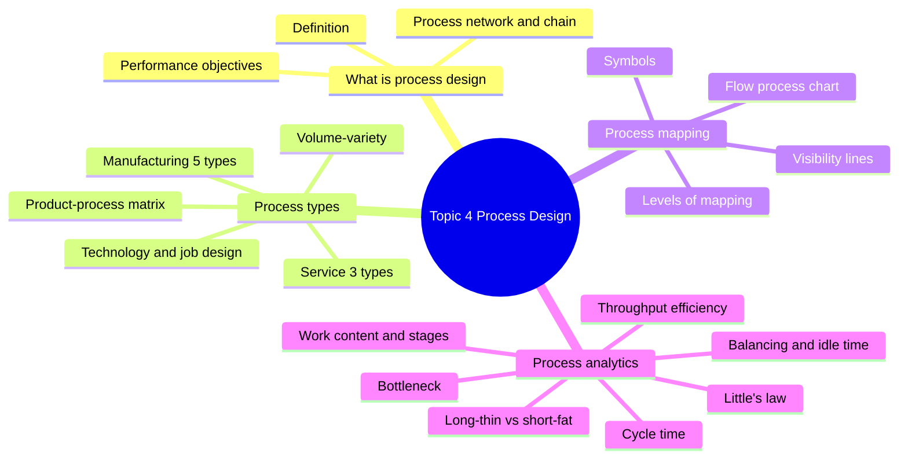

**一句话总结本章：** 流程设计就是把"设计"变成真正能交付产品/服务的实际流程。先根据 **产量–品种（volume–variety）** 选对 **流程类型**（制造业 5 种、服务业 3 种），再用 **流程图（process mapping）** 把流程画出来，最后用 **cycle time、stages、bottleneck、Little's law** 等指标来 **分析和平衡** 流程。

> 💡 **在全书中的位置：** 从这一章开始进入 4Ds 中的 **Design（设计）** 部分（Part Two）。Design 包括四个主题：**Process design（本章）**、The layout and look of facilities（布局）、Process technology（流程技术）、People in operations（运营中的人）。\
> 💡 **和前面章节的联系：**
> - Topic 1 的 **4Vs（尤其是 volume、variety、visibility）** 在本章直接决定流程类型和流程图；
> - Topic 2 的 **绩效目标（Q、S、D、F、C）** 在本章变成"流程设计的目标"；
> - Topic 3 讲 **产品** 怎么设计，本章讲 **生产/交付它的流程** 怎么设计，两者要一起考虑。

---

## 1. What is Process Design? 什么是流程设计？（LO 1）

### 1.1 定义（Slide 5）

- **It is the activity of turning a design into physical form that delivers services or products to customers.**
  把设计 **变成实际的形态**，向顾客交付服务或产品的活动。
- **The purpose is to meet customers' requirements and needs.** 目的：满足顾客的要求和需求。
- **Resources and environment must be taken into consideration when developing the design.** 设计时必须考虑 **资源和环境**。

### 1.2 Process network 与 process chain（Slide 4）

> A process network within an operation showing an internal "process chain"

- 一个 **运营（the operation）** 内部有许多 **单个流程（individual processes）**，它们互相连接，构成 **内部流程网络（internal process network）**；
- 从 **外部供应商（external suppliers）** 到 **外部顾客（external customers）** 的某一条具体路径，叫做 **内部流程链（internal process chain）**（讲义图中的深蓝色方块）。

> 💡 **补充：** 这就是 Topic 1 里 "process view" 的具体化：一个企业 = 很多流程连成的网络；每个流程都有自己的 **内部供应商和内部顾客**（上一道流程是你的供应商，下一道流程是你的顾客）。

### 1.3 ⭐ 流程设计的目标 = 五大绩效目标（Slide 6–8）

> **Objectives must ensure that the performance of the process is appropriate for whatever it is trying to achieve:** Quality, Speed, Dependability, Flexibility, Cost.

| 绩效目标 | **Typical process design objectives 典型的流程设计目标** | **Some benefits of good process design 好的流程设计带来的好处** |
|---|---|---|
| **Quality** | Provide appropriate resources, capable of achieving the specification of products or services（资源能达到规格） Error-free processing（零差错处理） | Products and services produced "on-specification"（符合规格） Less recycling and wasted effort within the process（返工和浪费少） |
| **Speed** | **Minimum throughput time**（最短的流程时间） Output rate appropriate for demand（产出速度与需求相符） | Short customer waiting time（顾客等待短） Low in-process inventory（在制品库存少） |
| **Dependability** | Provide dependable process resources（资源可靠） Reliable process output timing and volume（产出时间和数量可靠） | On-time deliveries（准时交付） Less disruption, confusion and rescheduling（少混乱、少重新排程） |
| **Flexibility** | Provide resources with an appropriate range of capabilities（资源有适当范围的能力） Change easily between processing states（what, how or how much is being processed）（容易在"做什么、怎么做、做多少"之间切换） | Ability to process a wide range of products and services Low cost/fast product and service change Low cost/fast volume and timing changes Ability to cope with unexpected events（e.g. supply or a processing failure） |
| **Cost** | Appropriate capacity to meet demand（产能刚好满足需求） **Eliminate process waste** in terms of：excess capacity（产能过剩）、excess process capability（能力过剩）、in-process delays（流程中的延误）、in-process errors（流程中的差错）、inappropriate process inputs（不合适的投入） | Low processing costs（加工成本低） Low resource costs (capital costs)（资源成本/资本成本低） Low delay/inventory costs (working capital costs)（等待/库存成本，即营运资本成本低） |

> 💡 **补充：** 表里出现的 "throughput time" 和 "in-process inventory（WIP）" 正是第 4 节要计算的指标。好流程的特征可以记成：**做得对（Q）、做得快（S）、做得准（D）、能变（F）、不浪费（C）**。

---

## 2. ⭐ Different Process Types 不同的流程类型（LO 2）

### 2.1 总览：流程类型由产量–品种决定（Slide 9）

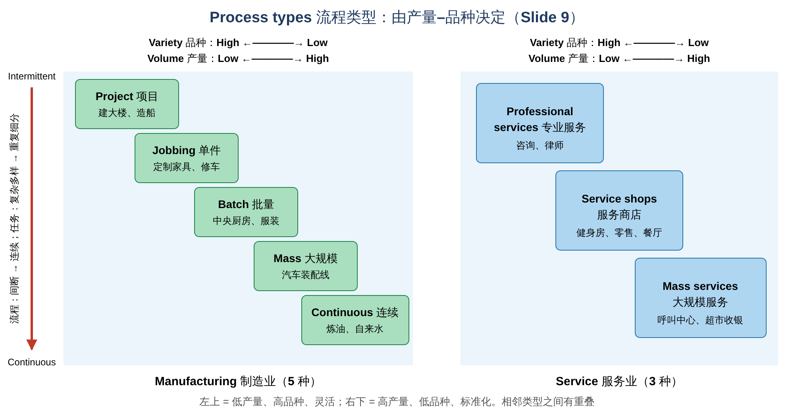

| | 左上 ←——————————→ 右下 |
|---|---|
| **Variety 品种** | High → Low |
| **Volume 产量** | Low → High |
| **Process tasks 任务** | **Diverse / complex**（多样复杂）→ **Repeated / divided**（重复、细分） |
| **Process flow 流动** | **Intermittent**（间断）→ **Continuous**（连续） |

- **Manufacturing process types 制造业（5 种）**：**Project → Jobbing → Batch → Mass → Continuous**
- **Service process types 服务业（3 种）**：**Professional services → Service shops → Mass services**

📝 **记忆口诀：** 制造业 **"项、单、批、大、连"**；服务业 **"专、店、众"**。
⚠️ **易错：** 图中相邻类型的方块 **互相重叠**，说明类型之间的边界不是绝对的（比如有些工厂介于 batch 和 mass 之间）。

### 2.2 制造业的五种流程

| 类型 | 讲义要点 | 💡 例子 |
|---|---|---|
| **Project processes 项目流程** | • **One-off, complex, large scale, high work content** "products"（一次性、复杂、规模大、工作量大） • **Specially-made, every one customized**（每一个都定制） • **Defined start and finish**: time, quality and cost objectives（有明确的开始和结束，有时间、质量、成本目标） • **Many different skills have to be coordinated**（需要协调很多不同技能） | 建摩天大楼、造船、拍电影、修建水坝、安装大型 IT 系统 |
| **Jobbing processes 单件流程** | • **Very small quantities**: "one-offs", or only a few required（数量极少） • Specially-made. **High variety, low repetition**. **"Strangers"** — every one customized • **Skill requirements are usually very broad**（技能要求很广） • **Skilled jobber, or team, complete whole product**（熟练工人或小团队完成整个产品） | 定制家具木匠、精密工具制造、修车厂、定制西装裁缝 |
| **Batch processes 批量流程** | • **Higher volumes and lower variety than for jobbing** • **Standard products, repeating demand. But can make specials**（标准产品、需求重复，但也能做特殊订单） • **Specialized, narrower skills**（技能更专、更窄） • **Set-ups (changeovers) at each stage of production**（每批之间要换型/准备） | 中央厨房、服装厂、机械零件加工、药品生产 |
| **Mass (line) processes 大规模（流水线）流程** | • **Higher volumes than batch** • **Standard, repeat products ("runners")** • **Low and/or narrow skills**（技能低/窄） • **No set-ups, or almost instantaneous ones**（几乎不用换型） | 汽车装配线、家电组装、瓶装饮料灌装 |
| **Continuous processes 连续流程** | • **Extremely high volumes and low variety: often single product** • Standard, repeat products ("runners") • **Highly capital-intensive and automated**（资本密集、高度自动化） • **Few changeovers required** • **Difficult and expensive to start and stop the process**（启动和停止都很难、很贵） | 炼油厂、发电厂、自来水厂、造纸厂、钢铁厂 |

> 💡 **补充：Runners、Repeaters、Strangers（产品按需求频率的分类）**
> - **Runners（常客）**：需求稳定、经常生产的标准产品 → 适合 mass / continuous
> - **Repeaters（回头客）**：定期重复生产的产品 → 适合 batch
> - **Strangers（陌生客）**：偶尔出现、每次都不同的定制需求 → 适合jobbing / project
>
> ⚠️ **Project vs Jobbing 的区别：** 两者都高度定制。Project 的产品通常 **大、复杂、一次性**，资源常常 **为这个项目专门调配**（甚至要到现场去，如建筑工地）；Jobbing 的产品 **较小**，在 **同一个车间** 里用共享的设备做很多不同的小订单。

### 2.3 服务业的三种流程

| 类型 | 讲义要点 | 💡 例子 |
|---|---|---|
| **Professional service 专业服务** | • **High levels of customer (client) contact**（与客户接触多） • **Clients spend a considerable time in the service process**（客户在流程中花很多时间） • **High levels of customization**, with service processes being highly adaptable（高度定制、流程灵活） • **Contact staff are given high levels of discretion**（一线员工有很大的自主决定权） • **People-based rather than equipment-based**（靠人，而不是靠设备） | 管理咨询、律师事务所、建筑设计、私人医生 |
| **Service shops 服务商店** | • **Medium levels of volumes** of customers • **Medium, or mixed, levels** of customer contact, customization and staff discretion（各方面都 **中等或混合**） | 健身房、银行网点、酒店、零售店、餐厅、租车公司 |
| **Mass service 大规模服务** | • **High levels of volumes** of customers • **Low to medium** levels of customer contact • **Low, or mixed,** levels of customization • **Low, or mixed,** levels of staff discretion | 呼叫中心、超市、机场安检、铁路/地铁、大型快递公司 |

📝 **规律：** 从专业服务 → 服务商店 → 大规模服务，**顾客数量↑，接触、定制、员工自主权↓**。

### 2.4 课堂活动：识别八张图片的流程类型（Slide 18–20）

> 💡 **参考答案**（讲义只给了图片 A–H，顺序正好对应前面介绍的 8 种类型）：
>
> | 图片 | 内容 | 流程类型 | 理由 |
> |---|---|---|---|
> | **A** | 建筑工地上戴安全帽的人 | **Project** | 一次性、大型、复杂，需要协调多种技能 |
> | **B** | 木工车间 | **Jobbing** | 小批量定制，工人技能广，独自完成整件产品 |
> | **C** | 专业厨房里的厨师 | **Batch** | 按批次准备标准菜品，也能做特殊要求，岗位技能较专 |
> | **D** | 汽车装配线 | **Mass** | 高产量标准产品，工人技能窄，几乎无换型 |
> | **E** | 水处理/泵站厂房 | **Continuous** | 极高产量、单一产品、资本密集、高度自动化、不轻易停机 |
> | **F** | 商务会议（咨询团队） | **Professional service** | 与客户高度接触、高度定制、靠人 |
> | **G** | 健身房 | **Service shop** | 中等顾客量，接触和定制程度中等 |
> | **H** | 呼叫中心 | **Mass service** | 大量顾客，标准化流程，员工自主权低 |
>
> ⚠️ 实际判断时要看 **具体流程**，而不是行业。例如同是餐厅，快餐店的厨房更接近 mass，而高级餐厅的厨房更接近 jobbing/batch。

### 2.5 ⭐ 流程设计要素受产量–品种影响（Slide 21）

> **The elements of process design are strongly influenced by the volume–variety requirements placed on the process.**

**Process design characteristics（流程设计特征）**，例如：**performance objectives（绩效目标）、tasks（任务）、flow（流动）、layout（布局）、technology（技术）、job design（岗位设计）**，都应该落在一条 **"Natural" line of fit（自然匹配线）** 上：
- 低产量、高品种 → 灵活的设计
- 高产量、低品种 → 标准化、低成本的设计

### 2.6 ⭐ Product–process matrix 产品–流程矩阵（Slide 22）

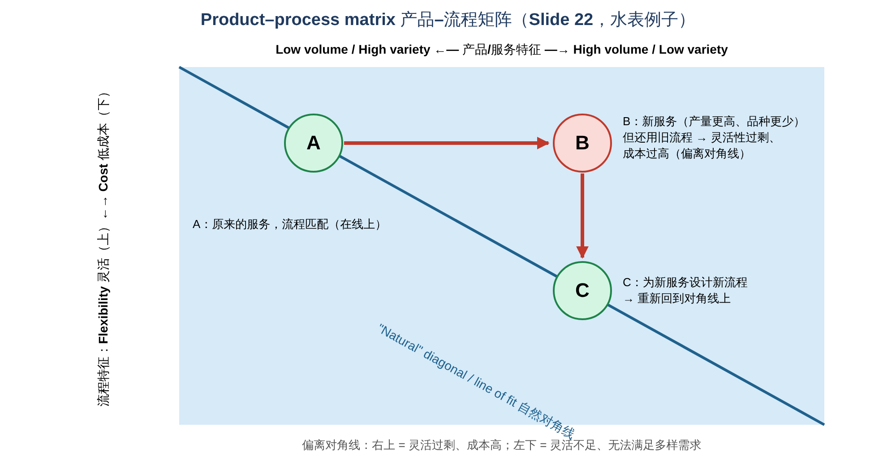

- **横轴：Product/service characteristics（产品/服务特征）**：Low volume, high variety → High volume, low variety
- **纵轴：Process performance characteristics（流程绩效特征）**：Flexibility（上）→ Cost（下）
- **对角线 = "natural" diagonal / "line of fit"（自然对角线/匹配线）**

**水表（water meter）例子：**

| 点 | 情况 |
|---|---|
| **A** | **Original service with appropriate process characteristics**：原来的服务，流程匹配（在对角线上） |
| **B** | **New service, old process, so excess process flexibility and high cost**：服务变成高产量、低品种了，但还在用原来那个灵活的旧流程 → **灵活性过剩、成本高** |
| **C** | **New service with new process having appropriate process characteristics**：为新服务设计新流程 → 重新回到对角线 |

> 💡 **补充：偏离对角线的两种情况**
> - **在对角线右上方（如 B）**：流程太灵活 → 成本太高（"用手工作坊的方式去做大批量"）
> - **在对角线左下方**：流程太僵化 → 满足不了多样化需求（"用流水线去做定制产品"）
>
> 这和 Topic 2 的 **line of fit** 是同一个思想：**运营能力要和市场要求匹配**。

### 2.7 流程技术和岗位设计也随产量–品种变化（Slide 23–24）

**① Process technology 流程技术**

| 维度 | 低产量、高品种 | 高产量、低品种 |
|---|---|---|
| **Automation 自动化** | Low | High |
| **Scale / scalability 规模** | Low | High |
| **Coupling / connectivity 耦合/连接度** | **Broad / unconstrained**（宽、不受约束） | **Narrow / constrained**（窄、受约束） |
| **整体** | **Manual, general purpose, small scale, flexible technology**（手动、通用、小规模、灵活的技术） | **Automated, dedicated, large scale, relatively inflexible technology**（自动化、专用、大规模、相对不灵活的技术） |

**② Job design 岗位设计**

| 维度 | 低产量、高品种 | 高产量、低品种 |
|---|---|---|
| **Division of labour 分工** | **Broad**（宽，一人做多事） | **Narrow**（窄，一人只做一小步） |
| **Job definition 岗位定义** | **Flexible**（灵活） | **Closely defined**（严格规定） |
| **Job commitment 工作投入来源** | **Task-based**（来自工作本身） | **Process-based**（来自流程） |
| **整体** | **Broad, relatively undefined jobs with decision-making discretion and intrinsic job commitment**（宽泛、不太固定的岗位，有决策自主权，工作本身就能激发投入） | **Narrow, closely defined jobs with relatively little decision-making discretion, needing action to help commitment**（窄、严格规定的岗位，自主权小，需要采取措施提高员工投入） |

> 💡 **补充："needing action to help commitment" 是什么意思？** 流水线工作重复单调，员工容易厌倦、缺乏投入感，所以企业需要 **岗位轮换（job rotation）、岗位扩大化（job enlargement）、团队合作、激励机制** 等措施。

---

## 3. ⭐ Process Mapping 流程图（LO 3）

### 3.1 什么是流程图？（Slide 25）

- **Breakdown of a process showing the flow of activities**；不同的活动用 **不同的符号（process mapping symbols）** 表示。
- **Describing processes in terms of how the activities within the process relate to each other.**（描述流程中各活动之间如何关联）

### 3.2 ⭐ 常用符号（Slide 26）

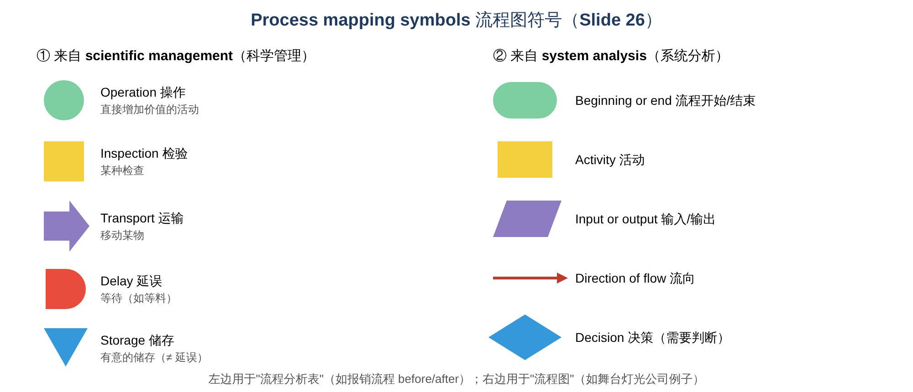

| **Derived from scientific management（科学管理）** | | **Derived from system analysis（系统分析）** | |
|---|---|---|---|
| ● 圆形 | **Operation**：an activity that **directly adds value**（直接增值的活动） | 圆角长条 | **Beginning or end** of process（开始/结束） |
| ■ 方形 | **Inspection**：a check of some sort（检验） | 矩形 | **Activity**（活动） |
| ➡ 箭头 | **Transport**：a movement of something（运输/移动） | 平行四边形 | **Input or output** from the process（输入/输出） |
| D 形 | **Delay**：a wait, e.g. for materials（延误/等待） | → 细箭头 | **Direction of flow**（流向） |
| ▼ 倒三角 | **Storage**：deliberate storage, as opposed to a delay（有意的储存） | ◆ 菱形 | **Decision**（exercising discretion）（决策/判断） |

⚠️ **易错：Delay vs Storage**
- **Delay（延误）**：**不想要的等待**，例如等材料、等审批 → 应该消除
- **Storage（储存）**：**有意的储存**，例如成品放进仓库、文件归档 → 是计划内的

> 💡 **补充：** 五个"科学管理"符号中，**只有 Operation 直接增加价值**；Inspection、Transport、Delay、Storage 都 **不直接增值**。流程改进的思路就是：**尽量减少不增值的活动**（这是后面精益 Lean 的核心思想）。

### 3.3 ⭐ Flow process chart：报销流程 Before vs After（Slide 27）

讲义用 **流程分析表（flow process chart）** 比较一个 **报销单处理流程（processing expenses）** 改进前后的情况。每一步标出属于哪种符号：

| 符号 | **Before（改进前）** | **After（改进后）** |
|---|---|---|
| ○ Operation 操作 | 7 | 5 |
| ➡ Transport 运输 | 8 | 5 |
| D Delay 延误 | 5 | 2 |
| □ Inspection 检验 | 5 | 2 |
| ▽ Storage 储存 | 1 | 1 |
| **合计步骤** | **26** | **15** |

📝 **改进的地方：**
- 删除了多次 **"Wait for processing"（等待处理）**：延误从 5 次降到 2 次；
- 合并了重复的 **检查（check expenses report、check advance payment、check employee record、check against rules……）**：检验从 5 次降到 2 次；
- 减少了在部门之间 **来回传递**（send to accounts receivable、send to account payable……）：运输从 8 次降到 5 次。
- **结果：步骤从 26 步减少到 15 步**，流程更快、更省。

### 3.4 Process map：舞台灯光公司的"询价到交付"流程（Slide 28）

讲义例子：一家 **舞台灯光租赁公司（stage lighting operation）** 的 **"enquire-to-delivery"（从询价到交付）** 流程，用系统分析符号画出：

1. **Customer request**（顾客请求）→ **Check availability file**（查库存记录）
2. 决策 **Supply from stock?（能用库存供货吗？）**
   - **Y** → Reserve on availability file（预留）→ Kit wagon to store（推车到仓库）→ **Assemble kit**（组装设备）
   - **N** → 决策 **Customer wants search?（顾客要我们去找吗？）**
     - **N** → Send customer guide（寄送指南）
     - **Y** → Search → 决策 **Find supplier?**：**N** → Call customer → Send customer guide；**Y** → Confirm to supplier → Supplier's equipment to store → **Stored equip.（储存）** → Assemble kit
3. Kit to workshop（送车间）→ Check equipment（检查）→ 决策 **Needs attention?**：**Y** → Repair（维修）→ Pack；**N** → **Pack for delivery** → **Deliver to customer**

📝 **读图要点：** 菱形/方框里的问句是 **决策点（Y/N 分支）**；流程图能清楚地显示 **有哪些分支、哪里可能等待、哪里可以改进**。

### 3.5 ⭐ Levels of process mapping：分层绘制流程（Slide 29）

讲义例子："supply-and-install"（供应与安装）流程被画成 **三个层次**：
1. **最高层：The operation of supplying and installing lighting equipment**（整个运营）
2. **中间层：The outline process**：**Enquire to delivery → Install and test → Collect and check**（三大步骤）
3. **最细层：The detailed process of the "install and test" activity**：To customer site → Safety check → Compliant?（N → Rectify in time? → Rectify 或 File failure note → Inform customer）→ Install → Routine control check → Pass check?（N → Rectify in time? → Rectify 或 Call for help）→ Job sign-off → Return to base

> 💡 **补充：为什么要分层？** 一张图如果把所有细节都画上，会太复杂、看不清。**高层图** 让管理层看到全局，**细节图** 让一线员工知道具体怎么做。可以把它理解为"地图的放大缩小"。

### 3.6 ⭐ 按可见度分层的流程图（Slide 30）

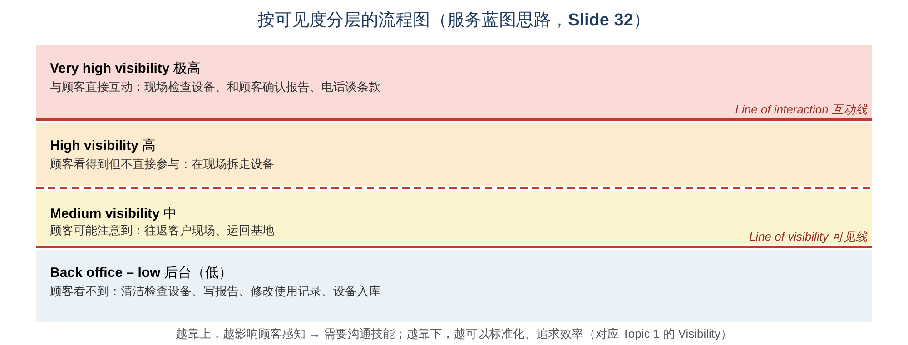

讲义例子："collect-and-check"（回收与检查）流程，按 **顾客能看到的程度** 分层：

| 层级 | 活动 |
|---|---|
| **Very high visibility 极高** | Check it worked OK → Worked OK?（N → Agree report）；Call customer to agree terms |
| —— **Line of interaction（互动线）** —— | |
| **High visibility 高** | Take out equipment（拆走设备） |
| **Medium visibility 中** | To site → To base（往返） |
| —— **Line of visibility（可见线）** —— | |
| **Back office – low visibility 后台（低）** | Check and clean equipment → Did it work OK?（N → Prepare report）→（Y）Equipment to store；Amend usage records |

- **Line of interaction（互动线）**：以上是 **顾客直接参与/互动** 的活动；
- **Line of visibility（可见线）**：以下是 **顾客看不到** 的后台活动。

> 💡 **补充：** 这种图在服务管理里叫 **Service blueprint（服务蓝图）**。它把 Topic 1 的 **Visibility** 画到了流程图上：
> - **可见线以上**：影响顾客感知 → 需要沟通技能、注重体验；
> - **可见线以下**：顾客看不到 → 可以标准化、集中处理、追求效率。

---

## 4. ⭐ Process Analytics 流程分析（LO 4）

### 4.1 关键指标一览（Slide 33）

| 指标 | 定义 |
|---|---|
| **Cycle time**（或 **takt time**） | The **average time between items being processed emerging from the process**（相邻两件成品从流程中出来的平均间隔时间） |
| **Work content** | The **total amount of work required to produce a unit of output**（生产一单位产出所需的总工作时间） |
| **Number of stages** | 流程分成几个阶段（工位） |
| **Process arrangement and balancing** | 流程的安排和平衡 |
| **Idle cycle time / rate** | 闲置时间 / 闲置率 |
| **Throughput time** | The **elapsed time between an item entering the process and leaving it**（一件东西从进入流程到离开流程所经过的时间） |
| **Throughput efficiency** | 增值工作时间占 throughput time 的比例 |
| **Work in progress (WIP)** | The **number of items within the process at any point in time**（任一时刻流程中的物品数量） |
| **Utilization** | The **proportion of available time that the resources within the process are performing useful work**（资源在可用时间中做有用工作的比例） |

### 🧋 本节贯穿全部计算的例子："茶语"奶茶店

光看公式很难懂，所以下面每个指标都 **用同一家奶茶店算一遍**。先记住这家店的情况：

**① 做一杯珍珠奶茶要 5 个步骤：**

| 步骤 | 内容 | 时间 |
|---|---|---|
| A | 点单收银 | 1.0 分钟 |
| B | 泡茶倒茶 | 1.0 分钟 |
| C | 加珍珠和配料 | 1.5 分钟 |
| D | 加冰摇匀 | 0.5 分钟 |
| E | 封口装袋、交给顾客 | 1.0 分钟 |
| | **合计** | **5.0 分钟** |

**② 需求：** 午餐高峰 12:00–14:00（**2 小时 = 120 分钟**），预计要卖 **60 杯**。

⚠️ **最容易混淆的三个时间**（先有个直观印象，后面逐个算）：

| | 含义 | 🧋 在奶茶店里 |
|---|---|---|
| **Work content 工作内容** | **做一杯一共需要多少工作时间**（所有步骤相加） | 1 + 1 + 1.5 + 0.5 + 1 = **5 分钟** |
| **Cycle time 周期时间** | **每隔多久出来一杯** | 三个人分工后，**每 2 分钟** 出一杯 |
| **Throughput time 流程时间** | **一位顾客从进店排队到拿到奶茶，总共花多久**（包括等待） | 前面排了很多人时，可能要 **30 分钟** |

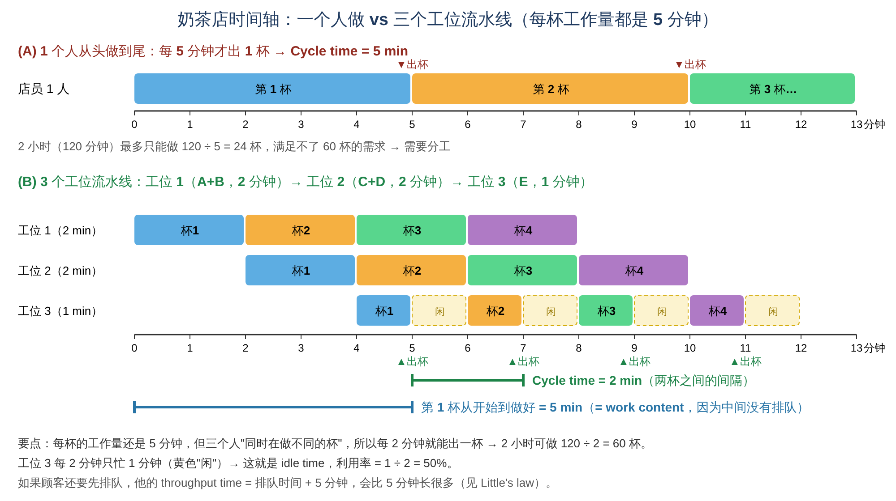

📝 **看图理解：** 图 (B) 里，每杯奶茶本身都要 5 分钟（蓝色线），但三个工位 **同时在做不同的杯**，所以 **每 2 分钟** 就有一杯出来（绿色线）。**Work content 看"一杯"，cycle time 看"间隔"。**

### 4.2 ⭐ Cycle time 周期时间（Slide 34）

- **Is the time in between processed, finished units emerge from the transformation process**（每件成品或每位服务好的顾客从运营中出来的间隔时间）
- **Is this different from total processing time?** → **是的！** Cycle time 是"**出产间隔**"，total processing time（work content）是"**做一件要花的总时间**"。多个工位同时工作时，cycle time 可以比 work content 短很多。
- 估算 cycle time 需要：**Available time（可用时间）** 和 **Number of units to be processed（需要处理的数量）**

> **Cycle time = Total work time available ÷ Units to be processed (required to satisfy demand)**

> 💡 **Takt time（节拍时间）**：来自德语 "Takt"（节拍）。它是 **为了满足需求，每多少时间必须产出一件**，就像音乐的节拍一样。

**🧮 举个例子：奶茶店的 cycle time**

> **问题：** 午餐 2 小时要卖 60 杯，平均每隔多久必须做好一杯？
>
> **Step 1 统一单位：** 2 小时 = 120 分钟\
> **Step 2 代入公式：** Cycle time = 120 分钟 ÷ 60 杯 = **2 分钟/杯**\
> **意思：** 想满足需求，店里 **每 2 分钟就要出一杯**。出得比这慢，就会有顾客买不到、队越排越长。

**反过来用（已知 cycle time 求产量）：** 产量 = 可用时间 ÷ cycle time
- 如果只有 1 个店员从头做到尾，每杯 5 分钟 → cycle time = 5 分钟 → 2 小时只能做 120 ÷ 5 = **24 杯**（远少于 60 杯，见上面的图 A）。
- 所以 **"Is cycle time different from total processing time?"** 答案就在这里：一个人做时两者相等（都是 5 分钟）；分工以后，cycle time（2 分钟）可以比 total processing time（5 分钟）**短很多**。

**🔁 再练一个：** 一家洗车店每天营业 10 小时，要洗 150 辆车。Cycle time = 600 分钟 ÷ 150 = **4 分钟/辆**。

### 4.3 ⭐ Number of stages 阶段数（Slide 35）

- **Benefits obtained from dividing tasks and division of labour**（把任务分开、分工带来的好处）
- 已知 **total processing time（work content）** 和 **cycle time**，就能算出需要几个阶段：

> **Number of stages = Total processing time (Work content, WC) ÷ Cycle time (CT)**

- **When does the work content equal the cycle time?** → 当 **只有一个阶段（一个人做完全部工作）** 时，work content = cycle time。
- ⚠️ 算出来如果是小数，要 **向上取整**（3.5 → 4），因为阶段数（人数、工位数）必须是整数，而且向下取整会导致产能不够。

**🧮 举个例子：奶茶店需要几个工位？**

> **已知：** Work content = 5 分钟（一杯的全部工作）；Cycle time = 2 分钟（每 2 分钟要出一杯）\
> **代入：** Stages = 5 ÷ 2 = **2.5 → 向上取整 = 3 个工位**（3 个店员）
>
> **为什么不能取 2？** 如果只用 2 个人，每人平均要做 5 ÷ 2 = 2.5 分钟 → 每 2.5 分钟才出一杯 → 2 小时只有 120 ÷ 2.5 = 48 杯，**不够 60 杯**。\
> **直观理解：** 一杯要 5 分钟的工作，但每 2 分钟就要交出一杯 → 一个人跟不上，至少要 3 个人一起分担。

**怎样把 5 个步骤分到 3 个工位？（考试常考的方法）**
1. **按顺序** 从第一个步骤开始往工位里放；
2. 每放一个就加一下时间，**只要不超过 cycle time（2 分钟）就继续放**；
3. 再放就会超过 2 分钟时，**开一个新工位**。

| 工位 | 放进去的步骤 | 累计时间 | 说明 |
|---|---|---|---|
| 工位 1 | A（1）+ B（1） | **2.0 分钟** | 再加 C（1.5）会变成 3.5 > 2，停 |
| 工位 2 | C（1.5）+ D（0.5） | **2.0 分钟** | 再加 E（1）会变成 3 > 2，停 |
| 工位 3 | E（1） | **1.0 分钟** | 没有步骤了 |

✅ 每个工位都 ≤ 2 分钟，所以整条线能做到 **每 2 分钟出一杯**。

### 4.4 ⭐ Process balancing 流程平衡与 idle time（Slide 40）

**平衡（balancing）**：把工作尽量平均地分配到各个阶段，让每个阶段的工作量都接近 cycle time。

> **Idle cycle time = Σ (Cycle time − Stage time)**

> **Idle cycle time rate = Σ (Cycle time − Stage time) ÷ (Cycle time × No. of stages)**

> 💡 **补充：Balancing efficiency（平衡效率）= 1 − idle rate**，也可以写成：\
> **Balancing efficiency = Work content ÷ (Cycle time × No. of stages)**\
> 平衡效率越高，说明人和设备的闲置越少。

**🧮 举个例子：奶茶店的闲置时间**

> 三个工位的工作量：**2 分钟、2 分钟、1 分钟**；cycle time = 2 分钟。
>
> **Step 1 每个工位闲多久？**（每 2 分钟一轮里，没事做的时间）\
> 工位 1：2 − 2 = 0；工位 2：2 − 2 = 0；工位 3：2 − 1 = **1 分钟**
>
> **Step 2 Idle cycle time（加起来）** = 0 + 0 + 1 = **1 分钟**
>
> **Step 3 Idle rate** = 1 ÷ (2 × 3) = 1 ÷ 6 = **16.7%**\
> 分母 "2 × 3" 的意思是：每一轮 3 个人各有 2 分钟，一共 **6 个"人·分钟"** 可以用；其中 1 个被浪费了。
>
> **Step 4 Balancing efficiency** = 1 − 16.7% = **83.3%**（也可以算 5 ÷ 6 = 83.3%：6 个人·分钟里，真正在做奶茶的是 5 个）

**顺便算 utilization（利用率）：** 工位 3 每 2 分钟只忙 1 分钟 → 利用率 = 1 ÷ 2 = **50%**；工位 1、2 的利用率都是 100%。
💡 **怎么改进？** 可以让工位 3 的店员在空闲时顺便 **补珍珠、擦台面**，或者让他兼做一部分点单工作。

### 4.5 ⭐ Bottleneck 瓶颈（Slide 41–42）

> **The bottleneck is that part of the process that is the most overloaded, relative to its capacity.**\
> **瓶颈 = 相对于自身产能，负荷最重的那个环节。**

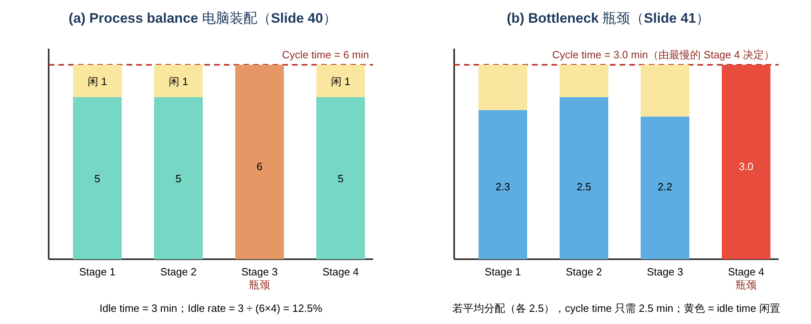

讲义例子（右图 b）：4 个阶段的工作时间为 **2.3、2.5、2.2、3.0 分钟**
- **(a) 平均分配**：每个阶段 2.5 分钟 → cycle time = **2.5 分钟**
- **(b) 分配不均**：最慢的 Stage 4 要 3.0 分钟 → **整个流程的 cycle time 变成 3.0 分钟**，其他阶段都会出现闲置（黄色部分）

📝 **核心规律：流程的速度由最慢的环节（瓶颈）决定。** 就像一个木桶能装多少水，取决于最短的那块木板。

**🧮 举个例子：奶茶店来了个新人**

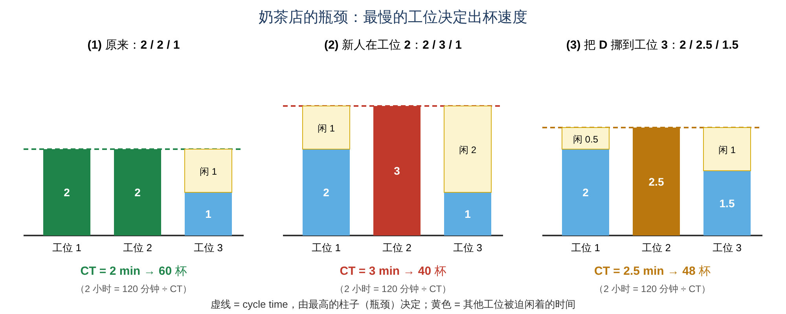

> **情况 (1) 原来：** 三个工位 2 / 2 / 1 分钟 → 最慢的是 2 分钟 → CT = 2 → 2 小时 120 ÷ 2 = **60 杯**
>
> **情况 (2) 工位 2 换了新人**，加珍珠（C）手慢，从 1.5 分钟变成 2.5 分钟 → 工位 2 = 2.5 + 0.5 = **3 分钟**
> - 工位 1 每 2 分钟就做好一杯半成品，但工位 2 要 3 分钟才能接下一杯 → 杯子在工位 2 前面 **越堆越多**；
> - 工位 3 每 3 分钟才收到一杯 → 只能干等；
> - **整条线每 3 分钟才出一杯 → 2 小时只有 120 ÷ 3 = 40 杯**，少卖了 20 杯！
> - **工位 2 就是瓶颈。**
>
> **情况 (3) 改进：** 把"加冰摇匀"（D，0.5 分钟）从工位 2 挪到工位 3 → 2 / **2.5** / 1.5 → CT = 2.5 → **48 杯**（好了一些）\
> 想回到 60 杯？要直接解决瓶颈：**培训新人** 或 **在工位 2 加一个帮手**。

⚠️ **最常见的错误：** 在 **非瓶颈** 的地方加人（例如给工位 1 加一个人）**一杯都不会多卖**，因为工位 2 还是每 3 分钟才放行一杯。**改进要先找瓶颈。**

**🌰 讲义例子：自动扶梯（escalator）**

| | **Traditional arrangement 传统** | **New arrangement 新安排** |
|---|---|---|
| 做法 | 右边站人、左边走人 | 不走，两边都站人 |
| 高峰期容量 | 约 **115 人/分钟** | 约 **150 人/分钟** |
| 排队 | 站的和走的混在一起，**混乱** | **更有秩序** |

→ **Requiring passengers to stand on both sides of the escalator makes it less of a bottleneck.**
💡 为什么？大多数人选择站着，于是"站立"那一侧排起长队，而"行走"那一侧却很空（愿意走的人少，而且走的人之间间隔大）。让两边都站人，扶梯的 **每一级台阶都被充分利用**，瓶颈就缓解了。

### 4.6 ⭐ Little's Law 利特尔法则（Slide 43–45）

> **Throughput time (TH) = Work In Progress (WIP) × Cycle Time (CT)**

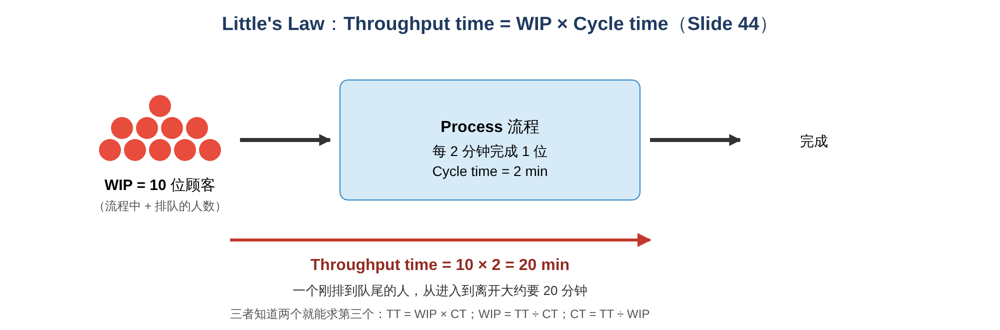

- **The mathematical representation between throughput time, work-in-progress and cycle time.**（流程时间、在制品和周期时间之间的数学关系）
- **Studies and measures the average performance of an operation over time.**（衡量运营在一段时间内的 **平均** 表现）
- **Measures changes over time or when new processes are introduced.**（衡量变化，或引入新流程后的效果）
- 在运营管理和管理决策中有 **很多用途**。

⚠️ **符号注意：** 讲义把 **Throughput time（流程时间）** 简写为 **TH**。注意不要和 "throughput rate（产出率）" 搞混。本章 Little's law 求的是 **时间**。

> 💡 **补充：Little's law 的三种用法（知二求一）**
> - **TH = WIP × CT**（求要等多久）
> - **WIP = TH ÷ CT**（求流程里有多少件/多少人）
> - **CT = TH ÷ WIP**（求多久出一件）
>
> 💡 **另一种常见写法：** 很多教科书把 Little's law 写成 **WIP = Throughput rate × Throughput time**。因为 throughput rate（产出率）= 1 ÷ cycle time，两种写法是 **完全等价** 的。

**🧮 举个例子：你在奶茶店要等多久？**

> **情况：** 12:30 你走进奶茶店，数了一下：前面排队的 + 正在做的，一共 **15 人**（WIP = 15）。店里每 **2 分钟** 出一杯（CT = 2）。
>
> **代入：** Throughput time = WIP × CT = 15 × 2 = **30 分钟**\
> **意思：** 你大约要 **30 分钟** 才能拿到奶茶。\
> **为什么是相乘？** 你前面的 15 个人，每人"占用"2 分钟的出杯时间，15 个 2 分钟就是 30 分钟。

**知二求一的另外两种用法：**

> **① 求 WIP：** 店长希望顾客最多等 **10 分钟**。队伍最多能有几人？\
> WIP = TT ÷ CT = 10 ÷ 2 = **5 人**。超过 5 人时，就该加开一个工位或者引导顾客用 App 预约。
>
> **② 求 CT：** 你观察到店里平均有 **12 人**，顾客平均要等 **36 分钟**。这家店多久出一杯？\
> CT = TT ÷ WIP = 36 ÷ 12 = **3 分钟/杯**。

**讲义问题：WIP = 10 位顾客，cycle time = 2 分钟（Slide 44）**
- **Throughput time = 10 × 2 = 20 分钟**
- **How long does the first customer in the queue need to wait?** 💡 排在最前面的顾客 **几乎马上就能完成**，大约 **2 分钟**（一个 cycle time）。
- **How long does the last customer in the queue need to wait?** 💡 排在最后的顾客前面有 10 人，大约要 **10 × 2 = 20 分钟**。
- → Little's law 算出的是 **一个新进入的人（排在队尾）平均需要的时间**。

**讲义例子：Steve Madden 鞋店门口排队（Slide 45）**
- 数一数队伍：**WIP = 14 人**，每 **2 分钟** 进去一位（CT = 2）
- **TH = 14 × 2 = 28 分钟**
- ⚠️ 讲义写的是 "customer at the beginning of the queue has to wait…28 mins"。按 Little's law 的逻辑，**要等 28 分钟的应该是刚排到队尾的那位顾客**；排在最前面的人很快就能进去。考试时建议写成 "**a customer joining the end of the queue** will wait about 28 minutes"。

### 4.7 ⭐ Throughput efficiency 流程效率（Slide 46）

> **Throughput efficiency is the work content (of whatever is being processed) as a percentage of its throughput time.**\
> 在 throughput time 中，**真正在做有用（增值）工作** 的时间占多少比例。

> **Throughput efficiency = Work content (WC) ÷ Throughput time × 100%**

**🧮 举个例子：你那杯奶茶的流程效率**

> 接着上面：你从排队到拿到奶茶共 **30 分钟**（throughput time），但真正有人在为你做奶茶的时间只有 **5 分钟**（work content）。
>
> **代入：** Throughput efficiency = 5 ÷ 30 × 100% = **16.7%**\
> **意思：** 你在店里的时间，只有 16.7% 是"有用的"，**83.3% 都在排队等**。\
> **怎么提高？** 让员工手更快作用有限（5 分钟最多压到 4 分钟）；**真正有效的是减少排队**，例如 App 预点单、高峰期加开工位。效率就能从 16.7% 大幅提高。

**🌰 讲义例子：Blood Transfusion Service（爱尔兰输血服务中心 IBTS，价值流图，Slide 47）**
- 献血者的流程：**Registration（登记）→ Interview（面谈）→ Hb（血红蛋白检测）→ Venepuncture（采血）→ Beds（卧床休息）→ Canteen（餐厅休息）**
- **Value added time（增值时间）= 28 分钟**
- **Total time in clinic（总时间）= 1 小时 53 分钟（113 分钟）**
- 💡 **Throughput efficiency ≈ 28 ÷ 113 ≈ 24.8%**：献血者在诊所里约 **3/4 的时间都在排队等待**（图中各环节之间的等待时间分别为 6、14、40、25 分钟，最长的是 Hb 检测前等 40 分钟）。

> 💡 **补充：** 这种图叫 **Value stream map（价值流图）**，是精益管理（Lean）常用的工具。它把 **增值时间** 和 **等待时间** 分开画，让人一眼就看出浪费在哪里。

### 4.8 ⭐ Stage arrangement：Long-thin vs Short-fat（Slide 48–49）

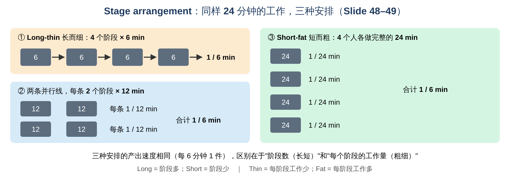

- **Long and short describes the number of stages**（长/短 = 阶段的 **数量**）
- **Fat and thin describes the amount of work at each stage**（粗/细 = **每个阶段的工作量**）

讲义例子：同样是 **24 分钟** 的工作，要求 **每 6 分钟产出 1 件**：

| 安排 | 做法 | 产出 |
|---|---|---|
| **Long-thin** | 1 条线，**4 个阶段 × 6 分钟** | 1 件 / 6 分钟 |
| 中间型 | **2 条并行线**，每条 **2 个阶段 × 12 分钟** | 每条 1 件 / 12 分钟，合计 1 件 / 6 分钟 |
| **Short-fat** | **4 个人并行**，每人做完整的 **24 分钟** | 每人 1 件 / 24 分钟，合计 1 件 / 6 分钟 |

| **Advantages of long-thin processes 长而细的优点** | **Advantages of short-fat processes 短而粗的优点** |
|---|---|
| **Controlled flow**（流动可控） | **Higher mix flexibility**（品种组合更灵活：每条线可以做不同产品） |
| **Simple materials handling**（物料搬运简单） | **Higher volume flexibility**（产量更灵活：需求少时关掉几条线即可） |
| **Lower capital requirement (no duplication)**（资本需求低，设备不用重复购买） | **Greater robustness**（更稳健：一个人/一条线出问题，其他的照常运作） |
| **Greater efficiency**（效率更高：专业化分工） | **Less monotonous**（工作没那么单调） |
| **Higher space utilization**（空间利用率高） | **Higher ownership**（员工对产品有更强的责任感和成就感） |

**🧮 举个例子：奶茶店的三个店员，排成"长而细"还是"短而粗"？**

| | **Long-thin（现在的做法）** | **Short-fat（另一种做法）** |
|---|---|---|
| 安排 | 3 个工位排成一条线，每人只做一部分（2 / 2 / 1 分钟） | 3 个店员 **各自** 从点单到封口做完整的一杯（每人 5 分钟） |
| 每人出杯速度 | — | 每人 1 杯 / 5 分钟 |
| 整店 cycle time | 由瓶颈决定 = **2 分钟** | 3 人合起来：每 5 分钟出 3 杯 → 5 ÷ 3 ≈ **1.67 分钟** |
| 2 小时产量 | 120 ÷ 2 = **60 杯** | 120 ÷ 1.67 ≈ **72 杯** |
| 设备 | **1 套** 收银机、泡茶机、封口机 | 要 **3 套**（每人一套）→ 成本高、占地方 |
| 有人请假 | 整条线要重新分工，否则停摆 | 剩下 2 人照做：2 小时 48 杯（**更稳健**） |
| 员工感受 | 一直重复同一个动作，单调 | 每人做完整一杯，**不单调、有成就感** |

📝 **结论：** 这里 short-fat 产量更高，是因为它没有"工位 3 闲着"的平衡损失，代价是 **设备要买 3 套**。现实中选哪种，要看 **设备贵不贵、需求稳不稳定、品种多不多**。

> 💡 **记忆：** Long-thin = **流水线思维**（效率高、成本低，但僵化）；Short-fat = **"一人一摊"思维**（灵活、稳健、员工满意，但设备要重复购买）。这和 2.7 节岗位设计的 **narrow vs broad division of labour** 是同一个道理。

---

## 5. ⭐ 计算题详解（讲义三道例题）

### 例题 1：电脑装配（Computer assembly operation，Slide 36–40、46）

**已知：**
- **Available time = 16 小时**（2 班 × 8 小时）
- **No. of products to be processed = 160 台**
- **Work content = 21 分钟/台**，各工序如下：

| 代码 | 工序 | 紧前工序（Predecessor） | 时间（分钟） |
|---|---|---|---|
| a | Motherboard assembly 主板 | — | 2 |
| b | Processor assembly 处理器 | a | 2 |
| c | Fan assembly 风扇 | b | 1 |
| d | RAM memory assembly 内存 | c | 2 |
| e | Video card assembly 显卡 | d | 3 |
| f | Audio card assembly 声卡 | d | 1.5 |
| g | DVD unit assembly 光驱 | d | 1.5 |
| h | Hard drive assembly 硬盘 | e, f, g | 3 |
| i | Energy source assembly 电源 | h | 3 |
| j | Case assembly 机箱 | i, h | 2 |
| | **Work content 合计** | | **21** |

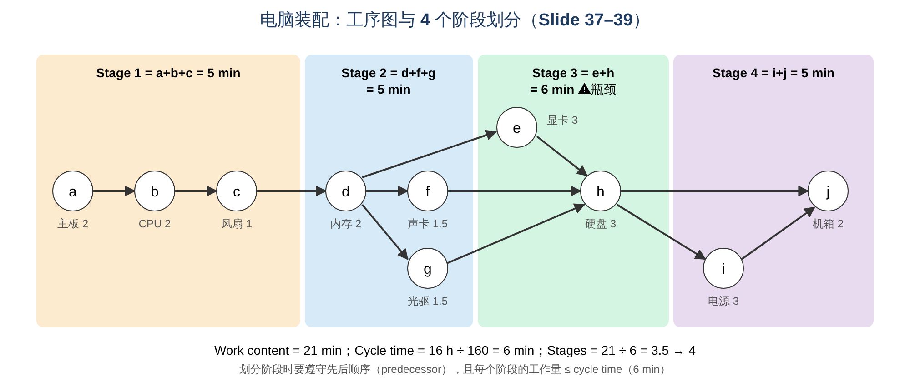

**Step 1：Cycle time**
> CT = 16 h ÷ 160 = 0.10 h = **6 min**

**Step 2：Number of stages**
> Stages = 21 ÷ 6 = 3.5 ≈ **4 stages**（向上取整）

**Step 3：分配工序到 4 个阶段**（每阶段 ≤ 6 分钟，并遵守先后顺序）

> **怎么分？**（和奶茶店的方法一样，只是多了"先后顺序"的限制）
> - 一个工序 **只有在它的紧前工序都放好之后** 才能放（例如 h 要等 e、f、g 都放好）；
> - 在可以放的工序里挑一个放进当前阶段，**只要累计不超过 6 分钟就继续放**；
> - 放不下了就开下一个阶段。
>
> 实际过程：a(2) → +b = 4 → +c = 5（再加 d 会变成 7 > 6，停）→ **Stage 1 = 5**；\
> d(2) → +f = 3.5 → +g = 5（再加 e 会变成 8 > 6，停）→ **Stage 2 = 5**；\
> e(3) → +h = 6（刚好 6，停）→ **Stage 3 = 6**；\
> i(3) → +j = 5 → **Stage 4 = 5**。

| 阶段 | 工序 | 时间 |
|---|---|---|
| Stage 1 | a + b + c | 2 + 2 + 1 = **5 min** |
| Stage 2 | d + f + g | 2 + 1.5 + 1.5 = **5 min** |
| Stage 3 | e + h | 3 + 3 = **6 min**（瓶颈） |
| Stage 4 | i + j | 3 + 2 = **5 min** |

**Step 4：Idle time 与 idle rate**
> Idle cycle time = (6−5) + (6−5) + (6−6) + (6−5) = **3 min**\
> Idle rate = 3 ÷ (6 × 4) = 0.125 = **12.5%**
💡 平衡效率 = 1 − 12.5% = **87.5%**（= 21 ÷ 24）

**Step 5：Little's law（Slide 46）**
- WIP = 160 台，CT = 6 分钟，WC = 21 分钟
> TH = 160 × 6 = **960 min**（= 16 小时）\
> Throughput efficiency = 21 ÷ 960 = 0.0218 = **2.18%**

⚠️ 讲义在这里 **把一天的全部 160 台都当作 WIP**（相当于假设一开始所有订单就都在流程中排队）。所以算出来的 throughput time 正好等于 16 小时的可用时间。考试时 **按题目给的 WIP 数字直接代入即可**。

### 例题 2：车辆牌照中心（Vehicle licensing centre，Slide 47）

**题目：** 一个车辆牌照中心每个 **8 小时工作日** 平均处理 **5,000 份** 申请。有 **15,000 份** 申请正在处理或等待处理。处理一份申请所需的全部活动加起来是 **25 分钟**。求 throughput time 和 throughput efficiency。

**Step 1：Cycle time**
> CT = 8 h ÷ 5,000 = 480 min ÷ 5,000 = **0.096 min**\
> 💡 0.096 分钟 ≈ **5.8 秒**：整个中心（很多员工一起）平均每 5.8 秒就处理完一份申请。

**Step 2：Throughput time（Little's law）**
> TH = 15,000 × 0.096 = **1,440 min** = 24 小时 = **3 个 8 小时工作日**

**Step 3：Throughput efficiency**
> Throughput efficiency = 25 ÷ 1,440 = **1.74%**

📝 **解读：** 一份申请真正被处理的时间只有 25 分钟，却要在系统里待 3 个工作日，**超过 98% 的时间都在等待**。改进的方向是 **减少积压的 WIP**，而不是让员工做得更快。

### 例题 3：排队（Slide 44–45）
- 10 位顾客、CT = 2 分钟 → TH = **20 分钟**
- 14 位顾客、CT = 2 分钟 → TH = **28 分钟**

---

## 6. 课堂活动：McDonald's preparation line 麦当劳制作线（Slide 50）

讲义给出的工序和时间（单位：秒）：

| 工序 | 1. Order 点单（看屏幕） | 2. Bun toasting 烤面包 | 3. Assembly with condiments 加酱组装 | 4. Wrapping of patty with bun 包装 | 5. Order picked up 取餐（保温台） | 6. Customer service（order and payment）顾客服务 |
|---|---|---|---|---|---|---|
| **Task time** | — | **11** | **20** | **14** | **0** | **45** |
| **Elapsed time** | 0:00 | 0:11 | 0:31 | 0:45 | — | 1:30 |

讲义的四个问题：

> 💡 **参考答案**（讲义没有给出答案，以下按本章公式推算，假设每道工序各由一个工位负责，若老师课上有不同假设请以课堂为准）：
>
> **Q1. What is the cycle time of this process?**\
> Cycle time 由 **最慢的工序（瓶颈）** 决定：最长的是 **Customer service（点单与付款）45 秒**。\
> → **Cycle time = 45 秒**（每 45 秒完成一单）
>
> **Q2. How many finished orders can we process during lunch time (2 hrs of pick time)?**\
> 2 × 3,600 s ÷ 45 s = 7,200 ÷ 45 = **160 orders**
>
> **Q3. What is the throughput time?**\
> 一份订单走完全部工序的时间（不考虑排队）= 11 + 20 + 14 + 0 + 45 = **90 秒（1 分 30 秒）**，与表中最后的 elapsed time 1:30 一致。\
> （如果有顾客在排队，就要用 Little's law：TH = WIP × 45 秒。）
>
> **Q4. To increase the number of processed orders by 100%, what would you do?**\
> 产量翻倍 → cycle time 要从 45 秒降到 **22.5 秒**。
> - **处理瓶颈**：再开 **一个收银台/点餐机（customer service 变成 2 个并行工位）**，每 45 秒能完成 2 单，相当于 22.5 秒一单；
> - **检查下一个瓶颈**：接下来最慢的是 **Assembly 20 秒**，仍然 < 22.5 秒，所以不会拖慢流程 → **产量刚好翻倍到 320 单**；
> - 其他办法：引入 **自助点餐机 / 手机 App 点餐**（把点单付款从制作线上"拿走"）；高峰时段 **增加人手**（讲义图中也写了 "more personnel added during busy periods"）；提前 **批量预制** 热门产品放在保温柜里。
>
> ⚠️ **注意：** 只在非瓶颈工序加人（例如再加一个烤面包的人）**不会** 提高产量，因为瓶颈没有变。

---

## 7. 📐 公式卡（考前必背）

| 指标 | 公式 |
|---|---|
| **Cycle time** | CT = Total work time available ÷ Units to be processed |
| **Number of stages** | Stages = Work content ÷ Cycle time（**向上取整**） |
| **Idle cycle time** | Σ(Cycle time − Stage time) |
| **Idle cycle time rate** | Σ(CT − Stage time) ÷ (CT × No. of stages) |
| 💡 **Balancing efficiency** | 1 − Idle rate = WC ÷ (CT × No. of stages) |
| **Little's law** | Throughput time = WIP × Cycle time |
| **Throughput efficiency** | Work content ÷ Throughput time × 100% |
| 💡 **Output in a period** | Available time ÷ Cycle time |

⚠️ **单位一致！** 计算前先把小时、分钟、秒统一（例如 16 小时 = 960 分钟；8 小时 = 480 分钟；2 小时 = 7,200 秒）。

---

## 8. ⚠️ 易混淆概念汇总

| 容易混淆 | 区别 |
|---|---|
| Process network vs Process chain | 组织内所有流程连成的网络 vs 其中从供应商到顾客的一条具体路径 |
| 制造业 5 种 vs 服务业 3 种 | Project、Jobbing、Batch、Mass、Continuous vs Professional、Service shop、Mass service |
| Project vs Jobbing | 大型一次性、资源专门调配 vs 较小的定制品、在车间里共享设备 |
| Batch vs Mass | 每批之间需要换型、可做特殊订单 vs 几乎不换型、标准品（runners） |
| Mass vs Continuous | 离散的产品（一件件汽车）vs 不间断的流动（石油、水、电），开停很难 |
| Professional service vs Mass service | 接触多、定制、员工自主权大、靠人 vs 顾客多、接触少、标准化、自主权小 |
| Product–process matrix 偏离 | 右上 = 灵活过剩、成本高；左下 = 灵活不足 |
| Delay vs Storage | 不想要的等待 vs 有意的储存 |
| Operation 符号 | 五个科学管理符号中 **唯一直接增值** 的 |
| Line of interaction vs Line of visibility | 以上顾客直接互动 vs 以下顾客看不到（后台） |
| **Cycle time vs Work content vs Throughput time** | 出产间隔 vs 做一件的总工作时间 vs 从进到出的总时间（含等待） |
| Throughput time vs Throughput rate | 时间（多久）vs 速度（单位时间多少件 = 1/CT） |
| Stages 取整 | 3.5 → **4**（向上取整） |
| Bottleneck | 相对产能 **负荷最重** 的环节；决定整个流程的 cycle time |
| Idle time | 每个阶段 (CT − 阶段时间) 的总和 |
| Long/short vs fat/thin | 阶段 **数量** vs 每个阶段的 **工作量** |
| Long-thin vs Short-fat 优点 | 可控、简单、低资本、高效、省空间 vs 组合灵活、产量灵活、稳健、不单调、责任感强 |

---

## 9. 📖 中英术语表（Glossary）

| English | 中文 |
|---|---|
| Process design | 流程设计 |
| Process network / Process chain | 流程网络 / 流程链 |
| External suppliers / customers | 外部供应商 / 顾客 |
| Throughput time | 流程时间（通过时间） |
| In-process inventory / Work in progress (WIP) | 在制品 |
| Excess capacity / capability | 产能过剩 / 能力过剩 |
| Working capital | 营运资本 |
| Process types | 流程类型 |
| Project process | 项目流程 |
| Jobbing process | 单件（作业车间）流程 |
| Batch process | 批量流程 |
| Mass (line) process | 大规模（流水线）流程 |
| Continuous process | 连续流程 |
| Professional service | 专业服务 |
| Service shop | 服务商店 |
| Mass service | 大规模服务 |
| Intermittent / Continuous flow | 间断 / 连续流动 |
| One-off | 一次性 |
| Work content | 工作内容（总工作时间） |
| Set-up / Changeover | 准备 / 换型 |
| Runners / Repeaters / Strangers | 常客 / 回头客 / 陌生客（按需求频率分类） |
| Capital-intensive | 资本密集 |
| Customer contact | 顾客接触 |
| Customization | 定制化 |
| Staff discretion | 员工自主权 |
| Line of fit / Natural diagonal | 匹配线 / 自然对角线 |
| Product–process matrix | 产品–流程矩阵 |
| Automation | 自动化 |
| Coupling / Connectivity | 耦合 / 连接度 |
| Dedicated technology | 专用技术 |
| Job design | 岗位设计 |
| Division of labour | 分工 |
| Job definition / commitment | 岗位定义 / 工作投入 |
| Process mapping | 流程图 |
| Scientific management | 科学管理 |
| System analysis | 系统分析 |
| Operation / Inspection / Transport / Delay / Storage | 操作 / 检验 / 运输 / 延误 / 储存 |
| Flow process chart | 流程分析表 |
| Decision | 决策点 |
| Line of interaction | 互动线 |
| Line of visibility | 可见线 |
| Back office | 后台 |
| Process analytics | 流程分析 |
| Cycle time / Takt time | 周期时间 / 节拍时间 |
| Number of stages | 阶段数 |
| Process balancing | 流程平衡 |
| Idle cycle time / rate | 闲置时间 / 闲置率 |
| Bottleneck | 瓶颈 |
| Little's law | 利特尔法则 |
| Throughput efficiency | 流程效率 |
| Value added time | 增值时间 |
| Utilization | 利用率 |
| Stage arrangement | 阶段安排 |
| Long-thin / Short-fat process | 长而细 / 短而粗的流程 |
| Mix / Volume flexibility | 品种组合 / 产量灵活性 |
| Robustness | 稳健性 |
| Monotonous | 单调的 |
| Ownership | 责任感/主人翁意识 |
| 💡 Precedence (predecessor) | 先后顺序（紧前工序） |
| 💡 Balancing efficiency | 平衡效率 |
| 💡 Service blueprint | 服务蓝图 |
| 💡 Value stream map | 价值流图 |
| 💡 Job rotation / enlargement | 岗位轮换 / 岗位扩大化 |

---

## 10. ✍️ 自测题（Self-test）

### Part A：选择题

1. 以下哪种流程类型的特点是"one-off, complex, large scale, defined start and finish"？\
   A. Jobbing\
   B. Project\
   C. Batch\
   D. Mass

2. "Standard products, repeating demand, but can make specials; set-ups at each stage" 描述的是：\
   A. Jobbing\
   B. Batch\
   C. Mass\
   D. Continuous

3. 炼油厂最可能使用哪种流程？\
   A. Project\
   B. Batch\
   C. Mass\
   D. Continuous

4. "High customer contact, high customization, high staff discretion, people-based" 描述的是：\
   A. Professional service\
   B. Service shop\
   C. Mass service\
   D. Mass process

5. 在产品–流程矩阵中，一个高产量、低品种的服务仍在使用灵活的旧流程，结果是：\
   A. 灵活性不足\
   B. 灵活性过剩、成本高\
   C. 完全匹配\
   D. 质量下降

6. 高产量、低品种的流程，其岗位设计通常是：\
   A. Broad, flexible, task-based\
   B. Narrow, closely defined, process-based\
   C. Broad, closely defined\
   D. Narrow, flexible

7. 在流程图符号中，唯一 **直接增加价值** 的是：\
   A. Inspection\
   B. Transport\
   C. Operation\
   D. Storage

8. "Deliberate storage, as opposed to a delay" 用哪个符号表示？\
   A. D 形\
   B. 倒三角\
   C. 菱形\
   D. 圆形

9. 在服务蓝图式的流程图中，"line of visibility" 以下的活动是：\
   A. 顾客直接互动的活动\
   B. 顾客看不到的后台活动\
   C. 决策点\
   D. 运输活动

10. "The average time between items being processed emerging from the process" 是：\
    A. Throughput time\
    B. Work content\
    C. Cycle time\
    D. Utilization

11. 可用时间 10 小时，需要生产 300 件，cycle time 是：\
    A. 0.5 分钟\
    B. 2 分钟\
    C. 3 分钟\
    D. 30 分钟

12. Work content = 17 分钟，cycle time = 4 分钟，需要几个阶段？\
    A. 4\
    B. 4.25\
    C. 5\
    D. 68

13. 根据 Little's law，WIP = 30，cycle time = 3 分钟，throughput time 是：\
    A. 10 分钟\
    B. 33 分钟\
    C. 90 分钟\
    D. 27 分钟

14. 以下哪一项是 **short-fat** 流程的优点？\
    A. Simple materials handling\
    B. Lower capital requirement\
    C. Greater robustness\
    D. Higher space utilization

15. 流程的 cycle time 由什么决定？\
    A. 最快的阶段\
    B. 所有阶段的平均\
    C. 瓶颈（负荷最重的阶段）\
    D. 第一个阶段

### Part B：简答题

1. 写出流程设计的定义，并说明流程设计的五个绩效目标。
2. 比较 batch、mass 和 continuous 三种制造流程。
3. 说明服务业三种流程类型在顾客接触、定制化和员工自主权上的区别。
4. 解释产品–流程矩阵中的 A → B → C（水表例子）。
5. 区分 delay 和 storage，并说明为什么流程改进要减少不增值的活动。
6. 解释 cycle time、work content 和 throughput time 的区别。
7. 比较 long-thin 和 short-fat 流程的优点。

### Part C：计算题

1. 一家面包店每天工作 **8 小时**，需要生产 **240 个** 蛋糕。每个蛋糕的 work content 是 **10 分钟**。
   (a) 求 cycle time；(b) 需要几个阶段？(c) 如果各阶段时间分别为 2、2、2、2、2 分钟，求 idle time 和 idle rate。
2. 一家银行客服中心每 **8 小时** 处理 **960 个** 来电。某时刻有 **120 个** 来电正在处理或排队。处理一个来电实际需要 **4 分钟** 的工作。求 throughput time 和 throughput efficiency。
3. 一条 4 阶段生产线的阶段时间分别是 **3、4、5、3 分钟**。
   (a) 瓶颈是哪个阶段？流程的 cycle time 是多少？
   (b) 8 小时内能生产多少件？
   (c) 求 idle time 和 idle rate。

<b>👉 点击查看答案</b>

**Part A**
1. **B**
2. **B**
3. **D**
4. **A**
5. **B**
6. **B**
7. **C**
8. **B**
9. **B**
10. **C**
11. **B**（600 min ÷ 300 = 2 min）
12. **C**（17 ÷ 4 = 4.25 → 向上取整为 5）
13. **C**（30 × 3 = 90 min）
14. **C**（A、B、D 是 long-thin 的优点）
15. **C**

**Part B**
1. 流程设计是把设计变成实际形态、向顾客交付产品或服务的活动，目的是满足顾客需求，并且要考虑资源和环境。五个目标：Quality（零差错、符合规格）、Speed（最短的 throughput time）、Dependability（产出时间和数量可靠）、Flexibility（容易在不同处理状态之间切换）、Cost（产能合适、消除流程浪费）。
2. Batch：产量和品种中等，标准产品但能做特殊订单，技能较专，每批之间要换型；Mass：产量更高，标准重复产品（runners），技能低/窄，几乎不换型；Continuous：产量极高、往往单一产品，资本密集、高度自动化，很少换型，启动和停止都很难、很贵。
3. 专业服务：接触高、高度定制、员工自主权高；服务商店：三者都是中等或混合；大规模服务：顾客多，接触低到中等，定制和自主权低或混合。
4. A：原来的服务和流程匹配，在对角线上；B：服务变成高产量、低品种，但仍用原来灵活的流程 → 灵活性过剩、成本高；C：为新服务设计新流程，重新回到对角线。
5. Delay 是不想要的等待（如等料），storage 是有意的储存。只有 operation 直接增值；运输、检验、延误、储存都不增值，却消耗时间和成本，所以要尽量减少，例如报销流程从 26 步减到 15 步。
6. Cycle time：相邻两件成品出来的间隔；work content：做一件所需的全部工作时间；throughput time：一件东西从进入到离开流程的总时间（包括等待）。
7. Long-thin：流动可控、物料搬运简单、资本需求低、效率高、空间利用率高；Short-fat：品种组合和产量更灵活、更稳健、工作不单调、员工责任感更强。

**Part C**
1. (a) CT = 480 min ÷ 240 = **2 min**；(b) Stages = 10 ÷ 2 = **5 个**；(c) 每个阶段都是 2 分钟，与 CT 相等 → idle time = **0**，idle rate = **0%**（完美平衡）。
2. CT = 480 ÷ 960 = **0.5 min**；TH = 120 × 0.5 = **60 min**；Throughput efficiency = 4 ÷ 60 = **6.67%**。
3. (a) 瓶颈是 **第 3 阶段（5 分钟）**，cycle time = **5 min**；(b) 480 ÷ 5 = **96 件**；(c) Idle time = (5−3) + (5−4) + (5−5) + (5−3) = **5 min**；idle rate = 5 ÷ (5 × 4) = **25%**。

---

## 11. 📌 考前 1 分钟速记

1. **流程设计** = 把设计变成能交付产品/服务的实际形态；目标是 **Q、S、D、F、C**。
2. **制造业 5 种**：Project → Jobbing → Batch → Mass → Continuous（项、单、批、大、连）。
3. **服务业 3 种**：Professional → Service shop → Mass service（专、店、众）。
4. 越往右下：**产量↑、品种↓、任务重复细分、流动连续、标准化、成本低**。
5. **产品–流程矩阵**：要落在对角线上；偏右上 = 灵活过剩、成本高（水表 A → B → C）。
6. **技术**：低产量 → 手动、通用、灵活；高产量 → 自动化、专用、大规模。**岗位**：低产量 → 宽、灵活；高产量 → 窄、严格规定。
7. **流程图符号**：Operation（唯一增值）、Inspection、Transport、Delay、Storage；系统分析：开始/结束、活动、输入/输出、流向、决策。
8. **报销流程**：26 步 → 15 步（减少等待、检验、搬运）。
9. **分层画图**；**Line of interaction / Line of visibility** 区分前台与后台。
10. **CT = 可用时间 ÷ 数量**；**Stages = WC ÷ CT（向上取整）**。
11. **Idle rate = Σ(CT − 阶段时间) ÷ (CT × 阶段数)**；电脑装配：CT 6 min、4 stages、idle 3 min、12.5%。
12. **瓶颈** 决定整个流程的 cycle time（扶梯两边站：115 → 150 人/分钟）。
13. **Little's law：Throughput time = WIP × CT**（10 × 2 = 20；14 × 2 = 28）。
14. **Throughput efficiency = WC ÷ Throughput time**（电脑 2.18%；牌照中心 1.74%；输血 28 ÷ 113 ≈ 25%）。
15. **Long-thin**（阶段多、每阶段工作少：可控、高效、省钱）vs **Short-fat**（阶段少、每阶段工作多：灵活、稳健、不单调）。
