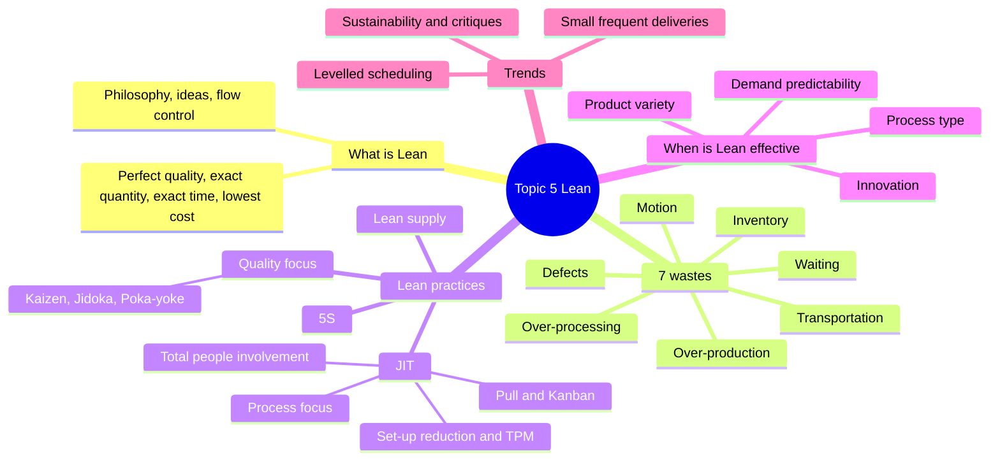
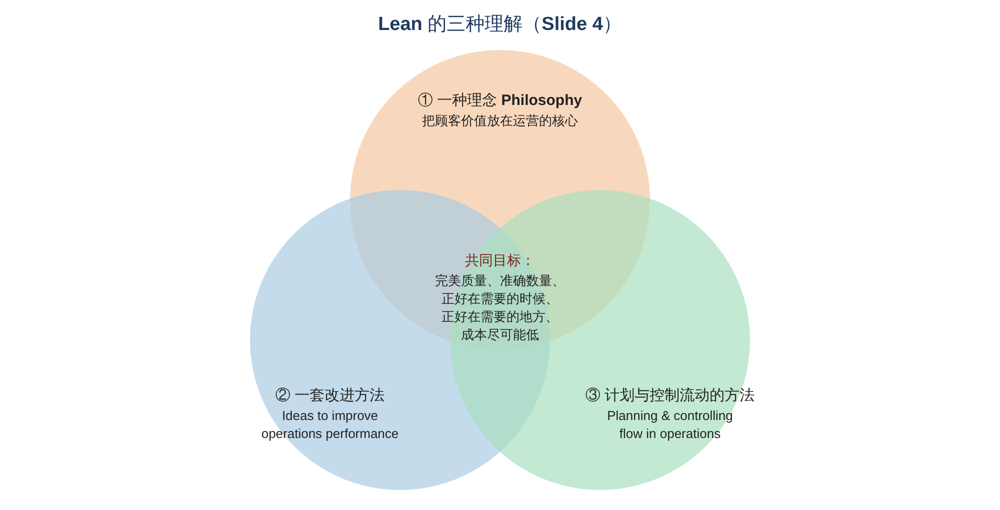
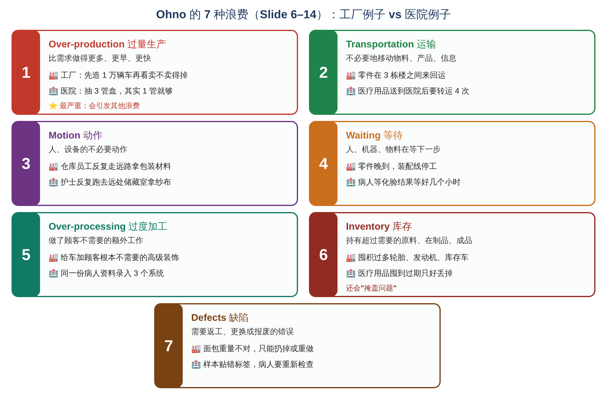
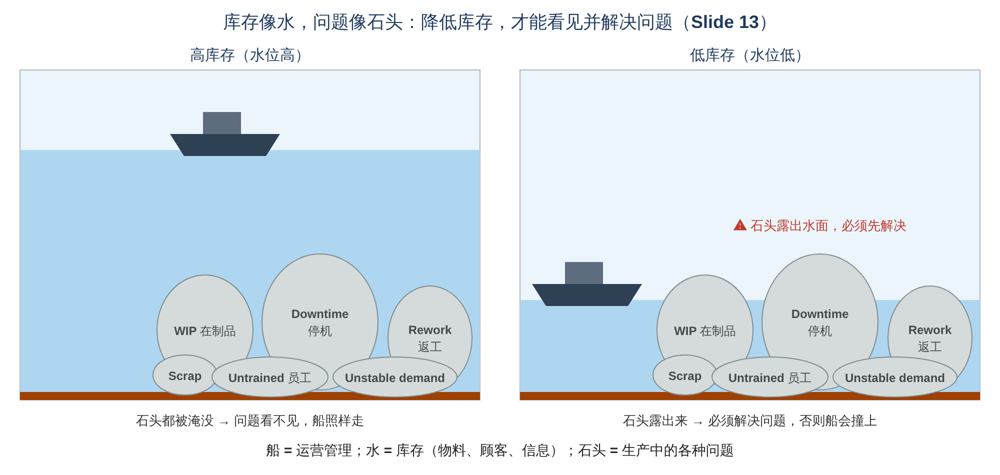
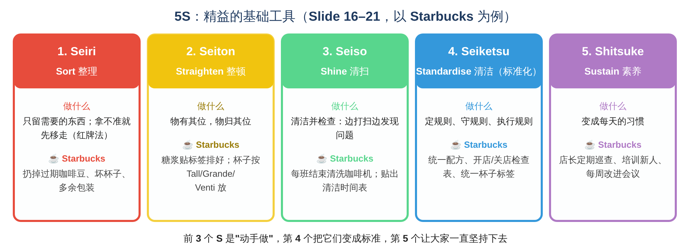
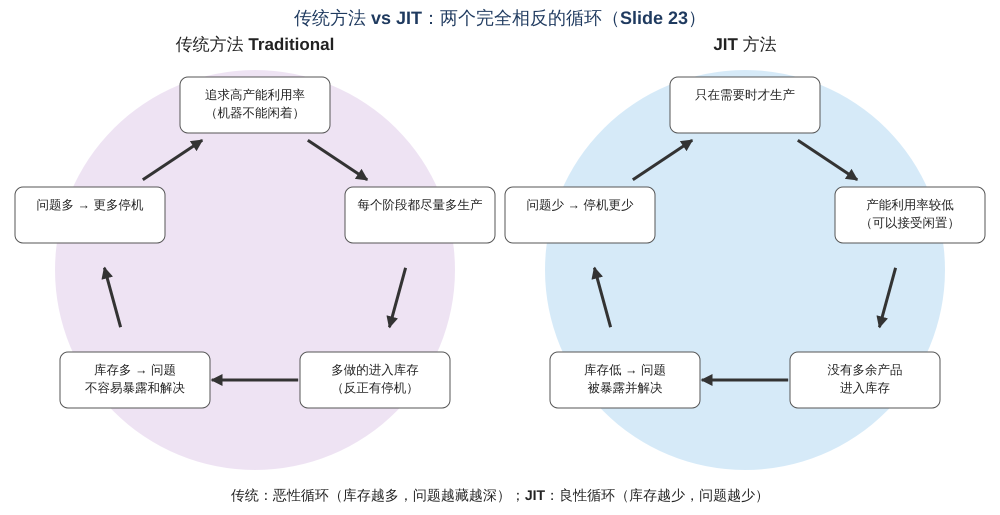
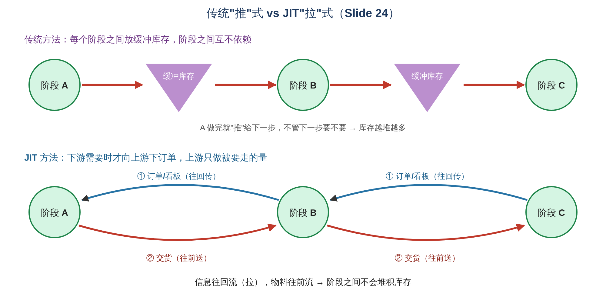
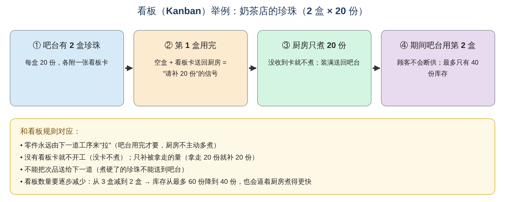
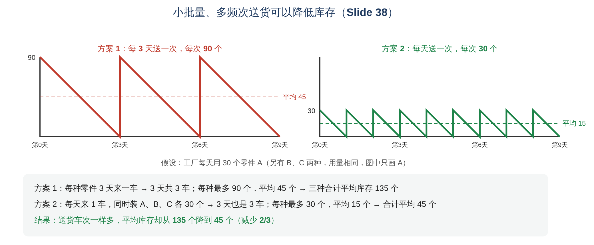
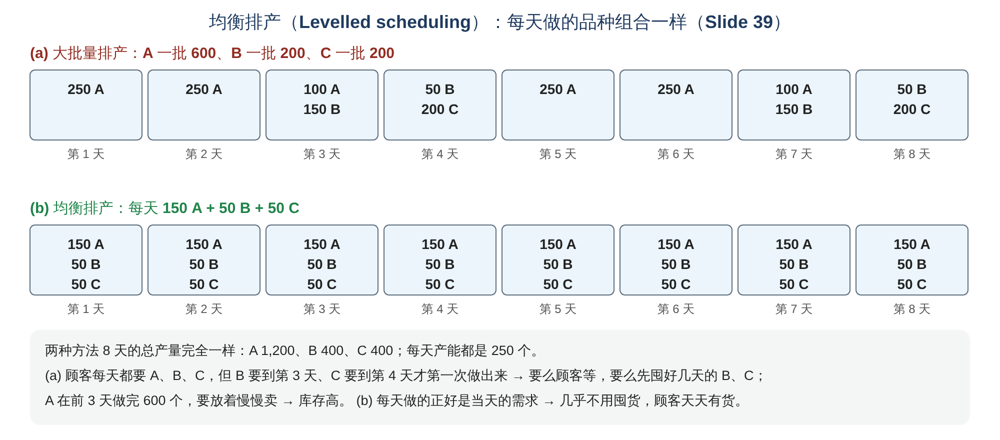

# Operations Management · Topic 5 精益管理（Lean Management）学习笔记

> 教材：Slack, Brandon-Jones & Burgess, *Operations Management*, 10th Edition — **Part Four "Development", Chapter 16 Lean operations**\
> 内容范围：讲义 Topic 5（共 40 页）
>
> 📌 阅读说明
> - **英文术语保留原文**（考试用英文作答），中文帮助理解。
> - **💡 补充** = 讲义没讲但能帮助理解的内容；**⚠️ 易错** = 容易混淆的地方；**🧮 举个例子** = 用具体数字或场景演示。
> - 文末有 **易混淆汇总、术语表、自测题（含答案）、课堂案例 SpeedServe Logistics 的参考答案**。

---

## 0. 一张图看懂本章

### 本章的五个学习目标（Learning Outcomes）

| # | Learning Outcome | 中文 |
|---|---|---|
| 1 | What is Lean Management & its importance | 什么是精益管理，为什么重要 |
| 2 | What is "Waste" for Lean | 精益眼中的"浪费"是什么 |
| 3 | Lean Management practices | 精益管理的具体做法 |
| 4 | When Lean is effective | 什么情况下精益最有效 |
| 5 | New Lean management trends | 精益管理的新趋势 |

**一句话总结本章：** 精益（Lean）的核心就是 **消除一切不为顾客增加价值的"浪费"**。先学会识别 **7 种浪费**，再用 **5S、JIT（准时制）、看板拉动、质量源头控制、精益供应** 等方法去消除它们。不过精益并不是到处都适用：需求越稳定、品种越少、流程越重复，精益就越有效。

> 💡 **在全书中的位置：** 前面学的是 4Ds 的 Direct（Topic 1–3）和 Design（Topic 4），本章跳到了 **Develop（发展/改进）** 部分。Develop 包括：Operations improvement（运营改进）、Quality management（质量管理）、**Lean operations（本章）**、Managing risk and recovery（风险管理）、Project management（项目管理）。
>
> 💡 **和前面章节的联系：**
> - Topic 1 的 **工业演进**：1980s 丰田的 **Lean production**，本章展开讲；
> - Topic 2 的 **沙锥模型**：先打好质量基础，最后成本自然下降，和精益思想一致；
> - Topic 4 的 **流程图符号**：只有 Operation 增值，Transport、Delay、Storage、Inspection 都不增值，本章把它们统称为 **"浪费"**；Topic 4 的 **Little's law**：WIP（库存）越少，throughput time 越短，这正是精益要减少库存的原因之一。

---

## 1. What is Lean? 什么是精益？（LO 1）

### 1.1 ⭐ Lean 的三种理解（Slide 4）

讲义用三个重叠的圆说明，"精益"可以从三个角度理解：

| 角度 | 英文 | 中文 |
|---|---|---|
| ① 理念 | **Lean is a philosophy that places customer value at the heart of operations** | 一种把 **顾客价值** 放在运营核心的理念 |
| ② 方法 | **Lean is a set of ideas to improve operations performance** | 一套 **改进运营绩效** 的方法 |
| ③ 流动控制 | **Lean is an approach to planning and controlling flow in operations** | 一种 **计划和控制运营中流动** 的方式 |

**三者的共同目标（中间重叠部分）：**
> **Lean aims to deliver perfect quality, in exact quantities, exactly when needed, exactly where required and at the lowest possible cost.**\
> **完美的质量、准确的数量、正好在需要的时候、正好在需要的地方、成本尽可能低。**

### 1.2 ⭐ Lean operations 的定义（Slide 5）

> **Lean manufacturing focuses on the elimination of all types of waste in order to develop an operation that is:**\
> **fast, dependable, uniform (production flow), quality oriented, where everybody is involved, and above all, operates at low cost!**（Slack et al., 2004）

精益生产 **专注于消除各种浪费**，目的是建立一个这样的运营：
- **Fast（快）**
- **Dependable（可靠）**
- **Uniform production flow（生产流动均匀、平稳）**
- **Quality oriented（以质量为导向）**
- **Everybody is involved（人人参与）**
- **最重要的：Low cost（低成本）**

> 💡 **补充：精益的由来**\
> 精益起源于 **丰田生产方式（Toyota Production System, TPS）**，主要设计者是丰田的工程师 **大野耐一（Taiichi Ohno）**。二战后的丰田资金少、市场小，买不起美国那种大规模生产设备，只能想办法 **"用更少的资源做更多的事"**。1990 年出版的《改变世界的机器》（*The Machine That Changed the World*）一书用 **"lean"** 来形容这种方式，这个名字从此流行开来。
>
> 💡 **为什么重要？（LO1 的 "importance"）**
> - **成本更低**：减少浪费 = 减少资源投入；
> - **更快、更可靠**：库存少、流动顺畅 → 交货快、准时；
> - **质量更好**：问题被暴露并从源头解决；
> - **员工更投入**：人人参与改进；
> - **适用面广**：从汽车厂扩展到 **医院、银行、餐厅、政府部门**（讲义大量用医院举例）。

---

## 2. ⭐ What is Waste? 七种浪费（LO 2）

### 2.1 浪费的定义（Slide 6）

> **Waste can be defined as any activity which does not add value to the production process.**\
> **Any activity that disrupts an even-flow production process.**\
> **Identifying waste is the 1st step in eliminating it!**

- **浪费** = 任何 **不增加价值** 的活动，或 **打乱平稳流动** 的活动；
- **识别浪费是消除浪费的第一步！**

🧮 **举个例子：什么算"增值"？** 判断标准是 **"顾客愿不愿意为这一步付钱？"**
> 你去奶茶店买一杯奶茶：
> - 泡茶、加珍珠、摇匀 → 顾客愿意付钱 → **增值**
> - 店员走到后面仓库拿珍珠、你排队 10 分钟、做错了重做 → 顾客不会为这些付钱 → **浪费**

### 2.2 ⭐ Ohno 的 7 种浪费（Slide 6–14）

| # | 浪费 | 讲义定义 | 🏭 工厂例子（讲义） | 🏥 医院例子（讲义） |
|---|---|---|---|---|
| 1 | **Over-production 过量生产** | Producing **more, earlier, or faster** than customer demand（比需求做得更多、更早、更快）。⭐ **The greatest source of waste according to Toyota**；**most serious because it often causes other wastes** | 汽车厂在确认需求之前先造了 **10,000 辆车**，卖不掉的车占地方、占资金 | 病人做了 **很多项检查**，其实一项就够；抽了 **3 管血**，其实只需要 1 管 |
| 2 | **Transportation 运输** | **Unnecessary movement of materials, products, or information**；excess movement **adds cost but not value**。（讲义：最好用让流程靠得更近的布局） | 发动机零件在 **3 栋楼之间** 来回运，其实可以在一个区域做完 | 病人、样本、文件在 **部门之间** 不必要地转运；医疗用品送到医院后要转运 **4 个地方** 才入库 |
| 3 | **Motion 动作** | **Unnecessary movement of people, equipment, or machinery** that do not add value | 仓库员工因为工具摆放混乱，**反复走远路** 拿包装材料 | 护士 **反复走到远处的储藏室** 拿纱布、注射器等常用物品 |
| 4 | **Waiting 等待** | **Idle time** when people, machines, or materials are waiting for the next step；原因是流程 **lack of synchronization and balancing** | 零件 **晚到**，装配线停工，工人只能等 | 病人 **等化验结果** 或专科会诊等好几个小时；确诊后 **几个月** 才开始治疗 |
| 5 | **Over-processing 过度加工**（讲义也叫 An inadequate process） | **Doing more work**, using **more complex methods**, or applying **higher specifications** than customers require | 汽车厂加了顾客 **根本不需要** 的高级功能和高端装饰 | 小病却做了很多治疗；同一份病人资料要 **重复录入**（纸质 + 电子 + 部门系统） |
| 6 | **Inventory 库存** | Holding **excessive** raw materials, work-in-progress, or finished goods **beyond what is needed**；**ties up capital and storage space** | 囤积过多的 **轮胎、发动机、卖不掉的车** → 仓储成本高、有过时风险 | 医疗用品囤到 **过期** 只好丢掉；急诊室囤了很多少用的药，常用的药别处却缺货 |
| 7 | **Defects 缺陷** | **Errors, mistakes, or faulty products** that require **rework, replacement, or disposal**；成本、时间、精力、原材料、人工全部浪费 | 面包店做出的面包 **重量不对**，只能扔掉或重做 | 医生把食物中毒 **误诊** 成阑尾炎；样本 **贴错标签**，病人要重新检查 |

📝 **记忆口诀（英文首字母）：TIMWOOD**
**T**ransport · **I**nventory · **M**otion · **W**aiting · **O**ver-processing · **O**ver-production · **D**efects

> 💡 **补充：第 8 种浪费**：很多现代教材再加一种 **Skills / Unused talent（没有利用好员工的才能和想法）**，口诀变成 **TIMWOODS**。这和第 3 节"人人参与（total people involvement）"相呼应。考试按讲义写 7 种即可。
>
> ⚠️ **易错：Transportation vs Motion**
> - **Transportation（运输）** = **物**（物料、产品、信息）在 **地点之间** 被移来移去
> - **Motion（动作）** = **人**（或设备）在 **工作区内** 做了不必要的动作（走动、弯腰、找东西）
> - 🌰 卡车在两个仓库之间运货 = transportation；仓库员工找不到工具走来走去 = motion
>
> ⚠️ **为什么过量生产是"最严重的浪费"？** 因为它会 **引发其他浪费**：多做的东西要 **存起来（inventory）**、要 **搬来搬去（transportation）**、可能 **过期或损坏（defects）**，还会掩盖真正的问题。
>
> ⚠️ **讲义里一个容易误解的地方：** Slide 6 写 "Unnecessary motion: **High resource utilization may be a source of waste**"。意思是：一味追求"人和机器都不能闲着"，会导致做出不需要的东西、多余的动作，反而造成浪费。这和下面 JIT 的循环图是一个道理。

### 2.3 ⭐ 库存会"掩盖"浪费：水和石头的比喻（Slide 13）

> **Reducing the level of materials, customers or information inventories (the water) allows operations management (the ship) to see the problems in the operation (the rocks) and work to reduce them.**

| 比喻 | 代表 |
|---|---|
| **船（ship）** | 运营管理 |
| **水（water）** | 库存（物料、顾客、信息） |
| **石头（rocks）** | 运营中的问题：**WIP、defective deliveries（供应商送来次品）、downtime（停机）、unstable demand（需求不稳定）、rework（返工）、inaccurate quantities（数量不准）、off-standards（不合标准）、untrained operators（员工没培训好）、poor floor layout（布局不好）、scrap（报废）** |

🧮 **举个例子：**
> 一家工厂每道工序之间都放了 **500 个** 零件的库存。某台机器每天故障 1 小时，但因为后面有 500 个零件"顶着"，下游照常工作 → **没人发现这台机器有问题**（水位高，石头被淹没）。\
> 工厂把库存降到 **20 个**。机器一坏，20 个零件很快用完，下游马上停工 → **问题立刻暴露**（水位低，石头露出来），大家只好去修好这台机器、做好保养。\
> **结论：精益不只是"省钱少囤货"，更是借降低库存来"逼出问题"、解决问题。**

---

## 3. ⭐ Lean Practices 精益的做法（LO 3）

### 3.0 总览（Slide 15）

> **Lean manufacturing is often seen as a managerial philosophy that encompasses a series of practices:**

| 做法 | 包括 |
|---|---|
| **5S** | 基础的工作场所整理工具（foundational workplace organization tools） |
| **Just-in-Time (JIT) techniques** | ① Total people involvement（全员参与）② Process focus（流程重点）③ Set-up time reduction and machine maintenance（缩短换型时间与设备维护）④ Pull production systems（拉动式生产） |
| **Quality focus** | 质量重点（Kaizen、Jidoka、Poka-yoke） |
| **Supplier and customer relationships** | 与供应商和顾客的关系（精益供应） |

### 3.1 ⭐ 5S（Slide 16–21）

> **5S as foundational workplace organization tools directly targets and eliminates the 7 sources of waste by creating a clean, visual, and highly efficient environment, and supports other lean practices.**

| # | 日文 | 英文 | 中文 | 讲义口诀 |
|---|---|---|---|---|
| 1 | **Seiri** | **Sort** | 整理 | **When in doubt, move it out — Red Tag technique**（拿不准就先移走：红牌法） |
| 2 | **Seiton** | **Straighten** | 整顿 | **A place for everything and everything in its place**（物有其位，物归其位） |
| 3 | **Seiso** | **Shine** | 清扫 | **Clean and inspect, or inspect through cleaning**（边清洁边检查） |
| 4 | **Seiketsu** | **Standardise** | 清洁（标准化） | **Make up the rules, follow and enforce them**（定规则、守规则、执行规则） |
| 5 | **Shitsuke** | **Sustain** | 素养 | **Part of daily work and it becomes a habit**（变成日常习惯） |

**每一步的例子与好处（讲义用 Starbucks 举例）：**

**① Sort 整理（Seiri）**：Remove unnecessary items from the workplace. Keep only what is needed for the job.
- 🏭 工厂：把旧的、不用的工具和材料从工作台上清走
- ☕ Starbucks：检查储藏室，清走 **过期的咖啡豆和糖浆**、**坏杯子和坏设备**、**多余包装**、**很少用的促销品** → **只把常用物品留在制作台附近**
- ✅ 好处：减少杂乱；提高工作空间效率；原料更容易找

**② Straighten 整顿（Seiton）**：Arrange necessary items in the correct place for easy and quick access.
- 🏭 工厂：工具按固定顺序挂在洞洞板上，好找也好放回
- ☕ Starbucks：**糖浆贴标签排成行**；**杯子按 Tall、Grande、Venti 分开放**；牛奶放冰箱指定区域；吧台工具放在标记好的位置 → **每样东西都有固定位置，减少寻找时间**
- ✅ 好处：做饮料更快；工作流程更顺；高峰期员工不混乱

**③ Shine 清扫（Seiso）**：Clean the workplace and equipment regularly to keep it neat and in good condition.
- 🏭 工厂：每班结束时清洁机器、工具和地面
- ☕ Starbucks：**每班结束清洗咖啡机**；定期清洁台面；全天清洁地面和桌子；**每周** 清洁冰箱和货架 → **贴出清洁时间表**
- ✅ 好处：保持卫生与食品安全；提升顾客体验；**预防机器故障**

**④ Standardise 标准化（Seiketsu）**：Establish standard procedures and visual controls so that the first three S's are done consistently.
- 🏭 工厂：用标签、标识、检查表规定东西该怎么放、怎么维护
- ☕ Starbucks：**每款饮料的标准配方**；**开店/关店检查表**；统一围裙和卫生规定；统一杯子标签 → **全球每家门店流程相同**
- ✅ 好处：产品质量一致；新员工培训更容易；更好的运营控制

**⑤ Sustain 素养（Shitsuke）**：Build discipline and make 5S a habit through training, communication, and regular audits.
- 🏭 工厂：定期做 5S 审核、开团队会议，鼓励持续改进
- ☕ Starbucks：店长 **定期巡店审核**；**培训新员工 5S**；**奖励** 整洁高效的团队；**每周改进会议**
- ✅ 好处：形成持续改进的文化；保持长期效率；员工更有责任感

📝 **记忆：** 前 3 个 S（整理、整顿、清扫）是 **"动手做"**；第 4 个 S 把它们 **变成标准**；第 5 个 S 让大家 **一直坚持**。

> 💡 **补充：红牌法（Red Tag technique）** 给不确定要不要的东西贴上红牌，放到一个集中区域。如果一段时间（比如一个月）都没人来拿，就说明不需要，可以处理掉。
>
🧮 **举个例子：5S 怎样消除 7 种浪费？**

| 5S | 消除的浪费 |
|---|---|
| Sort 整理 | **Inventory**（清掉多余的东西）、**Defects**（清掉过期的原料，避免用错） |
| Straighten 整顿 | **Motion**（不用到处找）、**Waiting**（不用等别人找到工具） |
| Shine 清扫 | **Defects**、**Waiting**（提前发现漏油、松动等问题，避免机器坏了停工） |
| Standardise 标准化 | **Defects**、**Over-processing**（大家按同一个标准做，不多做也不做错） |
| Sustain 素养 | 让上面的效果 **持续**，防止"一个月后又乱了" |

### 3.2 ⭐ Just-in-Time (JIT) 准时制（Slide 22）

- **Lean manufacturing and JIT are often used interchangeably**；**JIT operationalizes the lean view**（JIT 是精益思想的具体落地方法）。
- **JIT means producing goods and services exactly when they are needed：**
  - **not before**（不提前 → 否则变成 **库存**）
  - **not after**（不延后 → 否则顾客/产品要 **等待**）
  - **at the right amount**（数量刚好）
  - **required quality**（质量达标）

> **"JIT aims to meet demand instantaneously, with perfect quality and no waste."**（Slack et al., 2004, p.519）

🧮 **举个例子：生日蛋糕**
> 你订了周六晚上 7 点要的生日蛋糕：
> - 周四就做好 → **太早**：要放冰箱（库存），奶油可能变质（缺陷）
> - 周六晚上 8 点才做好 → **太晚**：派对上大家在等（等待）
> - 周六下午 5 点做好，6 点半送到，**大小和口味都对** → **JIT**

### 3.3 ⭐ 传统方法 vs JIT（Slide 23–24）

#### ① 两个相反的循环

| | **传统方法（恶性循环）** | **JIT（良性循环）** |
|---|---|---|
| 出发点 | **Focus on high capacity utilization**（追求高产能利用率，机器不能闲） | **Focus on producing only when needed**（只在需要时生产） |
| 生产 | **More production at each stage**（每个阶段都尽量多做） | **Lower capacity utilization, but…**（利用率较低，但……） |
| 库存 | **Extra production goes into inventory because of continuing stoppages**（多做的进入库存，反正经常停机） | **No surplus production goes into inventory**（没有多余产品进库存） |
| 问题 | **High inventory means less chance of problems being exposed and solved**（库存多，问题不容易暴露和解决） | **Low inventory so problems are exposed and solved**（库存低，问题被暴露并解决） |
| 结果 | **More stoppages because of problems**（问题多 → 停机更多）→ 又回到"更要多做" | **Fewer stoppages**（停机更少）→ 更能做到只在需要时生产 |

⚠️ **易错：** JIT **接受较低的产能利用率**（机器有时会闲着）。这一点和"机器越忙越好"的传统观念正好相反。精益认为：**做出没人要的东西，比让机器闲着更浪费。**

#### ② "推"式 vs "拉"式

| | **Traditional approach** | **JIT approach** |
|---|---|---|
| 阶段之间 | 放 **buffer inventory（缓冲库存）** | 不放库存，靠 **orders（订单/看板）** 和 **deliveries（交货）** 连接 |
| 效果 | **Buffers make stages independent**（各阶段互不依赖，一个阶段出问题，别的阶段照常做） | **JIT prevents inventory from accumulating between stages**（阶段之间不会堆积库存） |

🧮 **举个例子：三道工序（切割 → 焊接 → 喷漆）**
> - **推式**：切割每小时切 100 件，不管焊接需不需要，切完就推过去。焊接只能做 80 件 → 每小时多出 20 件堆在中间，8 小时就堆了 160 件。
> - **拉式**：喷漆用掉 80 件 → 发信号让焊接做 80 件 → 焊接再让切割切 80 件。**每道工序只做下游要走的量**，中间几乎没有堆积。
> - 代价：缓冲没了，一道工序出问题，整条线都会受影响，所以必须 **把问题真正解决掉**（回到水和石头的比喻）。

### 3.4 JIT 技术 ①：Total-people involvement 全员参与（Slide 25）

JIT 提倡一种支持以下内容的组织文化：

| 要素 | 含义 |
|---|---|
| **Autonomy 自主权** | 员工可以 **停止流程**、解决问题、监控数据（when required） |
| **Flexible and multi-skilled work force** | 灵活、多技能的员工 |
| **Improved communications** | 更好的沟通 |
| **Development of personnel** | 人员发展：**job rotation（岗位轮换）** 和 **cross-training（交叉培训）** |
| **Quality of work life** | 工作生活质量：安全感、乐趣、参与决策 |
| **High degree of responsibility and ownership of the job** | 高度的责任感和主人翁意识 |
| **Continuous improvement** | 持续改进：**团队式** 解决问题 |
| **Creativity** | 创造力：激励中不可缺少的要素 |
| **Equality** | 平等：取消 **不公平、制造对立** 的人事政策 |

> 💡 **补充：** 丰田工厂里著名的 **"安灯拉绳"（Andon cord）**：任何一个工人发现问题，都可以拉绳 **让整条生产线停下来**，这就是 "autonomy" 的典型例子。

### 3.5 JIT 技术 ②：Process focus 流程重点（Slide 26–27）

**有助于实施 JIT 的流程设计：**
- **Product, process and layout design to smooth the production flow**（产品、流程和布局设计都要让流动更顺畅）
- **Placing workstations close together** to avoid inventory building up and unnecessary movement（工作站靠近，避免堆积库存和不必要的移动）
- **U/S-shaped production lines** → **promotes visibility and increases flexibility**（U 形或 S 形生产线：看得清楚、更灵活）
- **Produce a limited, standardized, manageable set of products**（产品种类有限、标准化、好管理）
- **Machines and people grouped according to the product family** to which they are dedicated: **Cells**（按产品族把机器和人员组成 **单元**）
- **JIT source (suppliers) and JIT delivery (customers)**（供应商准时供货、准时交货给顾客）

**Lean layout tactics 精益布局策略**（目的：**reduce waste due to movement**）：

| 策略 | 中文 |
|---|---|
| Build work cells for families of products | 为产品族建立工作单元 |
| Include a large number of operations in a small area | 在小区域内安排很多工序 |
| Minimize distance | 尽量缩短距离 |
| Design little space for inventory | 只留很少的库存空间（"没地方囤，自然不会囤"） |
| Improve employee communication | 改善员工沟通 |
| Use poka-yoke devices | 使用防错装置 |
| Build flexible or movable equipment | 使用灵活或可移动的设备 |
| Cross-train workers to add flexibility | 交叉培训员工，增加灵活性 |

> 💡 **为什么用 U 形线？** 直线型生产线的头和尾离得很远；U 形线把入口和出口放在一起，一个员工可以 **同时照看相邻的多个工位**（包括头和尾），需求少时少安排几个人，需求多时多安排几个人，**灵活性高**，而且大家都看得见彼此，沟通更方便。

### 3.6 JIT 技术 ③：Set-up time reduction 与 TPM（Slide 28–29）

**目的：To eliminate the variability caused by process change and unplanned breakdowns**（消除换型和意外故障带来的波动）。

**① Machine/process set-up time reduction 缩短换型时间：**
- **Pre-preparation of tasks**（提前准备：能在机器运转时做的准备工作提前做好）
- **Cutting time taken to search for tools and equipment**（减少找工具的时间 → 这正是 5S 的作用）
- **Continuous practice of set-up routines**（反复练习换型流程）
- 讲义图片：**Aloha 航空的 Boeing 737** 可以 **在客机和货机之间快速转换**，就是缩短换型时间的例子。

**② Total Productive Maintenance (TPM) 全员生产维护：**
- **Operators are in the search of maintenance improvement**（操作员主动寻找维护改进）
- **Operators are encouraged to assume ownership of their machines** and to undertake **routine maintenance and repair**（操作员把机器当成"自己的"，负责日常保养和小修）

🧮 **举个例子：为什么换型时间这么重要？**
> 一台冲压机换一次模具要 **4 小时**。为了"划算"，工厂每次换模具后都一口气做 **10,000 件**（大批量 → 大量库存）。\
> 通过提前准备模具、标准化工具位置、反复练习，换型时间缩短到 **10 分钟**。现在每次只做 **500 件** 也划得来 → 可以 **小批量、多品种** 生产，库存大幅下降，还能更快响应顾客需求。\
> 💡 这就是丰田著名的 **SMED（Single-Minute Exchange of Die，单分钟换模）** 思想（由 **Shigeo Shingo 新乡重夫** 提出），目标是把换型时间缩短到 10 分钟以内。
>
> 🧮 **F1 赛车进站** 也是一个例子：十几个人分工明确、工具提前放好，**2–3 秒** 就能换完四个轮胎。

**③ Machines：用小而简单的机器（Slide 29）**

| | **大型机器（传统西方做法）** | **多台小型简单机器（精益做法）** |
|---|---|---|
| 理由 | 追求 **economies of scale（规模经济）** | 系统更 **robust（稳健）** |
| 问题 | **换型时间长且复杂**，一次做 **大批量** → 很快产生 **浪费** | — |
| 一台坏了？ | **整个生产都停了** | **只少了一部分产能，其他照常运转** |
| 其他好处 | — | **Easy to move**（易于调整布局）；**flexible scheduling options**（排程灵活）；**quick set-up**（换型快）；**planned maintenance easier**（计划维护更容易）；**fewer set-ups needed**（每台机器专做一种产品，需要的换型更少） |

### 3.7 ⭐ JIT 技术 ④：Pull production 与 Kanban 看板（Slide 31–32）

- **Lean production systems, and specifically JIT techniques, use a production method that is based on the demand requirements (pull)**（拉动式：根据需求生产）
- **Kanban** systems **operationalize pull-based systems**（看板是实现拉动的工具）。Kanban 是日文，意思是 **card / signal / container（卡片、信号、容器）**。
- **Kanban calls material only when required, and, in doing so, limits inventory that may accumulate between stages.**（只在需要时才叫料，从而限制工序之间的库存）

**⭐ Kanban rules 看板规则：**
1. **Parts are always pulled by the succeeding process**（零件总是由 **下一道工序** 来拉）
2. **No parts are started without the kanban card**（**没有看板卡，不开工**）
3. **No defective parts may be sent to the succeeding process**（**不能把次品送给下一道工序**）
4. **The maker can only produce enough to make up what has been withdrawn**（**只生产被拿走的量**）
5. **The number of kanbans should be reduced** as well as the total production time（months → weeks → days → hours）（看板数量和生产总时间都要逐步减少）

讲义的看板系统图：**Milling（铣削）** 和 **Drilling（钻孔）** 两道工序为 **Assembly（装配）** 供应零件，装配完成后送到 **Despatch（发货）**。每道工序后面都有一小批 **output stock（产出库存）**，用看板卡控制：后一道工序拿走一个容器，前一道工序才补一个。

🧮 **举个例子：奶茶店的珍珠（接 Topic 4 的奶茶店）**
> 1. 吧台有 **2 盒珍珠**，每盒 **20 份**，每盒附一张 **看板卡**。
> 2. 第 1 盒用完 → 店员把 **空盒 + 看板卡** 送回厨房。这张卡的意思就是："请补 20 份"。
> 3. 厨房 **收到卡才煮**，而且 **只煮 20 份**（规则 2 和 4）。煮硬了不合格的不能送出去（规则 3）。
> 4. 厨房煮的时候，吧台用第 2 盒，**顾客不会断供**。
> 5. **吧台最多只有 2 × 20 = 40 份珍珠**。珍珠放久了会变硬，库存越少越新鲜。
> 6. **减少看板（规则 5）：** 原来用 3 盒（最多 60 份），改成 2 盒（最多 40 份）。这样库存更少，但也逼着厨房 **煮得更快、更稳定**；如果厨房常常来不及，问题就暴露出来了（又是水和石头）。

> 💡 **看板就在你身边：** 超市货架快空时补货、医院病房的"双箱系统"（一箱用完、空箱就是补货信号）、Trello 看板软件，都是同一个思路。

### 3.8 ⭐ Quality focus 质量重点（Slide 33）

| 概念 | 讲义要点 | 💡 举个例子 |
|---|---|---|
| **Zero defect 零缺陷** | **Lean objectives = Zero defect**。这个目标很难达到，但基本思想是 **"可以不断接近它"** | 一家工厂的不良率从 2% → 1% → 0.5% → 0.1%，永远在靠近 0 |
| **Continuous vs Radical improvement** | 改进 **更可能是持续的，而不是一次性的** → **Kaizen** | — |
| **Kaizen 改善** | 日文"改善"：**持续的、小步的改进** | 员工每周提一个小建议：把常用工具挪近 30 厘米、改一张表格少填 2 个字段……一年下来积累成很大的进步 |
| **Quality at the source 源头质量** | 在问题 **产生的地方** 就把它解决，而不是等到最后检验 | 不是在出厂前挑出次品，而是让 **每个工位** 都保证自己做的是好的 |
| **Jidoka 自働化** | **Employees work as quality inspectors** → **quality problems are not sent forward**（员工自己就是质检员，问题不往下传）；**Process stoppage if needed**（必要时停线） | 工人发现螺丝没拧紧，马上 **拉安灯绳停线**，修好再继续；而不是"先放过去，最后再说" |
| **Poka-yoke 防错** | **Mistake-proofing methods**：**assembling methods that prevent human error**（让人 **不可能出错** 的装配方法） | 讲义图片：**加油口**。柴油车和汽油车的加油枪口 **粗细不同**，加错油的枪根本插不进去 |

> 💡 **Kaizen vs Radical improvement（突破式改进）：**
> - **Kaizen**：小步、持续、人人参与、成本低（如每周改善一点）
> - **Radical / breakthrough improvement**：一次性的大变革，如引入全新的生产线或 IT 系统（成本高、风险大）
> - 精益 **更偏向 Kaizen**，但两者可以结合。

### 3.9 ⭐ Poka-yoke 防错（Slide 34）

> **Poka-yoke is a Japanese term meaning "mistake-proofing" or "error prevention". It refers to a mechanism in a process that prevents human or equipment errors to avoid defects. Developed by Shigeo Shingo at Toyota.**

讲义把防错分成两类：

| | **Warning poka-yoke 警示型防错** | **Control poka-yoke 控制型防错** |
|---|---|---|
| 做法 | 出错时 **发出警告**（灯、声音、提示），**但不阻止你继续** | **从物理上让错误不可能发生**，或出错时 **自动停止** |
| 讲义例子 | **高温报警灯**；**车门没关的仪表盘提示**；**电梯超载报警**；**安全带提醒**；**拼写检查**（wasnt → wasn't） | **插头形状**（只有方向对才插得进）；**三脚插头**；**USB 接口**；**自动化生产线**（出错就自动停） |
| 💡 更多例子 | 微波炉"叮"一声提醒；手机电量低提示 | 洗衣机运转时门锁住打不开；SIM 卡切掉一个角，只能一个方向插入；汽车不踩刹车不能挂挡 |

📝 **区别：** 警示型是"**提醒你**"，你仍然可以犯错；控制型是"**不让你犯错**"。**控制型更可靠**，但设计成本通常更高。

### 3.10 ⭐ Lean supply 精益供应（Slide 35）

（讲义标题拼写为 "Leann supply"，应为 Lean supply。）

| Factor 因素 | Lean supply characteristics 精益供应的特点 |
|---|---|
| **Nature of competition 竞争性质** | Global operation; local presence（全球运营、本地存在）；**Dependent upon alliances/collaboration**（依赖联盟与合作） |
| **How suppliers are selected 如何选择供应商** | **Early involvement** of established supplier（让老供应商 **尽早参与**，如产品设计阶段）；Joint efforts in target costing/value analysis（共同做目标成本和价值分析）；**Single and dual sourcing**（只用一家或两家供应商）；Supplier provides global benefits；**Re-sourcing as a last resort** after attempts to improve（先帮供应商改进，实在不行才换供应商） |
| **Exchange of information 信息交换** | **True transparency: cost, etc.**（真正透明，连成本都共享）；Two-way discussion of costs and volumes；Technical and commercial information；**EDI**（电子数据交换）；**Kanban for production deliveries** |
| **Management of capacity 产能管理** | Regionally strategic investments discussed；**Synchronized capacity**（双方产能同步）；Flexibility to operate with fluctuations |
| **Delivery practice 交货方式** | **True just-in-time with kanban triggering deliveries**（看板触发送货）；Local, long-distance and international JIT |
| **Dealing with price changes 价格变动** | **Price reductions based upon cost reductions** from the start, often pre-planned, achieved from **joint efforts** of both supplier and customer（降价来自双方共同降低成本，而不是压价） |
| **Attitude to quality 质量态度** | **Supplier vetting schemes become redundant**（不再需要反复审查供应商，因为已经信任）；Mutual agreement on quality targets；Continual interaction and **kaizen**；**Perfect quality as goal** |

> 💡 **一句话理解：** 传统采购是 **"货比三家、谁便宜买谁、互相压价"**；精益供应是 **"少数几家长期伙伴、信息共享、一起降成本、一起提质量"**。\
> 🧮 **举个例子：** 丰田的座椅供应商把工厂建在丰田装配厂旁边，丰田每装一辆车，系统就发信号给供应商，几小时内座椅就 **按装配顺序** 送到生产线旁。

---

## 4. ⭐ When is Lean effective? 什么时候精益最有效？（LO 4）

### 4.1 Is lean universally applicable? 精益适用于所有情况吗？（Slide 36）

> **Lean manufacturing has proved to be a success; however, there are characteristics where lean is more effective.**

| 特征 | 精益在什么情况下 **更有效** | 💡 为什么 |
|---|---|---|
| **Demand predictability 需求可预测性** | 需求 **稳定、可预测** 时 | 拉动和小库存需要稳定的需求；需求暴涨暴跌时，没有缓冲库存很容易断货 |
| **Product variety 产品品种** | 品种 **较少、标准化** 时 | 品种太多，很难做到均衡生产、看板管理 |
| **Continuous innovation 持续创新**（包括 **disruptive innovation 颠覆式创新**） | 产品 **相对稳定、渐进式改进** 时 | 产品频繁大改甚至颠覆时，流程刚优化好又要推倒重来；精益擅长的是在 **现有流程上持续改进** |
| **Process type 流程类型** | **重复性的流程**（batch、mass，Topic 4） | Project、jobbing 这类一次性、高度定制的流程很难标准化 |

讲义图片：**Lockheed Martin（洛克希德·马丁）** 的战斗机装配。
> 💡 **参考理解：** 战斗机属于 **低产量、高复杂度、高度定制** 的产品，更接近 Topic 4 的 project/jobbing 流程。精益的部分理念（5S、减少浪费、移动装配线）可以借用，但很难像丰田那样完全做到 JIT 和看板拉动。所以精益 **要因地制宜地使用**，不能照搬。

🧮 **举个例子：精益适合哪家公司？**
> | 公司 | 需求 | 品种 | 流程 | 精益效果 |
> |---|---|---|---|---|
> | 瓶装水工厂 | 稳定 | 很少 | 大规模、重复 | ✅ 很适合 |
> | 快餐店 | 较稳定（有高峰但可预测） | 菜单固定 | 重复 | ✅ 适合 |
> | 婚纱定制工作室 | 季节性强 | 每件都不同 | jobbing | ⚠️ 只能部分采用（如 5S） |
> | 疫苗研发初期 | 极不确定 | — | 研发项目 | ❌ 不太适合完全照搬 |

> 💡 **补充：** 2020 年新冠疫情期间，很多实行 JIT、库存极低的企业（尤其是汽车业）因为芯片和零件断供而停产。这让人们重新思考："库存越低越好"在 **供应链风险高** 的时候是否合适。很多企业开始在 **精益（lean）** 和 **韧性（resilience，保留一定的安全库存）** 之间找平衡。

---

## 5. New trends 精益的新趋势（LO 5）

### 5.1 ⭐ Is lean sustainable? 精益可持续吗？（Slide 37）

**✅ 支持的观点：**
- **Waste reduction implies the reduction of resources**（减少浪费 = 减少资源消耗，本身就环保）
- **Lean manufacturing can work as a foundation for sustainable systems** → 通过 **continuous improvement**（持续改进）

**❌ 批评（Critiques）：**
1. **Sustainability systems often need radical change rather than continuous improvement**（可持续发展常常需要 **根本性变革**，而精益擅长的是 **小步改进**）
2. **Pull production systems imply continuous delivery of parts and thus more CO2 emissions**（拉动式生产意味着 **频繁送货**，卡车跑得更多，**碳排放可能更高**）
3. **Repetitive tasks systems can be stressful and harmful for employees**（重复性工作可能给员工带来 **压力和伤害**）。讲义例子：**Foxconn（富士康）**。

> 💡 **补充：** 第 3 点提醒我们，精益如果只被当成"压缩成本、加快节奏"的工具，而忽视了"尊重员工、全员参与"的部分，就会变成高压的流水线。丰田自己把 TPS 的两大支柱称为 **"持续改进"和"尊重人"（Respect for people）**。

### 5.2 ⭐ 小批量、多频次送货（Slide 38）

> **Delivering smaller quantities more often can reduce inventory levels.**

🧮 **举个例子：**
> 一家工厂每天各用 **30 个** 零件 A、B、C。
>
> **方案 1（传统）：每种零件单独一辆车，每 3 天送一次，每次 90 个**
> - 3 天里共 3 车（A、B、C 各一车）
> - 每种零件：送到时 90 个，3 天后用完 → **最多 90 个，平均约 45 个**
> - 三种合计 **平均库存 ≈ 135 个**
>
> **方案 2（精益）：每天一辆车，同时装 A、B、C 各 30 个（"混装"送货）**
> - 3 天里也是 3 车
> - 每种零件：送到时 30 个，当天用完 → **最多 30 个，平均约 15 个**
> - 三种合计 **平均库存 ≈ 45 个**
>
> **结果：车次一样多，平均库存却从 135 个降到 45 个，减少了 2/3。**\
> 💡 平均库存 ≈ 每次送货量 ÷ 2（每次送来后匀速用完）。**每次送得越少、送得越勤，平均库存越低。**\
> ⚠️ 这也是 5.1 节批评的来源：如果为了小批量而 **增加车次**，碳排放可能上升。上面的混装方案之所以好，是因为它 **没有增加车次**。

### 5.3 ⭐ Levelled scheduling 均衡排产（Slide 39）

> **Levelled scheduling equalises the mix of products/services delivered each day.**\
> （日文也叫 **Heijunka 平准化**）

| | **(a) Scheduling in large batches 大批量排产** | **(b) Levelled scheduling 均衡排产** |
|---|---|---|
| 批量 | A = **600**、B = **200**、C = **200** | A = **150**、B = **50**、C = **50** |
| 8 天的安排 | 第 1–2 天：各做 250 A；第 3 天：100 A + 150 B；第 4 天：50 B + 200 C；第 5–8 天重复 | **每天都做 150 A + 50 B + 50 C** |
| 产出 | 每 4 天才交出一批：600 A，然后 200 B + 200 C | **每天** 都交出 150 A + 50 B + 50 C |

🧮 **举个例子：用数字比较两种方法**
> **先确认两种方法的总量一样：** 8 天里 A = 1,200、B = 400、C = 400；每天产能都是 250 个（例如 150 + 50 + 50 = 250）。
>
> 假设顾客 **每天** 都要 **150 A、50 B、50 C**：
>
> **(a) 大批量：**
> - 第 1–3 天一直在做 A，到第 3 天结束共做了 600 个 A，而这 3 天顾客只拿走 450 个 → 多出来的 A 要 **放在仓库里慢慢卖**；
> - B 要到 **第 3 天**、C 要到 **第 4 天** 才第一次做出来 → 前几天想要 B、C 的顾客 **要么等**，要么工厂 **事先囤好几天的 B 和 C**（例如各囤 150–200 个）；
> - → **库存高、顾客等待多。**
>
> **(b) 均衡排产：**
> - 每天做的 **正好等于当天的需求** → 几乎不用囤货；
> - 顾客 **每天都能买到 A、B、C**；
> - 生产节奏每天一样 → 工人和供应商的工作量都很平稳，**看板拉动** 也更容易运作。
>
> ⚠️ **代价：** 每天都要在 A、B、C 之间 **换型 3 次**，所以均衡排产必须先把 **换型时间缩得很短**（回到 3.6 节 SMED）。这说明精益的各种做法是 **互相配合** 的。

---

## 6. 💬 课堂案例：SpeedServe Logistics（Slide 40 Class activity）

**案例：** SpeedServe Logistics 是一家快递和仓储公司，面临以下问题：
- 顾客抱怨 **送货晚（late deliveries）**、**包裹损坏（damaged packages）**、**物流追踪信息不一致（inconsistent tracking updates）**；
- 管理层注意到 **送货卡车闲置（idle delivery trucks）**、**仓库库存过多（excess inventory）**、**货物被重复搬运（repeated handling of goods）**。

运营经理决定采用精益原则来提高效率和服务质量。

**问题：**
1. Identify and explain **FOUR** types of waste likely to be found in SpeedServe Logistics operations.
2. For each type, suggest specific action the company could take to reduce or eliminate that waste. Use 5S and lean practices, with specific examples.

> 💡 **参考答案**（案例中每个症状都对应一种浪费，答题时要 **先点名浪费 → 用案例中的证据解释 → 给出具体做法**）：
>
> | 浪费 | 案例中的证据 | 具体改进措施（5S / 精益做法） |
> |---|---|---|
> | **① Waiting 等待** | **卡车闲置**；包裹 **送晚** | • **Levelled scheduling**：把装车和派送安排得均匀，避免早上所有车都在等装货、下午又忙不过来 • **Pull system / kanban**：仓库按卡车的出发时间准备货物 • 分析瓶颈（Topic 4）：如果是装货慢，就增加装货口或调整排班 |
> | **② Inventory 库存** | **仓库库存过多** | • **5S Sort（整理）**：用红牌法清理长期滞留、无人认领的货物 • **JIT**：和客户商定按需入库，减少提前堆放 • **Design little space for inventory**：限制每个区域的存储量 |
> | **③ Transportation / Motion 运输与动作** | **货物被重复搬运** | • **Lean layout**：重新规划仓库布局，"收货 → 分拣 → 装车"沿一条最短路线，像 **U 形线** 一样 • **Cross-docking（越库）**：货到之后直接分拣上车，不入库 • **5S Straighten（整顿）**：按目的地分区摆放、贴标签，员工不用来回找 |
> | **④ Defects 缺陷** | **包裹损坏**；**追踪信息不一致** | • **Poka-yoke**：扫码才能装车，扫错目的地系统自动报警（control 型）；易碎品贴专用标签并提示特殊处理（warning 型） • **Jidoka / quality at the source**：每个环节扫码确认，发现破损当场处理，不往下传 • **5S Standardise（标准化）**：统一包装、搬运和扫码流程，做成检查表 • **Total people involvement + Kaizen**：培训员工，每周开改进会议，讨论最常见的破损原因 |
>
> 💡 **加分点：** 可以在答案最后补一句：用 **5S Sustain（素养）** 定期巡查、奖励表现好的班组，让改进 **长期保持**。另外，**Over-processing**（同一包裹在多个系统里重复录入信息，导致追踪信息不一致）也是一个合理的答案。

---

## 7. ⚠️ 易混淆概念汇总

| 容易混淆 | 区别 |
|---|---|
| Lean vs JIT | 两个词常常互换使用；严格说 **Lean 是理念**，**JIT 是把理念落地的方法** |
| 浪费的定义 | 不增加价值的活动，或打乱平稳流动的活动；判断标准：**顾客愿不愿意为它付钱** |
| 最严重的浪费 | **Over-production**：会引发其他浪费 |
| Transportation vs Motion | **物** 在地点之间移动 vs **人/设备** 在工作区内多余的动作 |
| Over-production vs Inventory | 做多了（行为）vs 存多了（结果）；前者往往导致后者 |
| Over-processing vs Defects | 做了 **不需要的额外工作** vs 做 **错了** 要返工 |
| 水和石头 | 水 = 库存；石头 = 问题；船 = 运营管理；降低库存才能暴露问题 |
| 5S 顺序 | Sort 整理 → Straighten 整顿 → Shine 清扫 → Standardise 标准化 → Sustain 素养 |
| Sort vs Straighten | 清走不需要的 vs 把需要的放到固定位置 |
| 传统 vs JIT | 追求高利用率、多做多存、问题被掩盖 vs 只在需要时做、低库存、问题被暴露 |
| Push vs Pull | 做完就往下推（有缓冲库存）vs 下游要才做（看板信号） |
| Kanban 的意思 | 卡片 / 信号 / 容器 |
| Kanban 规则 | 下游拉、没卡不做、不传次品、只补被拿走的量、逐步减少看板数 |
| Set-up reduction vs TPM | 缩短换型时间 vs 全员参与设备维护 |
| 大机器 vs 小机器 | 规模经济、换型长、一坏全停 vs 稳健、灵活、换型快 |
| Kaizen vs Radical improvement | 小步持续改进 vs 一次性大变革 |
| Jidoka vs Poka-yoke | 员工当质检员、有问题就停线 vs 让人不可能犯错的装置 |
| Warning vs Control poka-yoke | 只提醒（还能犯错）vs 物理上阻止犯错 |
| 精益供应 vs 传统采购 | 少数长期伙伴、信息透明、一起降成本 vs 货比三家、压价 |
| 精益最有效的条件 | 需求可预测、品种少、创新渐进、流程重复 |
| 精益与可持续 | 减少资源浪费 ✅；但小步改进不够、频繁送货增加碳排放、重复劳动有压力 ❌ |
| 小批量送货 | 平均库存 ≈ 每次送货量 ÷ 2；混装送货可以不增加车次 |
| Levelled scheduling | 每天生产相同的品种组合；前提是换型时间很短 |

---

## 8. 📖 中英术语表（Glossary）

| English | 中文 |
|---|---|
| Lean operations / Lean management | 精益运营 / 精益管理 |
| Toyota Production System (TPS) | 丰田生产方式 |
| Customer value | 顾客价值 |
| Waste | 浪费 |
| Value-added / Non-value-added | 增值 / 不增值 |
| Even flow / Uniform flow | 平稳 / 均匀流动 |
| Over-production | 过量生产 |
| Transportation | 运输（搬运） |
| Motion | 动作 |
| Waiting time | 等待 |
| Over-processing / Inadequate process | 过度加工 / 不当流程 |
| Inventory | 库存 |
| Defects | 缺陷 |
| Rework / Scrap | 返工 / 报废 |
| Downtime | 停机 |
| 5S | 5S |
| Sort (Seiri) | 整理 |
| Straighten (Seiton) | 整顿 |
| Shine (Seiso) | 清扫 |
| Standardise (Seiketsu) | 清洁（标准化） |
| Sustain (Shitsuke) | 素养 |
| Red tag technique | 红牌法 |
| Just-in-Time (JIT) | 准时制 |
| Capacity utilization | 产能利用率 |
| Buffer inventory | 缓冲库存 |
| Push / Pull production | 推动式 / 拉动式生产 |
| Kanban | 看板 |
| Succeeding process | 下一道工序 |
| Total people involvement | 全员参与 |
| Autonomy | 自主权 |
| Multi-skilled workforce | 多技能员工 |
| Job rotation / Cross-training | 岗位轮换 / 交叉培训 |
| Ownership | 主人翁意识 |
| Process focus | 流程重点 |
| U-shaped line | U 形生产线 |
| Cell / Work cell | 生产单元 |
| Product family | 产品族 |
| Lean layout | 精益布局 |
| Set-up (changeover) time | 换型时间 |
| Total productive maintenance (TPM) | 全员生产维护 |
| Economies of scale | 规模经济 |
| Robust | 稳健 |
| Zero defect | 零缺陷 |
| Continuous improvement (Kaizen) | 持续改进（改善） |
| Radical improvement | 突破式改进 |
| Quality at the source | 源头质量 |
| Jidoka | 自働化 |
| Poka-yoke | 防错 |
| Warning / Control poka-yoke | 警示型 / 控制型防错 |
| Mistake-proofing | 防错 |
| Lean supply | 精益供应 |
| Single / Dual sourcing | 单一 / 双重采购 |
| Target costing / Value analysis | 目标成本 / 价值分析 |
| EDI (Electronic Data Interchange) | 电子数据交换 |
| Synchronized capacity | 同步产能 |
| Supplier vetting | 供应商审查 |
| Demand predictability | 需求可预测性 |
| Disruptive innovation | 颠覆式创新 |
| Sustainability | 可持续性 |
| CO2 emissions | 二氧化碳排放 |
| Levelled scheduling (Heijunka) | 均衡排产（平准化） |
| 💡 TIMWOOD(S) | 七（八）种浪费口诀 |
| 💡 Andon cord | 安灯拉绳 |
| 💡 SMED | 单分钟换模 |
| 💡 Cross-docking | 越库配送 |
| 💡 Resilience | 韧性 |
| 💡 Respect for people | 尊重人 |

---

## 9. ✍️ 自测题（Self-test）

### Part A：选择题

1. 根据讲义，精益的共同目标 **不包括**：\
   A. Perfect quality\
   B. Exact quantities\
   C. Maximum capacity utilization\
   D. Lowest possible cost

2. 丰田认为最严重的浪费是：\
   A. Waiting\
   B. Over-production\
   C. Motion\
   D. Defects

3. 护士反复走到远处的储藏室拿纱布，属于：\
   A. Transportation\
   B. Motion\
   C. Inventory\
   D. Over-processing

4. 同一份病人资料要录入纸质、电子和部门三个系统，属于：\
   A. Defects\
   B. Over-production\
   C. Over-processing\
   D. Waiting

5. 在"水和石头"的比喻中，水代表：\
   A. 运营管理\
   B. 问题\
   C. 库存\
   D. 顾客

6. "A place for everything and everything in its place" 是哪个 S？\
   A. Sort\
   B. Straighten\
   C. Shine\
   D. Sustain

7. 红牌法（red tag technique）属于：\
   A. Seiri（Sort）\
   B. Seiton\
   C. Seiso\
   D. Shitsuke

8. Starbucks 为每款饮料制定标准配方、使用开店/关店检查表，属于：\
   A. Shine\
   B. Straighten\
   C. Standardise\
   D. Sort

9. 关于 JIT，以下说法 **正确** 的是：\
   A. 追求尽可能高的产能利用率\
   B. 在阶段之间放大量缓冲库存\
   C. 生产不早、不晚、数量刚好、质量达标\
   D. 先生产再找顾客

10. 以下哪一项 **不是** 看板规则？\
    A. 零件由下一道工序来拉\
    B. 没有看板卡不开工\
    C. 可以把次品送给下一道工序，最后再检验\
    D. 只生产被拿走的量

11. 一个有 3 盒看板、每盒 25 个零件的系统，最多有多少库存？\
    A. 25\
    B. 50\
    C. 75\
    D. 100

12. 员工发现问题后可以停下生产线，问题不往下传，叫做：\
    A. Kaizen\
    B. Jidoka\
    C. Kanban\
    D. TPM

13. 汽车不踩刹车就不能挂挡，属于：\
    A. Warning poka-yoke\
    B. Control poka-yoke\
    C. Kaizen\
    D. 5S

14. 以下哪种情况 **最适合** 实行精益？\
    A. 需求波动极大、品种极多\
    B. 一次性的大型建设项目\
    C. 需求稳定、品种少、流程重复\
    D. 不断有颠覆式创新的研发项目

15. 以下哪一项是讲义中对"精益可持续性"的 **批评**？\
    A. 减少浪费等于减少资源\
    B. 持续改进可以作为基础\
    C. 拉动式生产要频繁送货，可能增加碳排放\
    D. 精益让员工更有主人翁意识

### Part B：简答题

1. 写出精益运营的定义，并说明精益的共同目标。
2. 列出 Ohno 的 7 种浪费，每种各举一个例子（工厂或服务业均可）。
3. 用"水和石头"的比喻解释为什么精益要降低库存。
4. 说明 5S 的五个步骤，并以一家你熟悉的店铺为例各举一例。
5. 比较传统方法和 JIT 方法（产能利用率、库存、问题暴露）。
6. 解释看板系统的运作方式，并写出至少 4 条看板规则。
7. 区分 Jidoka 和 Poka-yoke；区分 warning 和 control poka-yoke，各举一例。
8. 精益在什么条件下最有效？为什么？
9. 讨论精益是否可持续（正反两方面）。

### Part C：计算 / 应用题

1. 一家餐厅每天用 **40 份** 牛排、**40 份** 鸡肉、**40 份** 鱼。
   - 方案 1：每种食材每 **4 天** 单独送一次，每次 160 份。
   - 方案 2：每天一辆车，同时送三种各 40 份。
   (a) 两种方案 4 天内各要几趟车？(b) 两种方案的平均总库存各约是多少？(c) 对一家餐厅来说，方案 2 除了降低库存还有什么好处？
2. 一家工厂一共要生产 **A 400 件、B 200 件、C 200 件**，计划用 4 天，每天产能 200 件。
   (a) 如果用均衡排产，每天应生产多少 A、B、C？(b) 均衡排产对工厂提出了什么前提要求？

<b>👉 点击查看答案</b>

**Part A**
1. **C**（JIT 甚至接受较低的产能利用率）
2. **B**
3. **B**（人的多余动作）
4. **C**
5. **C**
6. **B**
7. **A**
8. **C**
9. **C**
10. **C**（"No defective parts may be sent to the succeeding process"）
11. **C**（3 × 25 = 75）
12. **B**
13. **B**（物理上阻止犯错）
14. **C**
15. **C**

**Part B**
1. 精益专注于消除各种浪费，建立一个快速、可靠、流动均匀、以质量为导向、人人参与、并且最重要的是低成本的运营。共同目标：完美的质量、准确的数量、正好在需要的时候、正好在需要的地方、成本尽可能低。
2. Over-production（例：先造 1 万辆车再找买家）、Transportation（零件在 3 栋楼之间运）、Motion（员工反复走远路拿材料）、Waiting（零件晚到导致停线）、Over-processing（加顾客不需要的功能）、Inventory（囤积过多轮胎、药品过期）、Defects（面包重量不对、样本贴错标签）。
3. 库存像水，问题像石头。库存高时，机器故障、次品、员工没培训好等问题被库存"淹没"，不影响生产，所以没人去解决；降低库存后，问题马上影响生产（石头露出水面），管理者只能去真正解决它们。
4. Sort：清走不需要的东西；Straighten：物有其位；Shine：清洁并检查；Standardise：制定并执行标准；Sustain：变成习惯。例：奶茶店清掉过期配料（Sort）、杯子按大小放（Straighten）、每晚清洗封口机（Shine）、贴出制作流程和清洁检查表（Standardise）、店长每周检查并奖励（Sustain）。
5. 传统：追求高产能利用率 → 每阶段多做 → 多余的进库存 → 库存掩盖问题 → 问题多、停机多（恶性循环）。JIT：只在需要时生产，接受较低利用率 → 没有多余库存 → 问题被暴露并解决 → 停机更少（良性循环）。
6. 下游工序用完一个容器后，把看板卡（或空容器）送回上游，作为补货信号；上游收到卡才生产，并且只生产被拿走的量。规则：零件总是由下一道工序拉；没有看板卡不开工；不能把次品送给下一道工序；只生产被拿走的量；看板数量和生产时间要逐步减少。
7. Jidoka：员工作为质检员，发现问题可以停线，问题不往下传；Poka-yoke：让人不可能出错的装置或方法。Warning：只发出提醒（安全带提醒、车门未关提示）；Control：物理上阻止错误（USB 接口、三脚插头）。
8. 需求可预测、品种少、产品相对稳定（渐进式创新）、流程重复（batch / mass）时最有效。因为拉动和低库存需要稳定的需求；品种少才容易均衡生产；流程重复才值得不断标准化和改进。
9. 正面：减少浪费就是减少资源消耗，持续改进可以成为可持续系统的基础。反面：可持续发展常需要根本性变革而非小步改进；拉动式生产频繁送货可能增加碳排放；重复性工作可能给员工带来压力（如富士康）。

**Part C**
1. (a) 方案 1：每种 4 天 1 趟 × 3 种 = **3 趟**；方案 2：每天 1 趟 × 4 天 = **4 趟**。（这里方案 2 多了 1 趟，说明小批量送货有时会增加运输次数。）
   (b) 方案 1：每种平均约 160 ÷ 2 = 80 份，三种合计约 **240 份**；方案 2：每种平均约 40 ÷ 2 = 20 份，三种合计约 **60 份**，减少 3/4。
   (c) 食材 **更新鲜**（不用放 4 天），过期浪费少；冷库空间需求小；资金占用少。
2. (a) 每天 **A 100 + B 50 + C 50**（= 200，每天产能用满；4 天合计正好 400 / 200 / 200）。(b) 每天都要在 A、B、C 之间换型，所以必须 **大幅缩短换型时间**（SMED），并且需求要相对稳定。

---

## 10. 📌 考前 1 分钟速记

1. **Lean** = 理念（顾客价值）+ 改进方法 + 流动控制；目标：**完美质量、准确数量、准时、准地、最低成本**。
2. **定义**：消除一切浪费 → fast, dependable, uniform flow, quality, everybody involved, **low cost**。
3. **浪费** = 不增值或打乱平稳流动的活动；**识别浪费是第一步**。
4. **7 种浪费（TIMWOOD）**：Transport、Inventory、Motion、Waiting、Over-processing、**Over-production（最严重）**、Defects。
5. **水和石头**：降低库存（水）→ 暴露问题（石头）→ 解决问题。
6. **5S**：Sort（红牌法）→ Straighten（物有其位）→ Shine（边清洁边检查）→ Standardise（定规则）→ Sustain（成习惯）。
7. **JIT**：不早（库存）、不晚（等待）、数量刚好、质量达标；JIT 是精益的落地方法。
8. **传统 vs JIT**：高利用率 + 多库存 + 问题被掩盖 vs 只在需要时做 + 低库存 + 问题被暴露。
9. **JIT 四技术**：全员参与、流程重点（U 形线、单元、精益布局）、换型时间与 TPM（小机器更稳健）、拉动与看板。
10. **看板规则**：下游拉、没卡不做、不传次品、只补被拿走的量、逐步减少看板。
11. **质量**：零缺陷、**Kaizen**（持续小改进）、源头质量、**Jidoka**（员工质检、停线）、**Poka-yoke**（防错：warning 提醒 vs control 阻止）。
12. **精益供应**：长期伙伴、早期参与、单一/双重采购、信息透明、看板送货、共同降本、质量互信。
13. **精益最有效**：需求可预测、品种少、渐进式创新、重复流程（Lockheed Martin 难以完全照搬）。
14. **可持续性**：✅ 减少资源；❌ 需根本变革、频繁送货增加碳排放、重复劳动有压力（富士康）。
15. **小批量多频次送货**降低库存（平均库存 ≈ 每次送货量 ÷ 2）；**均衡排产**每天生产相同组合（前提：换型快）。
