# Operations Management · Topic 6 质量管理（Quality Management）学习笔记

> 教材：Slack, Brandon-Jones & Burgess, *Operations Management*, 10th Edition — **Part Four "Development", Chapter 17 Quality management**\
> 内容范围：讲义 Topic 6（共 32 页）
>
> 📌 阅读说明
> - **英文术语保留原文**（考试用英文作答），中文帮助理解。
> - **💡 补充** = 讲义没讲但能帮助理解的内容；**⚠️ 易错** = 容易混淆的地方；**🧮 举个例子** = 用具体数字或场景演示。
> - 文末有 **易混淆汇总、术语表、自测题（含答案）、考前速记**。

---

## 0. 一张图看懂本章

### 本章的五个学习目标（Learning Outcomes）

| # | Learning Outcome | 中文 |
|---|---|---|
| 1 | Quality defined | 质量的定义 |
| 2 | The importance of Quality Management | 质量管理的重要性 |
| 3 | Quality management components | 质量管理的组成部分 |
| 4 | Continuous improvement | 持续改进 |
| 5 | Total quality management (TQM) | 全面质量管理 |

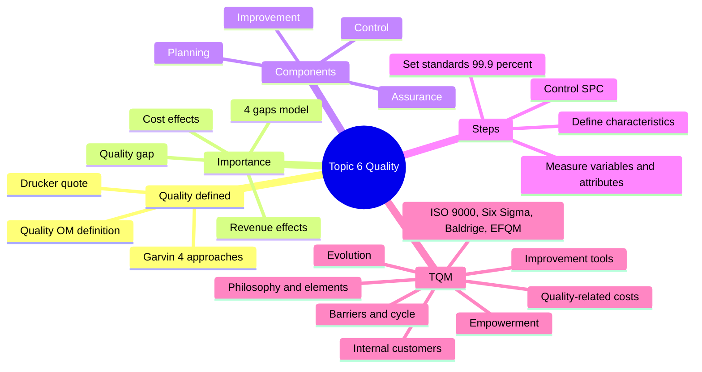

**一句话总结本章：** 质量就是 **持续地满足甚至超过顾客的期望**。质量管理的目标是 **缩小"顾客期望"和"顾客感知"之间的差距（gap）**。具体分四步走：**定义质量特征 → 衡量 → 设定标准 → 按标准控制（SPC）**，然后通过 **持续改进 / TQM** 让质量越来越好。TQM 强调 **人人参与、关注全部质量成本、预防胜于补救**。

> 💡 **和前面章节的联系：**
> - Topic 2：**Quality** 是五大绩效目标之一，而且在 **沙锥模型** 里是最底层的基础；
> - Topic 3：设计阶段的 **QFD（质量屋）** 就是在定义质量特征；
> - Topic 5：精益的 **零缺陷、Kaizen、Jidoka、Poka-yoke** 和本章的 TQM、持续改进是同一套思想；精益讲"消除浪费"，本章讲"把事情做对"。

---

## 1. Quality Defined 质量的定义（LO 1）

### 1.1 ⭐ Garvin 的四种质量观（Slide 4）

| 方法 | 讲义定义 | 中文理解 | 🧮 举个例子：买一块手表 |
|---|---|---|---|
| **The transcendent approach**（超越式） | **Innate excellence**, quality defined as **the absolute** | 质量是一种 **"天生的卓越"**，说不清但一看就知道 | 劳力士、百达翡丽，"就是好" |
| **The manufacturing-based approach**（制造导向） | **Free from errors** and **conform precisely to design specifications** | **没有错误、完全符合设计规格** | 走时误差在规格内（每天 ±2 秒），零件尺寸都达标 |
| **The user-based approach**（用户导向） | **Fit for its purpose**, appropriateness for the customer | **适合顾客的用途** | 对潜水员来说，防水 300 米的表才是"好表" |
| **The value-based approach**（价值导向） | Quality in terms of **cost and price** | 从 **成本和价格** 看质量，"物有所值" | 200 元的电子表准时、耐用，这个价钱已经很好 |

> 💡 **补充：** Garvin（1984）其实提出了 5 种视角，教材还有一种 **product-based approach（产品导向）**：质量是产品的一组 **可以测量的特征**（例如手表的精度、防水深度、电池寿命）。讲义列了 4 种，考试以讲义为准。
>
> ⚠️ **易错：** 这几种定义 **没有对错**，只是角度不同。运营经理通常 **综合使用**：用 manufacturing-based 方法 **控制生产**，用 user-based 方法 **理解顾客**。

### 1.2 ⭐ 运营中的质量管理定义（Slide 5）

> **Quality operations management is the systematic approach to ensuring the delivery of products / services that meet or exceed customer expectations consistently. This means establishing standards, monitoring processes, and implementing corrective actions when deviations occur.**

**运营质量管理** 是一种 **系统性** 的方法，确保交付的产品/服务 **持续地（consistently）满足或超过顾客期望**。具体就是：
1. **Establishing standards**（建立标准）
2. **Monitoring processes**（监控流程）
3. **Implementing corrective actions when deviations occur**（出现偏差时采取纠正措施）

⚠️ **关键词 "consistently"（持续地、稳定地）**：讲义特别加粗了这个词。偶尔做出一杯好咖啡不算质量好，**每一杯都好** 才算。

> **"Quality in a service or product is not what you put into it. It is what the client or customer gets out of it."** — Peter Drucker\
> 质量不在于你投入了什么，而在于顾客得到了什么。

🧮 **举个例子：** 一家餐厅用了最贵的食材（投入多），但上菜慢、服务员态度差 → 顾客"得到"的体验不好 → 在顾客眼里质量不高。

---

## 2. ⭐ Why is Quality Management important? 质量管理为什么重要（LO 2）

### 2.1 提高质量对收入和成本都有好处（Slide 6）

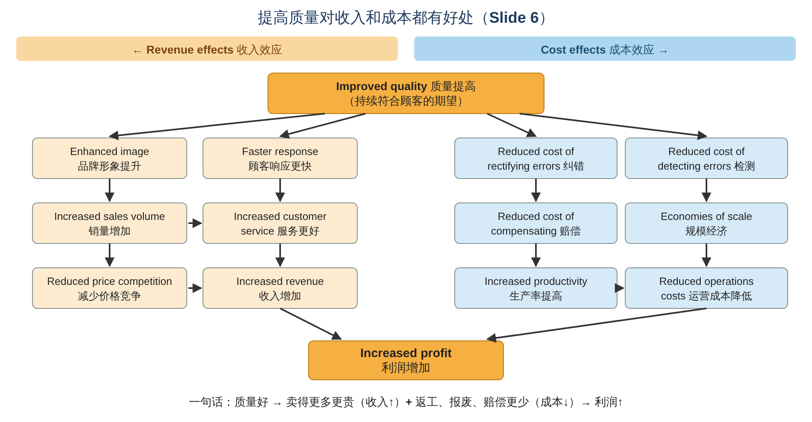

| **Revenue effects 收入效应** | **Cost effects 成本效应** |
|---|---|
| **Enhanced service/product image (brand value)** 品牌形象提升 | **Reduced cost of rectifying errors** 纠正错误的成本降低 |
| **Faster customer response time** 顾客响应更快 | **Reduced cost of detecting errors** 检测错误的成本降低 |
| **Increased customer service** 服务更好 | **Reduced cost of compensating customers** 赔偿顾客的成本降低 |
| **Increased sales volume** 销量增加 | **Economies of scale**（销量增加带来的）规模经济 |
| **Reduced price competition** 减少价格竞争 | **Reduced capital costs** 资本成本降低 |
| → **Increased revenue** 收入增加 | **Increased productivity** 生产率提高 → **Reduced operations costs** 运营成本降低 |

**两条路最后汇合：→ Increased profit（利润增加）**

🧮 **举个例子：**
> 一家手机厂把次品率从 5% 降到 1%：
> - **成本端**：每月少返工、少报废几千台；售后维修和退货赔偿大减；
> - **收入端**：网上好评增加 → 品牌形象变好 → 销量上升；顾客觉得"贵一点也值" → 不用靠降价竞争。
> - 两边加起来 → 利润增加。

### 2.2 ⭐ Quality gap 质量差距（Slide 7）

> **OM tries to reduce the gap between customers' expectations and perceptions.**\
> 运营管理要 **缩小顾客期望和顾客感知之间的差距**。

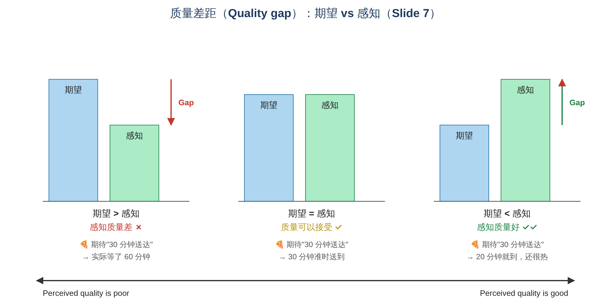

| 情况 | 结果 |
|---|---|
| **Expectations > perceptions**（期望 > 感知） | **Perceived quality is poor**（感知质量差） |
| **Expectations = perceptions**（期望 = 感知） | **Acceptable quality**（质量可以接受） |
| **Expectations < perceptions**（期望 < 感知） | **Perceived quality is good**（感知质量好） |

🧮 **举个例子：外卖承诺"30 分钟送达"**
> - 实际 60 分钟才到 → 期望 > 感知 → 顾客觉得质量差
> - 30 分钟准时到 → 期望 = 感知 → 可以接受
> - 20 分钟就到，餐还很热 → 期望 < 感知 → 顾客惊喜，觉得质量好

⚠️ **易错：** 质量是 **相对的**。同样 30 分钟送到，如果平台承诺的是"15 分钟送达"，顾客就会觉得质量差。所以 **管理顾客期望**（不要过度承诺）也是质量管理的一部分。

### 2.3 ⭐ 四个差距模型（Customers and Operations，Slide 8）

（来源：Parasuraman, Zeithaml & Berry, 1985，服务质量差距模型）

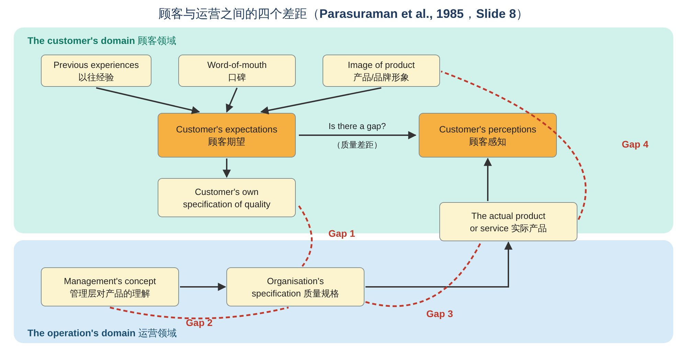

**顾客领域（Customer's domain）：**
- 顾客期望来自三方面：**previous experiences（以往经验）**、**word-of-mouth communications（口碑）**、**image of product or service（产品/品牌形象）**
- 期望 vs 感知 之间可能存在差距 → 这就是 2.2 节的 quality gap

**运营领域（Operation's domain）：** management's concept → organisation's specification of quality → the actual product or service

| 差距 | 位置 | 含义 | 🧮 举个例子：一家酒店 |
|---|---|---|---|
| **Gap 1** | **顾客自己的质量规格 ↔ 组织的质量规格** | 企业 **没搞懂顾客真正要什么** | 顾客最在乎 **安静和网速**，酒店却把钱花在大堂装修上 |
| **Gap 2** | **管理层对产品的理解 ↔ 组织的质量规格** | 管理层的想法 **没有正确地写成标准** | 老板想要"热情服务"，但标准里没写具体要怎么做（如"3 分钟内办好入住"） |
| **Gap 3** | **组织的质量规格 ↔ 实际的产品/服务** | 标准有了，但 **没有被执行到位** | 标准规定"3 分钟办好入住"，实际员工不够，要等 15 分钟 |
| **Gap 4** | **实际的产品/服务 ↔ 产品形象（对外宣传）** | **承诺和实际不符**（过度承诺） | 广告照片里房间又大又亮，实际又小又暗 |

📝 **记忆：** Gap 1 **没听懂**、Gap 2 **没写好**、Gap 3 **没做到**、Gap 4 **说过头**。只要任何一个差距存在，最后都会表现为 **顾客期望 > 顾客感知**。

---

## 3. ⭐ Components of Quality Management 质量管理的组成部分（LO 3）

### 3.1 四个关键组成部分（Slide 9–10）

| 组成部分 | 讲义定义 | 对应的具体步骤（Slide 10） |
|---|---|---|
| **1. Quality Planning 质量计划** | The process of **identifying the quality standards** relevant to the project and **deciding how to meet them** | **Define the quality characteristics** of the product/service（定义质量特征） |
| **2. Quality Assurance 质量保证** | The **systematic or planned actions** necessary to offer sufficient **reliability** that a product or service **will meet the specified requirements** | **Decide how to measure** each quality characteristic（决定如何衡量）；**Set quality standards** for each characteristic（设定标准） |
| **3. Quality Control 质量控制** | The **continuing effort to uphold a process' integrity and reliability** in achieving an outcome | **Control quality against standards**（按标准控制质量） |
| **4. Quality Improvement 质量改进** | The **purposeful change of a process** to improve the confidence or reliability of the outcome | **Continuous improvement: TQM**（持续改进） |

> **Quality components allow to reduce the gap between expectations and perceptions.**

🧮 **举个例子：一家咖啡店**
> 1. **Planning**：决定"好咖啡"的特征是：温度、浓度、出杯时间、拉花外观
> 2. **Assurance**：决定怎么量（温度计、计时器、顾客评分），并定标准（65–70°C、3 分钟内出杯）
> 3. **Control**：每小时抽查几杯，看是否符合标准，不符合就调整
> 4. **Improvement**：分析投诉，发现高峰期出杯慢 → 增加一台咖啡机 → 质量持续提升

⚠️ **易错：Quality assurance vs Quality control**
- **QA（保证）**：**事前** 建立体系和标准，**预防** 问题（"把规矩定好"）
- **QC（控制）**：**事中/事后** 检查是否符合标准，**发现** 问题（"按规矩检查"）

### 3.2 ⭐ Step 1：Define the quality characteristics 定义质量特征（Slide 11）

> **Define what quality characteristics (dimensions) will be used to compete.**（Garvin, 1984 的 8 个维度）

| Dimension 维度 | Description 描述 | Function 主要负责的职能 | 🧮 举个例子：智能手机 |
|---|---|---|---|
| **Performance 性能** | A product's **primary operating characteristics** | Design | 运行速度、拍照、通话质量 |
| **Features 特色** | **Secondary characteristics** — "the bells and whistles" | Design | 人脸识别、无线充电 |
| **Reliability 可靠性** | The **probability of a product malfunctioning** within a given period | Design | 一年内死机、坏机的概率 |
| **Conformance 符合性** | The degree to which a product is **manufactured to the agreed specification** | **Manufacturing** | 屏幕尺寸、电池容量是否和说明书一致 |
| **Durability 耐用性** | A measure of a **product's life** in terms of its technical and economic dimensions | Design | 能用几年才需要换 |
| **Serviceability 可维修性** | The **ease of servicing** (planned or breakdown), including the speed and provision of after-sales service | Design and after-sales | 维修网点多不多、修一次要几天 |
| **Aesthetics 美观** | **How the final product looks** | Design | 外观、颜色、手感 |
| **Perceived quality 感知质量** | **How a customer views the product** | **Marketing and design** | 品牌口碑、"大家都说好" |

📝 **记忆：** 8 个维度里只有 **Conformance** 主要由 **制造** 负责，**Perceived quality** 主要由 **营销和设计** 负责，其余基本都在 **设计** 阶段决定。

### 3.3 ⭐ Step 2：Measure quality characteristics 衡量质量特征（Slide 12）

> **Decompose quality characteristics into measurable variables and unmeasurable attributes to avoid losing the meaning of quality.**

| | **Variable 变量** | **Attribute 属性** |
|---|---|---|
| 含义 | 可以 **用连续的数字测量** | 只能 **判断"是/否""好/坏"** |
| 🧮 例子 | 咖啡温度 68.5°C、等待时间 4.2 分钟、重量 502 克 | 咖啡好不好喝？员工有没有微笑？ |

**讲义例子：汽车 vs 航班（Table 12.2）**

| Characteristic | Car — Variable | Car — Attribute | Flight — Variable | Flight — Attribute |
|---|---|---|---|---|
| **Functionality 功能** | 测试台上的加速和刹车性能 | 驾驶感受是否满意？ | 安全到达目的地的航程数 | 飞机餐可以接受吗？ |
| **Appearance 外观** | 车身上可见瑕疵的数量 | 颜色是否符合规格？ | 没清洁干净的座位数 | 机组人员穿着整洁吗？ |
| **Reliability 可靠性** | 平均故障间隔时间 | 可靠性是否满意？ | 准点到达的航班比例 | 有没有投诉？ |
| **Durability 耐用性** | 汽车寿命 | 使用寿命是否如预期？ | 服务创新落后于竞争对手的次数 | 航空公司的服务有没有及时更新？ |
| **Recovery 补救** | 从发现故障到修好的时间 | 维修服务是否可以接受？ | 服务失误被妥善解决的比例 | 顾客觉得员工处理投诉得当吗？ |
| **Contact 接触** | 销售人员提供帮助的程度（1–5 分） | 顾客觉得被好好服务了吗？（是/否） | 顾客觉得被员工善待的程度（1–5 分） | 顾客觉得员工乐于助人吗？（是/否） |

> 💡 **为什么要两种都用？** 只用变量（数字）会 **漏掉感受**（"准点率 99%，但空姐很凶"）；只用属性会 **太主观、难比较**。两者结合才不会"失去质量的真正含义"。

### 3.4 产品与服务的六个质量特征（Slide 13–15）

| 特征 | 定义（讲义） | 🏭 Goods 产品例子（讲义） | 🛎️ Services 服务例子（讲义） |
|---|---|---|---|
| **Functionality 功能性** | How well a product or service **fulfils its core purpose** and intended use | 洗衣机能把衣服洗干净；手机能打电话 | 理财顾问能正确管理你的投资 |
| **Appearance 外观** | Also known as aesthetics; how it **appeals to the human senses**（look, feel, sound, taste, smell） | 笔记本电脑的流线设计；食品鲜艳的包装 | 酒店大堂或诊所的 **清洁、灯光和装修** |
| **Reliability 可靠性** | The **consistency and dependability**; the probability it will perform **without failure** over a specified period | 汽车每天早上都能顺利启动 | 快递公司 **一直准时** 送达包裹 |
| **Durability 耐用性** | A product's **lifespan** and ability to **withstand wear and tear** | 耐用的工作靴、冰箱、建材 | （通常看服务的 **结果**）房屋油漆多年风吹雨打不褪色 |
| **Recovery 补救** | The ability to **swiftly resolve issues**, errors, or complaints, to **regain consumer trust** | 清楚、无麻烦的 **退换货和退款政策** | 航空公司迅速为取消的航班 **改签并补偿** 乘客 |
| **Contact 接触** | The **accessibility, helpfulness, and courtesy** of the personnel interacting with the customer | 零售店员的专业和友好；售后技术支持团队 | 客服、酒店礼宾、医护人员的 **同理心、及时沟通和礼貌** |

### 3.5 ⭐ Step 3：Set quality standards 设定质量标准（Slide 16）

> **Quality standards are levels of quality which define the boundary between acceptable and unacceptable quality.**\
> 质量标准 = **"可接受"和"不可接受"之间的分界线**。

讲义问题：**One complaint per 10,000 passengers is good or bad?（每 10,000 名乘客 1 宗投诉，是好还是坏？）**
> 💡 **参考思路：** 要看 **跟谁比、投诉什么**。如果行业平均是每万人 5 宗，那 1 宗算很好；如果投诉内容是"飞机差点出事"，那 1 宗也太多了。**标准要结合行业水平、顾客期望和问题的严重程度来定。**

**⭐ Why 99.9% just won't do（为什么 99.9% 还不够好？）**

讲义引用质量顾问 Jeff Dewar 的例子，**99.9% 无缺陷** 意味着：
- 芝加哥奥黑尔机场 **每天 2 次不安全降落**
- **每月 1 小时** 不安全的饮用水
- 美国邮政 **每小时丢失 16,000 封信**
- **每年 20,000 张错误处方**
- **每周 500 次错误手术**
- **每天 50 个新生儿** 在出生时被医生摔落
- **每小时 22,000 张支票** 从错误的账户扣款
- **每人每年 322,000 次心跳漏跳**

> **Suddenly, the quest for zero defects makes a lot of sense.**（零缺陷的追求突然变得很有道理。）

🧮 **自己算一下：**
> 一家快递公司每天送 **100,000 个包裹**：
> - 99% 准确 → 每天 **1,000 个** 送错
> - 99.9% 准确 → 每天 **100 个** 送错
> - 99.99% 准确 → 每天 **10 个** 送错
>
> 算法：错误数 = 总量 × (1 − 准确率)。例如 100,000 × (1 − 0.999) = 100,000 × 0.001 = 100。\
> **结论：** 业务量越大，哪怕 0.1% 的错误也意味着很多人受影响，所以要追求 **零缺陷（zero defects）**。

> 💡 **补充：Six Sigma（六西格玛）** 的目标是 **每百万次机会只有 3.4 个缺陷**，即 99.99966% 的准确率。它就是从这种"99.9% 不够好"的思想发展出来的（见 4.6 节）。

### 3.6 ⭐ Step 4：Control quality against standards 按标准控制质量（Slide 17）

按标准检查质量时要做 **三个决定**：

| 决定 | 选项 | 🧮 举个例子：面包厂 |
|---|---|---|
| **① Where** in the operations should checks take place? 在哪里检查？ | **At the beginning**（e.g. components from suppliers）；**During process**（e.g. costly processes with high error rates）；**At the end**（e.g. before shipping to customers） | **开始**：检查送来的面粉有没有受潮；**过程中**：烤箱温度最容易出错，每小时检查一次；**最后**：装箱前看包装是否完好 |
| **② Should checks be performed for every product?** 每件都查吗？ | **Sampling（抽样）or census（全检）?** | 面包 **抽样** 检查就够了；但 **飞机零件、药品** 这类出错代价极大的，要 **全检** |
| **③ If sampling, how should checks be performed?** 抽样怎么查？ | **Statistical process control (SPC)** | 每天随机抽一批称重，画在控制图上 |

> 💡 **抽样 vs 全检 的选择：**
> - **全检（census）**：适合 **出错后果严重**（医疗、航空）、**检查成本低**（自动扫描）、**数量少** 的情况；
> - **抽样（sampling）**：适合 **数量大**、**检查会破坏产品**（如测试罐头能放多久，要打开才能测）、**检查成本高** 的情况。

### 3.7 ⭐ Statistical Process Control (SPC) 统计过程控制（Slide 18）

**讲义要点：**
- **Random sample control of various samples over time to identify trends**（随时间随机抽取多个样本，找出趋势）
- **Process variation is a natural phenomenon**（流程有波动是 **正常现象**）
- **Control limits indicate the expected extent of common-cause variation**（e.g. machine and employees output）（控制界限代表 **正常原因** 引起的波动范围）
- **If points lie outside the limits, the process is out of control and variation is due to other unknown causes**（点落在控制界限之外 → 流程 **失控**，是由其他 **未知原因** 引起的）

**控制图上的几条线（讲义图）：**

| 线 | 含义 | 讲义数值 |
|---|---|---|
| **Upper bound of acceptability** | 可接受上限（顾客/标准能接受的最大值） | — |
| **Upper control limit (UCL)** | 控制上限 | 3.32% |
| **中心线（平均值）** | 流程的平均水平 | 2% |
| **Lower control limit (LCL)** | 控制下限 | 0.68% |
| **Lower bound of acceptability** | 可接受下限 | — |

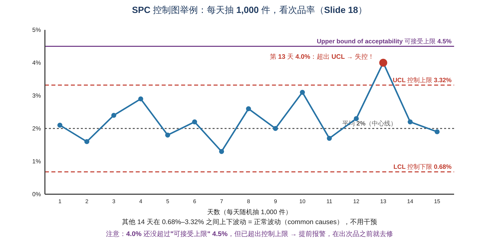

🧮 **举个例子：怎样读控制图**
> 一家工厂每天随机抽 **1,000 件** 产品，记录次品率。过去的平均次品率是 **2%**，控制界限是 **0.68%–3.32%**。
> - 第 1–12 天：次品率在 1.3%–3.1% 之间上下跳 → **都在控制界限内** → 这是 **正常波动（common-cause variation）**，例如原材料批次的小差异、工人的小差异 → **不用干预**（乱调反而更糟）
> - **第 13 天：4.0%** → **超出 UCL** → **流程失控（out of control）** → 一定有 **特殊原因（special / assignable cause）**，例如机器刀具磨损、换了一个没培训的新员工、一批坏原料 → **要停下来找原因**
> - ⚠️ 注意：4.0% 还在 **可接受上限（4.5%）** 以内，产品还能卖。但控制图 **提前报警**，让我们在真正出大量次品之前就把问题解决。这就是 SPC 的价值：**预防** 而不是事后补救。

> 💡 **补充：讲义的 3.32% 和 0.68% 是怎么来的？**（了解即可，课程不要求计算）\
> 对次品率（p-chart），控制界限 = 平均值 ± 3 × 标准差，标准差 = √[p × (1 − p) ÷ n]。\
> 当 p = 2%（0.02）、每次抽 n = 1,000 件时：\
> √(0.02 × 0.98 ÷ 1,000) = √0.0000196 ≈ 0.0044 = 0.44%\
> UCL = 2% + 3 × 0.44% ≈ **3.32%**；LCL = 2% − 3 × 0.44% ≈ **0.68%**，正好是讲义图里的数字。
>
> ⚠️ **易错：Control limits ≠ Specification limits（可接受界限）**
> - **控制界限**：由 **流程自身的历史数据** 算出来，说明流程 **稳不稳定**
> - **可接受界限 / 规格界限**：由 **顾客或设计要求** 决定，说明产品 **合不合格**
> - 一个流程可以"稳定但不合格"（一直稳定地做出次品），也可以"合格但失控"（像上面的第 13 天）。

---

## 4. ⭐ Continuous Improvement & TQM 持续改进与全面质量管理（LO 4 & 5）

### 4.1 TQM 的定义和要素（Slide 19–20）

> **TQM is a managerial philosophy that puts quality and continuous improvement at the heart of everything that is done by an operation.**\
> TQM 是一种管理理念，把 **质量** 和 **持续改进** 放在运营所做的一切事情的核心。

> **Total Quality Management (TQM) is a management framework based on the belief that an organisation can build long-term success by having all its members, from low-level workers to its highest-ranking executives, focus on improving quality and delivering customer satisfaction in its entire Operations Management Process.**\
> TQM 相信：让组织 **所有成员（从基层员工到最高层）** 都专注于提高质量、让顾客满意，组织就能获得 **长期成功**。

**TQM 特别强调以下要素（Slide 19）：**
1. **Meeting customers' expectations**（满足顾客期望）
2. **Everybody is part of the TQM effort**（人人都是 TQM 的一部分）
3. **Everybody contributes to the TQM effort**（人人都为 TQM 出力）
4. **Examining all quality-related costs**（审视所有质量相关成本）
5. **Developing systems and procedures** that support quality and improvement（建立支持质量与改进的体系和程序）
6. **Developing techniques of continuous improvement**（发展持续改进的方法）
7. **Identify success factors and barriers** of TQM implementation（识别 TQM 实施的成功因素和障碍）

📝 **"Total" 的三层意思：** **全员**（每个人）、**全过程**（从供应商到顾客的每个环节）、**全方面**（不只是产品，还有服务、成本、交付……）。

### 4.2 ⭐ TQM 是对以往质量观的扩展（Slide 21）

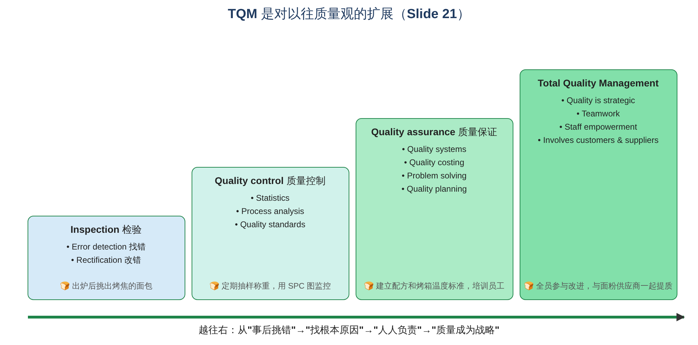

| 阶段 | 关注点（讲义） | 带来的进步 | 🧮 面包厂例子 |
|---|---|---|---|
| **Inspection 检验** | **Error detection；Rectification** | **Prevents "out of specification" products and services reaching market**（防止不合格品流入市场） | 面包出炉后，人工挑出烤焦的 |
| **Quality control 质量控制** | **Statistics；Process analysis；Quality standards** | **Solves the root cause of quality problems**（解决质量问题的根本原因） | 用 SPC 图监控重量，发现烤箱温度不稳就调整 |
| **Quality assurance 质量保证** | **Quality systems；Quality costing；Problem solving；Quality planning** | **Broadens the organizational responsibility for quality**（扩大组织对质量的责任） | 写好标准配方和操作规程，所有员工都按规程做 |
| **Total Quality Management** | **Quality is strategic；Teamwork；Staff empowerment；Involves customers and suppliers** | **Makes quality central and strategic in the organization**（让质量成为组织的核心和战略） | 全员参与改进，和面粉供应商一起提高原料质量，听取超市和顾客的反馈 |

📝 **规律：** 每一阶段都 **包含** 前一阶段（像楼梯一样往上叠），而不是取代它。TQM 仍然需要检验和 SPC，只是范围更广、更强调预防和全员参与。

### 4.3 ⭐ Quality-related costs 质量相关成本（Slide 22）

> **Quality comes at a cost.**

| 类别 | 定义（讲义） | 例子（讲义） |
|---|---|---|
| **Prevention costs 预防成本** | 为了 **从一开始就防止** 问题、失败和错误发生而产生的成本 | 识别潜在问题，在质量变差之前把流程调好；设计和改进产品、服务和流程以减少质量问题；**培训和发展员工**；流程控制 |
| **Appraisal costs 鉴定成本** | 为了 **检查** 产品或服务在生产中和生产后 **是否出了问题** 而产生的成本 | 建立统计抽样方案；**检验** 投入、过程和产出所需的时间和精力；获取检验和测试数据；调查质量问题、出质量报告；**顾客调查和质量审核** |
| **Internal failure costs 内部失败成本** | 与在 **运营内部** 发现和处理的错误有关的成本 | **报废** 零件和材料；**返工**；处理错误损失的生产时间；忙着救火而不是改进导致的注意力分散 |
| **External failure costs 外部失败成本** | 与 **顾客遇到** 的错误有关的成本 | **失去顾客好感**，影响未来生意；不满的顾客占用员工时间；**诉讼**（或为避免诉讼而付的钱）；**保修和保证** 成本；提供过度能力的成本（"包里咖啡放太多、给客户的资料太多"） |

📝 **记忆口诀：** **预防 → 鉴定 → 内部失败 → 外部失败**，越往后问题被发现得越晚，**代价越大**。

> 💡 **"1–10–100 法则"（常用的经验说法）：** 在设计阶段预防一个错误花 1 元，在工厂里发现并修好要花 10 元，到了顾客手里才发现要花 100 元（退货、赔偿、丢掉的口碑）。

### 4.4 ⭐ 增加预防投入，总质量成本反而下降（Slide 23）

> **Increasing the effort spent on preventing errors occurring in the first place brings a more than equivalent reduction in other cost categories.**\
> 在 **预防** 上多花一点，其他几类成本会 **减少得更多**。

讲义图：随着时间推移，**Prevention（预防）** 成本先上升，**Appraisal、Internal failure、External failure** 都大幅下降，**Total cost of quality（总质量成本）** 明显下降。

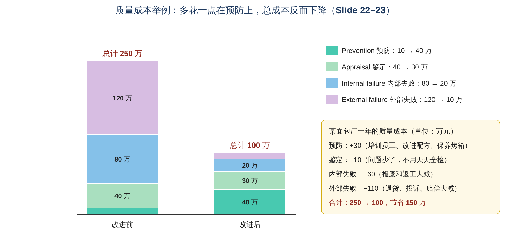

🧮 **举个例子：面包厂一年的质量成本（单位：万元）**

| 类别 | 改进前 | 改进后 | 变化 | 原因 |
|---|---|---|---|---|
| Prevention 预防 | 10 | 40 | **+30** | 培训员工、改进配方、定期保养烤箱 |
| Appraisal 鉴定 | 40 | 30 | −10 | 问题少了，不用天天全检 |
| Internal failure 内部失败 | 80 | 20 | −60 | 报废和返工大减 |
| External failure 外部失败 | 120 | 10 | −110 | 退货、投诉、赔偿大减 |
| **合计** | **250** | **100** | **−150** | |

> **多花 30 万在预防上，省下了 180 万的其他成本，总成本从 250 万降到 100 万。**\
> 这就是 TQM 主张 **"预防胜于补救"（prevention rather than detection）** 的经济理由。

### 4.5 ⭐ Everybody is part of the TQM effort：内部顾客（Slide 24）

> **TQM considers internal customers as important as external customers/suppliers.**\
> **Errors within the organization will eventually affect the product or service which reaches the external customer.**

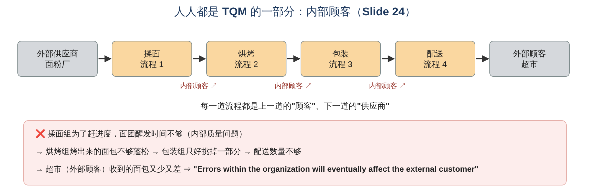

- 每一个内部流程都是 **上一个流程的顾客（internal customer）**，也是 **下一个流程的供应商（internal supplier）**；
- 组织内部的错误，**最终都会影响到外部顾客** 收到的产品或服务。

🧮 **举个例子：大学**
> 招生处录错了学生的专业（内部错误）→ 教务处排错课 → 老师拿到错误的名单 → **学生（外部顾客）** 开学第一天发现没有自己的课。\
> 如果每个部门都把下一个部门当作"顾客"来服务，错误在第一步就会被发现。

### 4.6 ⭐ Employee empowerment 员工授权（Slide 25）

**Getting employees involved in product and process improvements**（让员工参与产品和流程改进）。
- 讲义数据：**85% of quality problems are due to processes and materials**（**85%** 的质量问题来自 **流程和材料**，而不是员工不努力）→ 所以要让最了解流程的一线员工参与改进。

**Techniques 方法：**
1. **Build communication networks that include employees**（建立包括员工在内的沟通网络）
2. **Develop open, supportive supervisors**（培养开放、支持型的主管）
3. **More responsibility to employees**（给员工更多责任）
4. **Build a high-morale organization**（建立士气高昂的组织）
5. **Create formal team structures**（建立正式的团队结构，例如 **质量圈 quality circles**）

🧮 **举个例子：** 丽思卡尔顿酒店（Ritz-Carlton）授权每位员工 **不用请示上级**，就可以花一定金额（据报道最高约 2,000 美元）去解决客人的问题，例如客人的东西被弄丢了，员工可以马上赔偿或买新的。这就是给员工 **"more responsibility"**。

### 4.7 ⭐ Quality systems and procedures 质量体系与程序（Slide 26–27）

> **Improving quality is not something that happens by getting everyone to "think quality".**\
> 提高质量 **不是喊口号让大家"想着质量"就行**，需要详细的体系和程序来规定：

- **Organizational structure**（组织结构）
- **Responsibilities**（e.g. defining duties and responsibilities）（职责）
- **Procedures**（e.g. documenting procedures）（程序文件）
- **Standards**（标准）
- **Processes**（e.g. documenting processes）（流程文件）
- **The resources for implementing quality management**（e.g. cost of quality analysis）（实施质量管理的资源）
- **A preventive way of managing quality, rather than error detection and correction**（用 **预防** 的方式管理质量，而不是事后发现和纠正错误）

**常见的质量体系、程序和奖项（Slide 27）：**

| 体系 / 奖项 | 特点（讲义） | 💡 通俗理解 |
|---|---|---|
| **ISO 9000–14000** | 按职能分析和遵守标准与程序，后来才推行到流程；⚠️ **The focus is procedures rather than business performance**（**重点是程序，而不是经营绩效**） | 国际通用的"质量管理体系认证"（ISO 9001 是质量，ISO 14001 是环境）。证明你 **有一套规范的流程**，但不保证产品一定最好 |
| **Six Sigma 六西格玛** | **Customer driven**，严格使用统计信息，**structured improvement cycle**（DMAIC），结构化培训（绿带、黑带），过程能力与控制分析，流程设计和改进，**以减少波动（reduce variability）** | 目标：每百万次机会只有 **3.4 个缺陷**；摩托罗拉首创，通用电气（GE）推广 |
| **The Malcolm Baldrige National Quality Award（USA）** | **领导力、战略规划、顾客与市场导向、信息与分析、人力资源、流程管理、经营结果** | 美国国家质量奖，评估整个组织的卓越程度 |
| **The European Quality Award Model** | **领导力、人员管理、政策与战略、资源、流程、员工满意度、顾客满意度、社会影响、经营结果** | 欧洲质量奖，基于 EFQM 模型 |

> 💡 **补充：Six Sigma 的 DMAIC 改进循环**：**D**efine（定义问题）→ **M**easure（测量现状）→ **A**nalyse（分析原因）→ **I**mprove（改进）→ **C**ontrol（控制、保持成果）。

### 4.8 ⭐ The EFQM Excellence Model 欧洲质量管理基金会卓越模型（Slide 28）

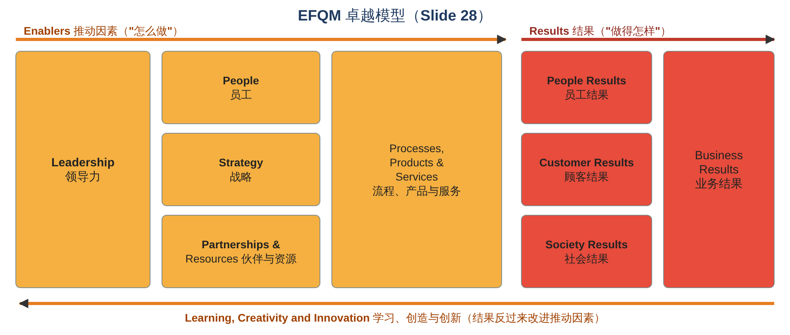

| **Enablers 推动因素（"怎么做"）** | **Results 结果（"做得怎样"）** |
|---|---|
| **Leadership** 领导力 | **People Results** 员工结果 |
| **People** 员工 | **Customer Results** 顾客结果 |
| **Strategy** 战略 | **Society Results** 社会结果 |
| **Partnerships & Resources** 伙伴与资源 | **Business Results** 业务结果 |
| **Processes, Products & Services** 流程、产品与服务 | |

底部的箭头：**Learning, Creativity and Innovation**（学习、创造与创新）：从结果中学习，反过来改进推动因素，形成一个 **循环**。

📝 **读图要点：** 从左往右读：**领导力** 带动 **员工、战略、伙伴与资源**，再通过 **流程、产品与服务**，产生 **员工、顾客、社会结果**，最后体现为 **业务结果**。

🧮 **举个例子：用 EFQM 评估一家连锁超市**
> - **Enablers**：CEO 重视顾客体验（Leadership）；培训员工（People）；"低价 + 新鲜"的战略（Strategy）；和本地农场长期合作（Partnerships）；高效的补货流程（Processes）
> - **Results**：员工流失率低（People results）；顾客满意度高（Customer results）；减少食物浪费、支持社区（Society results）；利润和市场份额增长（Business results）

### 4.9 ⭐ ISO 9000 的效果受哪些因素影响？（Slide 29，Lo et al., 2013）

讲义问题：**Do quality standards improve cost or customer experience?（质量标准能改善成本或顾客体验吗？）**

讲义的模型：**Certification ISO 9000（ISO 9000 认证）** → **Long-term effectiveness（长期效果）**：成本改进、顾客满意度、盈利能力，并且是 **迈向 TQM 的良好第一步（good first step towards TQM）**。

中间受三个 **情境因素（contextual factors）** 影响：

| 因素 | 讲义说明 | 💡 理解 |
|---|---|---|
| **Real commitment to quality** 真正对质量的承诺 | **Willingness to exploit quality improvement**（愿意真正利用认证去改进质量） | 有的公司拿证只是 **为了挂在墙上**、满足客户要求，没有真正改进 → 效果有限 |
| **Labour intensity** 劳动密集度 | **More prone to defects**（劳动密集的企业更容易出缺陷） | 人工多、出错机会多 → 标准化程序的作用 **更大** |
| **Firm technology intensity** 企业技术密集度 | **More prone to radical change**（技术密集的企业更容易发生根本性变化） | 技术变化快，固定的程序文件很快过时 → ISO 的作用可能 **受限** |

📝 **结论：** ISO 9000 认证 **本身不会自动带来好处**。只有企业 **真心投入改进**，并且结合自身情况，认证才会带来长期效果。

### 4.10 ⭐ Continuous improvement tools 持续改进工具（Slide 30）

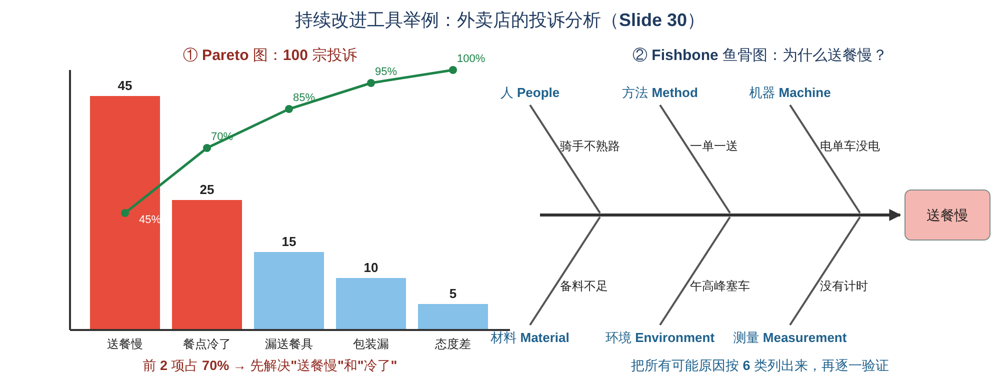

| 工具 | 用途 | 🧮 举个例子 |
|---|---|---|
| **PDCA cycle（Plan–Do–Check–Act）** | 持续改进的基本循环：**计划 → 执行 → 检查 → 处理**，然后再来一轮 | 外卖店想减少送餐慢：**Plan** 试行"一次送两单"；**Do** 在一个区域试一周；**Check** 平均送餐时间从 40 分钟降到 32 分钟；**Act** 推广到所有区域，再开始下一轮改进 |
| **Flow diagrams 流程图** | 画出流程的每一步，找出 **多余、重复、等待** 的环节（Topic 4 的流程图） | 画出"接单 → 备餐 → 打包 → 等骑手 → 送达"，发现"等骑手"平均要 8 分钟 |
| **Scatter plots 散点图** | 看两个变量之间 **有没有关系** | 横轴"送餐距离"、纵轴"差评数"→ 发现距离超过 5 公里差评明显增多 |
| **Fishbone diagrams 鱼骨图**（又叫 cause-and-effect / Ishikawa 图） | 把问题的 **所有可能原因** 按类别列出来（常用 6 类：人、方法、机器、材料、环境、测量） | 问题"送餐慢" ← 人：骑手不熟路；方法：一单一送；机器：电单车没电；材料：备料不足；环境：午高峰塞车；测量：没有计时 |
| **Pareto diagrams 帕累托图** | 把问题 **按出现次数从多到少排列**，找出 **"关键的少数"**（80/20 法则：大约 80% 的问题来自 20% 的原因） | 100 宗投诉：送餐慢 45、冷了 25、漏餐具 15、包装漏 10、态度差 5 → **前 2 项就占 70%** → 先集中解决这两项 |
| **"Why-why" analysis（5 Whys）** | 连续问 **"为什么"**，一直追到 **根本原因** | 见下面的例子 |

🧮 **"Why-why" 分析举例：餐点送到时是冷的**
> 1. **为什么** 餐冷了？→ 因为从出餐到送达用了 50 分钟
> 2. **为什么** 要 50 分钟？→ 因为餐做好后等了 20 分钟才有骑手来取
> 3. **为什么** 要等骑手？→ 因为骑手被派去取另一家店的餐
> 4. **为什么** 会这样派单？→ 因为系统只按"骑手离哪家店近"派单，不考虑餐什么时候做好
> 5. **为什么** 系统这样设计？→ 因为当初没有把"出餐时间"输入系统
> → **根本原因：派单系统缺少出餐时间数据**。解决办法是让厨房在出餐前 5 分钟通知系统，而不是简单地"让厨师做快点"。

> 💡 **这些工具怎么配合使用？** 先用 **Pareto** 找出最重要的问题 → 用 **鱼骨图** 和 **5 Whys** 找原因 → 用 **散点图** 验证原因 → 用 **流程图** 重新设计流程 → 整个过程按 **PDCA** 循环进行。

### 4.11 ⭐ Barriers that prevent TQM TQM 的障碍（Slide 31）

| 障碍 | 💡 例子 |
|---|---|
| **Lack of a quality definition** 没有明确的质量定义 | 各部门对"好"的理解不一样 |
| **Lack of a strategy to change towards quality** 缺乏向质量转变的战略 | 只喊口号，没有计划和资源 |
| **Lack of customer focus (internal and external)** 缺乏顾客导向（内部和外部） | 部门只管自己的 KPI，不管下游部门和顾客 |
| **Lack of communication and integration of processes** 缺乏沟通和流程整合 | 部门之间各自为政（Topic 1 的"部门墙"） |
| **Lack of employee participation and empowerment** 缺乏员工参与和授权 | 员工发现问题也不敢说、不能改 |
| **Lack of trust in top management** 不信任高层管理者 | 员工觉得"又是一阵风，过几个月就没人管了" |
| **Vision of quality as a short cut with fast business returns** 把质量当成能快速见效的捷径 | 期望 3 个月就看到利润，看不到就放弃 |
| **Political issues** 政治问题（权力斗争） | 部门之间争功推责 |

### 4.12 ⭐ TQM Implementation cycle TQM 实施周期（Slide 32）

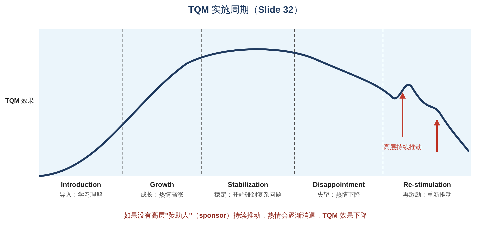

| 阶段 | 讲义描述 | 💡 一家公司推行 TQM 的经历 |
|---|---|---|
| **Introduction 导入** | **Learning and understanding**（学习和理解） | 请顾问来培训，大家学习 TQM 是什么 |
| **Growth 成长** | **Enthusiasm builds**（热情高涨） | 成立改进小组，快速解决了很多"容易的问题"，效果明显 |
| **Stabilization 稳定** | **Starting to identify complex issues**（开始碰到复杂问题） | 容易的改完了，剩下的问题跨部门、很难解决 |
| **Disappointment 失望** | **Enthusiasm decreases**（热情下降） | 进展变慢，大家开始觉得"TQM 没用" |
| **Re-stimulation 再激励** | **Effort to boost up the programme**（努力重新推动） | 高层重新表态、设立新目标、表彰成功案例 |

> **There must be a sponsor at top management who boosts up the process continuously.**\
> **必须有一位高层"赞助人"持续推动这个过程。**（图中的红色箭头就是高层每次重新推动带来的回升。）

📝 **启示：** TQM 不是一次性的项目，而是 **长期的文化变革**。最大的风险在"失望期"，这时候 **高层的持续支持** 最关键。

---

## 5. ⚠️ 易混淆概念汇总

| 容易混淆 | 区别 |
|---|---|
| Garvin 四种质量观 | 超越式（天生卓越）、制造导向（符合规格）、用户导向（适合用途）、价值导向（物有所值） |
| Expectations vs Perceptions | 顾客 **事前** 期望得到什么 vs 顾客 **事后** 觉得得到了什么 |
| Quality gap 的三种情况 | 期望 > 感知 = 差；期望 = 感知 = 可接受；期望 < 感知 = 好 |
| Gap 1–4 | 没听懂顾客（1）、没写成好标准（2）、没执行到位（3）、宣传过头（4） |
| Planning / Assurance / Control / Improvement | 定义特征 / 决定怎么量、定标准 / 按标准检查 / 持续改进 |
| Quality assurance vs Quality control | 事前建体系、预防 vs 事中事后检查、发现 |
| Garvin 8 维度 vs 讲义 6 特征 | 8 维度（性能、特色、可靠、符合、耐用、可维修、美观、感知质量）用于 **定义竞争维度**；6 特征（功能、外观、可靠、耐用、补救、接触）用于 **产品和服务的衡量** |
| Reliability vs Durability | 一段时间内 **不出故障的概率** vs **能用多久** |
| Variable vs Attribute | 能用 **数字** 测量 vs 只能判断 **是/否、好/坏** |
| Sampling vs Census | 抽样检查 vs 全部检查 |
| Common-cause vs Special-cause variation | 控制界限内的 **正常波动**（不干预）vs 超出界限、有 **特殊原因**（要找原因） |
| Control limits vs Acceptability bounds | 流程 **稳不稳定**（来自历史数据）vs 产品 **合不合格**（来自顾客/规格） |
| Inspection → QC → QA → TQM | 挑错 → 统计和根本原因 → 体系和计划 → 质量战略、全员参与 |
| Prevention vs Appraisal costs | 防止问题发生 vs 检查有没有问题 |
| Internal vs External failure costs | 在 **企业内部** 发现（报废、返工）vs **顾客** 发现（退货、诉讼、口碑） |
| Internal customer | 组织内部的下一道流程 |
| ISO 9000 vs Six Sigma | 重 **程序和文件**（不一定重绩效）vs 重 **统计、减少波动**（3.4 个缺陷/百万） |
| Baldrige vs EFQM | 美国国家质量奖 vs 欧洲质量奖模型（Enablers + Results） |
| Pareto vs Fishbone | 找出 **最重要的问题** vs 找出问题的 **所有可能原因** |
| PDCA | Plan → Do → Check → Act（循环） |

---

## 6. 📖 中英术语表（Glossary）

| English | 中文 |
|---|---|
| Quality management | 质量管理 |
| Transcendent approach | 超越式方法 |
| Manufacturing-based approach | 制造导向方法 |
| User-based approach | 用户导向方法 |
| Value-based approach | 价值导向方法 |
| Conform to specifications | 符合规格 |
| Fit for purpose | 适合用途 |
| Customer expectations / perceptions | 顾客期望 / 感知 |
| Quality gap | 质量差距 |
| Word-of-mouth | 口碑 |
| Brand value | 品牌价值 |
| Rectifying errors | 纠正错误 |
| Quality planning | 质量计划 |
| Quality assurance (QA) | 质量保证 |
| Quality control (QC) | 质量控制 |
| Quality improvement | 质量改进 |
| Quality characteristics / dimensions | 质量特征 / 维度 |
| Performance / Features | 性能 / 特色 |
| Reliability | 可靠性 |
| Conformance | 符合性 |
| Durability | 耐用性 |
| Serviceability | 可维修性 |
| Aesthetics / Appearance | 美观 / 外观 |
| Perceived quality | 感知质量 |
| Functionality | 功能性 |
| Recovery | 补救 |
| Contact | 接触 |
| Variable / Attribute | 变量 / 属性 |
| Quality standards | 质量标准 |
| Zero defects | 零缺陷 |
| Sampling / Census | 抽样 / 全检 |
| Statistical process control (SPC) | 统计过程控制 |
| Process variation | 流程波动 |
| Common-cause variation | 正常原因波动 |
| Control limits (UCL / LCL) | 控制界限（上限 / 下限） |
| Out of control | 失控 |
| Bounds of acceptability | 可接受界限 |
| Total quality management (TQM) | 全面质量管理 |
| Continuous improvement | 持续改进 |
| Inspection | 检验 |
| Quality costing | 质量成本核算 |
| Staff empowerment | 员工授权 |
| Quality-related costs | 质量相关成本 |
| Prevention costs | 预防成本 |
| Appraisal costs | 鉴定成本 |
| Internal failure costs | 内部失败成本 |
| External failure costs | 外部失败成本 |
| Scrap / Rework | 报废 / 返工 |
| Warranty / Litigation | 保修 / 诉讼 |
| Internal customer / supplier | 内部顾客 / 供应商 |
| Employee empowerment | 员工授权 |
| Quality systems and procedures | 质量体系与程序 |
| ISO 9000 | ISO 9000 质量管理体系标准 |
| Six Sigma | 六西格玛 |
| Malcolm Baldrige National Quality Award | 马尔科姆·鲍德里奇国家质量奖 |
| European Quality Award / EFQM | 欧洲质量奖 / 欧洲质量管理基金会 |
| Enablers / Results | 推动因素 / 结果 |
| Contextual factors | 情境因素 |
| Labour intensity / Technology intensity | 劳动密集度 / 技术密集度 |
| PDCA cycle | 计划–执行–检查–处理循环 |
| Flow diagram | 流程图 |
| Scatter plot | 散点图 |
| Fishbone (cause-and-effect) diagram | 鱼骨图（因果图） |
| Pareto diagram | 帕累托图 |
| Why-why analysis | 连续追问"为什么"分析 |
| Barriers | 障碍 |
| Implementation cycle | 实施周期 |
| Sponsor | 赞助人（推动者） |
| 💡 Special / Assignable cause | 特殊原因 |
| 💡 DMAIC | 定义–测量–分析–改进–控制 |
| 💡 Quality circle | 质量圈 |
| 💡 80/20 rule | 80/20 法则 |

---

## 7. ✍️ 自测题（Self-test）

### Part A：选择题

1. "Free from errors and conform precisely to design specifications" 是哪种质量观？\
   A. Transcendent\
   B. Manufacturing-based\
   C. User-based\
   D. Value-based

2. 根据讲义，运营质量管理定义中被特别强调的词是：\
   A. Cheaply\
   B. Quickly\
   C. Consistently\
   D. Creatively

3. 当顾客期望 > 顾客感知时：\
   A. 感知质量好\
   B. 感知质量差\
   C. 质量可以接受\
   D. 没有质量差距

4. 酒店规定"3 分钟内办好入住"，但实际员工不够，要等 15 分钟。这属于：\
   A. Gap 1\
   B. Gap 2\
   C. Gap 3\
   D. Gap 4

5. "Decide how to measure each quality characteristic; set quality standards" 属于质量管理的哪个部分？\
   A. Quality planning\
   B. Quality assurance\
   C. Quality control\
   D. Quality improvement

6. 在 Garvin 的 8 个维度中，主要由 **制造（manufacturing）** 负责的是：\
   A. Performance\
   B. Aesthetics\
   C. Conformance\
   D. Perceived quality

7. "Did customers feel well served (yes or no)?" 属于：\
   A. Variable\
   B. Attribute\
   C. Control limit\
   D. Standard

8. 一家公司每天处理 50,000 笔交易，准确率 99.9%，每天大约会出错多少笔？\
   A. 5\
   B. 50\
   C. 500\
   D. 5,000

9. 在 SPC 控制图上，一个点落在控制上限之外，说明：\
   A. 这是正常波动，不用管\
   B. 流程失控，可能有特殊原因\
   C. 产品一定不合格\
   D. 控制界限设错了

10. 以下哪一项属于 **appraisal costs**？\
    A. 培训员工\
    B. 检验产品、做质量审核\
    C. 报废零件\
    D. 保修和诉讼

11. 顾客退货和诉讼属于：\
    A. Prevention costs\
    B. Appraisal costs\
    C. Internal failure costs\
    D. External failure costs

12. 根据讲义，增加预防成本会：\
    A. 让总质量成本上升\
    B. 带来其他成本更大幅度的下降\
    C. 对其他成本没有影响\
    D. 只降低外部失败成本

13. 讲义指出 ISO 9000 的一个特点是：\
    A. 重点是经营绩效\
    B. 重点是程序而不是经营绩效\
    C. 每百万次只有 3.4 个缺陷\
    D. 是美国国家质量奖

14. 想找出"哪几个问题造成了大部分投诉"，最适合用：\
    A. Pareto diagram\
    B. Scatter plot\
    C. Fishbone diagram\
    D. Flow diagram

15. 在 TQM 实施周期中，热情下降的阶段是：\
    A. Introduction\
    B. Growth\
    C. Stabilization\
    D. Disappointment

### Part B：简答题

1. 说明 Garvin 的四种质量观，并各举一例。
2. 什么是质量差距（quality gap）？用一个服务例子说明三种情况。
3. 解释四个差距模型中的 Gap 1 到 Gap 4。
4. 质量管理由哪四个部分组成？以一家餐厅为例说明。
5. 区分 variable 和 attribute，并说明为什么要两者结合使用。
6. 为什么"99.9% 还不够好"？
7. 控制质量时要做哪三个决定？
8. 解释 SPC 控制图上点落在控制界限内和界限外分别意味着什么。
9. 说明四类质量相关成本，并解释为什么"预防胜于补救"。
10. TQM 和检验、质量控制、质量保证有什么关系？
11. 列出至少 5 个 TQM 的实施障碍，并说明为什么需要高层"赞助人"。

### Part C：计算 / 应用题

1. 一家医院化验室每天处理 **8,000** 份样本。(a) 如果准确率是 99.5%，每天会出错多少份？(b) 提高到 99.95% 呢？(c) 用这个结果说明零缺陷的意义。
2. 某工厂一年的质量成本：预防 20 万、鉴定 50 万、内部失败 90 万、外部失败 140 万。推行 TQM 后，预防增加到 60 万，鉴定降到 35 万，内部失败降到 30 万，外部失败降到 25 万。(a) 改进前后的总质量成本各是多少？(b) 预防每多花 1 元，其他成本平均减少了多少？
3. 一家网店收到 200 宗投诉：发错货 80、发货慢 60、包装破损 30、客服回复慢 20、其他 10。(a) 画（或列出）Pareto 排序并计算累计百分比；(b) 应该先解决哪些问题？

<b>👉 点击查看答案</b>

**Part A**
1. **B**
2. **C**
3. **B**
4. **C**（标准有了，但没执行到位）
5. **B**
6. **C**
7. **B**（是/否的判断）
8. **B**（50,000 × 0.001 = 50）
9. **B**
10. **B**
11. **D**
12. **B**
13. **B**
14. **A**
15. **D**

**Part B**
1. 超越式：天生的卓越（名表）；制造导向：零错误、符合规格（零件尺寸达标）；用户导向：适合用途（潜水表对潜水员）；价值导向：物有所值（便宜但耐用的电子表）。
2. 质量差距是顾客期望和顾客感知之间的差距。例：外卖承诺 30 分钟送达；60 分钟才到 → 期望 > 感知，质量差；30 分钟到 → 相等，可接受；20 分钟就到 → 期望 < 感知，质量好。
3. Gap 1：企业对质量的规格和顾客自己的质量要求不一致（没听懂顾客）；Gap 2：管理层的想法没有正确转化为质量规格（没写好）；Gap 3：质量规格和实际交付不一致（没做到）；Gap 4：实际产品和对外形象/宣传不一致（说过头）。
4. 质量计划（定义特征：菜的温度、上菜时间、味道）、质量保证（决定怎么量、定标准：15 分钟上菜）、质量控制（按标准抽查）、质量改进（分析投诉、持续改进）。
5. Variable 是可以用数字测量的（温度、时间、重量）；attribute 只能判断是/否、好/坏（服务好不好）。只用数字会漏掉顾客感受，只用属性又太主观，所以要结合使用，才不会失去质量的真正含义。
6. 因为业务量大时，0.1% 的错误也意味着大量人受影响：例如每周 500 次错误手术、每天 2 次不安全降落。所以要追求零缺陷。
7. ① 在哪里检查（开始、过程中、最后）；② 每件都查还是抽样（全检或抽样）；③ 抽样的话怎么查（SPC）。
8. 点在控制界限内：正常原因造成的正常波动，流程受控，不需要干预；点在界限外：流程失控，存在特殊（未知）原因，需要停下来查找原因。
9. 预防成本（培训、改进设计）、鉴定成本（检验、审核）、内部失败成本（报废、返工）、外部失败成本（退货、诉讼、失去顾客）。问题越晚发现代价越大；增加预防投入会让其他三类成本下降得更多，总成本下降。
10. TQM 是对它们的扩展：检验只是事后挑错；质量控制用统计找根本原因；质量保证建立体系、扩大责任；TQM 让质量成为战略，强调团队合作、员工授权、顾客和供应商参与。后一阶段包含前一阶段。
11. 缺乏质量定义、缺乏转变战略、缺乏顾客导向、缺乏沟通和流程整合、缺乏员工参与和授权、不信任高层、把质量当成快速见效的捷径、政治问题。TQM 是长期变革，会经历"失望期"，需要高层赞助人持续推动才能重新激励。

**Part C**
1. (a) 8,000 × (1 − 0.995) = 8,000 × 0.005 = **40 份**；(b) 8,000 × 0.0005 = **4 份**；(c) 即使准确率已经很高，每天仍有 4 位病人可能拿到错误的化验结果，可能导致误诊。医疗这类后果严重的领域，必须追求零缺陷。
2. (a) 改进前：20 + 50 + 90 + 140 = **300 万**；改进后：60 + 35 + 30 + 25 = **150 万**。(b) 预防多花 40 万；其他三类从 280 万降到 90 万，减少 **190 万** → 平均每多花 1 元预防，其他成本减少约 **4.75 元**（190 ÷ 40）。
3. (a) 排序：发错货 80（40%，累计 40%）→ 发货慢 60（30%，累计 70%）→ 包装破损 30（15%，累计 85%）→ 客服回复慢 20（10%，累计 95%）→ 其他 10（5%，累计 100%）。(b) **先解决"发错货"和"发货慢"**，两项合计占 70% 的投诉。

---

## 8. 📌 考前 1 分钟速记

1. **Garvin 四种质量观**：超越式（天生卓越）、制造导向（符合规格）、用户导向（适合用途）、价值导向（物有所值）。
2. **质量管理定义**：系统性地确保 **持续（consistently）** 满足或超过顾客期望；建标准、监控流程、纠正偏差。
3. **质量的好处**：收入↑（品牌、销量、少打价格战）+ 成本↓（少纠错、少检测、少赔偿）→ 利润↑。
4. **质量差距**：期望 > 感知 = 差；= 可接受；< 好。
5. **四个差距**：没听懂（1）、没写好（2）、没做到（3）、说过头（4）。
6. **四个组成部分**：Planning（定义特征）→ Assurance（怎么量、定标准）→ Control（按标准控制）→ Improvement（TQM）。
7. **Garvin 8 维度**：性能、特色、可靠、符合（制造）、耐用、可维修、美观、感知质量（营销）。
8. **衡量**：Variable（数字）+ Attribute（是/否）。
9. **6 个特征**：功能、外观、可靠、耐用、补救、接触。
10. **标准**：可接受与不可接受的分界线；**99.9% 不够好** → 零缺陷。
11. **控制三决定**：在哪查（开始/中间/最后）、全检还是抽样、怎么抽样（SPC）。
12. **SPC**：界限内 = 正常波动；界限外 = 失控，有特殊原因；控制界限 ≠ 可接受界限。
13. **TQM**：质量 + 持续改进是一切的核心；人人参与；全部质量成本；体系和程序。
14. **演进**：Inspection → Quality control → Quality assurance → TQM。
15. **质量成本**：预防、鉴定、内部失败、外部失败；**多花在预防，总成本更低**。
16. **内部顾客**：内部错误最终会影响外部顾客；**85%** 的质量问题来自流程和材料 → 员工授权。
17. **体系与奖项**：ISO 9000（重程序）、Six Sigma（减少波动）、Baldrige（美国）、EFQM（Enablers + Results）。
18. **改进工具**：PDCA、流程图、散点图、鱼骨图、Pareto、Why-why。
19. **障碍与周期**：导入 → 成长 → 稳定 → 失望 → 再激励；需要高层赞助人持续推动。
