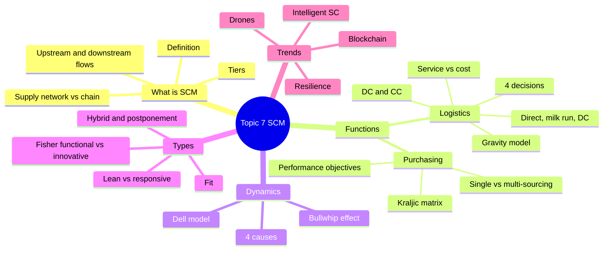
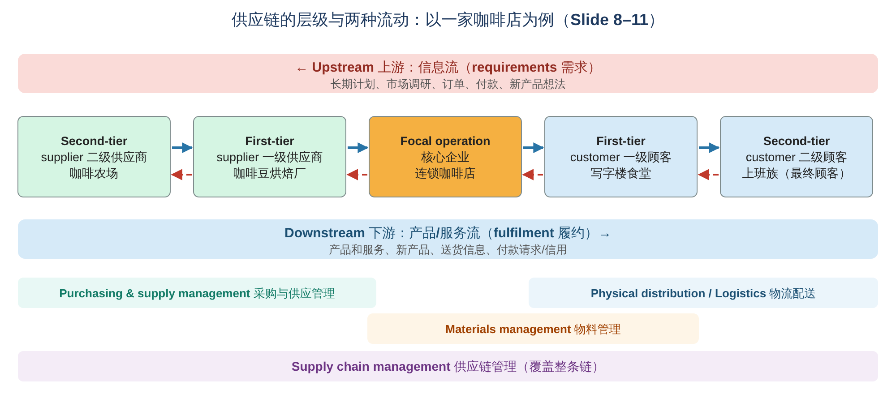
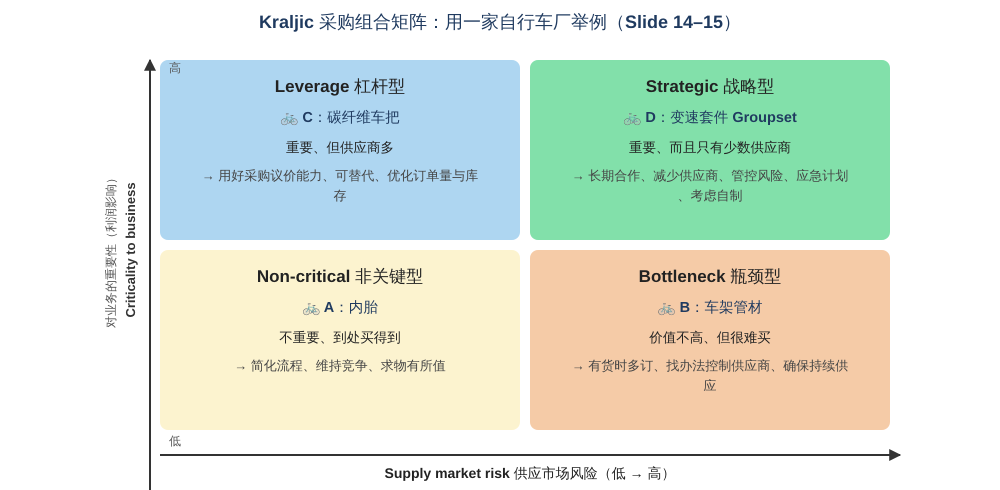
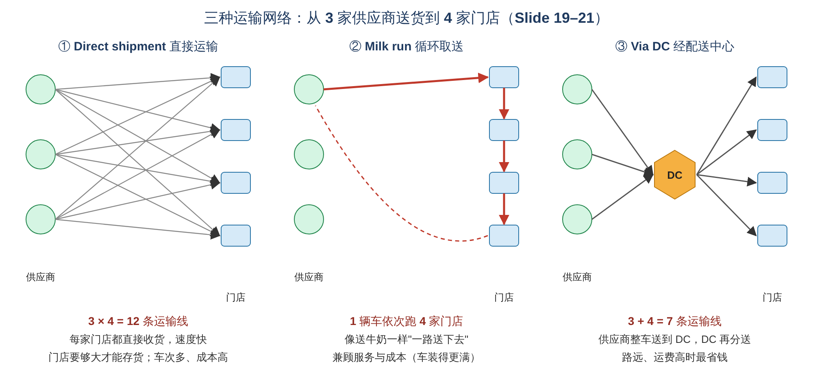
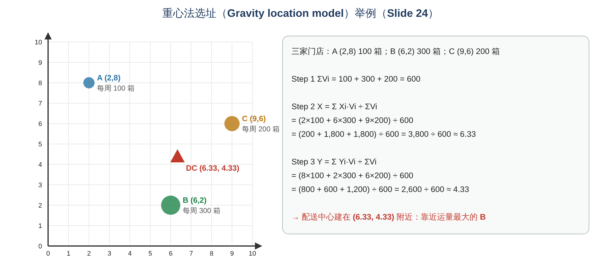
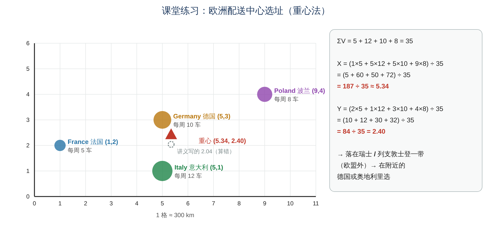
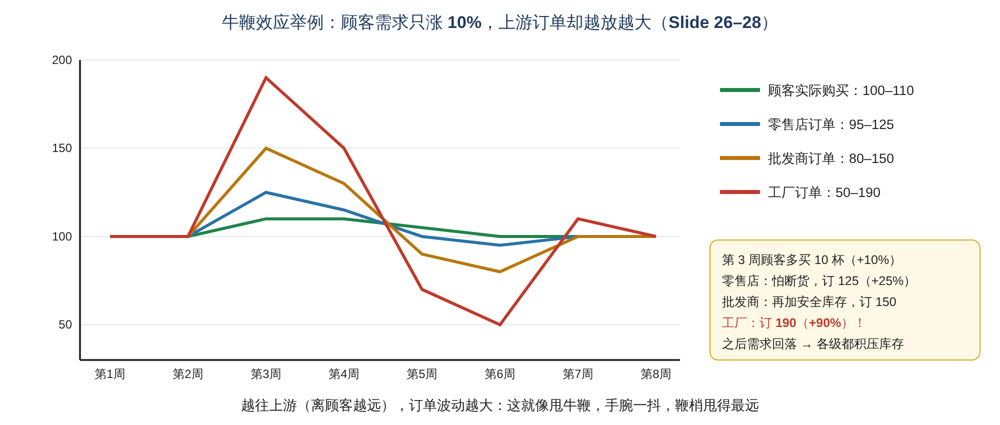
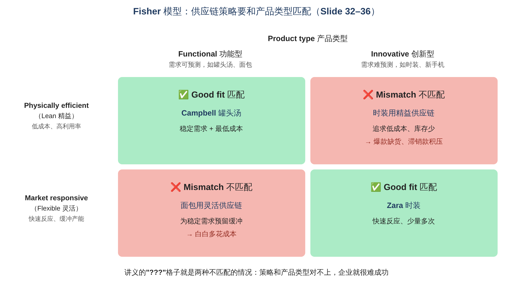
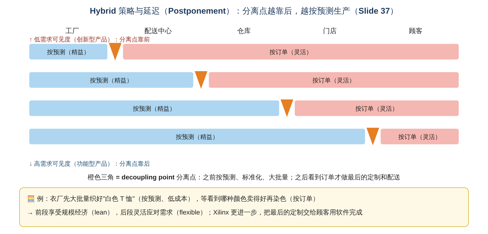
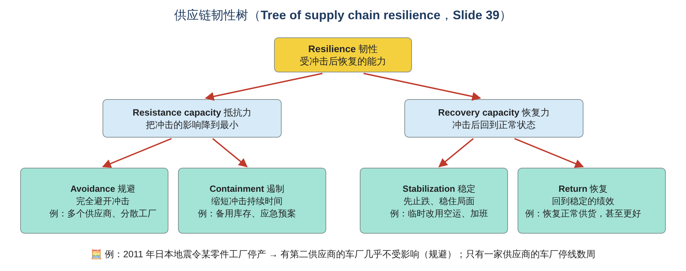

# Operations Management · Topic 7 供应链管理（Supply Chain Management）学习笔记

> 教材：Slack, Brandon-Jones & Burgess, *Operations Management*, 10th Edition — **Part Three "Deliver", Chapter 12 Supply chain management**\
> 内容范围：讲义 Topic 7（共 43 页）
>
> 📌 阅读说明
> - **英文术语保留原文**（考试用英文作答），中文帮助理解。
> - **💡 补充** = 讲义没讲但能帮助理解的内容；**⚠️ 易错** = 容易混淆的地方；**🧮 举个例子** = 用具体数字或场景演示。
> - 本章有一道 **计算题**：重心法选址（gravity location model），第 3 节一步步算，包括老师课上讲的欧洲选址题（3.4 节）。
> - 文末有 **易混淆汇总、术语表、自测题（含答案）、考前速记**。

---

## 0. 一张图看懂本章

### 本章的五个学习目标（Learning Outcomes）

| # | Learning Outcome | 中文 |
|---|---|---|
| 1 | What is Supply Chain Management & its Importance | 什么是供应链管理，为什么重要 |
| 2 | Supply Chain Management functions | 供应链管理的职能 |
| 3 | Supply Chain Management dynamics | 供应链的动态（牛鞭效应） |
| 4 | Types of Supply Chains and Management approaches | 供应链类型与管理方法 |
| 5 | New Supply chain management trends | 供应链管理的新趋势 |

**一句话总结本章：** 供应链管理就是管理 **从原料到最终顾客的一连串企业之间的"物流 + 信息流"**。它有两大职能：**采购**（买什么、找谁买：单一/多家供应商、Kraljic 矩阵）和 **物流**（怎么送：直接运输、循环取送、配送中心、选址）。供应链会因为 **牛鞭效应** 而放大需求波动；供应链策略要和 **产品类型匹配**（Fisher 模型：功能型 → 精益，创新型 → 灵活）；新趋势是 **韧性、无人机、智能供应链和区块链**。

> 💡 **在全书中的位置：** 本章属于 4Ds 的 **Deliver（交付）** 部分。Deliver 包括：Planning and control、Capacity management、**Supply chain management（本章）**、Inventory management、Planning and control systems。
>
> 💡 **和前面章节的联系：**
> - Topic 1：**OM 管组织内部，SCM 管从供应商到顾客的整条链**；
> - Topic 2：采购要服务于 **绩效目标**（质量、交付、灵活、成本、创新、可持续），Fisher 模型就是 Topic 2 **"line of fit"** 在供应链上的应用；
> - Topic 5：**精益供应、JIT、看板、小批量多频次送货** 都是供应链问题；
> - Topic 6：选择供应商时看 **ISO 9000**；**内部顾客** 的概念扩展到企业之间。

---

## 1. What is Supply Chain Management? 什么是供应链管理？（LO 1）

### 1.1 ⭐ 定义（Slide 4）

> **"Supply chain management is the management of the interconnection of organizations that relate to each other through upstream and downstream linkages between the processes that produce value to the ultimate consumer in the form of products and services."**

**供应链管理** 是对 **一系列相互关联的组织** 的管理：这些组织通过 **上游和下游的联系** 连在一起，共同为 **最终消费者** 创造产品和服务形式的价值。

拆解关键词：
- **Interconnection of organizations**：管的是 **多个组织之间** 的关系，不只是一家公司；
- **Upstream and downstream linkages**：上游（供应商方向）和下游（顾客方向）的连接；
- **Value to the ultimate consumer**：最终目的是为 **最终消费者** 创造价值。

### 1.2 Supply chain vs Supply network（Slide 5）

> **Supply chain management is concerned with managing the flow of materials and information between a string of operations that form the strands or "chains" of a supply network.**

| | 范围 |
|---|---|
| **Flow between processes**（流程之间的流动） | 一家企业 **内部**，就是 **OM**（Topic 1、4） |
| **Supply chain management** | **一串（a string of）** 企业之间的流动，像网里的一条"链" |
| **Supply network management** | 所有相关企业组成的 **整张网络** 之间的流动 |

📝 **理解：** 现实中一家企业有很多供应商和顾客，交织成一张 **网（network）**；我们从中挑出一条从原料到顾客的路径来看，就是一条 **链（chain）**。

### 1.3 供应网络的例子（Slide 6–9）

**① Leah's Cupcakes（小型纸杯蛋糕店，Slide 6）**
- 面粉：小麦种子 → 小麦种植 → 粮商 → 面粉厂 → 餐饮批发商 → Leah's
- 糖：甘蔗种植 → 制糖厂 → 糖分销商 → Leah's
- 黄油：黄油生产商 → 黄油分销商 → Leah's
- 鸡蛋：母鸡供应商 + 饲料供应商 → 本地蛋农 → Leah's
- 蛋糕纸杯：纸杯制造商 → 纸杯零售商 → **第三方物流（3PL）** → Leah's
- 出货：Leah's → 本地面包店 / 直接卖给消费者 / 邮局 → 本地配送中心 → 消费者

📝 **启示：** 哪怕是一家小店，背后也有一张复杂的供应网络。

**② Wimbledon 网球（Slide 7）**：温网用的网球在供应网络中 **旅行超过 80,000 公里**。原料来自 **11 个国家/地区**（美国的黏土、新西兰的羊毛、英国的毛毡、中国的石油化工原料、韩国的硫磺、日本的碳酸镁、希腊的二氧化硅、泰国的氧化锌、菲律宾和马来西亚的胶水和橡胶），在 **菲律宾 Bataan** 生产，在 **印尼** 装罐，最后送到 **温布尔登**。
> 💡 说明了 **全球化供应链**：成本低、能获得最好的原料，但路途远、风险大（Topic 1 的"全球化"挑战）。

**③ ⭐ 层级（Tiers）：塑料家居用品公司（Slide 8）和购物中心（Slide 9）**

| 层级 | 塑料家居用品制造商 | 购物中心 |
|---|---|---|
| **Second-tier suppliers** 二级供应商 | 化工公司、纸板公司、油墨供应商 | 招聘中介、清洁用品供应商、设备供应商 |
| **First-tier suppliers** 一级供应商 | 塑料经销商、包装供应商 | 保安服务、清洁服务、维修服务 |
| **Focal operation** 核心企业 | 塑料家居用品制造商 | 购物中心 |
| **First-tier customers** 一级顾客 | 批发商、零售商 | 零售商（租户） |
| **Second-tier customers** 二级顾客 | 零售商 | 零售顾客（逛街的人） |

- **蓝色箭头 = Direct supply（直接供应，物流）**；**红色箭头 = Information（信息流）**
- ⚠️ 注意：塑料制造商 **既卖给批发商（一级顾客），也直接卖给某家零售商**。所以同一个零售商可能既是一级顾客，又是二级顾客。

📝 **记忆：**
- **First-tier（一级）** = 和你 **直接** 做生意的
- **Second-tier（二级）** = 和你的供应商/顾客做生意的（**隔了一层**）

> 💡 **购物中心的例子说明：服务业也有供应链**：它"买"的是保安、清洁、维修服务，"卖"给租户的是场地和客流。

### 1.4 ⭐ 两种流动：上游的信息流 vs 下游的产品流（Slide 10）

| | **"Upstream" 上游流动** | **"Downstream" 下游流动** |
|---|---|---|
| 方向 | 顾客 → 供应商 | 供应商 → 顾客 |
| 本质 | 顾客的 **Requirements（需求）** | 为顾客 **Fulfilment（履约）** |
| 内容 | **Long-term plans and requirements**（长期计划和需求）；**Market research information**（市场调研信息）；**Individual orders**（订单）；**Payment**（付款）；**Potential new products and services**（潜在的新产品想法） | **Products and services**（产品和服务）；**New products and services**（新产品）；**Delivery information**（送货信息）；**Payment request / Credit**（付款请求/信用） |

📝 **一句话：** **钱和需求往上游走，货和服务往下游走。**

🧮 **举个例子：你在网上订一台电脑**
> - **上游**：你下单、付款（信息、钱）→ 网店把订单传给电脑厂 → 电脑厂向芯片供应商下单
> - **下游**：芯片送到电脑厂 → 电脑组装好送到网店仓库 → 快递送到你家，同时你收到"已发货"的物流通知（送货信息）

### 1.5 为什么重要？（LO1 的 "importance"）

> 💡 **补充（讲义没有单独一页）：**
> - **企业之间的竞争，越来越变成供应链之间的竞争**：Zara、Amazon、Dell 都是靠供应链胜出；
> - **一家企业的成本和质量，很大一部分取决于供应商**：例如汽车厂 60%–70% 的零件是买来的；
> - **供应链出问题，全线受影响**：疫情期间芯片短缺，很多车厂停产（Topic 3、5 都提过）；
> - **好的供应链能同时提升顾客服务（准时、有货）和降低成本（少库存、少运输）**。

---

## 2. ⭐ Supply Chain Management Functions 供应链管理的职能（LO 2）

### 2.1 职能的范围（Slide 11）

讲义用一条汽车供应链来说明：**钢厂（二级供应商）→ 钢卷厂（一级供应商）→ 汽车厂 → 汽车仓储（一级顾客）→ 丰田经销店（二级顾客）→ 最终顾客（一家人）**

| 职能 | 覆盖的范围 |
|---|---|
| **Purchasing and supply management**（采购与供应管理） | **Supply side 供应端**：一级供应商 → 核心企业 |
| **Physical distribution management**（实物配送管理） | **Demand side 需求端**：核心企业 → 一级顾客 |
| **Logistics**（物流） | 从核心企业一直延伸到 **最终顾客** |
| **Materials management**（物料管理） | 物料从一级供应商进来，在 **企业内部** 流动，到送出去 |
| **Supply chain management**（供应链管理） | **整条链**：从二级供应商到最终顾客 |

- 虚线 = **Information flow（信息流）**，往上游走；实线 = **Physical flow（实物流）**，往下游走。

⚠️ **易错：** **Logistics（物流）≠ Supply chain management**。物流只是供应链管理中 **"把东西送出去"** 的那一部分；SCM 是 **整条链** 的管理，包括采购、生产、配送和关系管理。

### 2.2 ⭐ Purchasing 采购（Slide 12）

- **Traditionally, purchasing was seen as a clerical function**（传统上采购被看作 **文书工作**，比如做质量检查）；
- **Recently, the strategic perspective of purchasing has been recognized**（现在采购的 **战略意义** 被认可）；
- **Purchasing is aligned with all operational performance objectives**（采购要和 **所有运营绩效目标** 保持一致）：

| Performance objective | Purchasing function 采购要做到 | 🧮 举个例子：一家奶茶店 |
|---|---|---|
| **Quality** | 选择 **对质量负责、并能认证质量水平**（如 ISO 9000）的供应商 | 选有食品安全认证的茶叶供应商 |
| **Delivery** | 选择 **可靠、准时交货** 的供应商 | 选每天早上 8 点前一定送到鲜奶的牧场 |
| **Flexibility** | 选择 **能快速响应需求变化** 的供应商 | 夏天订单暴增时，珍珠供应商能临时加量 |
| **Cost** | 选择 **能带来成本优势** 的供应商 | 选价格比别家低 10% 的杯子厂 |
| **Innovation** | 选择 **能合作设计新产品和新流程** 的供应商 | 和配料商一起开发季节限定口味 |
| **Sustainability** | 选择 **对可持续负责** 的供应商（如 ISO 14000、OHSAS 职业健康安全） | 选用可降解吸管的供应商 |

> 💡 这张表和 Topic 2 的 **六大运营能力** 一一对应：采购就是把这些目标 **延伸到供应商身上**。

### 2.3 ⭐ Single-sourcing vs Multi-sourcing 单一采购 vs 多家采购（Slide 13）

| | **Single-sourcing 单一采购**（只找一家供应商） | **Multi-sourcing 多家采购**（同时找几家） |
|---|---|---|
| **Advantages 优点** | • **质量可能更好**（可以帮供应商做认证） • **关系强而持久** • **依赖会促使双方更投入、更努力** • **沟通好** • **更容易合作开发新产品** • **规模经济更大**（订单集中） • **保密性更高** | • **可以靠竞争压低价格** • **一家断供可以换另一家** • **知识和专业来源更广** |
| **Disadvantages 缺点** | • **一旦供应中断，非常脆弱** • **对需求波动更脆弱** • **没有替代者时，供应商可能涨价** | • **很难让供应商投入** • **不容易建立有效的质量体系** • **沟通更费力** • **供应商不太愿意投资新流程** • **更难获得规模经济** |

🧮 **举个例子：奶茶店的珍珠**
> - **单一采购**：只向 A 厂买 → A 厂愿意为你专门研发更 Q 的珍珠，价格也因为量大而便宜。但 A 厂一旦停电停产，你 **全店断货**。
> - **多家采购**：同时向 A、B、C 三家买 → 三家互相竞价，价格低；A 厂停产时马上让 B、C 加量。但每家都只拿到一点订单，**没人愿意为你专门改进**，三家的口感也不一样。
> - **💡 折中办法：dual sourcing（双重采购）**：一家为主（70%），一家为辅（30%）。Topic 5 精益供应里提到的 "single and dual sourcing" 就是这个意思。

### 2.4 ⭐ Kraljic Matrix 采购组合矩阵（Slide 14–15）

用两个维度给采购的物品分类：
- **Supply market risk（供应市场风险）**：物品 **稀缺**、受 **政局不稳、自然灾害** 影响、**运输困难** 容易中断，或 **供应商很少**；
- **Criticality to business（对业务的重要性，或利润影响）**：这个物品对 **产品价值和利润** 的贡献有多大。

| 类别 | 位置 | 采购策略（讲义） | 🚲 讲义例子：自行车厂 |
|---|---|---|---|
| **Strategic 战略型** | 重要性 **高** + 风险 **高** | • **建立长期供应关系**（减少供应商数量） • **定期分析和管理风险** • **制定应急计划** • **考虑自己生产而不是购买** | **D：变速套件（Groupset）**：决定车的档次，而且只有少数几家品牌能做 |
| **Leverage 杠杆型** | 重要性 **高** + 风险 **低** | • **充分利用采购议价能力** • **使用替代产品或替代供应商** • **优化订单量** • **优化库存水平** | **C：碳纤维车把**：价值高，但能做的厂家很多 |
| **Bottleneck 瓶颈型** | 重要性 **低** + 风险 **高** | • **有货时多订一些**（因为供应不可靠） • **想办法控制供应商** | **B：车架管材**：本身价值不高，但规格特殊、很难买到 |
| **Non-critical / Tactical 非关键型** | 重要性 **低** + 风险 **低** | • **确保从最合适的来源买到物有所值的东西** • **增加供应商数量，保持供应商之间的竞争** | **A：内胎**：便宜、到处都买得到 |

讲义还标注：**Strategic + Leverage（上半部分）大约占采购支出的 80%**。

📝 **记忆口诀：**
- **上面两格"重要"**：风险低的 → 用 **议价能力**（Leverage）；风险高的 → 做 **长期伙伴**（Strategic）
- **下面两格"不重要"**：风险低的 → **简单处理**（Non-critical）；风险高的 → **确保有货**（Bottleneck）

> ⚠️ **讲义 Slide 15 右边的表（Table 9.3）要小心：** 表里 "Low/High" 被标成 **Tactical**、"Low/Low" 被标成 **Leverage**，和左边的矩阵图（以及 Slide 14）对不上，看起来是标签放错了。**考试请按矩阵图来答**：低风险 + 高重要性 = Leverage；低风险 + 低重要性 = Non-critical / Tactical。

### 2.5 ⭐ Logistics：分销网络的四个主要决策（Slide 16）

> **Main decisions determine the logistics network, which reflect the firm's performance objectives (customer).**

| # | 决策 | 选项 | 🧮 举个例子：一家网店 |
|---|---|---|---|
| 1 | **Ownership 所有权** | **Private（自营）vs outsourcing（外包）** | 自己买车队送货（如京东）vs 交给快递公司（如顺丰、Ninja Van） |
| 2 | **Capacity 产能** | **Transportation（运输能力）** 和 **warehousing（仓储能力）** | 需要多少辆货车？仓库要多大？ |
| 3 | **Mode selection 运输方式** | **Truck（卡车）、train（火车）、ship（船）、pipeline（管道）、airplane（飞机）、intermodal（多式联运）** | 国内用卡车；从中国进货用海运；急件用空运 |
| 4 | **Location 选址** | 为仓库、配送中心或工厂选择 **区域、地区和具体地点** | 仓库建在市中心还是郊区？（见 3.6 节重心法） |

> 💡 **运输方式的取舍：** 越快通常越贵。**空运** 最快最贵；**海运** 最慢最便宜，适合大件、不急的货；**管道** 只适合石油、天然气、水；**多式联运（intermodal）** = 同一个集装箱先用船、再用火车、最后用卡车，不用重新装卸。

### 2.6 ⭐ 设计分销网络：服务 vs 成本（Slide 17–18）

> **A distribution network design should consider the desired degree of customer service (availability) and cost effectiveness.**

设计运输网络时要考虑两个问题：
1. **Should transportation be direct or through an intermediate site?**（直接运，还是经过中转站？）
2. **Should the intermediate site stock product?**（中转站要不要存货？）

| **Factors affecting customer service 影响顾客服务的因素** | **Factors affecting cost 影响成本的因素** |
|---|---|
| **Response time** 响应时间 | **Holding inventories** 持有库存 |
| **Product variety** 产品种类 | **Handling inventories** 搬运库存 |
| **Product availability** 产品可得性 | **Transportation** 运输 |
| **Customer experience** 顾客体验 | |
| **Time to market** 上市时间 | |
| **Order visibility** 订单可见性（能查到订单状态） | |
| **Returnability** 退货便利性 | |

🧮 **举个例子：** 网店想做到"当日达"（响应时间短、服务好）→ 要在各个城市都设仓库、都备货 → **库存成本和仓库成本大增**。只设一个中央仓库 → 成本低，但送货要 3 天。**服务和成本之间要权衡。**

### 2.7 ⭐ 三种运输网络（Slide 19–21）

| 网络 | 讲义要点 | 主要关注 | 🧮 举个例子 |
|---|---|---|---|
| **① Direct shipment networks 直接运输** | **All shipments directly from suppliers to retail stores**；只有当 **门店够大、能自己存货** 时才合理 | **Customer service** | 可口可乐的货车直接把饮料送到大型超市 |
| **② Direct shipping with milk runs 循环取送** | 一辆车 **从一个供应商送货到多家门店**，或者 **从多个供应商取货送到一家门店** | **Customer service and cost** | 一辆面包车早上从面包厂出发，依次给 8 家便利店送面包 |
| **③ Shipments via intermediate distribution centers (DC) 经配送中心** | **All shipments go through a DC**（DC 之后还可以再配合 milk run） | **Customer service (e.g. speed) and cost** | 超市连锁的所有供应商都把货送到区域配送中心，再由配送中心统一送到各门店 |

> 💡 **"Milk run（送奶路线）"的由来：** 以前送牛奶的人每天沿着固定路线挨家挨户送，而不是每送一家就回一次牛奶厂。
>
> 🧮 **用数字理解（3 家供应商、4 家门店）：**
> - 直接运输：每家供应商分别送到每家门店 → 3 × 4 = **12 条运输线**，很多车都装不满
> - 经 DC：3 家供应商各送 1 趟到 DC + DC 送 4 趟到门店 = **7 条运输线**，每趟都装得满
> - 循环取送：1 辆车依次跑完 4 家门店 → 车次最少，但 **最后一家门店收货最晚**

### 2.8 ⭐ 配送中心（DC）与整合中心（CC）（Slide 22）

- **供应商不直接送货到门店**：零售连锁按 **地理区域** 划分门店，**每个区域建一个 DC**；
- **DC 是一种仓库**，供应商把大量产品送到这里；
- **每个 DC 服务该区域的多家门店**：**RDCs（Regional distribution centres，区域配送中心）** 和 **NDCs（National distribution centres，全国配送中心）**；
- **DC 的主要作用**：
  1. **Store inventory**（储存库存）
  2. **Serve as a transfer location**（作为中转站）
  3. **Serve as an assembling facility**（作为组装/拼单设施）
- **目标：当供应商离门店很远、运费很高时，降低成本**；
- **Consolidation centres (CC) 整合中心**：**减少仓库和门店里的重复库存**，从而降低库存水平。

> 💡 **DC vs CC 的区别：**
> - **DC（配送中心）**：在 **零售商这一端**，把货 **分发** 给各门店
> - **CC（整合中心）**：在 **供应商这一端**，把多家小供应商的货 **集中拼成整车**，再送到 DC
> - 🧮 例：10 家小农场每家只有半车菜 → 先送到 CC 拼成 5 整车 → 再送到超市的 DC → 再分送到各门店。如果没有 CC，就要 10 辆半空的车跑去 DC。

### 2.9 分销的演变（Slide 23，Potter et al., 2003）

| 年代 | 分销方式 | 谁组织运输 |
|---|---|---|
| **Pre-1970s** | 供应商 **直接送到商店** | 供应商组织（虚线） |
| **1970s** | 供应商 → **DC** → 商店 | DC → 商店由 **零售商** 组织（实线） |
| **1990s** | 供应商 →（部分经 **CC**）→ DC → 商店 | 供应商 → CC/DC 仍由 **供应商** 组织 |
| **2000s** | 供应商 → CC → DC → 商店 | **全程由零售商组织**（实线） |

📝 **趋势：** 零售商（如 Tesco、Walmart）**越来越多地控制整条物流**，自己安排车去供应商那里取货，从而降低成本、提高可靠性。

---

## 3. ⭐ 计算：重心法选址（Gravity location model，Slide 24）

### 3.1 原理

- 目标：找到 **运输成本最低** 的位置；
- 假设每个地点都有一个"重量"：**往返这个地点的运输量**；
- 运量越大的地点，对仓库位置的"吸引力"越大，就像 **重力** 一样。

**公式：**

> **X = Σ (Xi × Vi) ÷ Σ Vi**\
> **Y = Σ (Yi × Vi) ÷ Σ Vi**

- **Xi、Yi** = 第 i 个地点的坐标
- **Vi** = 运往（或来自）第 i 个地点的数量

📝 **其实就是"加权平均"**：把每个地点的坐标按运量加权，再除以总运量。

### 3.2 🧮 举个例子：一家饮料公司要给 3 家门店建一个配送中心

| 门店 | X 坐标 | Y 坐标 | 每周运量 V | X × V | Y × V |
|---|---|---|---|---|---|
| A | 2 | 8 | 100 | 200 | 800 |
| B | 6 | 2 | 300 | 1,800 | 600 |
| C | 9 | 6 | 200 | 1,800 | 1,200 |
| **合计** | | | **600** | **3,800** | **2,600** |

**Step 1：总运量** ΣV = 100 + 300 + 200 = **600**

**Step 2：X 坐标** X = 3,800 ÷ 600 ≈ **6.33**

**Step 3：Y 坐标** Y = 2,600 ÷ 600 ≈ **4.33**

**答案：配送中心应建在 (6.33, 4.33) 附近。**

📝 **检查答案是否合理：** 如果三家门店运量一样，中心点应该是简单平均 ((2+6+9)/3, (8+2+6)/3) = (5.67, 5.33)。现在 B 的运量最大（300），所以答案 **被"拉"向 B (6, 2)**：X 变大、Y 变小。✅ 合理。

### 3.3 🔁 再练一个

> 一家面包厂要从 **两个面粉供应商** 进货，并送货到 **一个大客户**：
> - 供应商 P (0, 0)，每月运入 50 吨
> - 供应商 Q (10, 0)，每月运入 150 吨
> - 客户 R (4, 8)，每月运出 200 吨
>
> ΣV = 50 + 150 + 200 = 400\
> X = (0×50 + 10×150 + 4×200) ÷ 400 = (0 + 1,500 + 800) ÷ 400 = 2,300 ÷ 400 = **5.75**\
> Y = (0×50 + 0×150 + 8×200) ÷ 400 = (0 + 0 + 1,600) ÷ 400 = 1,600 ÷ 400 = **4.0**\
> **→ 工厂建在 (5.75, 4.0)**
>
> ⚠️ 注意：**运入和运出的量都要算进去**（公式里 Vi 是 "sent from/to a location"）。

> 💡 **重心法的局限：** 它只考虑了 **直线距离和运量**，没有考虑 **实际道路、地价、劳动力、政策** 等因素。算出来的点只是一个 **起点**，还要结合现实情况调整（比如那个位置刚好是一个湖）。

### 3.4 ⭐ 课堂练习：欧洲配送中心选址（老师在课上讲的题，Chavez 改编案例）

**题目（根据课堂照片整理）：** 一家公司在欧洲有 4 个销售中心，要找一个新配送中心的位置。公司认为 **Germany 或 Austria** 可能是好的选择，并且还要考虑其他主要标准来做最终决定。

**Table 1 每周需求（单位：车 truck loads）**

| 销售中心 | 每周销量 |
|---|---|
| France 法国 | 5 |
| Germany 德国 | 10 |
| Italy 意大利 | 12 |
| Poland 波兰 | 8 |

⚠️ 照片里表格的数字看起来往上错了一行（5 对着空行），**以老师的解答为准**：法国 5、德国 10、意大利 12、波兰 8。

**地图坐标**（从解答里的公式读出来，地图上 1 格 ≈ 300 km）：

| 销售中心 | X | Y | 运量 V |
|---|---|---|---|
| France 法国 | 1 | 2 | 5 |
| Italy 意大利 | 5 | 1 | 12 |
| Germany 德国 | 5 | 3 | 10 |
| Poland 波兰 | 9 | 4 | 8 |

**问题：**
- **(a)** Using the centre-of-gravity method, find a location on the map that reduces cost of transportation (distance travelled) and maintains service levels.
- **(b)** Once the location has been chosen, consider the important factors in Table 2 before making your final decision.

#### (a) 计算过程（一步步来）

| 销售中心 | X | Y | V | X × V | Y × V |
|---|---|---|---|---|---|
| France | 1 | 2 | 5 | 5 | 10 |
| Italy | 5 | 1 | 12 | 60 | 12 |
| Germany | 5 | 3 | 10 | 50 | 30 |
| Poland | 9 | 4 | 8 | 72 | 32 |
| **合计** | | | **35** | **187** | **84** |

**Step 1：总运量** ΣV = 5 + 12 + 10 + 8 = **35**

**Step 2：X 坐标** X = ΣXV ÷ ΣV = (1×5 + 5×12 + 5×10 + 9×8) ÷ 35 = (5 + 60 + 50 + 72) ÷ 35 = 187 ÷ 35 ≈ **5.34** ✅（和讲义一致）

**Step 3：Y 坐标** Y = ΣYV ÷ ΣV = (2×5 + 1×12 + 3×10 + 4×8) ÷ 35 = (10 + 12 + 30 + 32) ÷ 35 = 84 ÷ 35 = **2.40**

> ⚠️ **注意：讲义解答写的是 Y = 2.04，这是算错（或打错）了。** 用讲义自己的公式，84 ÷ 35 = **2.40**，不是 2.04。你可以自己按计算器验证：35 × 2.04 = 71.4 ≠ 84，而 35 × 2.4 = 84 ✓。\
> 老师在地图上画的蓝圈也在 **Y ≈ 2.4–2.6** 的位置（列支敦士登附近），和 2.40 吻合；如果是 2.04，点会落在更南边的米兰附近。考试时用 **2.40**；如果老师坚持 2.04，可以把计算过程写出来说明。

**答案（a）：重心约在 (5.34, 2.40)。** 在地图上大约是 **瑞士东部 / 列支敦士登 / 奥地利西部** 一带。

📝 **检查答案是否合理：**
- X = 5.34：意大利和德国都在 X = 5，运量又最大（12 + 10 = 22），所以 X 被拉在 5 附近；波兰（X = 9）把它往右拉了一点 ✓
- Y = 2.40：意大利（Y = 1）运量最大，把点往下拉；德国（Y = 3）和波兰（Y = 4）往上拉 → 落在 2 和 3 之间 ✓

#### (b) 结合其他因素做最终决定

**为什么题目说"Germany 或 Austria"？** 💡 重心落在 **瑞士 / 列支敦士登** 附近，但 **瑞士不是欧盟成员，使用瑞士法郎**（跨境要报关、有汇率风险），所以公司在 **紧挨着重心的两个欧盟国家**：德国（南部，如慕尼黑一带）和奥地利（西部，如因斯布鲁克 / 福拉尔贝格一带）之间选择。这正是第 3.3 节说的：重心法只给出 **起点**，最后还要看现实因素。

**Table 2 其他决策因素**（照片拍得斜，笔挡住了一部分，按我的读法整理）：

| Criteria 标准 | Germany 德国 | Austria 奥地利 |
|---|---|---|
| Land cost 土地成本 | Euro | Euro |
| Local tax 地方税 | **High（高）** | **Competitive（有竞争力）** |
| Input costs 投入成本 | Euro | Euro |
| Qualified labor cost 熟练劳动力成本 | Competitive | Competitive |
| Movement of capital 资本流动 | Competitive | Competitive |
| Accessibility (roads) 公路交通 | Competitive | Competitive |
| Accessibility (airport) 机场交通 | Competitive | Competitive |
| Potential expansion 扩展潜力 | Competitive | Competitive |
| Political stability 政治稳定 | UE | UE |
| Government support 政府支持 | Competitive | Competitive |

- **"Euro"**：两国都用欧元 → 没有汇率风险，成本用同一种货币计价，可以直接比较
- **"UE"**：西班牙语 Unión Europea = **EU（欧盟）**，两国都是欧盟成员 → 政治稳定、货物自由流通
- **"Competitive"**：在这一项上有竞争力（不吃亏）

**分析：** 两个国家在 **几乎所有标准上都一样**（都用欧元、都是欧盟、交通/劳动力/扩展/政府支持都 competitive），**唯一的区别是 Germany 有一项是 "High"（照片里在地方税这一行），而 Austria 是 "Competitive"**。

**答案（b）：选 Austria（奥地利，靠近重心的西部地区）。**

> 📝 **答题模板（英文）：**\
> "Using the centre-of-gravity method, the optimal location is approximately (5.34, 2.40), which falls in the Switzerland / Liechtenstein / western Austria area. Since Switzerland is outside the EU, the nearest feasible options are southern Germany and western Austria. Both countries share the euro, EU membership and competitive labour, accessibility, expansion potential and government support. The only difference is that Germany's local tax is high while Austria's is competitive. Therefore, **Austria** is recommended, as it minimises transportation distance and offers lower costs while maintaining service levels."
>
> ⚠️ 如果你在讲义原件上看到 "High" 实际是在 **Land cost（土地成本）** 那一行，结论不变：只要德国在某一项成本上偏高、其他都一样，就选 **奥地利**。

> 💡 **这道题说明的两个道理：**
> 1. **重心法 = 量化（只看距离和运量）**；**Table 2 = 定性因素（税、劳动力、政治、扩展……）**。真正的选址决策要 **两者结合**。
> 2. 如果想更严谨地比较 Table 2，可以用 **加权评分法（weighted factor rating）**：给每个标准一个权重（比如税 20%、交通 25%……），每个国家打分，再算加权总分，总分高的胜出。在这道题里两国只差一项，所以不用算也能看出奥地利更好。

---

## 4. ⭐ Supply Chain Dynamics 供应链动态：牛鞭效应（LO 3）

### 4.1 供应链不是静止的（Slide 25）

- **SCM is not simply a static group of functions**（SCM 不只是一组静态的职能）；
- 成功的 SCM 策略会根据 **内外部环境**，以不同方式组合各种职能和做法；
- **不同的特征意味着不同的 SCM 策略**，主要看两点：
  1. **Demand distortion（需求扭曲）** → 本节
  2. **Product type（产品类型）** → 第 5 节

### 4.2 ⭐ The "bullwhip" effect 牛鞭效应（Slide 26）

- **Demand distortion occurs when retailers issue orders based on demand forecast rather than actual sales figures**（零售商按 **预测** 而不是 **实际销量** 下订单，就会产生需求扭曲）；
- **Demand is amplified from downstream to upstream supply chain**（需求从 **下游到上游被不断放大**）。

讲义图：从顾客 → 零售商 → 一级供应商 → 二级供应商 → 三级供应商，每一层都在问 "Demand?"，库存（砖墙）越往上游堆得越高，需求波动曲线越往上游越剧烈。

🧮 **举个例子：一家奶茶店的牛鞭效应**
> 平时每周顾客买 **100 杯**，各级都按 100 下单。
> - **第 3 周**：天气热，顾客买了 **110 杯**（只多了 **10%**）
> - **零售店**："需求在涨！再留点安全库存" → 向批发商订 **125**（+25%）
> - **批发商**：看到订单从 100 涨到 125，"涨了 25%！我也要备货" → 向工厂订 **150**（+50%）
> - **工厂**：看到订单涨到 150，"需求暴增！" → 向原料商订 **190**（+90%）
> - **第 5–6 周**：天气转凉，顾客需求回到 100。各级手上都压着大量库存 → 停止下单 → 工厂订单跌到 **50**
>
> **结果：顾客需求只在 100–110 之间波动，工厂的订单却在 50–190 之间剧烈摆动。** 这就是"牛鞭"：手腕轻轻一抖，鞭梢甩得最远。

> 💡 **"啤酒游戏"（Beer Game）**：MIT 设计的一个经典课堂游戏，学生扮演零售商、批发商、分销商、工厂，每次只能看到下一级的订单。几乎每次玩都会出现严重的牛鞭效应，即使最终顾客的需求只变化过一次。

### 4.3 ⭐ 牛鞭效应的四大原因（Slide 27–30，Lee et al., 1997）

> **"Each of the four forces in concert with the chain's infrastructure and the order managers' rational decision making create the bullwhip effect."**\
> 四种力量 + 供应链结构 + 订货经理 **各自看似理性** 的决策，一起造成了牛鞭效应。

| 原因 | 讲义要点 | 🧮 举个例子 |
|---|---|---|
| **① Demand forecast updating 需求预测更新** | • 预测常常 **只根据直接顾客的订单历史** • 供应链上的预测是 **"对估计的估计"**，而且每层都加了 **安全库存** • 预测 = **满足未来需求的库存 + 安全库存** • **供应链的提前期（lead time）越长，需求扭曲越大，库存越高** | 上面的奶茶例子：每一层都只看下一级的订单来预测，再加一点安全库存，层层放大 |
| **② Order batching 订单批量** | • 企业常常 **把需求攒起来再一起下单**：每周、每两周或每月一次，而不是频繁下单 • 原因：**频繁下单的处理成本**；**运输成本（要凑满一车）**；**MRP 系统通常每月运行一次** • 需求看起来像是静态的，**不代表真实的需求模式** • 结果：供应商收到的是 **夸大的订单**，并据此向自己的供应商下单 | 一家便利店每天实际卖 10 瓶水，但为了凑满一车，每两周才订一次 140 瓶 → 供应商看到的需求是"两周 0 瓶、然后突然 140 瓶" |
| **③ Price fluctuation 价格波动** | • **促销和优惠会扭曲需求** • **下游**：降价、优惠券、返现 • **上游**：贸易折扣、大批量折扣、付款条件 • **顾客的购买模式不能反映真实的消费模式** • 需求大幅波动时，**供应商会提前备货** | 超市搞"洗衣液买一送一" → 顾客一次囤 3 个月的量 → 促销期销量暴增，之后 3 个月几乎没人买 → 工厂看到的是"暴增—暴跌" |
| **④ Rationing and shortage gaming 配给与短缺博弈** | • 知道厂商会 **按比例配给**，顾客就 **故意夸大订单** • 有的顾客 **同时向多家供应商重复下单，然后再取消** • 厂商 **分不清哪些订单是真的（genuine）、哪些是"幽灵订单"（phantom）** | 口罩短缺时，药店知道厂家只给订单量的 50%，于是需要 1,000 个就订 2,000 个，还同时向 3 家厂下单。厂家以为需求是实际的 6 倍，拼命扩产；短缺一结束，订单被大量取消 |

📝 **记忆口诀：** **预测、批量、价格、抢货**（Forecast、Batching、Price、Gaming）

> 💡 **怎样减少牛鞭效应？**（常见对策）
>
> | 原因 | 对策 |
> |---|---|
> | 需求预测更新 | **共享真实销售数据**（POS 数据，例如 Walmart 和宝洁共享）；**缩短提前期** |
> | 订单批量 | **小批量多频次下单**（Topic 5 的混装送货）；降低下单成本（电子下单 EDI） |
> | 价格波动 | **天天低价（EDLP）**，少搞大促 |
> | 配给与短缺博弈 | **按历史销量而不是订单量来配给**；不允许随意取消订单 |

### 4.4 ⭐ Dell 模式：缩短提前期（Slide 31）

| | **Traditional model lead time 传统模式** | **Dell model lead time 戴尔模式** |
|---|---|---|
| 流程 | 供应商 → 运输 → **仓库** → 运输 → 制造 → 运输 → **分销商** → 运输 → 顾客 | 供应商 → 运输 → 制造 → 运输 → 顾客 |
| 环节 | 4 次运输，中间有仓库和分销商 | 只有 2 次运输，**跳过仓库和分销商** |
| 结果 | 提前期长 | **Time to market advantage > 80%**（上市时间缩短超过 80%） |

> 💡 **为什么这和牛鞭效应有关？**
> - Dell 采用 **直销（顾客直接在网上下单）+ 按订单组装（build-to-order）**；
> - Dell 看到的是 **真实的顾客订单**，而不是分销商的预测订单 → 没有"对估计的估计"→ **牛鞭效应大大减少**；
> - 环节少、提前期短 → 库存少，新芯片一出来就能用上，**不会积压过时的电脑**。

---

## 5. ⭐ Types of Supply Chains 供应链类型与管理方法（LO 4）

### 5.1 产品类型决定供应链策略（Slide 32，Marshall Fisher, 1997）

- **SCM strategy should be determined by the type of product**（供应链策略应该由 **产品类型** 决定）
- 两种产品（按需求类型）：**Functional（功能型）**、**Innovative（创新型）**
- 两种供应链策略：**Physically efficient or "lean"（实物高效 / 精益型）**、**Market responsive or "flexible"（市场响应 / 灵活型）**

### 5.2 ⭐ 功能型 vs 创新型产品（Slide 33、35）

| 特征 | **FUNCTIONAL 功能型**（需求可预测） | **INNOVATIVE 创新型**（需求不可预测） |
|---|---|---|
| **Product life cycle** 产品生命周期 | **超过 2 年** | **3 个月到 1 年** |
| **Contribution margin** 边际贡献 | **5%–20%** | **20%–60%** |
| **Product variety** 产品种类 | **低**（每类 10–20 种） | **高**（每类可能上百万种） |
| **Forecast error at production commitment** 投产时的平均预测误差 | **10%** | **40%–100%** |
| **Average stock-out rate** 平均缺货率 | **1%–2%** | **10%–40%** |
| **Forced end-of-season markdown** 季末被迫降价幅度 | **0%** | **10%–25%** |
| **Lead time for made-to-order** 按订单生产的提前期 | **6 个月到 1 年** | **1 天到 2 周** |

**讲义例子（Slide 35）：从功能型到创新型**

| 产品 | **Bucket 水桶** | **Bread 面包** | **Mobile phone 手机** | **Fashion handbag 时尚手袋** |
|---|---|---|---|---|
| 新产品推出间隔 | 10 年以上 | 1–10 年以上 | 1 年–18 个月 | 3–6 个月 |
| 利润率 | 极低 | 低 | 很高 | 高 |
| 产量 / 品种 | 高 / 很低 | 高 / 低 | 中 / 中 | 中 / 中 |
| 需求波动和不确定性 | 很低 | 很低 | 中 | 中到高 |

📝 **一句话：功能型 = 满足基本需求、需求稳定、利润薄（牙膏、大米）；创新型 = 新潮、需求难测、利润高、生命周期短（时装、新款手机）。**

### 5.3 ⭐ 两种供应链策略（Slide 34）

| 特征 | **PHYSICALLY EFFICIENT 实物高效（精益）** | **MARKET-RESPONSIVE 市场响应（灵活）** |
|---|---|---|
| **Primary purpose** 主要目的 | **以最低成本高效地供应可预测的需求** | **快速响应不可预测的需求**，尽量减少缺货、被迫降价和过时库存 |
| **Manufacturing focus** 生产重点 | **保持高平均利用率** | **部署额外的缓冲产能** |
| **Inventory strategy** 库存策略 | **高周转，整条链的库存最少** | **部署大量缓冲库存或成品** |
| **Lead time focus** 提前期 | **在不增加成本的前提下缩短提前期** | **积极投资来缩短提前期**（即使贵） |
| **Approach to choosing suppliers** 选择供应商 | **主要看成本和质量** | **主要看速度、灵活性和质量** |
| **Product design strategy** 产品设计 | **性能最大化、成本最小化** | **用模块化设计，尽量推迟产品差异化**（即 postponement） |

### 5.4 ⭐ 匹配：策略要和产品类型一致（Slide 36）

> **Consistency between SCM strategy and product type is key — better fit determines success.**

| | **Functional 功能型产品** | **Innovative 创新型产品** |
|---|---|---|
| **Physically efficient (Lean)** | ✅ **Good fit**：罐头食品（如 **Campbell Soup**） | ❌ **???（不匹配）** |
| **Market responsive (Flexible)** | ❌ **???（不匹配）** | ✅ **Good fit**：时装（如 **Zara**） |

> 💡 **讲义的两个 "???" 是什么意思？（参考答案）**
> - **创新型产品 + 精益供应链**：例如用"低成本、大批量、库存最少"的方式卖时装 → 生产要提前很久按预测下单 → 预测误差 40%–100% → **爆款缺货、滞销款积压、季末大减价**。
> - **功能型产品 + 灵活供应链**：例如用"缓冲产能、大量库存、空运"的方式卖大米 → 需求本来就很稳定，**多花的钱完全浪费**，利润本来就薄，会被吃光。
> - **结论：** 两种都是 **不匹配（mismatch）**，企业很难成功。这和 Topic 2 的 **line of fit**、Topic 4 的 **product–process matrix** 是同一个道理。

🧮 **举个例子：判断下面的产品适合哪种供应链**
> | 产品 | 类型 | 适合的供应链 |
> |---|---|---|
> | 卫生纸 | 功能型（需求稳定、利润薄） | 精益：大批量、少库存、低成本运输 |
> | 限量版球鞋 | 创新型（需求难测、利润高） | 灵活：小批量、快速补货 |
> | 手机充电线 | 功能型 | 精益 |
> | 新上市的游戏机 | 创新型 | 灵活 |

### 5.5 ⭐ Hybrid SCM strategy 混合策略与延迟（Slide 37–38）

- **Lean and flexible SCM strategies can be combined** to obtain the benefits of both（精益和灵活可以结合，两者的好处兼得）；
- 用 **postponement（延迟）** 的概念来结合。

**讲义图（Hoekstra and Romme, 1992）：**
- 供应链从左到右：**Plants（工厂）→ Distribution Centres（配送中心）→ Warehouses（仓库）→ Depots（网点）→ 顾客**
- **左边（浅色箭头）：Driven by forecast（按预测推动）**
- **右边（深色箭头）：Driven by demand（按需求/订单拉动）**
- 中间的 **三角形** 是两者的分界点，通常叫 **decoupling point（分离点）**
- **High demand visibility（需求可见度高，功能型产品）**：分离点 **靠近顾客**，大部分环节都按预测做
- **Low demand visibility（需求可见度低，创新型产品）**：分离点 **靠近工厂**，很早就要等订单

> 💡 **Postponement（延迟）的意思：** 把 **"让产品变得不一样"（差异化）的那一步尽量往后推**，推到看到真实订单之后再做。
> - **分离点之前**：标准化、大批量、按预测生产 → 享受 **精益** 的低成本
> - **分离点之后**：根据订单做最后的定制 → 享受 **灵活** 的快速响应
>
> 🧮 **举个例子：**
> - **贝纳通（Benetton）毛衣**：先用白色毛线织好毛衣（按预测、大批量），等看到当季哪种颜色流行，再染色（按订单）。不会出现"红色卖光、绿色积压"。
> - **油漆店**：只存白色底漆，顾客要什么颜色，现场用调色机调。只要存几种底漆，就能提供上千种颜色。
> - **Dell**：标准零件按预测采购，顾客下单后才组装成具体配置。

**⭐ Xilinx 案例（Slide 38，Brown et al., 2000）**
- Xilinx 是一家成功的 **半导体公司**，把延迟概念 **推到了极致**；
- 它设计产品和流程，让 **顾客自己用软件完成最后的定制**（Xilinx 生产的是 **可编程芯片 FPGA**，顾客买回去后用软件"写入"自己需要的功能）；
- 结果：
  - **No inventory of finished products**（没有成品库存）：只需生产一种标准芯片
  - **No risk of obsolescence**（没有过时风险）
  - **Excellent fit between product type, product and process design, and SCM strategy**（产品类型、产品与流程设计、供应链策略之间完美匹配）

📝 **启示：** 延迟不只是供应链的问题，还需要 **产品设计** 配合（例如模块化设计，Topic 3）。

---

## 6. ⭐ New SCM Trends 供应链新趋势（LO 5）

### 6.1 ⭐ Supply chain vulnerability & resilience 供应链脆弱性与韧性（Slide 39，Melnyk et al., 2015）

- **A robust SCM strategy enables a firm to manage regular fluctuations in demand efficiently under normal circumstances regardless of the occurrence of a major disruption.**（稳健的供应链策略：正常情况下高效应对日常波动，即使发生重大中断也能应对）
- **Resilience（韧性）**：**the ability of a system to return to its original (or desired) state after being disrupted**（系统受冲击后恢复到原来或理想状态的能力）

| 能力 | 定义（讲义） | 两个部分 |
|---|---|---|
| **Resistance capacity 抵抗力** | 系统 **把冲击的影响降到最小** 的能力：要么 **完全避开（avoidance）**，要么 **缩短从冲击发生到开始恢复的时间（containment）** | **Avoidance 规避**、**Containment 遏制** |
| **Recovery capacity 恢复力** | 冲击发生后系统 **恢复运作** 的能力：先经过一个（希望很短的）**稳定（stabilization）** 阶段，再 **回到（return）** 稳定的绩效水平。最终的绩效 **可能回到、也可能回不到原来的水平** | **Stabilization 稳定**、**Return 恢复** |

🧮 **举个例子：一家车厂面对零件工厂火灾**
> - **Avoidance**：平时就有两家供应商（Topic 7 的 multi-sourcing）→ 一家起火，另一家马上加量，几乎不受影响
> - **Containment**：备有 2 周安全库存 + 应急预案 → 冲击只持续几天
> - **Stabilization**：临时改用空运、员工加班，先稳住生产
> - **Return**：供应商重建工厂，恢复正常供货；甚至借机改进，比原来更好

> 💡 **补充：精益 vs 韧性的平衡**（呼应 Topic 5）：精益追求 **库存越少越好、供应商越少越好**；韧性要求 **保留一定的安全库存、多个供应商**。疫情之后，很多企业从 "**just-in-time**" 转向 "**just-in-case**（以防万一）"，在两者之间找平衡。

### 6.2 Resilient SC 案例：Terra Drone 与 Unilever（Slide 40，Kan, 2020）

讲义图片：日本无人机公司 **Terra Drone** 与 **联合利华（Unilever）** 合作，用 **无人机** 配送 **Ben & Jerry's 冰淇淋**。

> 💡 **参考理解：** 这个试点在新冠疫情期间进行。无人机配送的意义：
> - **无接触配送**：疫情期间减少人员接触；
> - **绕开道路拥堵和人手不足**：增加了一条 **备用的配送渠道** → 提高供应链 **韧性**；
> - **速度快**：冰淇淋这种要冷藏的产品，送得越快越好。

### 6.3 New technology trends：智能供应链（Slide 41）

**Intelligent supply chains（智能供应链）** 依靠：
- **Big data 大数据**：分析海量销售和物流数据，提高预测准确度
- **Internet of Things (IoT) 物联网**：货物、车辆、货架上装传感器，实时知道东西在哪里、状态如何
- **AI 人工智能**：自动预测需求、规划路线、决定补货
- **Sensing 感知技术**：例如温度传感器监控冷链

**讲义的小组讨论题：How are digital technologies affecting SCM? Provide an industry example and discuss in groups.**

> 💡 **参考例子（任选一个展开）：**
>
> | 行业 | 技术 | 对供应链的影响 |
> |---|---|---|
> | **电商（Amazon）** | AI 预测 + 仓库机器人 | 在顾客下单前就把商品放到附近仓库（预测性备货）；机器人拣货更快 |
> | **零售（Walmart）** | 大数据 + 共享 POS 数据 | 供应商实时看到门店销量，自动补货 → 减少牛鞭效应 |
> | **冷链（疫苗、生鲜）** | IoT 温度传感器 | 全程监控温度，一旦超标马上报警，减少损坏 |
> | **物流（Grab、DHL）** | AI 路线规划 + GPS | 自动规划最短路线，顾客能实时看到包裹位置（提高 **order visibility**） |
> | **港口（新加坡港）** | 自动化码头 + 数据平台 | 集装箱自动装卸，缩短船舶停靠时间 |
>
> **答题框架：** 技术是什么 → 解决了供应链的什么问题（预测、可见性、速度、成本、韧性）→ 具体例子 → 可能的挑战（投资大、数据安全、员工技能）

### 6.4 ⭐ Blockchain 区块链在供应链中的应用（Slide 42–43）

**什么是区块链？**
> **A blockchain is a digital record book (or ledger) that stores information across a network of computers rather than in one central place. Once data is added, it is permanently locked, creating an unchangeable and highly secure history of transactions.**\
> 区块链是一个 **数字账本**，信息存放在 **一个计算机网络里，而不是一个中心位置**。数据一旦写入就 **永久锁定**，形成一份 **不可篡改、高度安全** 的交易历史。

**在 SCM 中的作用：**
> It creates an unalterable **"single source of truth"**. This allows all stakeholders from raw material suppliers to retailers to **track products, verify authenticity, and automate processes in real-time**.\
> 区块链创造了一个不可篡改的 **"唯一真相来源"**：从原料供应商到零售商，所有参与方都能 **实时追踪产品、验证真伪、自动执行流程**。

**⭐ 区块链如何记录和验证交易（Slide 42，5 个步骤）：**

| 步骤 | 内容 |
|---|---|
| 1 | 供应链中的某个企业 **提出一笔交易**（transaction requested） |
| 2 | 这笔交易被 **加密**，并 **广播** 到由供应链其他企业组成的 **P2P 网络**（这些企业叫 **nodes 节点**） |
| 3 | 网络中的节点用已知的算法 **验证** 交易代码和请求者的身份 |
| 4 | 验证通过后，这笔交易和其他交易 **合并成一个新的"区块"（block）**，写入网络的账本 |
| 5 | 新区块被加到现有的区块链上，**永久、不可更改** |

图中的参与者：**Supplier（供应商）、Manufacturer（制造商）、Logistics operation（物流）、Bank（银行）、End customer（最终顾客）、Other operations in the chain（链上其他企业）**，每个都有一份账本副本。

🧮 **举个例子：一块牛排的"身份证"**
> 1. 牧场把"牛的出生日期、饲料、检疫记录"写入区块链
> 2. 屠宰场写入"屠宰日期、检验结果"
> 3. 冷链物流写入"运输全程的温度记录"
> 4. 超市写入"上架日期"
> 5. 顾客扫一下包装上的二维码，就能看到这块牛排的 **全部历史**，而且 **任何人都改不了**
>
> 如果发生食品安全问题，几秒钟就能查到是哪一批、哪个牧场的牛，而不用花几天翻纸质记录。\
> 💡 现实中，沃尔玛和 IBM 合作过类似的食品追溯项目，据报道把芒果的溯源时间从约 7 天缩短到约 2 秒。

> 💡 **区块链的好处与局限：**
>
> | 好处 | 局限 |
> |---|---|
> | **透明、可追溯**（来源、真伪） | 投资和运营成本高 |
> | **防篡改、防伪**（奢侈品、药品） | 需要所有参与方都愿意加入 |
> | **自动执行**（智能合约：货到自动付款） | **"垃圾进、垃圾出"**：如果一开始录入的信息就是假的，区块链也只会忠实地保存假信息 |
> | 减少纸质单据和对账时间 | 技术和法规还不够成熟 |

---

## 7. ⚠️ 易混淆概念汇总

| 容易混淆 | 区别 |
|---|---|
| OM vs SCM | 一家企业 **内部** 流程之间 vs **多家企业之间** |
| Supply chain vs Supply network | 一条链（一串企业）vs 整张网 |
| First-tier vs Second-tier | **直接** 交易的 vs **隔一层** 的 |
| Upstream vs Downstream | 往供应商方向：**需求、订单、付款**（信息）vs 往顾客方向：**产品、服务、送货信息**（实物） |
| Logistics vs SCM | 物流只是"送出去"的部分 vs 整条链的管理 |
| Purchasing vs Physical distribution | 供应端（买进来）vs 需求端（送出去） |
| Single vs Multi-sourcing | 关系强、质量好、规模经济，但脆弱 vs 竞争压价、可替换，但难合作 |
| Kraljic 四格 | **Strategic**（重要 + 高风险）、**Leverage**（重要 + 低风险）、**Bottleneck**（不重要 + 高风险）、**Non-critical**（不重要 + 低风险） |
| Leverage vs Bottleneck | 重要、好买 → 用议价能力 vs 不重要、难买 → 确保有货 |
| Direct vs Milk run vs DC | 每家直接送 vs 一车跑多家 vs 先送到中转中心 |
| DC vs CC | 零售端 **分发** vs 供应端 **拼单整合** |
| RDC vs NDC | 区域配送中心 vs 全国配送中心 |
| 重心法中的 Vi | 运入和运出的量 **都要算** |
| Bullwhip 方向 | 需求波动 **从下游往上游放大**（越靠近工厂越大） |
| 牛鞭四原因 | 需求预测更新、订单批量、价格波动、配给与短缺博弈 |
| Genuine vs Phantom orders | 真实订单 vs "幽灵订单"（夸大、重复下单后取消） |
| Functional vs Innovative | 需求可预测、生命周期长、利润薄 vs 需求难预测、生命周期短、利润高 |
| Efficient (lean) vs Responsive (flexible) | 最低成本、高利用率、少库存 vs 快速响应、缓冲产能、缓冲库存 |
| Fit | 功能型 + 精益 ✅；创新型 + 灵活 ✅；反过来 ❌ |
| Postponement | 把差异化推迟到看到订单之后；分离点之前按预测，之后按订单 |
| Resistance vs Recovery | 降低冲击（规避、遏制）vs 冲击后恢复（稳定、恢复） |
| Blockchain | 分布式、不可篡改的共享账本；"唯一真相来源" |

---

## 8. 📖 中英术语表（Glossary）

| English | 中文 |
|---|---|
| Supply chain management (SCM) | 供应链管理 |
| Supply network | 供应网络 |
| Upstream / Downstream | 上游 / 下游 |
| Ultimate consumer / End customer | 最终消费者 |
| Focal operation | 核心企业 |
| First-tier / Second-tier supplier | 一级 / 二级供应商 |
| First-tier / Second-tier customer | 一级 / 二级顾客 |
| Third-party logistics provider (3PL) | 第三方物流 |
| Information flow / Physical flow | 信息流 / 实物流 |
| Requirements / Fulfilment | 需求 / 履约 |
| Purchasing and supply management | 采购与供应管理 |
| Physical distribution management | 实物配送管理 |
| Logistics | 物流 |
| Materials management | 物料管理 |
| Clerical function | 文书职能 |
| Single-sourcing / Multi-sourcing | 单一采购 / 多家采购 |
| Dual sourcing | 双重采购 |
| Procurement portfolio | 采购组合 |
| Kraljic matrix | 卡拉杰克矩阵 |
| Supply market risk | 供应市场风险 |
| Criticality to business / Profit impact | 业务重要性 / 利润影响 |
| Strategic / Leverage / Bottleneck / Non-critical (Tactical) | 战略型 / 杠杆型 / 瓶颈型 / 非关键型 |
| Ownership: private vs outsourcing | 所有权：自营 vs 外包 |
| Transportation / Warehousing capacity | 运输 / 仓储能力 |
| Mode selection | 运输方式选择 |
| Intermodal | 多式联运 |
| Distribution network | 分销网络 |
| Response time | 响应时间 |
| Product availability | 产品可得性 |
| Order visibility | 订单可见性 |
| Returnability | 退货便利性 |
| Holding / Handling inventories | 持有 / 搬运库存 |
| Direct shipment | 直接运输 |
| Milk run | 循环取送 |
| Distribution centre (DC) | 配送中心 |
| Regional / National distribution centre (RDC / NDC) | 区域 / 全国配送中心 |
| Consolidation centre (CC) | 整合中心 |
| Transfer location | 中转站 |
| Gravity location model | 重心法选址模型 |
| Supply chain dynamics | 供应链动态 |
| Demand distortion | 需求扭曲 |
| Bullwhip effect | 牛鞭效应 |
| Demand forecast updating | 需求预测更新 |
| Safety stock | 安全库存 |
| Lead time | 提前期 |
| Order batching | 订单批量 |
| MRP (Material Requirements Planning) | 物料需求计划 |
| Price fluctuation | 价格波动 |
| Trade deals / Volume discounts | 贸易折扣 / 批量折扣 |
| Rationing and shortage gaming | 配给与短缺博弈 |
| Genuine / Phantom orders | 真实 / 幽灵订单 |
| Time to market | 上市时间 |
| Functional / Innovative products | 功能型 / 创新型产品 |
| Contribution margin | 边际贡献 |
| Stock-out rate | 缺货率 |
| Markdown | 降价 |
| Physically efficient (lean) supply chain | 实物高效（精益）供应链 |
| Market-responsive (flexible) supply chain | 市场响应（灵活）供应链 |
| Buffer capacity / Buffer stock | 缓冲产能 / 缓冲库存 |
| Hybrid SCM strategy | 混合供应链策略 |
| Postponement | 延迟（差异化） |
| Decoupling point | 分离点 |
| Demand visibility | 需求可见度 |
| Obsolescence | 过时 |
| Supply chain vulnerability | 供应链脆弱性 |
| Resilience | 韧性 |
| Resistance / Recovery capacity | 抵抗力 / 恢复力 |
| Avoidance / Containment | 规避 / 遏制 |
| Stabilization / Return | 稳定 / 恢复 |
| Intelligent supply chain | 智能供应链 |
| Big data / IoT / AI / Sensing | 大数据 / 物联网 / 人工智能 / 感知 |
| Blockchain | 区块链 |
| Ledger | 账本 |
| Node / P2P network | 节点 / 点对点网络 |
| Single source of truth | 唯一真相来源 |
| 💡 Build-to-order | 按订单生产 |
| 💡 Beer game | 啤酒游戏 |
| 💡 Just-in-case | 以防万一（保留缓冲） |
| 💡 Smart contract | 智能合约 |

---

## 9. ✍️ 自测题（Self-test）

### Part A：选择题

1. 根据定义，供应链管理管理的是：\
   A. 一家企业内部各流程之间的流动\
   B. 通过上下游联系相互关联的多个组织\
   C. 只有运输活动\
   D. 只有采购活动

2. 对一家塑料家居用品制造商来说，"油墨供应商"是：\
   A. 一级供应商\
   B. 二级供应商\
   C. 一级顾客\
   D. 二级顾客

3. 以下哪一项属于 **上游（upstream）** 流动？\
   A. 产品和服务\
   B. 送货信息\
   C. 订单和付款\
   D. 新产品

4. 以下哪一项是 **单一采购（single-sourcing）** 的缺点？\
   A. 很难让供应商投入\
   B. 一旦供应中断就非常脆弱\
   C. 沟通更费力\
   D. 更难获得规模经济

5. 在 Kraljic 矩阵中，"重要性高、供应风险也高"的物品属于：\
   A. Leverage\
   B. Strategic\
   C. Bottleneck\
   D. Non-critical

6. "有货时多订、想办法控制供应商"是哪类物品的采购策略？\
   A. Strategic\
   B. Leverage\
   C. Bottleneck\
   D. Non-critical

7. 一辆货车从一家供应商出发，依次给多家门店送货，叫做：\
   A. Direct shipment\
   B. Milk run\
   C. Cross-docking\
   D. Intermodal

8. 整合中心（Consolidation centre）的作用是：\
   A. 把货物分发到各门店\
   B. 减少仓库和门店里的重复库存\
   C. 生产产品\
   D. 处理退货

9. 用重心法计算：A (0,0) 运量 100，B (10,0) 运量 300。X 坐标是：\
   A. 5\
   B. 7.5\
   C. 2.5\
   D. 10

10. 牛鞭效应是指：\
    A. 需求从上游到下游被放大\
    B. 需求从下游到上游被放大\
    C. 价格从上游到下游下降\
    D. 库存从上游到下游增加

11. 一家便利店为了凑满一车货，每两周才下一次大单，这属于牛鞭效应的哪个原因？\
    A. Demand forecast updating\
    B. Order batching\
    C. Price fluctuation\
    D. Rationing and shortage gaming

12. 根据 Fisher 模型，创新型产品的特点 **不包括**：\
    A. 生命周期 3 个月到 1 年\
    B. 边际贡献 20%–60%\
    C. 平均缺货率 1%–2%\
    D. 预测误差 40%–100%

13. 时装（如 Zara）最适合哪种供应链？\
    A. Physically efficient（lean）\
    B. Market responsive（flexible）\
    C. 两种都不适合\
    D. 只要成本最低就行

14. 先生产白色毛衣，看到流行颜色后再染色，体现了：\
    A. Order batching\
    B. Postponement\
    C. Single-sourcing\
    D. Milk run

15. 在供应链韧性树中，"缩短从冲击发生到开始恢复的时间"属于：\
    A. Avoidance\
    B. Containment\
    C. Stabilization\
    D. Return

### Part B：简答题

1. 写出供应链管理的定义，并解释 supply chain 和 supply network 的区别。
2. 以一家你熟悉的企业为例，画出（或列出）它的一级、二级供应商和顾客。
3. 说明上游和下游流动各包括哪些内容。
4. 采购应如何与各项绩效目标保持一致？
5. 比较单一采购和多家采购的优缺点。
6. 解释 Kraljic 矩阵的四个类别，并各举一例。
7. 分销网络设计要做哪四个决策？服务和成本各受哪些因素影响？
8. 比较三种运输网络（直接、循环取送、经 DC）。
9. 什么是牛鞭效应？说明它的四个原因，并为每个原因提出一个对策。
10. 用 Fisher 模型说明为什么供应链策略要和产品类型匹配。
11. 什么是 postponement？Xilinx 是怎样运用它的？
12. 解释供应链韧性的两种能力和四个组成部分。
13. 区块链如何帮助供应链管理？有什么局限？

### Part C：计算题

1. 一家连锁超市要为 4 家门店建一个配送中心：
   | 门店 | X | Y | 每周运量 |
   |---|---|---|---|
   | P | 1 | 5 | 200 |
   | Q | 4 | 9 | 100 |
   | R | 7 | 2 | 300 |
   | S | 9 | 8 | 400 |
   求配送中心的坐标。
2. 一个工厂从供应商 A (2, 2) 每月运入 400 吨原料，产品运往顾客 B (8, 6) 每月 600 吨。用重心法求工厂的位置。

<b>👉 点击查看答案</b>

**Part A**
1. **B**
2. **B**（油墨供应商 → 包装供应商 → 制造商）
3. **C**
4. **B**（A、C、D 是多家采购的缺点）
5. **B**
6. **C**
7. **B**
8. **B**
9. **B**（(0×100 + 10×300) ÷ 400 = 3,000 ÷ 400 = 7.5）
10. **B**
11. **B**
12. **C**（1%–2% 是功能型产品；创新型是 10%–40%）
13. **B**
14. **B**
15. **B**

**Part B**
1. 供应链管理是对通过上下游联系相互关联的组织的管理，这些组织之间的流程共同以产品和服务的形式为最终消费者创造价值。Supply network 是所有相关企业组成的整张网；supply chain 是其中从原料到顾客的一串企业（一条链）。
2. 例：咖啡店。二级供应商：咖啡农场；一级供应商：咖啡豆烘焙厂、牛奶供应商；一级顾客：写字楼食堂、外卖平台；二级顾客：上班族。
3. 上游（需求）：长期计划和需求、市场调研信息、订单、付款、潜在新产品想法；下游（履约）：产品和服务、新产品、送货信息、付款请求/信用。
4. Quality：选能认证质量的供应商（ISO 9000）；Delivery：选准时可靠的；Flexibility：选能快速响应需求变化的；Cost：选有成本优势的；Innovation：选能合作开发新产品的；Sustainability：选对可持续负责的（ISO 14000、OHSAS）。
5. 单一采购：质量好、关系强、投入多、沟通好、易合作开发、规模经济、保密；但易受中断和需求波动影响，供应商可能涨价。多家采购：竞争压价、可替换、知识来源广；但难让供应商投入、质量难管、沟通费力、供应商不愿投资、难获规模经济。
6. Strategic（高重要 + 高风险，变速套件）：长期合作、管控风险、应急计划、考虑自制；Leverage（高重要 + 低风险，碳纤维车把）：用议价能力、可替代、优化订单和库存；Bottleneck（低重要 + 高风险，车架管材）：有货时多订、控制供应商；Non-critical（低重要 + 低风险，内胎）：物有所值、增加供应商、保持竞争。
7. 决策：所有权（自营 vs 外包）、产能（运输和仓储）、运输方式、选址。服务：响应时间、产品种类、可得性、顾客体验、上市时间、订单可见性、退货便利性。成本：持有库存、搬运库存、运输。
8. 直接运输：供应商直接送到门店，关注服务，门店要够大才能存货，运输线多；循环取送：一辆车送多家门店或从多家供应商取货，兼顾服务和成本；经 DC：所有货先到配送中心再分送，关注速度和成本，适合供应商远、运费高的情况。
9. 牛鞭效应：需求波动从下游往上游被不断放大。原因和对策：需求预测更新（共享真实销售数据、缩短提前期）；订单批量（小批量多频次下单、电子下单）；价格波动（天天低价，少搞大促）；配给与短缺博弈（按历史销量配给、限制取消订单）。
10. 功能型产品需求稳定、利润薄 → 适合低成本的精益供应链（Campbell Soup）；创新型产品需求难测、利润高、生命周期短 → 适合快速响应的灵活供应链（Zara）。如果不匹配：创新型 + 精益 → 缺货和积压；功能型 + 灵活 → 成本浪费。
11. Postponement：把产品差异化推迟到看到真实订单之后，分离点之前按预测大批量生产，之后按订单定制。Xilinx 生产标准的可编程芯片，让顾客自己用软件完成最后的定制 → 没有成品库存、没有过时风险，产品、流程与供应链策略完美匹配。
12. Resistance capacity（抵抗力）：避开冲击（avoidance）或缩短冲击时间（containment）；Recovery capacity（恢复力）：先稳住局面（stabilization），再回到稳定的绩效（return）。
13. 区块链是分布式、不可篡改的共享账本，为所有参与方提供"唯一真相来源"，可以实时追踪产品、验证真伪、自动执行流程（如货到自动付款）。局限：成本高、需要所有参与方加入、录入的信息如果是假的也无法纠正、技术和法规不成熟。

**Part C**
1. ΣV = 200 + 100 + 300 + 400 = 1,000；
   X = (1×200 + 4×100 + 7×300 + 9×400) ÷ 1,000 = (200 + 400 + 2,100 + 3,600) ÷ 1,000 = 6,300 ÷ 1,000 = **6.3**；
   Y = (5×200 + 9×100 + 2×300 + 8×400) ÷ 1,000 = (1,000 + 900 + 600 + 3,200) ÷ 1,000 = 5,700 ÷ 1,000 = **5.7**；
   → 配送中心建在 **(6.3, 5.7)**，被拉向运量最大的 S (9, 8)。
2. ΣV = 400 + 600 = 1,000；X = (2×400 + 8×600) ÷ 1,000 = (800 + 4,800) ÷ 1,000 = **5.6**；Y = (2×400 + 6×600) ÷ 1,000 = (800 + 3,600) ÷ 1,000 = **4.4**；→ 工厂建在 **(5.6, 4.4)**，更靠近运量大的顾客 B。

---

## 10. 📌 考前 1 分钟速记

1. **SCM 定义**：管理通过 **上下游联系** 相互关联的组织，为 **最终消费者** 创造价值。
2. **链 vs 网**：一串企业 vs 整张网；**OM** 管内部，**SCM** 管企业之间。
3. **层级**：一级 = 直接交易，二级 = 隔一层；服务业（购物中心）也有供应链。
4. **两种流动**：上游 = 需求（订单、付款、信息）；下游 = 履约（产品、送货信息）。
5. **职能**：采购与供应（供应端）、实物配送（需求端）、物流、物料管理、SCM（全链）。
6. **采购** 要对齐 **Q、D、F、C、创新、可持续** 六个目标。
7. **单一 vs 多家采购**：关系与质量 vs 竞争与替代；折中 = 双重采购。
8. **Kraljic**：Strategic（长期合作）、Leverage（议价）、Bottleneck（确保有货）、Non-critical（物有所值）；上半部分约占 80% 支出。
9. **物流四决策**：所有权、产能、运输方式、选址；**服务 vs 成本** 的权衡。
10. **三种网络**：直接（服务）、循环取送（服务 + 成本）、经 DC（速度 + 成本）；**DC 分发、CC 整合**。
11. **重心法**：X = ΣXiVi ÷ ΣVi，Y = ΣYiVi ÷ ΣVi（加权平均，运入运出都算）；课堂欧洲题答案 **(5.34, 2.40)**（讲义的 2.04 算错了），最终选 **奥地利**（重心在瑞士附近、欧盟外；德国有一项成本偏高）。
12. **牛鞭效应**：需求 **从下游到上游被放大**；四原因：预测更新、订单批量、价格波动、抢货博弈。
13. **Dell 模式**：跳过仓库和分销商，上市时间缩短 80% 以上，看到真实订单。
14. **Fisher**：功能型（稳定、利润薄）→ 精益；创新型（难测、利润高）→ 灵活；**不匹配就会失败**。
15. **Hybrid / postponement**：分离点之前按预测，之后按订单；Xilinx 让顾客用软件定制。
16. **韧性**：抵抗力（规避、遏制）+ 恢复力（稳定、恢复）；Terra Drone 无人机送冰淇淋。
17. **新技术**：大数据、IoT、AI、感知；**区块链** = 不可篡改的共享账本、唯一真相来源。
