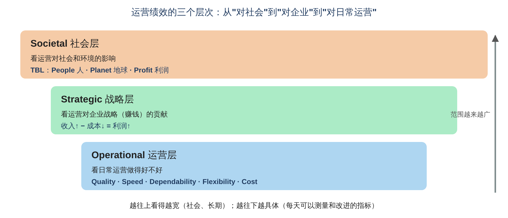
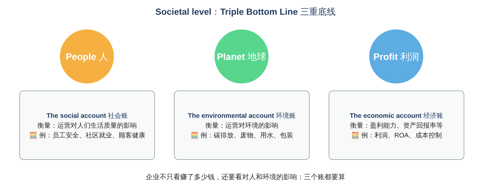
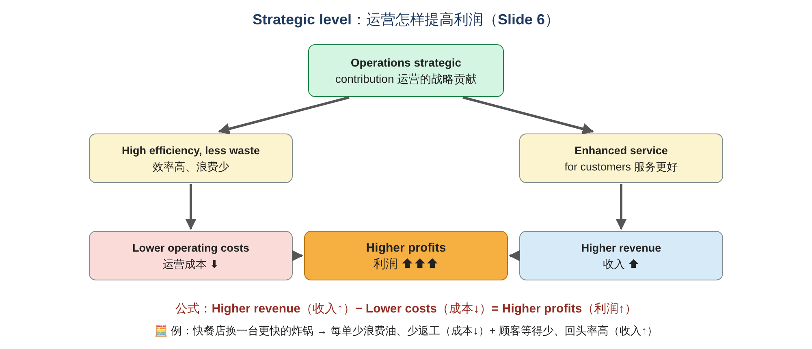
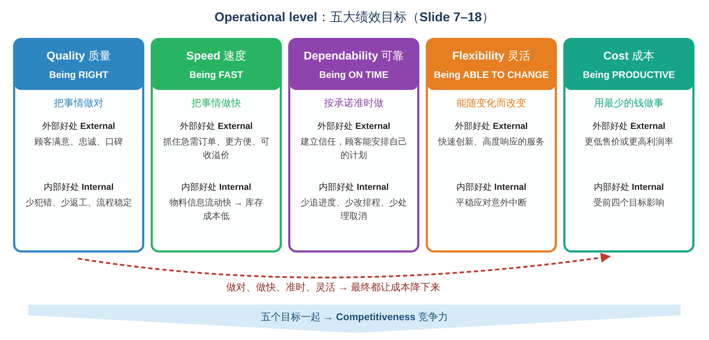
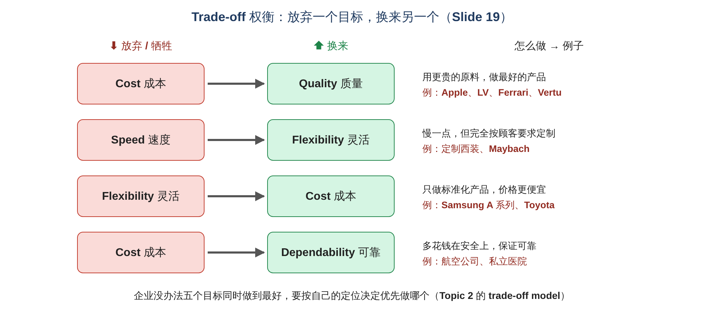
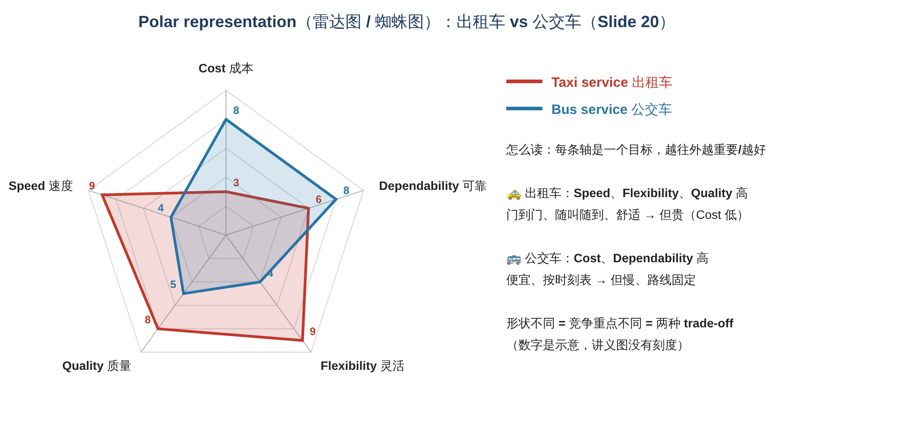
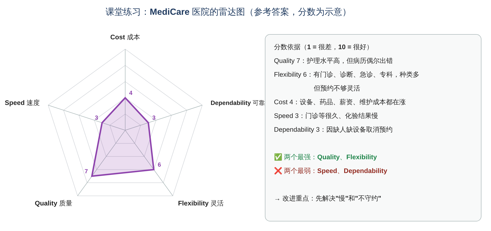

# Operations Management · Topic 8 运营绩效（Operations Performance）学习笔记

> 教材：Slack, Brandon-Jones & Burgess, *Operations Management*, 10th Edition — **Chapter 2 Operations performance**（讲义 Topic 8，共 22 页）
>
> 📌 这一章内容不多，笔记按 **"一张图 + 一张表 + 一个例子"** 的方式写得尽量简洁。**🧮 = 举例**，**⚠️ = 易错**。

---

## 0. 一句话看懂本章

**运营绩效 = 运营在三个层次上做得好不好：对社会（TBL）、对企业战略（利润）、对日常运营（五大目标）。** 五大目标之间常常要 **权衡（trade-off）**，可以用 **雷达图（polar diagram）** 一眼看出强项和弱项。

```
运营绩效 Operations Performance
   │
   ├─ ① Societal  社会层：TBL
   ├─ ② Strategic 战略层：利润
   └─ ③ Operational 运营层：Q·S·D·F·C
            │
            └─ Trade-off 权衡 → Polar 雷达图
```

> 💡 **和前面章节的联系：** Topic 1 的模型图里有 "Operations performance：Societal / Strategic / Operational"，本章就是把它展开；Topic 2 讲过五大目标和 trade-off，本章是它们的 **完整版和例子版**。

---

## 1. 什么是运营绩效？（Slide 3）

> **Operational performance objectives are the areas of operations that a company tries to improve, in a bid to meet its overall corporate strategy.**
> 运营绩效目标 = 公司为了实现整体战略，**努力去改进的运营领域**。

**运营卓越（operational excellence）** = 持续改进，最终实现：

| 目标 | 意思 |
|---|---|
| **Efficiency 效率** | 省成本、省时间、增加利润 |
| **Competitive advantage 竞争优势** | 比对手做得好 |
| **Customer value & satisfaction 顾客价值与满意** | 顾客觉得值、觉得满意 |

---

## 2. 三个层次（Slide 4）



| 层次 | 看什么 | 关键词 |
|---|---|---|
| **Societal 社会层** | 运营对社会、环境的影响 | **TBL：People · Planet · Profit** |
| **Strategic 战略层** | 运营对企业赚钱的贡献 | **收入↑ − 成本↓ = 利润↑** |
| **Operational 运营层** | 日常运营做得好不好 | **Q · S · D · F · C** |

📝 **记忆：** 从上往下 = 从"大"到"小"，从"长期"到"每天"。

---

## 3. Societal 层：Triple Bottom Line 三重底线（Slide 5）



| TBL | 讲义定义 | 🧮 举例（一家咖啡连锁店） |
|---|---|---|
| **People 人** | **The social account**：运营对 **人们生活质量** 的影响 | 员工工作安全、工资合理；雇用本地人 |
| **Planet 地球** | **The environmental account**：运营对 **环境** 的影响 | 用可回收杯子、减少咖啡渣浪费、节能 |
| **Profit 利润** | **The economic account**：**盈利能力、资产回报率** 等 | 每家店的利润、投资回报 |

⚠️ **易错：** TBL 里的 "Profit" 也是三个"底线"之一。企业 **既要赚钱，也要对人和地球负责**，三者要 **同时** 兼顾，不是只看其中一个。

---

## 4. Strategic 层：运营怎样提高利润（Slide 6）



两条路，最后都通向 **更高的利润**：

| 路线 | 过程 |
|---|---|
| ⬅ **成本路线** | 效率高、浪费少 → **运营成本降低** |
| ➡ **收入路线** | 给顾客更好的服务 → **收入增加** |

> **公式（讲义 Summary）：Increase Revenue − Lower Costs = Higher Profits**

---

## 5. ⭐ Operational 层：五大绩效目标（Slide 7–18）



### 5.1 一句话版

| 目标 | 一句话（讲义 Slide 8） | 定义 |
|---|---|---|
| **Quality 质量** | **Being RIGHT** 做对 | 产品/服务 **持续符合** 顾客的规格和期望 |
| **Speed 速度** | **Being FAST** 做快 | 缩短 **从顾客提出要求到收到** 的时间 |
| **Dependability 可靠性** | **Being ON TIME** 准时 | **按承诺** 准时交付、守约 |
| **Flexibility 灵活性** | **Being ABLE TO CHANGE** 能变 | 能 **快速调整**，应对意外或市场变化 |
| **Cost 成本** | **Being PRODUCTIVE** 高产出 | **限制** 在投入、转换和交付上花的钱 |

→ 五个目标一起，形成 **Competitiveness（竞争力）**。

⚠️ **最容易混：Speed vs Dependability**
- **Speed = 多快**（"30 分钟送到"）
- **Dependability = 多准**（"说 30 分钟就 30 分钟，不会晚"）
- 🧮 一家快递"3 天到"但每次都准时 → **dependability 好、speed 一般**；一家"当天到"但经常晚 → **speed 好、dependability 差**。

### 5.2 ⭐ 每个目标的"外部好处"和"内部好处"（考试常考）

| 目标 | **External benefit 外部好处**（对顾客/市场） | **Internal benefit 内部好处**（对运营自身） |
|---|---|---|
| **Quality** | 提升 **顾客满意、忠诚和品牌声誉** | **减少错误、浪费和返工成本**，让流程更稳定 |
| **Speed** | 抓住 **急需的订单**、更方便，常常能 **收更高的价格** | 物料和信息在运营中 **停留时间短** → **库存管理成本更低** |
| **Dependability** | 靠 **信任** 和别人区分开，顾客能 **安排自己的计划** | 不用 **总是追进度、改排程、处理取消** → 省钱省时间 |
| **Flexibility** | 能 **快速创新**、提供 **高度响应** 的服务 | 能 **平稳应对意外中断** |
| **Cost** | 能给顾客 **更低售价**，或自己享受 **更高利润率** | **成本受前四个目标影响**：做对、做快、准时、灵活，最终都会降低成本 |

📝 **答题模板：** "Improving **[目标]** gives an external benefit of ___ and an internal benefit of ___."

### 5.3 讲义的四个例子：超市、医院、汽车厂、公交

讲义用新加坡的 **FairPrice 超市、医院、汽车装配厂、公交车** 来解释每个目标，整理成一张表：

| | 🛒 **超市** | 🏥 **医院** | 🚗 **汽车厂** | 🚌 **公交** |
|---|---|---|---|---|
| **Quality** | 店面干净整洁、装修合适、商品状况良好 | 病人得到 **最合适** 的治疗、治疗方式正确、病人被咨询和告知 | 产品可靠、零件符合规格、外观无瑕疵 | 车干净整洁、安静无废气、时刻表准确易懂 |
| **Speed** | 去超市、购物、回家的总时间最短；商品随时有货 | 从需要治疗到接受治疗的时间最短；化验和 X 光结果出得快 | 经销商订某配置的车后尽快收到；备件尽快送到维修点 | 从出发到到达目的地的时间最短 |
| **Dependability** | 营业时间可预期；缺货率低；排队时间合理 | 预约 **被取消的比例** 最低；**按预约时间** 看诊 | 经销商 **按合同** 交车；分销商及时回应顾客问题 | **全线都按公布的时刻表**；一直有座位 |
| **Flexibility** | 商品种类多、有新品；能调整服务的顾客数量；能补到缺货商品 | 引进新疗法和新设备；治疗种类多；能 **改约** | 推出新车型、车型丰富；能调整产量 | 开新路线和观光线；覆盖地点多；能调整班次频率 |
| **Cost** | 降低人工、自动化技术、进货成本 | 降低人工、医疗设备、病人用的材料和易耗品成本 | 降低生产人工、制造技术和设施、零件和材料成本 | 降低人工、技术和设施、燃油等运营成本 |

📝 **规律：** 成本这一行几乎都是 **"人工 + 技术/设施 + 材料/燃料"** 三类，四个例子都一样。

---

## 6. ⭐ Trade-off 权衡（Slide 19）

> **Many companies may decide to trade-off one performance objective for another.**
> 很多企业会 **牺牲一个目标，换取另一个目标**。



| 放弃 ⬇ | 换来 ⬆ | 怎么做 | 讲义例子 |
|---|---|---|---|
| **Cost** | **Quality** | 买更贵的优质原料 | Apple、LV、Ferrari、Vertu |
| **Speed** | **Flexibility** | 慢一点，但按顾客需求定制 | 定制西装、Maybach |
| **Flexibility** | **Cost** | 只做标准化产品，降低价格 | Samsung A 系列、Toyota |
| **Cost** | **Dependability** | 多花钱在安全上，保证可靠 | 航空公司、私立医院 |

> 💡 **为什么要权衡？** 资源有限，五个目标很难同时做到最好。企业要根据 **自己的市场定位** 选重点。这就是 Topic 2 的 **trade-off model**；但 Topic 2 的 **sandcone model** 也提醒我们：长期持续改进后，可以逐步 **兼顾** 多个目标。

---

## 7. ⭐ Polar representation 雷达图（Slide 20）

> **The polar representation of performance objectives — often referred to as a radar chart, or spider chart — is a visual tool used to evaluate and display an organisation's performance across multiple competing criteria simultaneously.**

**怎么画、怎么读：**
1. 从中心画出 **5 条轴**，每条轴代表一个目标（Q、S、D、F、C）；
2. 在每条轴上标出分数，**越往外越重要 / 表现越好**；
3. 把 5 个点连起来，得到一个 **形状（geometric footprint）**；
4. 看形状：**往外凸的是强项，往里凹的是弱项**；两条线放在一起，就能比较两家企业的 **trade-off**。



| | 🚕 **出租车** | 🚌 **公交车** |
|---|---|---|
| 强项 | **Speed、Flexibility、Quality**（门到门、随叫随到、舒适） | **Cost、Dependability**（便宜、按时刻表） |
| 弱项 | **Cost**（贵） | **Speed、Flexibility**（慢、路线固定） |

---

## 8. 💬 课堂练习：MediCare 医院（Slide 22，参考答案）

**案例要点：** 私立医院，病人增多、竞争激烈。问题：
- **门诊等很久**、**化验结果慢**
- **病历偶尔出错**
- **因缺人、缺设备而取消预约**
- 病人希望 **预约更灵活**、能看 **更多专科**、服务 **更可靠**
- **成本上涨**：设备、药品、薪资、设施维护

### Q1. 五大目标：问题 → 改进 → 外部好处 + 内部好处

| 目标 | MediCare 的问题 | 建议改进 | 外部好处 | 内部好处 |
|---|---|---|---|---|
| **Quality** | 病历出错 | 电子病历系统 + 双人核对 | 病人更信任、口碑更好 | 少出错、少重复检查和返工 |
| **Speed** | 门诊等太久、化验慢 | 网上分时段挂号；化验室加自动化设备 | 病人等得少、更方便，可收"快速通道"费用 | 病人和样本在院内停留短，床位和资源周转快 |
| **Dependability** | 缺人缺设备导致取消预约 | 合理排班、设后备人员、设备定期保养 | 病人能放心安排时间、建立长期信任 | 少改约、少处理投诉和取消，省时省钱 |
| **Flexibility** | 预约不灵活、专科不够 | 线上改约、晚间/周末门诊、与外部专科合作 | 满足病人不同需求，服务更有响应 | 遇到病人高峰或人手短缺时能平稳应对 |
| **Cost** | 设备、药品、薪资、维护成本上涨 | 集中采购药品、共享设备、减少浪费 | 价格更有竞争力，或利润率更高 | 前四项改好后，返工、等待和取消都减少 → 总成本下降 |

### Q2. 一个可能的 trade-off

> 🧮 **牺牲 Cost，换取 Dependability（和 Speed）**：多聘后备医护人员、多买一台关键设备。短期成本上升，但预约不再被取消、等待时间缩短，病人更信任医院。
> 这和讲义的例子 **"私立医院：trade-off cost to focus on safety in order to provide dependability"** 一致。

### Q3. 雷达图 + 两个最强 / 两个最弱



| | 目标 | 理由（来自案例） |
|---|---|---|
| ✅ **最强** | **Quality** | 题目说医院要"保持高水平的病人护理"，问题只是"偶尔"的病历错误 |
| ✅ **最强** | **Flexibility** | 提供门诊、诊断、急诊、专科等多种服务 |
| ❌ **最弱** | **Speed** | 门诊等候时间长、化验结果慢 |
| ❌ **最弱** | **Dependability** | 因缺人缺设备取消预约 |

⚠️ 分数是我根据案例描述估计的示意分数（讲义没有给数字）。考试时只要 **分数和你写的理由对得上** 即可；例如有人会把 Cost 也算作弱项，也说得通。

---

## 9. ⚠️ 易混淆 & 📖 术语

| English | 中文 | 一句话 |
|---|---|---|
| Operations performance | 运营绩效 | 运营在社会、战略、日常三个层次做得好不好 |
| Societal / Strategic / Operational level | 社会 / 战略 / 运营层 | 范围从大到小 |
| Triple Bottom Line (TBL) | 三重底线 | People（社会账）、Planet（环境账）、Profit（经济账） |
| Return on assets (ROA) | 资产回报率 | Profit 账的衡量指标之一 |
| Quality — Being RIGHT | 质量 | 做对 |
| Speed — Being FAST | 速度 | 做快（多快） |
| Dependability — Being ON TIME | 可靠性 | 准时（多准） |
| Flexibility — Being ABLE TO CHANGE | 灵活性 | 能变 |
| Cost — Being PRODUCTIVE | 成本 | 高产出、低花费 |
| External / Internal benefit | 外部 / 内部好处 | 对顾客 vs 对运营自身 |
| Competitiveness | 竞争力 | 五个目标合起来的结果 |
| Trade-off | 权衡 | 牺牲一个目标换另一个 |
| Polar representation / Radar / Spider chart | 雷达图 / 蜘蛛图 | 多条轴同时显示强弱项 |

---

## 10. ✍️ 自测题

**选择题**
1. "Being ON TIME" 对应：A. Quality　B. Speed　C. Dependability　D. Flexibility
2. TBL 中衡量"运营对人们生活质量的影响"的是：A. People　B. Planet　C. Profit　D. Cost
3. "物料和信息在运营中停留时间短 → 库存成本低"是哪个目标的内部好处？A. Quality　B. Speed　C. Flexibility　D. Cost
4. Samsung A 系列牺牲了什么来降低成本？A. Quality　B. Speed　C. Flexibility　D. Dependability
5. 雷达图上往里凹的点表示：A. 强项　B. 弱项　C. 成本最高　D. 没有意义

**简答题**
1. 说明运营绩效的三个层次。
2. 解释五大目标，并各写一个外部好处和一个内部好处。
3. 为什么说"成本受其他四个目标影响"？
4. 举一个 trade-off 的例子。

<details>
<summary><b>👉 点击查看答案</b></summary>

**选择题：** 1. C　2. A　3. B　4. C　5. B

**简答题**
1. Societal（TBL：People、Planet、Profit）；Strategic（收入↑、成本↓ → 利润↑）；Operational（质量、速度、可靠性、灵活性、成本）。
2. 见第 5.2 节的表。
3. 质量好 → 少返工；速度快 → 库存少；可靠 → 少改排程、少处理取消；灵活 → 平稳应对意外。这些都会减少浪费，所以最终降低成本。
4. 例：Ferrari 牺牲成本，用昂贵材料和手工制造换取极高的质量。

</details>

---

## 11. 📌 考前 30 秒

1. **三层**：Societal（TBL）→ Strategic（利润）→ Operational（五大目标）
2. **TBL**：People 社会账 · Planet 环境账 · Profit 经济账
3. **战略层**：收入↑ − 成本↓ = 利润↑
4. **五大目标**：做对 · 做快 · 准时 · 能变 · 高产出 → 竞争力
5. **每个目标都有外部好处 + 内部好处**；成本受前四个影响
6. **Trade-off**：Cost↔Quality（Apple）、Speed↔Flexibility（定制西装）、Flexibility↔Cost（Toyota）、Cost↔Dependability（航空公司）
7. **雷达图**：往外 = 强，往里 = 弱；出租车（快、灵活）vs 公交车（便宜、准时）
