# Operations Management · Topic 9 计划与控制（Planning and Control）学习笔记

> 教材：Slack, Brandon-Jones & Burgess, *Operations Management*, 10th Edition — **Chapter 10 Planning and control**（讲义 Topic 9，共 22 页）
>
> 📌 和 Topic 8 一样按 **"一张图 + 一张表 + 一个算例"** 来写。**🧮 = 举例 / 计算**，**⚠️ = 易错**，**💡 = 补充**。

---

## 0. 一句话看懂本章

**计划（Planning）= 事前定好"做什么、做多少、什么时候做、用什么资源、谁来做"；控制（Control）= 做的过程中和做完以后，检查"实际有没有达到计划"，没达到就纠正。** 两者连起来就是一个不停转的 **循环（cycle）**。

```
Topic 9 计划与控制
   │
   ├─ ① 是什么：Planning（定方向）+ Control（保落实）
   ├─ ② 循环：Planning → Implementation → Control → Corrective action → 再计划
   ├─ ③ 六个目标：资源、产能、需求、成本、时间、顾客满意
   ├─ ④ 三个层次：Strategic（长期）→ Tactical（中期）→ Operational（短期）
   ├─ ⑤ 支持"计划"的理论：Systems Theory · Demand Forecasting · MRP
   └─ ⑥ 支持"控制"的理论：Feedback Control（3 种）· SPC · Theory of Constraints
```

> 💡 **和前面章节的联系：** FreshBite 的例子用到了 Topic 8 的 **五大绩效目标** 和 **雷达图**；SPC 在 Topic 6（质量管理）出现过；瓶颈（bottleneck）在 Topic 4（流程设计 · 生产线平衡）出现过。

---

## 1. 什么是计划与控制？（Slide 3–4）

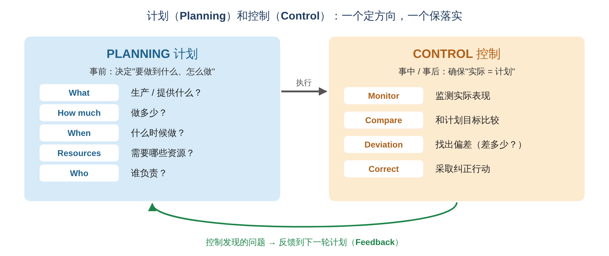

光有资源（人、材料、机器、技术、信息、场地）还不够，企业必须回答 6 个问题：

| # | 问题 | 属于 |
|---|---|---|
| 1 | **What** 要生产 / 提供什么？ | 计划 |
| 2 | **How much** 要做多少？ | 计划 |
| 3 | **When** 什么时候做？ | 计划 |
| 4 | **Resources** 需要哪些资源？ | 计划 |
| 5 | **Who** 谁负责？ | 计划 |
| 6 | **How to ensure** 怎样确保实际表现达到计划目标？ | **控制** |

| | Planning 计划 | Control 控制 |
|---|---|---|
| 讲义定义 | determines **what** an organisation intends to achieve and **how** its operations should be organised | ensures activities are carried out **according to plan** by **monitoring** actual performance, **identifying deviations** and **implementing corrective actions** |
| 时间 | 事前 | 事中 + 事后 |
| 一句话 | 定目标、定路线 | 盯执行、纠偏差 |
| 🧮 生活例子 | 考前做复习计划：每天复习 2 章 | 每晚检查：今天只复习了 1 章 → 明天补上 |

⚠️ **易错：** 控制 **不是** "管人、罚人"，而是 **监测 → 比较 → 找偏差 → 纠正** 这一整套动作。

---

## 2. ⭐ 计划与控制循环（Slide 5–11）

### 2.1 四个步骤

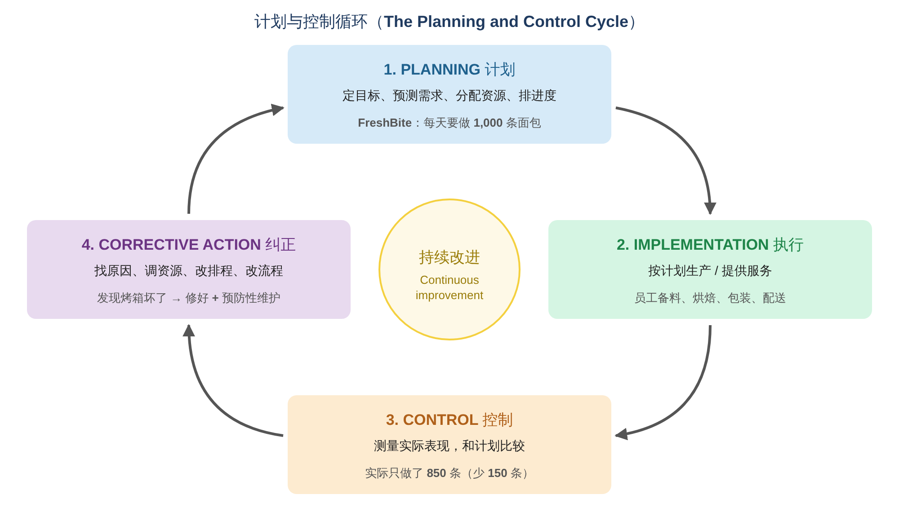

| 步骤 | 管理层做什么 | FreshBite 面包店例子 |
|---|---|---|
| **1. Planning 计划** | 定目标、预测需求、分配资源、排进度 | 每天生产 **1,000 条** 面包；算好面粉、员工、烤箱、配送 |
| **2. Implementation 执行** | 按计划生产 / 提供服务 | 员工备料、烘焙、包装、送到超市 |
| **3. Control 控制** | 测量实际表现，和计划目标比较 | 实际只做了 **850 条** |
| **4. Corrective action 纠正** | 找问题、调资源、改排程、改流程 | 发现一台烤箱故障 → **修好 + 引入预防性维护** |

然后回到第 1 步：**持续改进，把经验反馈到下一轮计划**。

📝 **记忆：P-I-C-C**（Plan → Implement → Control → Correct）。和 Topic 6 的 **PDCA**（Plan-Do-Check-Act）几乎一一对应。

### 2.2 🧮 FreshBite 绩效报告：一项一项算清楚（Slide 8–9）

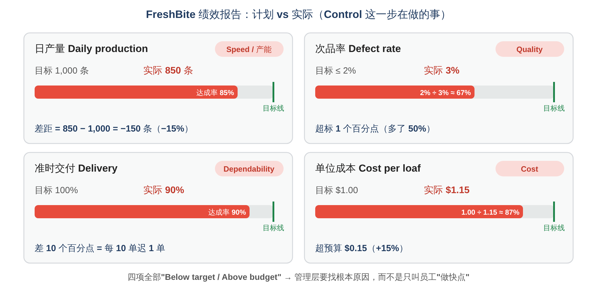

| 指标 | 计划 | 实际 | 对应五大目标 |
|---|---|---|---|
| 日产量 | 1,000 条 | 850 条 | Speed / 产能 |
| 次品率 | ≤ 2% | 3% | Quality |
| 准时交付 | 100% | 90% | Dependability |
| 单位成本 | \$1.00 / 条 | \$1.15 / 条 | Cost |

🧮 **差距怎么算：**

1. **日产量：** 850 − 1,000 = **−150 条**；150 ÷ 1,000 = **少 15%**（达成率 850 ÷ 1,000 = 85%）
2. **次品率：** 3% − 2% = **多 1 个百分点**；1 ÷ 2 = **比上限高 50%**
3. **准时交付：** 100% − 90% = **差 10 个百分点** → 每 10 单有 1 单迟到
4. **单位成本：** 1.15 − 1.00 = **+\$0.15**；0.15 ÷ 1.00 = **超预算 15%**

🧮 **再算深一点（把百分比换成"条"和"钱"）：**

- 次品：850 × 3% = **25.5 ≈ 26 条** 次品；如果达标（2%），850 × 2% = **17 条** → 多了约 **9 条** 次品。
- 准时交付：假设每天送 20 家超市，90% 准时 → 20 × 10% = **2 家** 收货迟了。
- 成本：850 条 × 多出的 \$0.15 = **多花 \$127.50 / 天**。

💡 **为什么产量少了，单位成本反而变高？（补充）** 很多成本是 **固定成本**（房租、烤箱折旧、员工底薪），不管做多少都要付。
假设每天固定成本 \$400，每条面包的材料等变动成本 \$0.60：

| | 做 1,000 条 | 只做 850 条 |
|---|---|---|
| 每条分摊的固定成本 | 400 ÷ 1,000 = \$0.40 | 400 ÷ 850 ≈ **\$0.47** |
| + 变动成本 | \$0.60 | \$0.60 |
| = 单位成本 | **\$1.00** | **≈ \$1.07** |

剩下的 \$0.08 可以解释为 **次品浪费的材料** 等。→ 所以修好机器（产量回升）本身就能降低单位成本。

⚠️ **讲义小问题：** Slide 8 的次品率一栏写的是 "Below target"，意思是 **表现低于目标（变差了）**，不是"次品率低于目标"。3% > 2%，是 **超标**。

### 2.3 纠正行动：针对根本原因（Slide 9）

> **Management must investigate the root causes rather than simply instructing employees to work faster.**\
> 管理层要找 **根本原因**，而不是只叫员工"做快点"。

| 发现的问题 | 纠正行动 | 预期改进 |
|---|---|---|
| 机器故障 | 修机器 + 预防性维护 | 产能↑ |
| 次品率高 | 培训员工 + 加强质检 | 次品↓ |
| 送货迟 | 改进生产和配送排程 | 准时率↑ |
| 成本高 | 减少材料浪费 + 提高资源利用率 | 单位成本↓ |

### 2.4 FreshBite 雷达图（Slide 10–11）

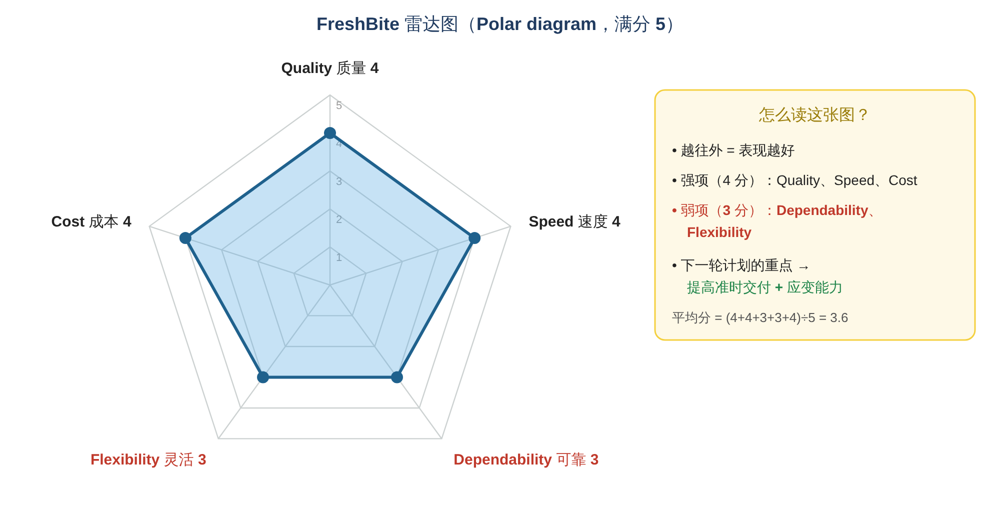

| 五大目标 | 循环怎样帮忙 | 评分 /5 |
|---|---|---|
| Quality | 定质量标准、检查成品 | 4 |
| Speed | 改进流程、减少延误 | 4 |
| Dependability | 让生产和送货按时 | **3** |
| Flexibility | 需求变化时调整产量 | **3** |
| Cost | 减少浪费、停机和多余人工 | 4 |

结论：**Quality、Speed、Cost 强；Dependability、Flexibility 是下一轮要改进的重点。**

---

## 3. 计划与控制的六个目标（Slide 12）

| 目标 | 意思 | 🧮 例子 |
|---|---|---|
| **Resource utilisation** 资源利用 | 资源用得有效率 | 按生产需求安排员工和机器 |
| **Capacity management** 产能管理 | 产能能满足需求 | 医院在高峰期加派人手 |
| **Demand management** 需求管理 | 估计未来需求 | 超市预测节日的食品需求 |
| **Cost management** 成本管理 | 控制运营开支 | 工厂减少不必要的采购 |
| **Time management** 时间管理 | 按时完成 | 建筑公司做项目进度表 |
| **Customer satisfaction** 顾客满意 | 满足顾客期望 | 航空公司安排足够航班 |

📝 **记忆：** "**R-C-D-C-T-C**" → 资源、产能、需求、成本、时间、顾客。

🧮 **产能管理小算例：** 医院平时每天 200 名病人，每名护士每天能照顾 8 人 → 需要 200 ÷ 8 = **25 名护士**。流感季病人增到 280 人 → 280 ÷ 8 = **35 名** → 要提前多排 **10 名**。

---

## 4. ⭐ 计划的三个层次（Slide 13–14）

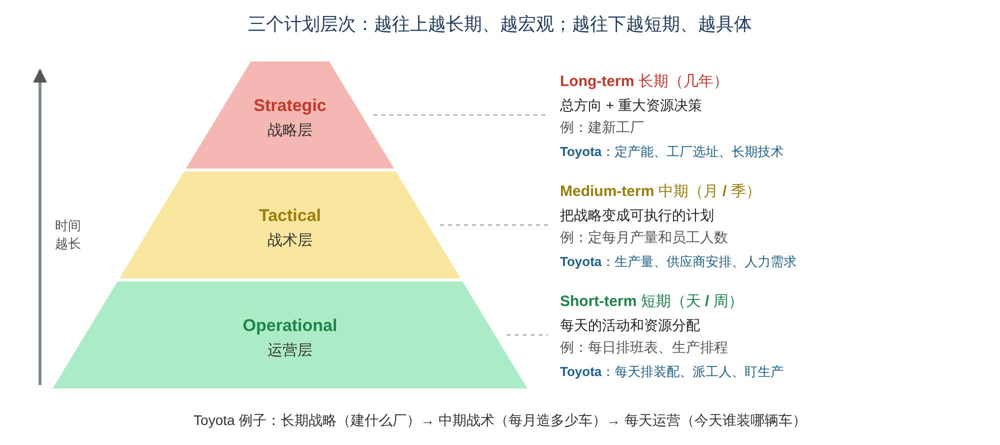

| 层次 | 时间 | 重点 | 例子 | Toyota |
|---|---|---|---|---|
| **Strategic 战略** | **长期**（几年） | 总方向、重大资源决策 | 建新工厂 | 定产能、工厂选址、长期生产技术 |
| **Tactical 战术** | **中期**（月 / 季） | 把战略变成运营计划 | 定每月产量和人手 | 定产量、供应商安排、人力需求 |
| **Operational 运营** | **短期**（天 / 周） | 每天的活动和资源分配 | 每日排班表、生产排程 | 每天排装配、派工人、监控生产 |

🧮 **一家奶茶连锁店的三个层次：**
- 战略：未来 3 年在马来西亚开 20 家店。
- 战术：下个月每家店要备多少茶叶和珍珠，要招几个兼职。
- 运营：今天下午 3–6 点高峰期排 4 个人，谁负责收银、谁负责做饮料。

⚠️ **易错：** "Operational planning" 在这里是 **三个层次中最短期的那一层**，不要和整个 "Operations planning（运营计划）" 搞混。

---

## 5. 支持"计划"的三个理论（Slide 15–17）

### 5.1 Systems Theory 系统理论

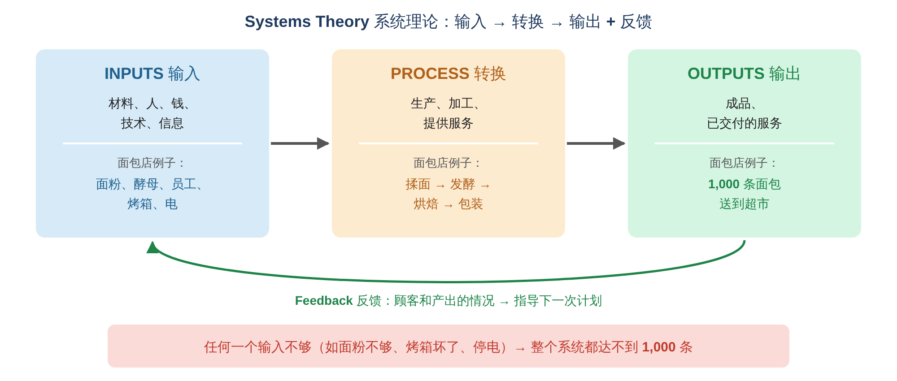

> 组织是一个 **相互连接的系统**，各部门要一起配合才能达到共同目标。

- 输入（材料、人、钱、技术、信息）→ 转换（生产、加工、提供服务）→ 输出（产品、服务）→ **反馈** 指导下一次计划。
- 管理者要 **协调所有输入**；**跨部门一起计划**，不要各做各的。

🧮 **例子：** 面包店要做 1,000 条：

| 输入 | 够不够？ | 结果 |
|---|---|---|
| 面粉（每条 0.5 kg → 需 500 kg） | 只有 400 kg | 最多 400 ÷ 0.5 = **800 条** |
| 烤箱（每台每天 250 条） | 4 台都正常 | 4 × 250 = 1,000 条 ✓ |
| 员工 | 足够 | ✓ |

→ 就算其他都够，**面粉不够** 就只能做 800 条。这就是"系统"的意思：**一个环节缺了，整体就达不到**。

⚠️ **讲义笔误：** Slide 15 写 "…if it has sufficient baking equipment, insufficient flour, skilled employees or electricity"，意思应该是 **"if it has insufficient baking equipment, flour, skilled employees or electricity"**（任何一样不够都不行）。

### 5.2 Demand Forecasting 需求预测

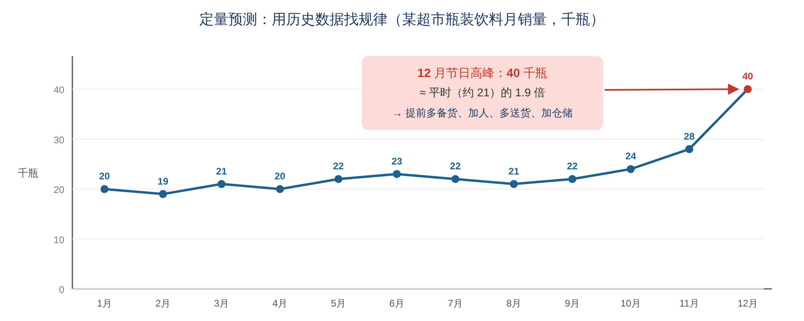

| 方法 | 依据 | 例子 | 适合 |
|---|---|---|---|
| **Qualitative 定性** | 经验、专家意见、市场调研 | 酒店经理根据行业预期估计游客量 | 新产品、没有历史数据 |
| **Quantitative 定量** | 历史数据 + 统计方法 | 超市分析过去的销量 | 有足够历史数据 |

🧮 **定量预测怎么算？（补充两个最简单的方法，数据见上图）**

**方法 1：3 个月移动平均（moving average）** —— 用最近 3 个月的平均值做下个月预测：
- 预测 12 月 = (9 月 22 + 10 月 24 + 11 月 28) ÷ 3 = 74 ÷ 3 ≈ **24.7 千瓶**
- 但去年 12 月实际是 **40 千瓶** → 移动平均 **严重低估** 了节日高峰！

**方法 2：考虑季节性（seasonality）** —— 看去年同期：
- 去年 12 月 = 40 千瓶；今年整体销量比去年增长 10%
- 预测今年 12 月 = 40 × 1.1 = **44 千瓶**

→ 有季节性的产品，要用 **同期数据**，不能只看最近几个月。

**预测出来以后怎么用？**（Slide 16）

| 预测到 12 月需求↑ | 计划动作 |
|---|---|
| 1 | 提高库存（多备货） |
| 2 | 增加员工 |
| 3 | 让供应商更频繁送货 |
| 4 | 增加仓储空间 |

🧮 如果一名员工每月能处理 4 千瓶的上架和补货：平时约 21 千瓶 → 21 ÷ 4 ≈ **6 人**；12 月 44 千瓶 → 44 ÷ 4 = **11 人** → 要多排 **5 人**。

### 5.3 ⭐ MRP 物料需求计划（Material Requirements Planning）

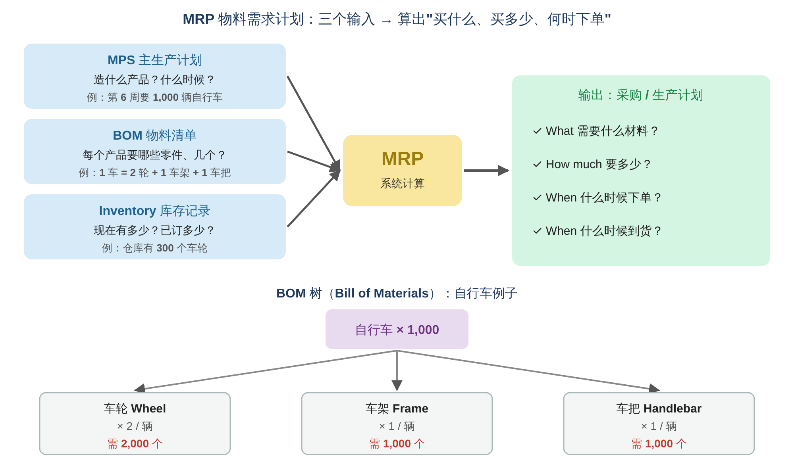

MRP 回答：**需要什么材料？要多少？什么时候下单？什么时候到？**

三个输入：

| 输入 | 内容 | 例子 |
|---|---|---|
| **MPS** 主生产计划 | 造什么、什么时候造 | 第 6 周要 1,000 辆自行车 |
| **BOM** 物料清单 | 每个产品要哪些零件、各几个 | 1 辆 = 2 个车轮 + 1 个车架 + 1 个车把 |
| **Inventory records** 库存记录 | 现有库存 + 已下的订单 | 见下表 |

🧮 **一步一步算（自行车，讲义 Slide 17 例子 + 补充数字）：**

> **公式：毛需求（Gross）= 产量 × 每件用量；净需求（Net）= 毛需求 − 现有库存 − 已订未到**

| 零件 | ① 毛需求 | ② 现有库存 | ③ 已订未到 | ④ 净需求 = ① − ② − ③ |
|---|---|---|---|---|
| 车轮 | 1,000 × 2 = **2,000** | 300 | 200 | 2,000 − 300 − 200 = **1,500** |
| 车架 | 1,000 × 1 = **1,000** | 150 | 0 | 1,000 − 150 = **850** |
| 车把 | 1,000 × 1 = **1,000** | 400 | 0 | 1,000 − 400 = **600** |

💡 **"什么时候下单" = 需要的时间 − 交货期（lead time）**（这叫 *lead-time offsetting*）。第 6 周要用：

| 零件 | 交货期 | 最晚下单 |
|---|---|---|
| 车轮 | 2 周 | 6 − 2 = **第 4 周** |
| 车架 | 3 周 | 6 − 3 = **第 3 周** |
| 车把 | 1 周 | 6 − 1 = **第 5 周** |

⚠️ **易错：** 车轮是 **每辆 2 个**，毛需求是 2,000 不是 1,000；而且要 **减掉库存** 才是要买的数量。

---

## 6. 支持"控制"的三个理论（Slide 18–20）

### 6.1 ⭐ Feedback Control Theory：三种控制

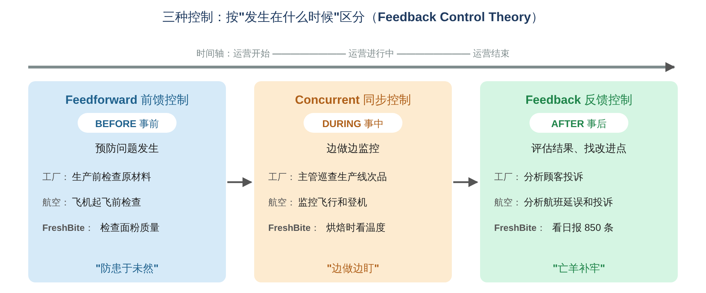

> 基本原则：**把实际结果和计划目标比较，必要时调整。**

| 类型 | 什么时候 | 作用 | 工厂例子 | 航空公司例子 |
|---|---|---|---|---|
| **Feedforward 前馈** | **Before** 事前 | 预防问题 | 生产前检查原材料 | 起飞前检查飞机 |
| **Concurrent 同步** | **During** 事中 | 边做边监控 | 主管巡查生产线次品 | 监控飞行和登机 |
| **Feedback 反馈** | **After** 事后 | 评估结果、找改进 | 分析顾客投诉 | 分析延误和投诉 |

📝 **记忆：** 前馈 = 防患于未然；同步 = 边做边盯；反馈 = 亡羊补牢。

⚠️ **易错：** 名字都带 "feed"，靠 **时间** 区分：**forward = 往前看（还没开始）**，**back = 往回看（已经结束）**。FreshBite 看日报发现只做了 850 条 → **Feedback control**。

### 6.2 ⭐ SPC 统计过程控制（Statistical Process Control）

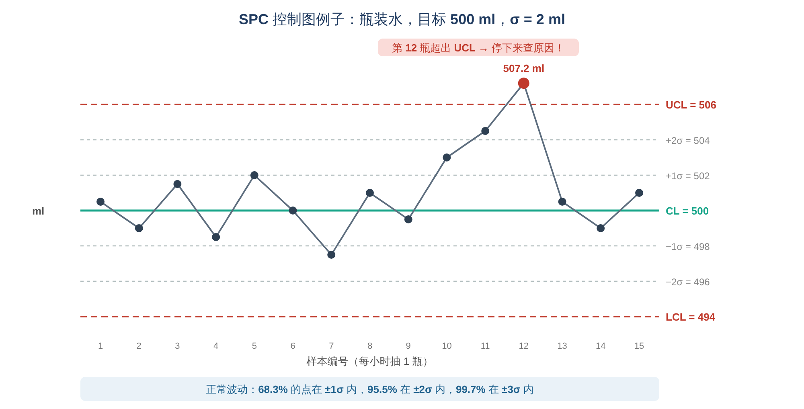

控制图三条线：

| 线 | 意思 | 🧮 瓶装水（目标 500 ml，标准差 σ = 2 ml） |
|---|---|---|
| **CL** Centre Line 中心线 | 平均表现 | **500 ml** |
| **UCL** Upper Control Limit 上控制限 | 正常波动的上边界 | 500 + 3 × 2 = **506 ml** |
| **LCL** Lower Control Limit 下控制限 | 正常波动的下边界 | 500 − 3 × 2 = **494 ml** |

> **公式（常用 3σ 控制限）：UCL = CL + 3σ，LCL = CL − 3σ**

🧮 **怎么判断？**

| 抽样结果 | 判断 | 行动 |
|---|---|---|
| 501 ml、498.5 ml… | 在 494–506 之间 → **正常波动**（common cause） | 不用管，别乱调机器 |
| 第 12 瓶 **507.2 ml** | **超出 UCL** → 有特殊原因（assignable cause） | 停下来查，例如 **灌装机故障** |
| 第 9–12 瓶连续上升 499.5 → 503 → 504.5 → 507.2 | **异常趋势**（即使还没超线也要注意） | 提前检查（💡 补充规则） |

💡 **68.3 / 95.5 / 99.7（讲义图右边的数字）：** 正常情况下，68.3% 的点在 ±1σ 内，95.5% 在 ±2σ 内，**99.7% 在 ±3σ 内**。所以一个点跑到 3σ 外面，"纯属运气"的概率只有 0.3% → 很可能出了问题。

### 6.3 ⭐ Theory of Constraints 约束理论（TOC，Goldratt）

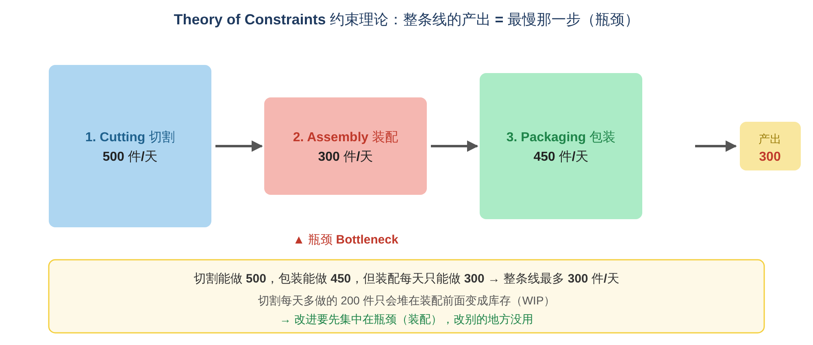

> **The performance of an entire operational system is limited by its most significant constraint or bottleneck.**\
> 整个系统的表现，取决于 **最紧的那个约束（瓶颈）**。

🧮 **讲义例子 + 继续算：**

| 环节 | 产能/天 | 实际产出 300 时的利用率 |
|---|---|---|
| 切割 | 500 | 300 ÷ 500 = **60%**（闲 40%） |
| **装配（瓶颈）** | **300** | 300 ÷ 300 = **100%** |
| 包装 | 450 | 300 ÷ 450 ≈ **67%** |

**系统产出 = min(500, 300, 450) = 300 件/天**

如果改进不同的地方会怎样？

| 改进 | 新产能 | 系统产出 | 结论 |
|---|---|---|---|
| 切割 500 → 600 | min(600, 300, 450) | **300**（没变！） | 改非瓶颈 = 白花钱 |
| 装配 300 → 400 | min(500, 400, 450) | **400**（+100） | 改瓶颈才有用 ✓ |
| 装配 → 500 | min(500, 500, 450) | **450** | 瓶颈 **转移** 到包装了 |

💡 **补充：TOC 五步法（Five focusing steps）**
1. **Identify** 找出瓶颈 → 2. **Exploit** 先把瓶颈用到最满（不让它停）→ 3. **Subordinate** 其他环节配合瓶颈的节奏 → 4. **Elevate** 再投资扩大瓶颈产能 → 5. **Repeat** 瓶颈转移后重新找。

⚠️ **易错：** 瓶颈是 **产能最小** 的环节，不是 "最忙" 或 "人最多" 的环节。

---

## 7. 💬 课堂练习：SwiftFlow Logistics（Slide 22，参考答案）

**案例要点：** 平时每天约 **8,000** 件包裹，目标 **≥ 95%** 准时；年底每天 **12,000** 件 → 仓库拥挤、分拣延误、车辆晚出发，准时率 **95% → 82%**；根本原因是 **自动分拣系统（瓶颈）**，车辆和员工都够。

🧮 **先把数字算清楚：**

| | 平时 | 年底高峰 |
|---|---|---|
| 每天包裹 | 8,000 | 12,000（12,000 ÷ 8,000 = **1.5 倍，+50%**） |
| 准时率 | 95% | 82% |
| 准时件数 | 8,000 × 95% = **7,600** | 12,000 × 82% = **9,840** |
| 迟到件数 | 8,000 × 5% = **400** | 12,000 × 18% = **2,160**（是平时的 **5.4 倍**） |

### Q1. 用计划与控制循环的四步管理配送

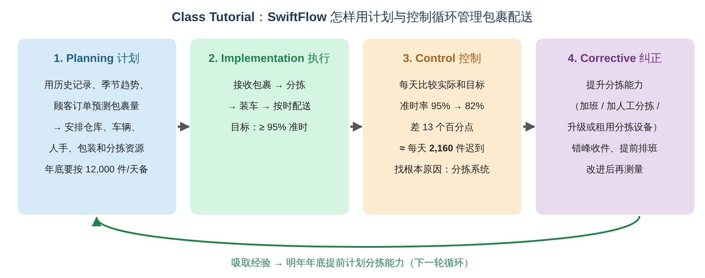

1. **Planning：** 用历史记录、季节趋势、顾客订单预测包裹量；年底要按 **12,000 件/天** 计划仓库空间、车辆、员工、包装和 **分拣能力**，目标仍是 ≥ 95% 准时。
2. **Implementation：** 按计划收件 → 分拣 → 装车 → 配送；按排班安排员工和车辆。
3. **Control：** 每天比较实际和目标：准时率只有 82%，比目标低 13 个百分点，约 **2,160 件/天** 迟到；追查发现原因是 **分拣系统处理不过来**。
4. **Corrective action：** 针对分拣瓶颈——延长分拣时间（加班 / 多一个班次）、高峰期加人工分拣、升级或租用临时分拣设备、错峰收件；然后 **再测量** 准时率是否回到 95%，并把经验写进明年的年底计划。

### Q2. 选一个计划理论：Demand Forecasting（推荐）

- 用 **定量预测**：分析过去几年年底的包裹量（例如去年 12 月是平时的 1.5 倍）→ 提前估计今年高峰。
- 用 **定性预测**：参考电商平台的大促日期（双 11、黑五、圣诞）和大客户的订单预告。
- 预测结果用来 **提前** 安排：租额外仓库空间、增加分拣能力、多排班、备包装材料。
- 🧮 如果预测今年高峰是 12,000 件/天，而分拣系统每天最多处理（假设）10,000 件 → 提前知道 **每天缺 2,000 件分拣能力**，在高峰前就补上，而不是等准时率掉了才救火。

> 💡 也可以选 **Systems Theory**：分拣、仓库、车辆、员工是一个系统，车辆和员工再多，分拣这一环卡住，整体也做不到 95%；所以要 **跨部门一起计划**。

### Q3. 选一个控制理论：Theory of Constraints（最贴合案例）

- **Identify：** 瓶颈 = 自动分拣系统（案例已经说明车辆、员工都够）。
- **Exploit：** 让分拣系统一分钟都不停——24 小时运作、高峰前做好维护、先分拣最急的包裹。
- **Subordinate：** 收件和装车按分拣的节奏安排，避免包裹在仓库里堆积。
- **Elevate：** 加人工分拣线、升级或租用分拣设备。
- **Repeat：** 分拣能力上来后，再看新的瓶颈是不是变成了车辆或装卸。
- 结论：**只加车、加司机没用**，因为产出 = 最慢环节。

> 💡 也可以选 **Feedback control 三种控制**：前馈（高峰前检查分拣系统、预测量）、同步（实时监控分拣排队和车辆出发时间）、反馈（每天分析准时率和投诉）。或者 **SPC**：把每天的准时率画成控制图，一旦低于 LCL 马上调查。

---

## 8. ⚠️ 易混淆汇总

| 容易混淆 | 区分方法 |
|---|---|
| Planning vs Control | 计划 = 事前定目标；控制 = 事中 / 事后比较实际和计划 |
| Control vs Corrective action | 控制 = **测量和比较**（发现问题）；纠正 = **采取行动**（解决问题） |
| Strategic / Tactical / Operational | 长期（年）/ 中期（月、季）/ 短期（天、周） |
| Qualitative vs Quantitative forecasting | 凭经验和意见 vs 凭历史数据和统计 |
| 毛需求 vs 净需求（MRP） | 毛 = 产量 × 用量；净 = 毛 − 库存 − 已订 |
| Feedforward / Concurrent / Feedback | 事前预防 / 事中监控 / 事后评估 |
| SPC 的控制限 vs 目标值 | 控制限是 **正常波动范围**（494–506），不是"合格标准"；目标是 CL = 500 |
| 瓶颈 vs 忙碌 | 瓶颈 = **产能最小** 的环节，它决定整体产出 |

---

## 9. 📖 术语表

| English | 中文 | 一句话 |
|---|---|---|
| Planning | 计划 | 决定要做到什么、怎么做 |
| Control | 控制 | 监测实际 → 找偏差 → 纠正 |
| Planning and control cycle | 计划与控制循环 | Planning → Implementation → Control → Corrective action |
| Implementation | 执行 | 按计划生产 / 提供服务 |
| Corrective action | 纠正行动 | 找根本原因并解决 |
| Root cause | 根本原因 | 问题真正的来源 |
| Preventive maintenance | 预防性维护 | 机器坏之前定期保养 |
| Resource utilisation | 资源利用 | 资源用得有效率 |
| Capacity management | 产能管理 | 产能配合需求 |
| Strategic / Tactical / Operational planning | 战略 / 战术 / 运营计划 | 长期 / 中期 / 短期 |
| Systems theory | 系统理论 | 输入 → 转换 → 输出 + 反馈，各部门相互连接 |
| Demand forecasting | 需求预测 | 估计未来顾客需求 |
| Qualitative / Quantitative forecasting | 定性 / 定量预测 | 凭经验 vs 凭数据 |
| Moving average | 移动平均 | 用最近几期平均值做预测（补充） |
| MRP | 物料需求计划 | 算出要买什么、多少、何时下单 |
| MPS (Master Production Schedule) | 主生产计划 | 造什么、什么时候 |
| BOM (Bill of Materials) | 物料清单 | 产品由哪些零件、各几个组成 |
| Lead time | 交货期 | 下单到收货的时间 |
| Feedforward / Concurrent / Feedback control | 前馈 / 同步 / 反馈控制 | 事前 / 事中 / 事后 |
| SPC | 统计过程控制 | 用控制图监测流程是否稳定 |
| CL / UCL / LCL | 中心线 / 上控制限 / 下控制限 | 平均值 / 平均 + 3σ / 平均 − 3σ |
| Theory of Constraints (TOC) | 约束理论 | 系统产出受瓶颈限制 |
| Bottleneck | 瓶颈 | 产能最小、限制整体产出的环节 |

---

## 10. ✍️ 自测题

**选择题**
1. "测量实际表现并和计划目标比较" 是循环的哪一步？A. Planning　B. Implementation　C. Control　D. Corrective action
2. "决定每月生产目标和人手需求" 属于：A. 战略计划　B. 战术计划　C. 运营计划　D. 反馈控制
3. 起飞前检查飞机属于：A. Feedforward　B. Concurrent　C. Feedback　D. SPC
4. 三个环节产能分别为 600、350、400 件/天，系统产出是：A. 600　B. 450　C. 400　D. 350
5. 控制图 CL = 200 g，σ = 4 g，UCL 是：A. 204 g　B. 208 g　C. 212 g　D. 216 g

**计算题**
1. 一家工厂要生产 500 张桌子，每张需 4 条桌腿、1 块桌面。库存有 600 条桌腿、80 块桌面，已订 200 条桌腿未到。算出桌腿和桌面的净需求。
2. 一家咖啡店计划每天卖 400 杯，实际卖了 340 杯。算差距和达成率。
3. 承第 4 题选择题，如果把产能 350 的环节提升到 500，系统产出变成多少？新的瓶颈是哪个？

**简答题**
1. 解释计划与控制循环的四个步骤，并用一个例子说明。
2. 比较三种控制（Feedforward、Concurrent、Feedback）。
3. 为什么 TOC 说"改进非瓶颈环节没有用"？

<details>
<summary><b>👉 点击查看答案</b></summary>

**选择题：** 1. C　2. B　3. A　4. D　5. C（200 + 3 × 4 = 212）

**计算题**
1. 桌腿：毛需求 500 × 4 = 2,000；净需求 = 2,000 − 600 − 200 = **1,200 条**。桌面：毛需求 500 × 1 = 500；净需求 = 500 − 80 = **420 块**。
2. 差距 = 340 − 400 = **−60 杯**；达成率 = 340 ÷ 400 = **85%**（少了 15%）。
3. 新产出 = min(600, 500, 400) = **400 件/天**；新的瓶颈是 **产能 400 的那个环节**。

**简答题**
1. Planning（定目标、分配资源）→ Implementation（按计划执行）→ Control（比较实际和目标）→ Corrective action（找根本原因、纠正）→ 回到计划。例：FreshBite 计划 1,000 条，实际 850 条，发现烤箱故障 → 修好并引入预防性维护。
2. Feedforward = 事前预防（检查原材料）；Concurrent = 事中监控（主管巡查生产线）；Feedback = 事后评估（分析顾客投诉）。
3. 因为系统产出 = 最慢环节的产能。非瓶颈环节产能再大，多做的也只会堆在瓶颈前面变成库存，整体产出不变。

</details>

---

## 11. 📌 考前 30 秒

1. **Planning** = 事前定 What / How much / When / Resources / Who；**Control** = 监测 → 比较 → 找偏差 → 纠正
2. **循环 P-I-C-C**：Planning → Implementation → Control → Corrective action → 再计划
3. **FreshBite**：1,000 → 850 条（−15%）；次品 3% > 2%；准时 90%；成本 \$1.15 > \$1.00 → 找根本原因（烤箱）
4. **六个目标**：资源、产能、需求、成本、时间、顾客满意
5. **三层次**：Strategic 长期 · Tactical 中期 · Operational 短期（Toyota：建厂 → 月产量 → 每日排班）
6. **计划理论**：Systems Theory（输入-转换-输出-反馈）· Demand Forecasting（定性 / 定量）· MRP（MPS + BOM + 库存 → 净需求 = 毛需求 − 库存 − 已订）
7. **控制理论**：Feedforward / Concurrent / Feedback（事前 / 事中 / 事后）· SPC（UCL / LCL = CL ± 3σ）· TOC（产出 = 瓶颈产能）
8. **SwiftFlow**：12,000 件 × 82% → 2,160 件迟到；瓶颈 = 分拣系统 → 用 TOC 集中改进分拣
